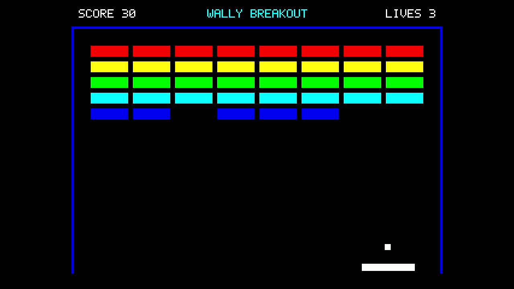

# Wally Game Console Research

**教育用CPUのWallyに描画機能を追加し、FPGAボードでブロック崩しを動かした研究の資料です。**

CPUをゲーム機へ拡張したい人が、回路のつなぎ方とプログラムの動かし方を参照できる例を示すことを目的としています。
このリポジトリでは、論文・発表資料・設計の詳しい説明・実験記録を公開しています。

## 実機のプレイ動画

Nexys Video上で動く、640×480画素のブロック崩しです。画像をクリックすると、2026年11月8日にタイトルを上部中央へ移した版の、実機から記録した30秒の動画を開けます。
**自動プレイであり、プログラムがパドルを動かしています。ゲームコントローラは今後追加します。**

[](experiments/breakout-title-top-20261108/video/breakout-30s.mp4)

[動画を開く（MP4、30秒）](experiments/breakout-title-top-20261108/video/breakout-30s.mp4) · [文字配置・映像と試験条件](experiments/breakout-title-top-20261108/README.md)

この動画は研究用HDMI表示構成で取得しました。[再生成する差分と手順](experiments/basic-operation-20261108/hdmi/README.md)を保存しています。`console/`が参照する製品の標準表示構成とは区別しています。

<details>
<summary>2026年10月8日の標準構成の動画</summary>

https://github.com/user-attachments/assets/5828d8d5-2a1d-4f39-900c-06449b90e9ef

[元の動画ファイル（MP4）](docs/thesis/再現資料/実験記録/E6/report/results/video/breakout-latest-30s.mp4) · [動画と元の記録の対応](publication/demo-video.json)

</details>

## 何を作ったのか

FPGAは、記述した論理回路をチップ内に実装できる半導体です。
本研究では、FPGAボードのNexys Videoに、CPUの**Wally**と描画回路の**RasterIX**、表示回路を実装しました。
既存のCPUと描画回路を利用し、それらを接続する回路とソフトウェアを実装しています。公式RasterIX本体は変更していません。

ゲーム画面が出るまでの流れは、次のとおりです。

1. **プログラムを読み込む。** CPUがSDカード制御回路を操作し、ゲームプログラムをSDカードからDDR3メモリへ読み込みます。
2. **ゲームの状態を計算する。** Wallyがプログラムを実行し、ボールの位置やブロックとの衝突を計算します。
3. **画像を作る。** 描画用ソフトウェアが作った命令を接続回路からRasterIXへ渡し、描いた画像をDDR3の画像用領域へ保存します。
4. **映像を出す。** 表示回路が画像を読み出し、HDMI端子へ映像を出力します。

DDR3への読み書きには、AMD提供のDDRメモリコントローラーを利用します。
回路の接続とプログラムの動作は、[図付きのアブスト](docs/abstract/アブスト_主要事項.md)で説明しています。

上の保存映像では、ボールの移動、壁やパドルでの反射、当たったブロックの消去を確認できます。タイトルを上部へ移した現在の版で、[30秒の実行と文字の表示](experiments/breakout-title-top-20261108/README.md)を確認しています。[確認する場面と手順](experiments/basic-operation-20261108/README.md)を画像付きでまとめています。

2026年11月8日のHDMI表示構成では、FPGAの設定から起動する手順を3回繰り返し、各30秒の映像で基本動作を確認しました。その後、同じ回路で300秒の実行と録画も確認しました。記録とソースの版は[E8](experiments/basic-operation-20261108/README.md)にまとめています。変更前の試行も[履歴](experiments/basic-operation-20261108/history/README.md)に残しています。過去の画素比較や内部の動作確認は、[E6](docs/thesis/再現資料/実験記録/E6/README.md)と[技術付録第73章](docs/thesis/appendix/05-integration/operation-verification.md)を参照できます。

## 目的に合う資料から読む

**資料はGitHub上で読めます。ダウンロードやcloneは不要です。**
最初はアブストかスライドを開き、詳しく知りたい部分を論文や技術付録で調べてください。

| 知りたいこと | GitHubで読む | ダウンロード |
|---|---|---|
| 研究の目的、仕組み、主な結果を1ページで知りたい | [アブスト](docs/abstract/アブスト_主要事項.md) | [Word](docs/abstract/アブスト_主要事項.docx) |
| 図を追いながら、CPUからゲーム機への拡張を理解したい | [6分発表のスライドと原稿](docs/presentation/中間発表_主要事項.md) | [PowerPoint](docs/presentation/中間発表_主要事項.pptx) |
| なぜその構成にし、実機で何を確認したかを読みたい | [論文本文](docs/thesis/本文.md) | [Word](docs/thesis/本文.docx) |
| 基礎知識やコードまで、必要な分野を深く調べたい | [技術付録の総目次](docs/thesis/技術付録.md) | [Word](docs/thesis/技術付録.docx) |

技術付録は、**HDL・FPGA／Wally／Linux・ソフトウェア／RasterIX・描画／ボード対応・実験**の5分野に分けています。
内容を省略せず章ごとのページに分割しているので、必要な箇所から読めます。
探す場所に迷った場合は、[資料の読み方と分野別の入口](docs/thesis/README.md)を使ってください。

## ゲーム機の実装と、このリポジトリの関係

| リポジトリ | 保存するもの |
|---|---|
| [wally-game-console](https://github.com/SoshiroFujimori/wally-game-console) | ゲーム機をビルドして動かすための回路・ソフトウェア |
| **wally-game-console-research（ここ）** | 論文、発表資料、実験用コード、測定記録、SDWire3などの機器操作ツール |

ゲーム機の実装を使いたい場合は、まず製品側のリポジトリを参照してください。
こちらの[`console/`](console)は、その使用版を固定するGitサブモジュールです。
実験用の変更を、ゲーム機の通常構成と区別して保存しています。

### ソースも取得する場合

```bash
git clone https://github.com/SoshiroFujimori/wally-game-console-research.git
cd wally-game-console-research
git submodule update --init console
git -C console submodule update --init --recursive
```

資料だけを読む場合、サブモジュールの取得は不要です。
`console`は製品の公開コミット`ed6a1c09b34d597dcde92ec26a4f5a97cbf18a17`を参照します。
[使用ソースとの照合記録](publication/console-source.json)と[実験ごとの版の説明](docs/thesis/再現資料/実験記録/E6/README.md)を残しています。
過去の実験は使用版や条件が異なるため、再現するときは対象の記録を確認してください。

## 実験・再現・資料更新の入口

普段は上の資料から読み、測定値や実装の詳細を追うときに、以下を使ってください。

<details>
<summary>実験報告・再現用コード・機器操作</summary>

| 内容 | 入口 |
|---|---|
| 画像の照合、継続実行、命令FIFOの比較 | [E6の結果と判断](docs/thesis/再現資料/実験記録/E6/report/結果と判断.md) |
| 命令DMA、共有メモリ、転送方法の比較 | [E7の結果と適用範囲](experiments/transport-study-20261009/RESULTS.md) |
| 過去の設計変更、測定コード、実験記録 | [再現資料](docs/thesis/再現資料/README.md) |
| 論文中の旧ローカルパスに対応する公開ファイル | [参照先の一覧](docs/references.md) |
| SDカード接続の切り替えとWindows側の復旧 | [SDWire3の操作](tools/sdwire3/README.md) |
| 保存した資料と保存対象外の資料 | [収録範囲](docs/scope.md) |

各実験報告に、確認した条件と未解決の条件を記載しています。
`archive` / `archive-scripts`は当時の処理を説明する保存資料です。パスや機器識別子を伏せてあるため、そのまま実行できる汎用ツールではありません。
実験用ビットストリーム、ディスクイメージ、ビルドキャッシュは収録していません。

</details>

<details>
<summary>ディレクトリ構成と公開資料の更新手順</summary>

```text
console/                    ゲーム機の実装の固定版
docs/abstract/              アブスト
docs/presentation/          発表スライドと原稿
docs/thesis/                論文、技術付録、図、実験記録E1〜E6
source/                     資料の原稿と生成プログラム
examples/technical-models/  数値や信号の受渡しを確かめる説明用モデル
experiments/                比較実験、補足試験、実験用コード
tools/                      SDWire3、資料生成、公開前の検査など
publication/                公開ファイルの検証情報とメディアの記録
LICENSES/                   ライセンスと出典
```

公開資料の更新は、[匿名化と検査の手順](docs/privacy.md)に従います。

```bash
python3 -m venv .venv
.venv/bin/python -m pip install -r requirements-publication.txt
git config core.hooksPath .githooks
export PUBLICATION_PYTHON="$PWD/.venv/bin/python"
.venv/bin/python -m unittest discover -s tests -v
.venv/bin/python tools/publication/check.py
```

最後の検査には、公開しない`.private/redactions.json`が必要です。
初めて取得した読者は、`check.py --public`で公開情報だけの検査を実行できます。

</details>

## 公開範囲とライセンス

資料から氏名・所属・私的なパス・機器の識別情報を除去しています。
GitHubの所有アカウントと製品リポジトリへの関係は公開しています。

上流コードの著作権・ライセンス表記を保持しています。文書や新規コードを含む全ファイルに、一律に同じライセンスを適用するものではありません。
詳しくは[ライセンスと出典](LICENSES/README.md)を参照してください。
