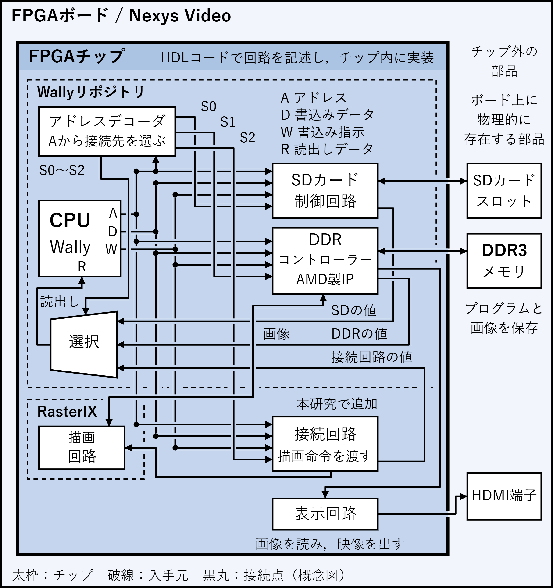

# FPGAを用いた2Dゲーム機の製作

## 1  はじめに

FPGAは，コードで記述した論理回路を実装できる半導体チップである．本研究では，教科書RISC-V System-on-Chip Design[1]の教育用CPU「Wally」に描画・表示機能を追加し，ブロック崩しが動くゲーム機を製作した．Wallyの学習者が，CPUをゲーム機へ拡張する際に参照できる設計例を示すことを目的とする．

## 2  ゲーム機の設計

図1に標準構成を示す．CPU，バス，SDカード制御の回路はWallyのリポジトリから，描画・表示の回路はRasterIX[2]の同一リポジトリから取り入れた．これらと接続回路をNexys VideoのFPGAチップに実装し，チップ外のSDカードスロット，DDR3メモリ，HDMI端子につないだ．

図1  ゲーム機の標準構成と回路の入手元

CPUはロード命令（lw）で指定アドレスの値を読み，ストア命令（sw）で値を書く．バスはアドレスに応じて，要求をメモリや周辺回路へ届ける．本研究では，バスに描画命令を送るための接続回路を追加した．専用のアドレスを割り当て，CPUがそこへ書いた数値をRasterIXへ渡す．周辺回路をメモリと同じ読み書きで操作するこの方式を，MMIO（メモリマップドI/O）という．

CPUはSDカード制御回路を操作し，カード上のゲームプログラムをDDR3へ読み込む．その後，DDR3から命令を読み出して実行し，ボールの位置や衝突を計算する．DDR3の制御には，Wallyリポジトリの設定から生成・接続するAMD製IPを用いる．

画面を描く際は，ゲームプログラムからRasterIX付属のOpenGL互換ライブラリへ図形の位置や色を指定する．CPU上で動くこのライブラリが，描き方を指示する数値列（描画命令）を作る．CPUは接続回路へその数値列を書き込み，RasterIXへ送る．

RasterIXは描画命令に従って画面の各点（画素）の色を求め，画像をDDR3へ保存する．表示回路はその画像を読み出し，HDMI端子から映像を出す．RasterIX本体は変更していない．

## 3  動作の確認

実機で640×480画素のブロック崩しを実行した（図2）．映像記録には試験用のHDMI表示回路を用いた．FPGAに回路を設定して起動する手順を3回繰り返し，各30秒の映像を記録した．3回とも，ボールが動き，壁やパドルで跳ね返り，当たったブロックが消えることを確認した．

現在はプログラムがパドルを動かす自動操作であり，ゲームコントローラによる操作は未実装である．

図2  実機のゲーム画面

## 4  おわりに

Wallyに描画回路を接続し，ゲームの実行から画面表示までを実現した．回路のつなぎ方とゲームを動かす方法を公開し，Wallyの拡張例を示した．今後は，ゲームコントローラへの対応や，ホーム画面などのGUIの充実を検討する．

図2の出典は[実機映像の記録](../../experiments/breakout-title-top-20261108/README.md)であり，[30秒の動画](../../experiments/breakout-title-top-20261108/video/breakout-30s.mp4)も公開している．本文に示した3回の起動・動作確認の条件と結果は，[動作確認記録](../../experiments/basic-operation-20261108/README.md)を参照できる．

標準構成の表示回路は，RasterIXリポジトリに同梱されたultraembeddedの`dvi_framebuffer`を用い，本研究で接続・画面切替の回路を追加したものである．DDRコントローラーはAMD製IPで，本研究で追加したNexys Video用の生成・接続設定をWally側のリポジトリに収めている．回路の入手元と実装箇所は[構成要素の出典](../../source/presentation/board-evolution/README.md)を参照できる．映像記録時の表示部分には，[実験E8のHDMI構成](../../experiments/basic-operation-20261108/hdmi/README.md)を用いた．

## 参考文献

[1] D. Harrisほか，RISC-V System-on-Chip Design，Morgan Kaufmann，2026．

[2] ToNi3141，RasterIX，https://github.com/ToNi3141/RasterIX （使用版9269a01c9bd4，参照2026-10-09）．

命令の接続設計は[論文第6章](../thesis/本文.md#ch_6)，実機で確認した条件と結果は[第12章](../thesis/本文.md#ch_12)に示す．詳しい実装は[技術付録](../thesis/技術付録.md)から参照できる．
