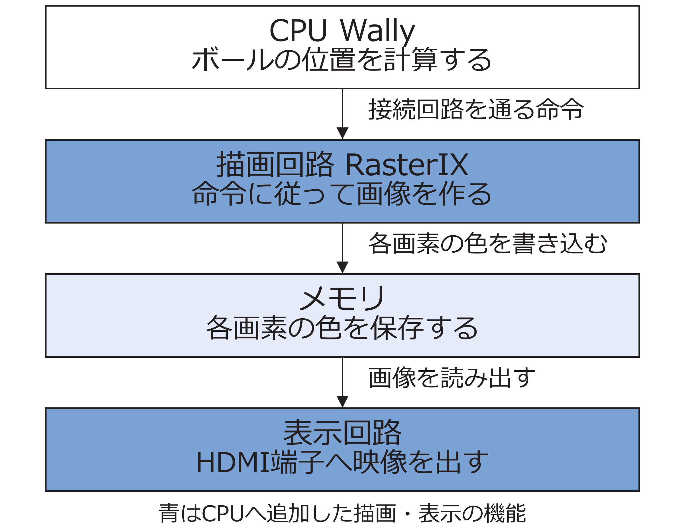

# FPGAを用いた二次元ゲーム機の設計と実装

## 1  はじめに

本研究では，CPUに画面を描く機能を加え，ブロック崩しが動くゲーム機を製作した．CPUには，教科書RISC-V System-on-Chip Designで設計を学べるWally[Harris26]を用いた．目的は，Wallyの学習者が，CPUに別の回路をつないで機能を増やす際に参照できる例を示すことである．

## 2  ゲーム機の設計

FPGAは，内部に作る論理回路を変更できる半導体チップである．Nexys Videoという基板上のFPGAに，CPUのWallyと，画像を作る回路RasterIX[RasterIX]を実装した．CPUはSDカードから読み込んだゲームプログラムを実行し，ボールの位置などを計算する．

ゲームプログラムは，RasterIX付属のOpenGL互換ライブラリ（図形を描くためのソフトウェア）に，図形の位置や色を渡す．ライブラリはそれを描画回路への命令に変換する．RasterIXは命令に従って画像を作り，各点（画素）の色をメモリに保存する．表示回路がその画像を読み出し，HDMI端子から映像として出力する（図1）．

図1  CPUの計算が画面になるまで

本研究で設計した接続回路は，CPUから来る命令を一時的に保存し，RasterIXが受け取れるときに順に渡す．この回路で，データの渡し方と動作のタイミングが異なる二つの回路をつないだ．また，プログラムと画像が互いの保存場所を上書きしないよう，メモリの使う範囲を分けた．表示中の画像を書き換えないように，二枚の画像を交互に描画用・表示用として使う制御も実装した．公式RasterIXの内部は変更していない．

## 3  動作の確認

回路シミュレーションでは，描画回路の受け取りを一時的に止め，再開後に命令が欠けたり重複したりせずに届くことを確認した．

実機では640×480画素のブロック崩しを動かした．実機のメモリから取り出した四枚のゲーム画像を，CPUで別に作った比較用画像と照合したところ，全画素の色が一致した．

自動操作による5分間の実行では，ゲームの計算と画面の更新が続いた．別の実行で記録した30秒間の映像でも，ボールが動くことを確認した（図2）．試験には，描画処理を軽くする工夫を加えたゲームを用いた．

図2  実機から記録したブロック崩しの映像

## 4  おわりに

Wallyに描画・表示機能を加え，二次元ゲームを動かせた．回路のつなぎ方と動作確認の手順を公開し，Wallyに機能を追加する学習者が参照できる例とした．映像を受信できない場合があり，原因の解明が課題である．最終発表ではWii Classic Controller Proを接続し，ボタンによるゲーム操作を確認する．

## 参考文献

[Harris26] D. Harrisほか，RISC-V System-on-Chip Design，Morgan Kaufmann，2026．

[RasterIX] ToNi3141，RasterIX，https://github.com/ToNi3141/RasterIX （使用版9269a01c9bd4，参照2026-10-09）．

命令の接続設計は[論文第6章](../thesis/本文.md#ch_6)，実機で確認した条件と結果は[第12章](../thesis/本文.md#ch_12)に示す．詳しい実装と比較実験は[技術付録](../thesis/技術付録.md)から参照できる．
