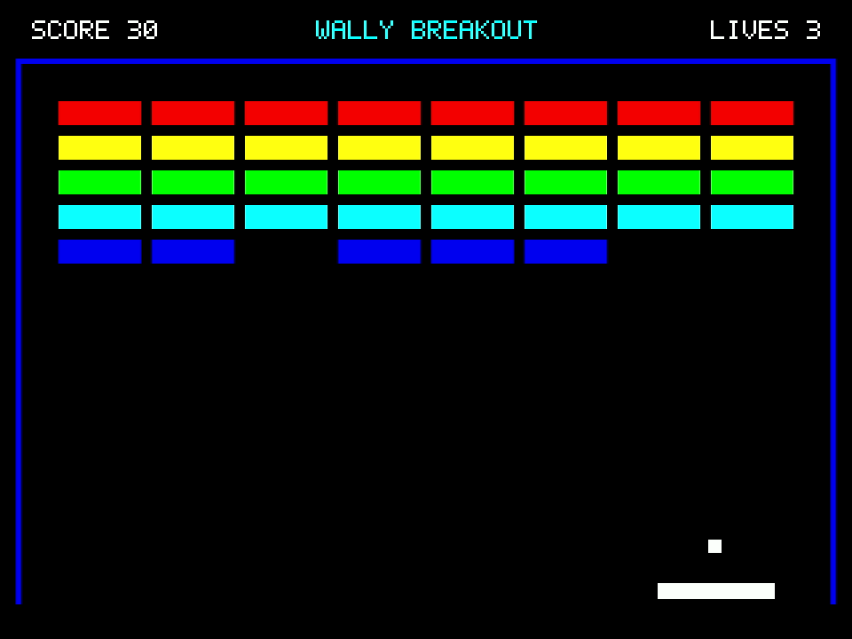

# FPGAを用いた2Dゲーム機の製作

## 1  はじめに

FPGAは，コードで記述した論理回路を実装できる半導体チップである．本研究では，教育用CPU「Wally」[1]に描画・表示機能を追加し，ブロック崩しが動くゲーム機を製作した．Wallyの学習者に，ゲーム機への拡張例を示すことを目的とする．

## 2  ゲーム機の設計

図1にCPUと周辺回路の接続を示す．Wallyの回路に，RasterIX[2]の描画・表示回路と本研究の接続回路を加え，Nexys VideoのFPGAに実装した．


図1  チップ内の信号接続と外部の部品

CPUは，アドレスAで読み書き先を指定する．アドレスデコーダはAからS0〜S2の一つを有効にする．書くときは，CPUがDに値を出してWを有効にすると，選ばれた回路がその値を受け取る．読むときは，Wを無効にし，選ばれた回路の値が選択回路を通ってCPUへ戻る．

SDカードを読むときは，CPUがSD制御の送信先アドレスへ指示を書く．SD制御がカードと通信し，CPUは受信先アドレスからデータを読む．次に，CPUがDDR3上の保存先アドレスへそのデータを書くと，DDRコントローラーが選ばれ，DDR3へ保存する．これを繰り返してゲームプログラムを読み込み，実行する．

ゲームは，RasterIX付属のOpenGL互換ライブラリに図形の位置や色を渡す．CPU上で動くライブラリは，描かせる内容を数値列にする．CPUが専用アドレスへその数値を書くと，接続回路が選ばれ，描画回路へ数値を渡す．

次は主要な読書きの擬似コードである．write(アドレス, 値)は書込み，read(アドレス)は読出しを表す．SD_TXとSD_RXはSD制御の送受信先，DDR_BASEはDDR3の先頭，CMD_PORTは描画命令の送信先を表す．

```text
write(SD_TX, request[i]);
data = read(SD_RX);
write(DDR_BASE + offset, data);
...
write(CMD_PORT, cmd[j]);
```

描画回路は，受け取った命令に従って画像を作り，DDRコントローラーを介してDDR3へ保存する．表示回路は同じコントローラーを通して画像を読み，HDMI端子へ映像を出す．RasterIX本体は変更していない．

## 3  動作の確認

実機で640×480画素のブロック崩しを実行した（図2）．映像記録には試験用のHDMI表示回路を用いた．FPGAに回路を設定して起動する手順を3回繰り返し，各30秒の映像を記録した．3回とも，ボールが動き，壁やパドルで跳ね返り，当たったブロックが消えることを確認した．

現在はプログラムがパドルを動かす自動操作であり，ゲームコントローラによる操作は未実装である．



図2  実機のゲーム画面

## 4  おわりに

Wallyを拡張し，ブロック崩しの実行と映像出力を実現した．回路の接続とゲームの動かし方を公開した．今後は，ゲームコントローラへの対応やホーム画面などのGUIの充実を検討する．

図2の出典は[実機映像の記録](../../experiments/breakout-title-top-20261108/README.md)であり，[30秒の動画](../../experiments/breakout-title-top-20261108/video/breakout-30s.mp4)も公開している．本文に示した3回の起動・動作確認の条件と結果は，[動作確認記録](../../experiments/basic-operation-20261108/README.md)を参照できる．

標準構成の表示回路は，RasterIXリポジトリに同梱されたultraembeddedの`dvi_framebuffer`を用い，本研究で接続・画面切替の回路を追加したものである．DDRコントローラーはAMD製IPで，本研究で追加したNexys Video用の生成・接続設定をWally側のリポジトリに収めている．回路の入手元と実装箇所は[構成要素の出典](../../source/presentation/board-evolution/README.md)を参照できる．映像記録時の表示部分には，[実験E8のHDMI構成](../../experiments/basic-operation-20261108/hdmi/README.md)を用いた．

## 参考文献

[1] D. Harrisほか，RISC-V System-on-Chip Design，Morgan Kaufmann，2026．

[2] ToNi3141，RasterIX，https://github.com/ToNi3141/RasterIX （使用版9269a01c9bd4，参照2026-10-09）．

命令の接続設計は[論文第6章](../thesis/本文.md#ch_6)，実機で確認した条件と結果は[第12章](../thesis/本文.md#ch_12)に示す．詳しい実装は[技術付録](../thesis/技術付録.md)から参照できる．
