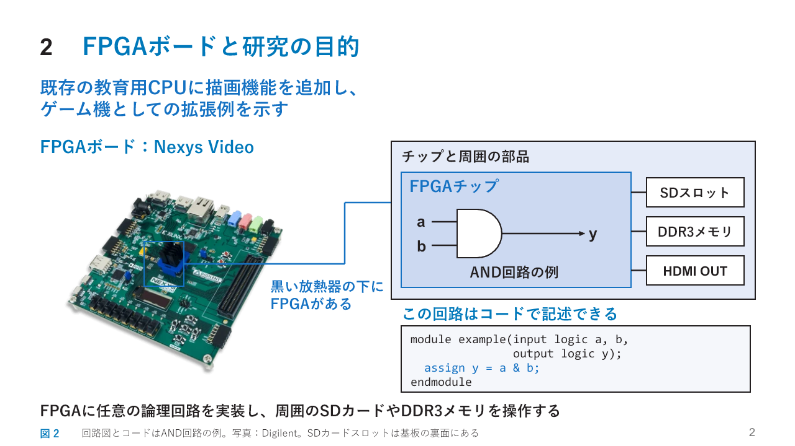
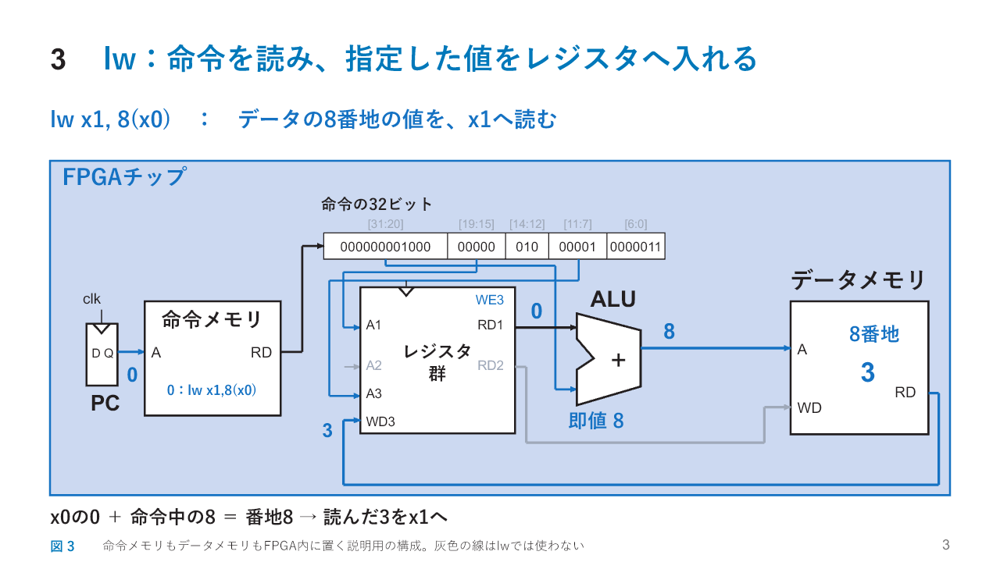
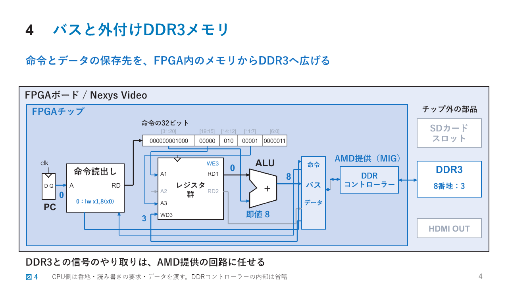
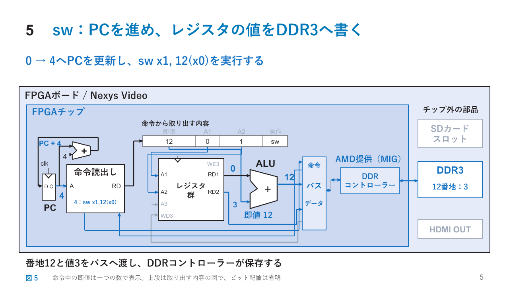
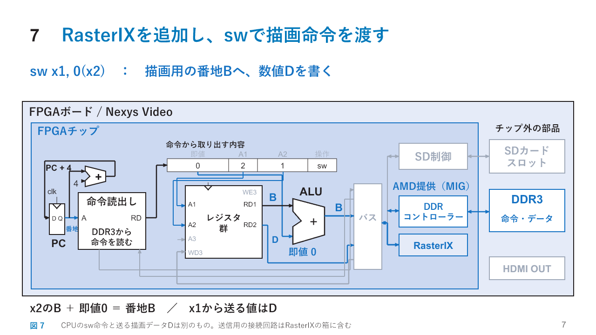
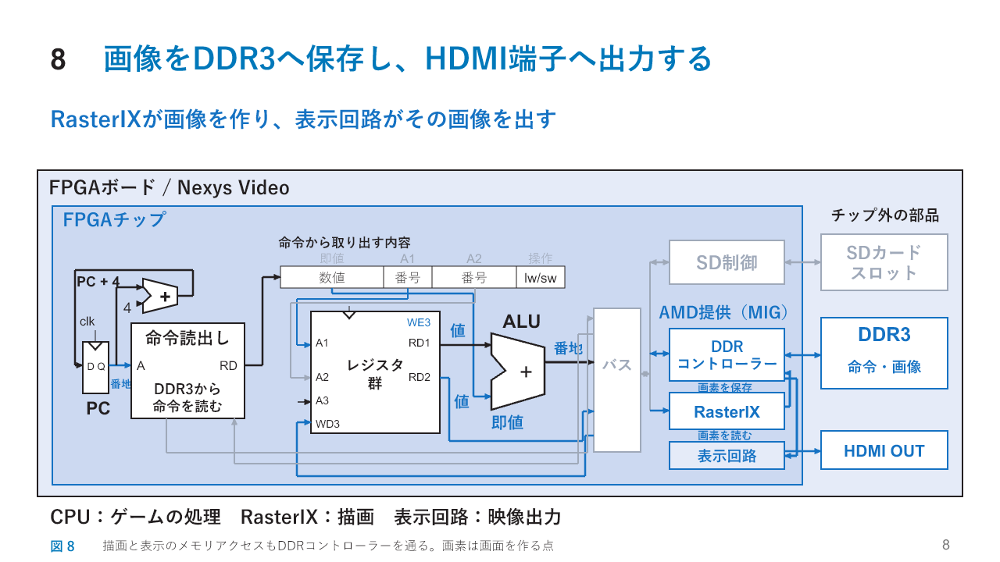
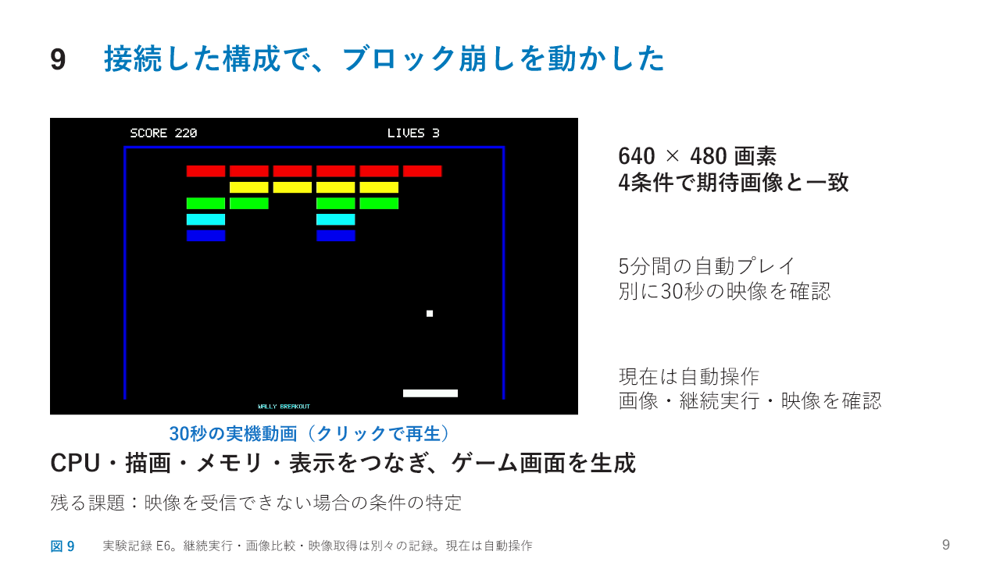
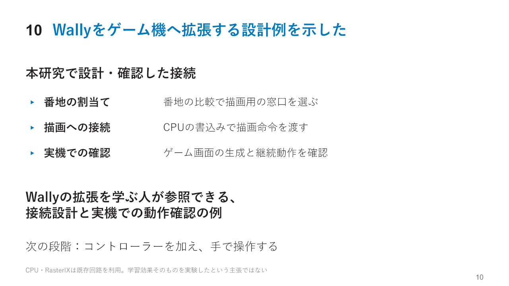
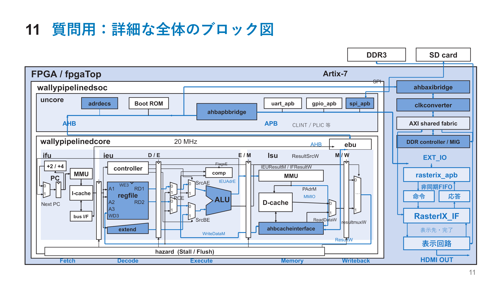

# 同じFPGAボード図を展開する発表案

本編10枚と質問用1枚です。2枚目は大きなボード写真でFPGAの場所を示し、チップ内に実装する回路を図とコードで対応づけます。3枚目ではチップ内を拡大してlwを説明します。4枚目でバスと外付けDDR3を加え、5枚目でswによる書込みを説明します。その後、SDカード、描画と表示を順に加えます。従来案との比較用で、実装や実験結果を変更したものではありません。

[PowerPoint版](中間発表_ボード図を拡張する案.pptx) / [従来案](../中間発表_主要事項.md) / [アブスト](../../abstract/アブスト_主要事項.md) / [論文本文](../../thesis/本文.md) / [技術付録](../../thesis/技術付録.md) / [再生成方法](../../../source/presentation/board-evolution/README.md)

## 図の見方

2枚目では写真中央の黒い放熱器の下にあるFPGAを示し、隣の模式図のチップと対応づけます。SDカードスロットは基板の裏面にあります。3枚目はFPGAチップの囲いだけを大きく表示し、外側のボードや周辺部品を省きます。4〜8枚目はボード外周、青いFPGAチップの枠、右側の外付け部品を同じ位置に保ちます。模式図の部品配置は、実物の配置をそのまま示すものではありません。

2枚目ではFPGAチップの上にANDゲートを直接描き、短いHDLコードと対応づけます。これは回路記述の例であり、ANDゲートだけで周辺部品を制御するという意味ではありません。3枚目は命令メモリとデータメモリをFPGA内に置いた構成でlwを説明します。4枚目では同じデータパスを縮めてボード全体を示し、バスとAMD提供のDDRコントローラーを加えます。命令とデータの保存先を外付けDDR3へ広げ、「命令メモリ」の箱をバス経由の「命令読出し」の箱へ替えます。5枚目ではその構成にPC+4を加え、swがDDR3へ値を書き込む経路を追います。

SD制御回路は6枚目、RasterIXは7枚目、表示回路は8枚目で初めて加えます。説明していない回路を先に薄く描くことはしません。CPU、RasterIX、表示回路のメモリアクセスはDDRコントローラーを通ります。送信用アダプタはRasterIXの箱に含めます。線は機能上の経路をまとめており、電気的に異なる信号を短絡する図ではありません。

3枚目のFPGA内メモリの構成は命令を説明するためのモデルであり、現在の実機構成を示したものではありません。0・4・8・12などの番地も説明例です。AMD提供のメモリ制御回路は、接続する端子と役割を示し、内部の作り方は展開しません。キャッシュ、番地変換、仲裁などの詳細は技術付録に記載します。

## 発表時間と質問用スライド

本編の配分は動画の再生30秒を含め355秒です。動画を再生しながら結果を説明します。6分まで5秒の余裕を置きます。これは練習を実測した時間ではありません。11枚目は非表示の質問用スライドです。通常のスライドショーでは本編10枚を表示します。

## 目次

- [1. FPGAを用いた二次元ゲーム機の設計と実装](#slide-1)
- [2. FPGAボードと研究の目的](#slide-2)
- [3. lw：命令を読み、指定した値をレジスタへ入れる](#slide-3)
- [4. バスと外付けDDR3メモリ](#slide-4)
- [5. sw：PCを進め、レジスタの値をDDR3へ書く](#slide-5)
- [6. SDカードのプログラムを、CPUがDDR3へ移す](#slide-6)
- [7. RasterIXを追加し、swで描画命令を渡す](#slide-7)
- [8. 画像をDDR3へ保存し、HDMI端子へ出力する](#slide-8)
- [9. 接続した構成で、ブロック崩しを動かした](#slide-9)
- [10. Wallyをゲーム機へ拡張する設計例を示した](#slide-10)
- [11. 質問用：詳細な全体のブロック図](#slide-11)（質問用）

## 1. FPGAを用いた二次元ゲーム機の設計と実装

説明時間の配分：5秒

### 発表原稿

この題目で発表します。

補足説明と出典

表紙は題目と発表者・指導教員の情報のみを示す。公開版は個人情報を伏せる。

## 2. FPGAボードと研究の目的

説明時間の配分：35秒

### 発表原稿

写真が、今回使うNexys VideoというFPGAボードです。中央の黒い放熱器の下にFPGAチップがあります。このチップには、目的に応じた論理回路を実装できます。右のAND回路もその例で、下のようなコードで記述します。チップの周囲には、SDカードスロットやDDR3メモリ、HDMI端子が物理的にあります。FPGA内にそれぞれを操作する回路を実装して使います。本研究では、既存の教育用CPUに描画機能を追加し、ゲーム機としての拡張例を示します。

補足説明と出典

写真の中央にある黒い部品は放熱器で、その下にFPGAがある。写真上の青枠と引出し線を、右側のFPGAチップの図に対応づける。SDカードスロットは基板の裏面にあり、この角度の写真では見えない。右側の部品配置は内外の関係を示す模式図で、写真の配置をそのまま写したものではない。FPGA内には枠で一括りにした抽象的な箱ではなく、ANDゲートと入出力の線を直接描く。aとbが両方1のときにyが1となり、SystemVerilogのassign y = a & b;がこの組合せ回路を表す。四行のコードは完全な小さなmoduleの例で、ゲーム機全体のコードではない。このAND回路だけでSDカードやDDR3を制御できるという意味ではなく、それぞれの装置に合った制御回路をFPGA内に実装する。チップから周辺部品へ延びる線は、部品間の物理的な接続をまとめた表記である。HDLはCPUがゲームプログラムのように実行するものではない。任意とはFPGAの素子数や配線、動作速度などの制約内で構成できることを指す。次の図ではチップ内を拡大し、CPUとFPGA内のメモリによる命令実行を説明する。学習者向けの拡張例を示すことが目的で、教育効果を学習実験で測定したという主張ではない。写真はDigilentの製品写真。

出典：Harris, S. L. and Harris, D., Digital Design and Computer Architecture: RISC-V Edition (2021), Chapter 7. Official figure source: https://pages.hmc.edu/harris/ddca/ddcarv.html (DDCArv_Figures.zip). Chapters 2 and 4, combinational logic and HDL. Harris et al., RISC-V System-on-Chip Design, Chapters 7–13, 20, 22–23. Official figure source: https://pages.hmc.edu/harris/ddca/rvsocd.html (RVSoCD_figs.zip). Chapter 23. Product revision 261832d48832dd6e26c4971ab8893ce61200688b. console/fpga/src/fpgaTopNexysVideo.sv; console/fpga/src/rasterix.sv; console/fpga/src/rasterix_apb.sv; console/fpga/generator/axiscdc.tcl. Digilent, Nexys Video product photograph: https://digilent.com/shop/nexys-video-amd-artix-7-fpga-trainer-board-for-multimedia-applications/ . Board identification: Nexys Video Reference Manual (2020), pp.3-4. Image copyright Digilent. Nexys Video Reference Manual (2020), pp.3–4: https://digilent.com/reference/_media/reference/programmable-logic/nexys-video/nexys-video_rm.pdf .

## 3. lw：命令を読み、指定した値をレジスタへ入れる

説明時間の配分：60秒

### 発表原稿

ここからはFPGAチップの中を拡大します。CPUと二つのメモリをFPGA内に置いた構成で説明します。PCから現在の命令の番地が出ます。ここでは0とすると、命令メモリは0番地のlw x1, 8(x0)を出します。これは、常に0であるx0の値に8を足し、その番地の値をx1へ読む命令です。実際の命令は上の32ビットです。19から15ビットの00000がA1に入り、レジスタ群はx0の値0を出します。31から20ビットの000000001000は8で、これもALUへ入ります。ALUは0足す8で番地8を作ります。そこに3があれば、メモリから3が戻ります。11から7ビットの00001は書込み先x1を選び、3を保存します。

補足説明と出典

CPUの動きを説明するため、命令メモリとデータメモリをFPGA内部に置いた単純な構成を示す。外付けDDR3はここでは使わない。この構成を実機で試作・測定したという主張ではなく、現在のWally全体を表す図でもない。命令メモリの0番地には32ビット命令lw x1,8(x0)、データメモリの8番地には32ビット値3があるとする。命令メモリとデータメモリは別の記憶領域である。命令の格納先0とデータの読出し先8を区別する。命令の機械語は0x00802083。I形式の[31:20]=000000001000（即値8）、[19:15]=00000（rs1=x0）、[14:12]=010、[11:7]=00001（rd=x1）、[6:0]=0000011。A1は読出しレジスタ番号、RD1はそのレジスタの値であり、番号0と値0は役割が異なる。x0は読出すと常に0になる。A3は書込み先番号、WD3は書く値、WE3は書込許可を表す。lwではメモリへの書込みは行わず、読んだ値をレジスタへ書く。今回は正の即値8だけを使うため、即値の幅を広げる回路、命令を解読して許可信号を作る回路、PCの次の値を作る回路は図示しない。線が交差しても接続点として示していない場所ではつながらない。灰色の経路はこの命令で使用しない。

出典：Harris, S. L. and Harris, D., Digital Design and Computer Architecture: RISC-V Edition (2021), Chapter 7. Official figure source: https://pages.hmc.edu/harris/ddca/ddcarv.html (DDCArv_Figures.zip). Chapter 7, single-cycle load datapath. RISC-V unprivileged ISA, RV32I load instruction format.

## 4. バスと外付けDDR3メモリ

説明時間の配分：45秒

### 発表原稿

次に、ボード全体の図へ戻り、命令とデータの置き場所を外付けのDDR3へ広げます。CPUの命令読出し側とデータの読み書き側を、共通の経路であるバスへつなぎます。ただし、DDR3には専用の信号で読み書きする必要があります。そこでAMDが提供するDDRコントローラーを利用します。これはDDR3とのやり取りを担当する既存の回路です。CPU側から番地と読み書きの要求を渡し、必要なデータをやり取りします。PCの番地で命令を読むと、これまでと同じレジスタ群とALUで処理できます。先ほどのlwも、このバスを通してDDR3から値を読みます。

補足説明と出典

ここで初めてバスとAMD提供のDDRコントローラーを加える。前の図でFPGA内に置いた二つのメモリに代わり、命令とデータを外付けDDR3内の別の領域に置く構成を説明する。チップ内の図を縮めてボード全体を示す。PC、レジスタ群、ALUの相対的な位置と主要経路は保つ。「命令メモリ」の箱は「命令読出し」へ変更し、バスへ要求を出して応答を受け取る機能をまとめた箱とする。独立した命令ROMが実機にあるという意味ではない。命令の要求と戻りを別々の線でバスにつなぐ。DDRコントローラーはFPGA内、DDR3メモリチップはFPGA外にある。製品の生成スクリプトはAMD（旧Xilinx）のmig_7seriesを生成する。MIGはMemory Interface Generatorの略で、図の箱はそれで生成したメモリ制御回路を指す。既存の回路を利用するため、DDR3のコマンド、信号のタイミング、初期化やリフレッシュを内部でどう実現するかは、この発表では展開しない。接続にはメモリ種類、ピン、クロック、リセット、CPU側との信号規約などを合わせる必要がある。「内部を作り直さず利用する」ことと「接続条件を知らなくてよい」ことは異なる。バス側の変換と仲裁は図ではまとめる。実機の構成はIROM_SUPPORTED=0、DTIM_SUPPORTED=0、ICACHE_SUPPORTED=1、DCACHE_SUPPORTED=1であり、全命令が毎回DDR3への読出しを起こすわけではない。キャッシュ、番地変換や応答待ちの内部は省略する。図中の番地は説明用で、実機のDDR3領域は0x80000000から始まる。バスの線は複数の信号をまとめており、異なる信号を電気的に短絡する意味ではない。

出典：Harris et al., RISC-V System-on-Chip Design, Chapters 7–13, 20, 22–23. Official figure source: https://pages.hmc.edu/harris/ddca/rvsocd.html (RVSoCD_figs.zip). Chapters 9 and 23. Product revision 261832d48832dd6e26c4971ab8893ce61200688b. console/fpga/src/fpgaTopNexysVideo.sv; console/fpga/src/rasterix.sv; console/fpga/src/rasterix_apb.sv; console/fpga/generator/axiscdc.tcl. console/fpga/generator/ddr3-nexysvideo.tcl; console/config/rv64gc/config.vh.

## 5. sw：PCを進め、レジスタの値をDDR3へ書く

説明時間の配分：45秒

### 発表原稿

バスとDDR3をつないだ図に、PCへ4を足して戻す回路を加えます。前の命令の終了時に、PCは0から4へ進みます。次に、DDR3の4番地に置いたsw x1, 12(x0)を読みます。命令から取り出した番号0がA1に、番号1がA2に入り、x0の0とx1の3が出ます。ALUには0と命令中の12を入れ、書く番地12を作ります。一方、保存する3は、x1からALUを通らない別の線でバスへ送ります。DDRコントローラーがこの要求を処理し、DDR3の12番地に3を保存します。このように、番地を作る処理と、書く値を送る処理があります。

補足説明と出典

図はPC=4でswを実行している状態であり、加算器が用意する次の番地は4+4=8である。32ビットで分岐しない命令だけを例にする。図の上部は命令から取り出す内容を整理した表示で、実際の32ビット内の配置を示すものではない。即値12を一つの数として示し、ビット位置や取り出し方は展開しない。A1は基準値を読むレジスタ番号、A2は書く値を読むレジスタ番号である。swではレジスタへの書込みを許可せず、メモリへの書込みを許可する。命令とデータは前の図と同じくDDR3に置く。CPUは番地と書く値をバスへ渡し、DDRコントローラーがDDR3への書込みを処理する。PC、命令読出し、レジスタ群、ALU、バス、DDRコントローラーは前の図と同じ位置に置く。0・4・8・12は説明用の番地であり、製品のDDR3物理アドレス範囲をそのまま表すものではない。

出典：Harris, S. L. and Harris, D., Digital Design and Computer Architecture: RISC-V Edition (2021), Chapter 7. Official figure source: https://pages.hmc.edu/harris/ddca/ddcarv.html (DDCArv_Figures.zip). Chapter 7, sequential PC update and store datapath.

## 6. SDカードのプログラムを、CPUがDDR3へ移す

説明時間の配分：55秒

### 発表原稿

このバスに、SDカードの制御回路もつなぎます。電源を切っても残したいゲームプログラムはSDカードに保存しておきます。実行前に、CPUが読込み用のプログラムを動かします。まずSD制御回路の決められた番地へ書き込み、カードからの読み出しを指示します。制御回路がカードと通信し、データを受け取ります。次にCPUが受取り用の番地を読むと、そのデータがバスを通ってCPUのレジスタへ戻ります。続いて、その値をDDR3の番地へ書きます。この書込みもDDRコントローラーが処理します。これを繰り返すと、プログラムがDDR3へコピーされます。準備ができたら、実行する命令の番地をPCに入れます。以後は前のスライドの経路で、DDR3上の命令を読んで実行します。

補足説明と出典

読み出しを指示する書込み、受信した値の読出し、DDR3への保存をCPUの仕事として説明する。SDカードからDDR3へ直接転送する専用回路を新たに設けたという図ではない。製品のSPI制御回路では受信データの読出しレジスタを介してCPUが値を受け取る。カードとの通信、ブロック単位の処理、ファイルの解釈、バッファ間のコピーなどの詳細は省略する。受信した1バイトに対して実際に必ずlwを1回、swを1回使うという実装の断定ではなく、CPUの読出しと書込みによる移動をまとめている。最初の読込みを始める処理は起動用のプログラムが担い、CPUが空のDDR3からゲームを読み始めるという説明ではない。ゲームの開始番地へ制御を移す細部は省略し、準備とゲームの実行を分けて説明する。

出典：Harris et al., RISC-V System-on-Chip Design, Chapters 7–13, 20, 22–23. Official figure source: https://pages.hmc.edu/harris/ddca/rvsocd.html (RVSoCD_figs.zip). Chapters 20 and 23. Product revision 261832d48832dd6e26c4971ab8893ce61200688b. console/fpga/src/fpgaTopNexysVideo.sv; console/fpga/src/rasterix.sv; console/fpga/src/rasterix_apb.sv; console/fpga/generator/axiscdc.tcl. console/src/uncore/spi_apb.sv; console/fpga/zsbl.

## 7. RasterIXを追加し、swで描画命令を渡す

説明時間の配分：40秒

### 発表原稿

ここへ、本研究で描画用の接続回路とRasterIXを加えました。描画用の窓口にも番地を割り当てるので、先ほどのswで操作できます。例えばx2に窓口の番地B、x1に送りたい数値Dを用意します。sw x1, 0(x2)では、ALUがB足す0で番地Bを作り、x1のDを別の線で送ります。番地Bの相手はDDR3ではなく描画用の窓口なので、DをRasterIXへ渡します。描画用ソフトウェアが用意した数値列をこのように送ります。CPUが実行するsw命令と、データとして送る描画命令は別のものです。

補足説明と出典

既存CPUと公式RasterIXを利用し、その間の接続を設計した。上部には即値0、基準値を読む番号2、書く値を読む番号1を、取り出した内容として並べる。実際の機械語のビット配置は示さない。x2とx1への値の準備は省略し、レジスタ割当ては説明用とする。BはCPUから見た窓口の番地で、物理アドレスと必ず同じ値とは限らない。Dは描画命令の数値列の一語であり、RISC-V命令のswの機械語ではない。OpenGLの1回の呼出しがそのまま1回のswに対応するという意味でもない。接続回路の内部の規約や時刻合わせは一つの箱にまとめる。前の図のCPUとバスの位置を保ち、RasterIXを加える。RasterIXによる画像の保存と表示回路を次の図で加える。描画命令の送信用アダプタはRasterIXの箱にまとめる。

出典：Product revision 261832d48832dd6e26c4971ab8893ce61200688b. console/fpga/src/fpgaTopNexysVideo.sv; console/fpga/src/rasterix.sv; console/fpga/src/rasterix_apb.sv; console/fpga/generator/axiscdc.tcl. console/examples/rasterix/WallyBusConnector.hpp; console/fpga/src/rasterix_apb.sv.

## 8. 画像をDDR3へ保存し、HDMI端子へ出力する

説明時間の配分：30秒

### 発表原稿

RasterIXは描画命令に従って、画面の各点の色を求めます。この一つひとつの点が画素です。作った画像は、DDRコントローラーを通して、DDR3の画像用の領域へ保存します。表示回路もこのコントローラーを通して画素の色を順に読み、画面に表示するためのタイミングに合わせてHDMI端子へ出します。CPUはゲームの処理と描画命令の送信、RasterIXは画像の作成、表示回路は画像の出力を担当します。

補足説明と出典

同じボード図の中で、RasterIXのメモリへの書込み経路と、表示回路による読出し経路を詳しく示す。RasterIX_IFは内部の作業領域で描画し、結果を外部メモリへ転送する。内部作業領域、テクスチャ読出し、表示画像の切替、メモリ仲裁や映像符号化の内部は省略する。画像用とプログラム用にはDDR3内の別の範囲を確保する。描画回路による書込みと表示回路への読出しの線は、いずれもDDRコントローラーへ接続する。DDR3へ直接つないだ線ではない。実装の共有インターコネクトや仲裁は線にまとめており、別々の出力を電気的に短絡するという意味ではない。表示回路は表示タイミングに従って読み出す。CPUの書込み1回ごとに画面全体を一回表示するものではない。

出典：Product revision 261832d48832dd6e26c4971ab8893ce61200688b. console/fpga/src/fpgaTopNexysVideo.sv; console/fpga/src/rasterix.sv; console/fpga/src/rasterix_apb.sv; console/fpga/generator/axiscdc.tcl. console/fpga/src/rasterixdisplay.sv; console/fpga/generator/rasterixmem.tcl; console/addins/rasterix/rtl/RasterIX/RasterIX_IF.v.

## 9. 接続した構成で、ブロック崩しを動かした

説明時間の配分：30秒

[30秒の実機動画を開く](../../thesis/再現資料/実験記録/E6/report/results/video/breakout-latest-30s.mp4)

PowerPointには動画を埋め込んでいます。スライドショー中に動画の領域をクリックして再生します。

### 発表原稿

こちらが実機で取得した30秒の動画です。この構成で640掛ける480画素のブロック崩しが動きました。四つの条件で期待画像との一致を確認しました。さらに5分間の自動プレイを記録し、別の試行では30秒の映像を確認しました。現在は自動操作で、専用コントローラーの接続はこれからです。

補足説明と出典

4条件は3種類の描画条件と再起動後の1条件。これらの条件で全画面を期待画像と比較した。5分の記録は300.011秒の自動プレイで、30秒の取得映像とは別試行。動画のフレーム数をゲームFPSとして用いていない。ゲームには描画負荷を軽減する実装を含むが、この案はその最適化の優劣を主張しない。録画の取得経路は実験環境であり、ゲーム機の公開構成と分けている。映像を受信できない場合の条件の特定は残っており、全ての表示機器での互換性を確認したわけではない。専用コントローラーは将来項目で未検証。動画はPowerPoint内へ埋め込み、スライドショー中に動画の領域をクリックして再生する。再生中に結果を説明する。音声はない。再生前は同じ試行の静止フレームを表示する。資料は既存実験E6の結果を示し、新たな実機計測を行ったという意味ではない。

出典：docs/thesis/再現資料/実験記録/E6/fresh-product/qualification/qualification.json; docs/thesis/再現資料/実験記録/E6/report/results/video/validation.json. Video: docs/thesis/再現資料/実験記録/E6/report/results/video/breakout-latest-30s.mp4 Product revision 261832d48832dd6e26c4971ab8893ce61200688b. console/fpga/src/fpgaTopNexysVideo.sv; console/fpga/src/rasterix.sv; console/fpga/src/rasterix_apb.sv; console/fpga/generator/axiscdc.tcl.

## 10. Wallyをゲーム機へ拡張する設計例を示した

説明時間の配分：10秒

### 発表原稿

既存の読み書きの仕組みに接続回路を加え、描画命令を渡せるようにしました。Wallyを拡張する学習者に向けた設計例です。次は専用コントローラーで操作できることを確認します。

補足説明と出典

学習者向けの拡張例としての利用を想定しているが、教育効果を学習実験で評価したわけではない。CPUやRasterIX本体を新たに設計したという主張ではなく、既存回路間をつなぐアダプタ、メモリ接続、切替制御とソフトウェア側の接続を実装した。専用コントローラーは未実装・未検証であり今後の項目。実機の結果は実験E6に基づく。

出典：Product revision 261832d48832dd6e26c4971ab8893ce61200688b. console/fpga/src/fpgaTopNexysVideo.sv; console/fpga/src/rasterix.sv; console/fpga/src/rasterix_apb.sv; console/fpga/generator/axiscdc.tcl. docs/thesis/再現資料/実験記録/E6/fresh-product/qualification/qualification.json; docs/thesis/再現資料/実験記録/E6/report/results/video/validation.json. Video: docs/thesis/再現資料/実験記録/E6/report/results/video/breakout-latest-30s.mp4

## 11. 質問用：詳細な全体のブロック図

質問時に参照する資料。本編の発表時間には含めません。

### 質問時の使い方

RVSOCのパイプライン図を基にした全体図です。PC、レジスタ群、ALU、段間レジスタ、書戻しの経路を保ち、実機のメモリ接続と本研究の描画接続を付け加えています。質問に応じて関係する経路をたどります。

補足説明と出典

RVSOC図7.11の配置と回路記号を基に、PCから命令読出し、レジスタ群、入力選択、ALU、メモリアクセス、書戻しへ進むデータパスを示す。Fetch、Decode、Execute、Memory、Writebackの位置関係、段間レジスタ、転送用MUX、下側を戻る書戻し経路を保つ。読める大きさを優先し、図7.11のすべての制御線や端子名をそのまま描き写してはいない。実機ではIROMとDTIMが無効のため、その箱を残さず、命令側をMMU・I-cache・バスI/F、データ側をMMU・D-cache・非キャッシュアクセス経路へ置き換える。命令側とデータ側の外部要求はebuからAHBへ出る。uncoreとAHB/APB変換を上部に加え、SPI、Boot ROMなどの既存周辺回路を示す。CPU側のDDR接続はAHB/AXI変換とclkconverterを通る。右側には共有AXI、MIG、rasterix_apb、命令用と応答用の非同期FIFO、RasterIX_IF、表示回路を加える。CPU、RasterIX、表示回路は共有AXIを介してDDR3へアクセスする。RasterIXと表示回路の間の線は表示先の通知と切替確認であり、画素そのものはDDR3を介して共有する。回路内部を展開しない箱も、単なる名前の一覧ではなく入力と出力の接続を示す。細長い白い箱はレジスタ、台形はMUX、切欠きのある記号はALUを表す。段間レジスタは複数の状態をまとめた表記であり、一本の線で全制御情報を短絡する意味ではない。図は全RTLと等価な回路図や物理配置図ではない。MMUとキャッシュ内部、ALUの個々の演算回路、CSR、FPU、MDU、予測、例外、全制御線、クロックとリセットの詳細は省略する。各々の内部は別の図で扱う。青い塗りは本編で説明した機能、青い枠は追加した描画接続を表す。

出典：Harris et al., RISC-V System-on-Chip Design, Chapters 7–13, 20, 22–23. Official figure source: https://pages.hmc.edu/harris/ddca/rvsocd.html (RVSoCD_figs.zip). Figure 7.11 (pipeline datapath), Figure 9.20 (uncore), Chapters 10–11 and 23. Product revision 261832d48832dd6e26c4971ab8893ce61200688b. console/fpga/src/fpgaTopNexysVideo.sv; console/fpga/src/rasterix.sv; console/fpga/src/rasterix_apb.sv; console/fpga/generator/axiscdc.tcl. console/src/wally/wallypipelinedcore.sv; console/src/uncore/uncore.sv; console/src/ieu/datapath.sv; console/src/ifu/ifu.sv; console/src/lsu/lsu.sv.

## 動作確認と詳しい実装

実機の結果は既存のE6に基づきます。製品版は261832d48832dd6e26c4971ab8893ce61200688bです。4条件の画像比較、300.011秒の自動プレイ、別試行の30秒映像を区別しています。[実験記録E6](../../thesis/再現資料/実験記録/E6/README.md)から条件と結果を参照できます。3〜5・7枚目の命令と値は経路の説明例で、実測波形ではありません。専用コントローラーは今後の項目です。

描画処理の工夫、接続方式の比較、再現手順は[技術付録](../../thesis/技術付録.md)にまとめています。本編ではそれらの最適化の優劣や教育効果を結論として主張しません。

## 図と書式の出典

CPU内部の簡略図はDDCA第7章、回路記号や書式はRVSOC図7.11などを参考にしています。チップ内の拡大図からボード全体へ視野を広げ、4〜8枚目では外付け部品の位置を固定して説明します。質問用はRVSOCと製品RTLを基にした機能単位のブロック図で、個々の論理回路や全HDL信号、物理配置を網羅するものではありません。公開版の表紙では個人情報を伏せています。[デザインと出典](../../../source/presentation/board-evolution/README.md)に省略範囲と再生成方法を記載しています。
