# 中間発表：FPGAを用いた2Dゲーム機の製作

アブストの説明に沿った発表です。表紙1枚、発表用12枚、移動用の目次1枚、回答用7枚で構成します。FPGAとCPUのWallyを紹介し、SDカードへの読出し要求、受信値の読出し、DDR3への保存と実行開始、描画命令の送信、接続回路での受渡し、映像出力を順に説明します。動作確認は実機動画で示します。

[PowerPoint版](中間発表_主要事項.pptx) / [アブスト](../abstract/アブスト_主要事項.md) / [論文本文](../thesis/本文.md) / [技術付録](../thesis/技術付録.md) / [再生成方法](../../source/presentation/board-evolution/README.md) / [DDCA授業利用の出典](DDCA授業利用の出典.md) / [RVSOC教科書採用の出典](RVSOC教科書採用の出典.md)

## 図の見方

2〜11枚目は、同じ位置・大きさのFPGAボードを使います。外側の薄い枠はボード、内側の青い枠はFPGAチップです。SDカードスロット、DDR3メモリ、HDMI端子はチップの外にある部品で、位置を変えずに示します。外枠の「Wallyリポジトリ」は回路の提供元を示し、その中のCPUを「Wally」と表記します。3枚目のCPUと周辺回路の箱を、4枚目でCPU・アドレスデコーダ・SD制御・DDR制御へ展開します。4〜11枚目は回路と信号線の配置を保ち、説明中の経路を青で示します。7枚目は6枚目のDDR3への書込み経路にSDからの読出し経路を加えて強調し、この二つを交互に繰り返すコピー処理を説明します。

ADはアドレス、WDは書込みデータ、WEは1ビットの書込みイネーブル、RDは読出しデータです。有効な読書きの際のWE=1を書込み、WE=0を読出しとして示します。アドレスデコーダが接続先を選び、読出し値も対応する選択信号で選びます。分岐の黒丸は接続を表し、接続しない線の交差には隙間があります。転送の細かなタイミングや待ち処理は省略します。Cのコードは、物理アドレスを直接使うと仮定した概念コードです。完全なSDドライバやゲームプログラムではありません。

## 回路の提供元

CPU・バス・SD制御はWallyリポジトリ（CVW）の既存RTLを利用する。DDR制御はWallyリポジトリの生成・接続の仕組みを利用し、回路本体はAMD製MIG IPである。Nexys Video用の設定は本研究で追加した。標準構成の描画本体RasterIX_IFと表示本体dvi_framebufferは、同じ公式RasterIXリポジトリから取得する。表示本体はrtl/3rdParty/core_dvi_framebufferに同梱されたultraembedded由来の回路で、RasterIXの作者がすべて新規に設計したという意味ではない。バスから描画回路への変換、画面切替などの接続処理は本研究で追加した。本資料の実機動画は、RasterIX同梱の表示本体を利用する標準構成で取得した。表示本体そのものを本研究で新規設計したという主張ではない。

対応するソースは[回路の提供元一覧](../../source/presentation/board-evolution/README.md#component-provenance)にまとめています。主図では、同じRasterIXリポジトリに含まれる描画と表示を一つの箱にまとめています。実機動画も、この標準表示構成で取得しています。

## 発表時間と回答用スライド

表紙と発表用12枚の配分は動画30秒を含め355秒です。動画の再生中に結果を説明します。これは練習を実測した時間ではありません。14枚目の目次から本編と回答用の両方へ移動できます。各スライドの右下の番号から目次に戻れます。回答用の15〜21枚目は、通常の順送りでは表示しません。

## 目次

- [1. FPGAを用いた2Dゲーム機の製作](#slide-1)
- [2. FPGAチップで周囲の部品を制御する](#slide-2)
- [3. 拡張元のWallyと研究の目的](#slide-3)
- [4. SDカードへ読出しを要求する](#slide-4)
- [5. SDカードから届いた値をCPUへ戻す](#slide-5)
- [6. 受け取った値をDDR3へ保存する](#slide-6)
- [7. SDカードからDDR3へコピーする](#slide-7)
- [8. DDR3に置いたプログラムを実行する](#slide-8)
- [9. 描画回路へ命令を送る](#slide-9)
- [10. 接続回路が描画命令を受け渡す](#slide-10)
- [11. 画像をDDR3へ保存し、映像を出す](#slide-11)
- [12. ブロック崩しの実機動画](#slide-12)
- [13. 結論と今後の展望](#slide-13)
- [14. 目次：発表・回答用スライド](#slide-14)
- [15. 回答用：DDCAを教材に挙げる授業の広がり](#slide-15)（回答用）
- [16. 回答用：RVSOCの教科書採用例](#slide-16)（回答用）
- [17. 回答用：FPGAチップの構成要素](#slide-17)（回答用）
- [18. 回答用：FPGAの使用量](#slide-18)（回答用）
- [19. 回答用：命令実行から周辺回路への接続](#slide-19)（回答用）
- [20. 回答用：詳細な全体のブロック図](#slide-20)（回答用）
- [21. 回答用：描画回路のFPGAパイプライン](#slide-21)（回答用）

## 1. FPGAを用いた2Dゲーム機の製作

説明時間の配分：5秒

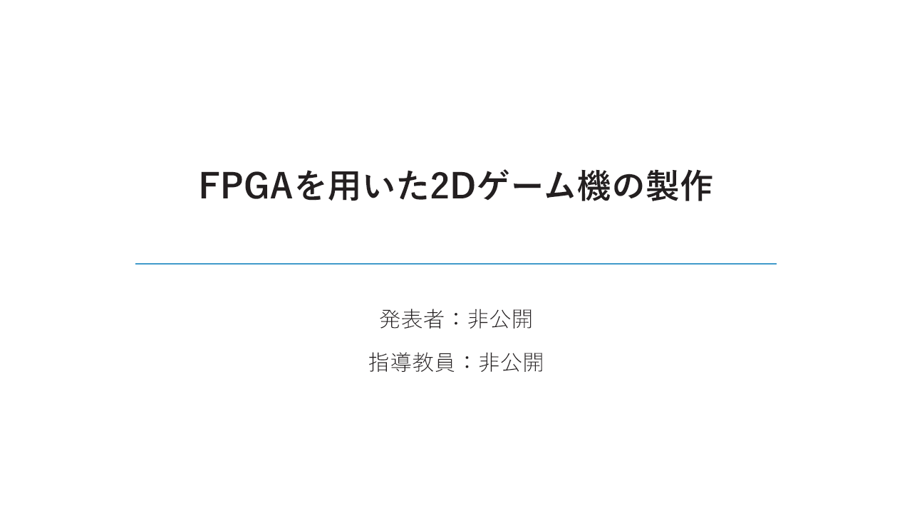

### 発表原稿

この題目で発表します。

補足説明と出典

教育用CPUに描画・表示機能を追加したゲーム機の製作について報告する。

[移動用の目次へ戻る](#slide-14)

## 2. FPGAチップで周囲の部品を制御する

説明時間の配分：25秒

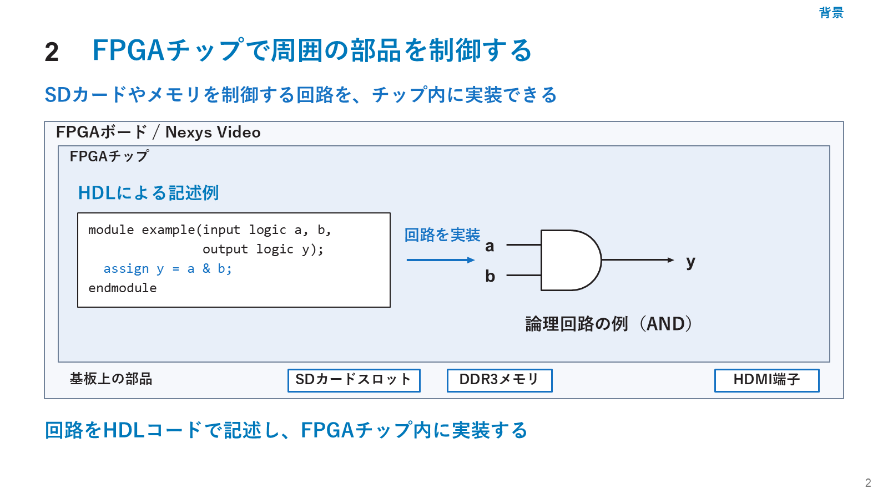

### 発表原稿

FPGAボードには、SDカードスロット、DDR3メモリ、HDMI端子が付いています。中央のFPGAチップには、これらを制御する回路を実装できます。回路はコードで記述します。例えば、左のコードは右のAND回路を表します。このように回路を記述して、チップ内に実装します。

補足説明と出典

AND回路はHDL記述と論理回路の対応例である。外側の部品すべてを一つのAND回路で制御する意味ではない。ボード上の部品は物理的に実装済みであり、図はその配置を簡略化している。

出典：Harris, S. L. and Harris, D., Digital Design and Computer Architecture: RISC-V Edition (2021), Chapter 7. Official figure source: https://pages.hmc.edu/harris/ddca/ddcarv.html (DDCArv_Figures.zip). Chapters 2 and 4. Harris et al., RISC-V System-on-Chip Design, Chapters 7–13, 20, 22–23. Official figure source: https://pages.hmc.edu/harris/ddca/rvsocd.html (RVSoCD_figs.zip). Chapter 23. Nexys Video Reference Manual.

[移動用の目次へ戻る](#slide-14)

## 3. 拡張元のWallyと研究の目的

説明時間の配分：35秒

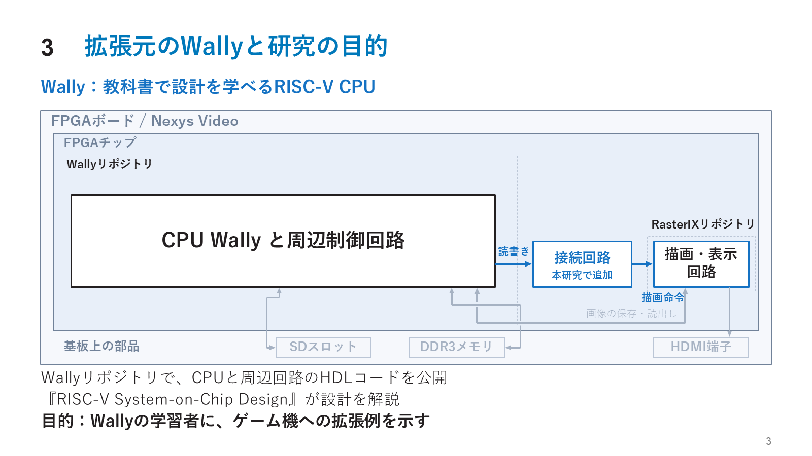

### 発表原稿

Wallyは、教科書で設計を学べるRISC-V CPUです。そのCPUと周辺回路のコードが、Wallyリポジトリで公開されています。教科書RISC-V System-on-Chip Designが、この設計を説明しています。今回は公開されている回路に、RasterIXの描画・表示回路を接続しました。Wallyの学習者に、ゲーム機への拡張例を示すことが目的です。

補足説明と出典

本資料ではCPUをWallyと呼ぶ。外枠の「Wallyリポジトリ」は、利用した回路のコードの提供元を示す。CPUと周辺回路を集積した構成はSoCであり、リポジトリはその設計コードの公開場所である。ここではCPU Wallyと周辺制御回路を一つの箱にまとめる。次の図では、その範囲をCPU、アドレスデコーダ、SD制御、DDR制御に展開する。FPGAボードとチップの境界、チップ外の部品、描画側の回路は同じ位置を保つ。WallyのリポジトリにはCPUと周辺回路のRTLが含まれる。DDRコントローラー本体はAMD製IPである。Wallyの教育効果を測定したという主張ではない。

CPU・バス・SD制御はWallyリポジトリ（CVW）の既存RTLを利用する。DDR制御はWallyリポジトリの生成・接続の仕組みを利用し、回路本体はAMD製MIG IPである。Nexys Video用の設定は本研究で追加した。標準構成の描画本体RasterIX_IFと表示本体dvi_framebufferは、同じ公式RasterIXリポジトリから取得する。表示本体はrtl/3rdParty/core_dvi_framebufferに同梱されたultraembedded由来の回路で、RasterIXの作者がすべて新規に設計したという意味ではない。バスから描画回路への変換、画面切替などの接続処理は本研究で追加した。本資料の実機動画は、RasterIX同梱の表示本体を利用する標準構成で取得した。表示本体そのものを本研究で新規設計したという主張ではない。

出典：Harris et al., RISC-V System-on-Chip Design, Chapters 7–13, 20, 22–23. Official figure source: https://pages.hmc.edu/harris/ddca/rvsocd.html (RVSoCD_figs.zip). console/README.md; Product revision 261832d48832dd6e26c4971ab8893ce61200688b. console/fpga/src/fpgaTopNexysVideo.sv; console/fpga/src/rasterix.sv; console/fpga/src/rasterix_apb.sv; console/fpga/generator/axiscdc.tcl. source/abstract/content.json.
Wally upstream: https://github.com/openhwgroup/cvw . Official RasterIX: https://github.com/ToNi3141/RasterIX/tree/9269a01c9bd4c3342bfa70ef8e3cdd751c15c6d0 . RTL: console/src/wally/wallypipelinedcore.sv; console/src/uncore/uncore.sv; console/src/uncore/spi_apb.sv; console/fpga/generator/ddr3-nexysvideo.tcl; console/fpga/generator/wally.tcl; console/fpga/src/rasterixdisplay.sv. RasterIX: rtl/RasterIX/RasterIX_IF.v; rtl/3rdParty/core_dvi_framebuffer/README.md; rtl/3rdParty/core_dvi_framebuffer/src_v/dvi_framebuffer.v. Standard-output evidence: experiments/dvi-recovery-20261109/results.json.

[移動用の目次へ戻る](#slide-14)

## 4. SDカードへ読出しを要求する

説明時間の配分：45秒

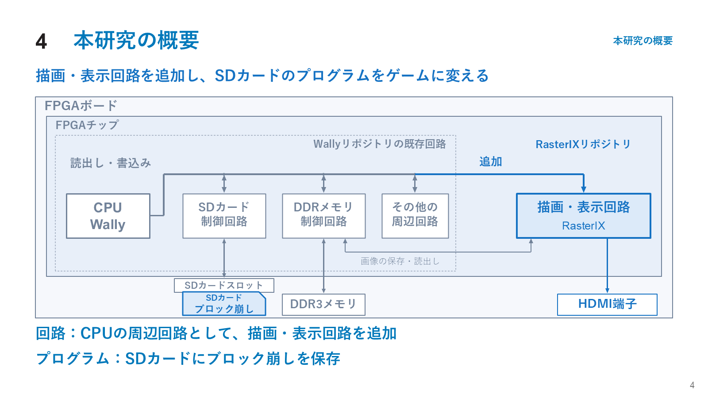

### 発表原稿

まず、SDカードからゲームプログラムを読み込みます。CPUはアドレスADに0x13048、書込みデータWDに読出し要求を表す数値、書込みイネーブルWEに1を出します。デコーダは、アドレスがSD制御の範囲に入るため、S0を1にします。SD制御は、選ばれた送信用レジスタにWDを取り込み、カードへ送ります。下のコードのrequestは要求を表す数値の配列です。同じアドレスへ順に書いて、カードに読出しを要求します。

補足説明と出典

AD/WD/WE/RD、S0〜S2は説明用の信号名である。有効な読書きが行われる場面を示し、転送の有効性、バス変換、待ち、クロック変換、アクセス幅などは省略する。SD制御の範囲は0x13000〜0x13FFF。requestは読出し要求を構成する数値の配列、iは順番を示し、アブストのCMD18の配列に対応する。Cは物理アドレスを直接参照する概念コードであり、初期化や応答確認などを含む実行可能なドライバ全体ではない。

出典：source/abstract/content.json; console/fpga/zsbl/spi.h; console/src/uncore/spi_apb.sv; console/src/mmu/adrdecs.sv; console/src/uncore/uncore.sv.

[移動用の目次へ戻る](#slide-14)

## 5. SDカードから届いた値をCPUへ戻す

説明時間の配分：35秒

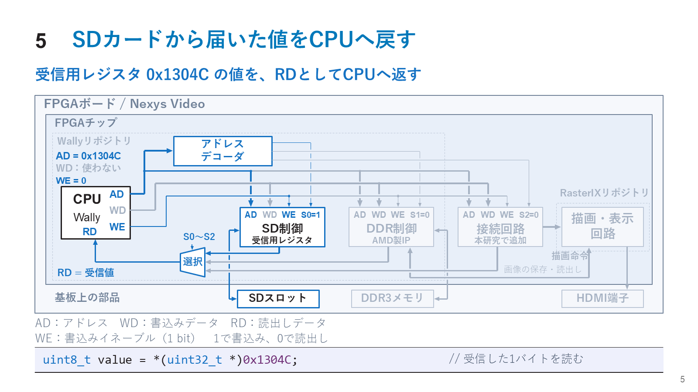

### 発表原稿

カードから届いたデータは、SD制御の受信用レジスタに入ります。CPUはそのアドレス0x1304Cを出し、今度はWEを0にします。デコーダは同じSD制御を選ぶS0を1にします。下の選択回路にもS0からS2が入り、S0が1なので、SD制御の受信値だけを選びます。その値がRDとしてCPUへ戻ります。アドレスを変えることで、同じSD制御の送信用と受信用を使い分けています。

補足説明と出典

受信用レジスタは0x1304C。受信値の下位8ビットをvalueに格納する。有効な転送中のWE=0を読出しとして示しており、WE=0だけで転送が始まる意味ではない。戻り値を選ぶS0〜S2は同じ選択信号を表す。図の同名ラベルは接続を表し、実バスでは応答まで選択を保持する。受信可能性の確認と通信クロックの発生は概念コードから省略している。

出典：source/abstract/content.json; console/fpga/zsbl/spi.h; console/src/uncore/spi_apb.sv; console/src/uncore/uncore.sv.

[移動用の目次へ戻る](#slide-14)

## 6. 受け取った値をDDR3へ保存する

説明時間の配分：30秒

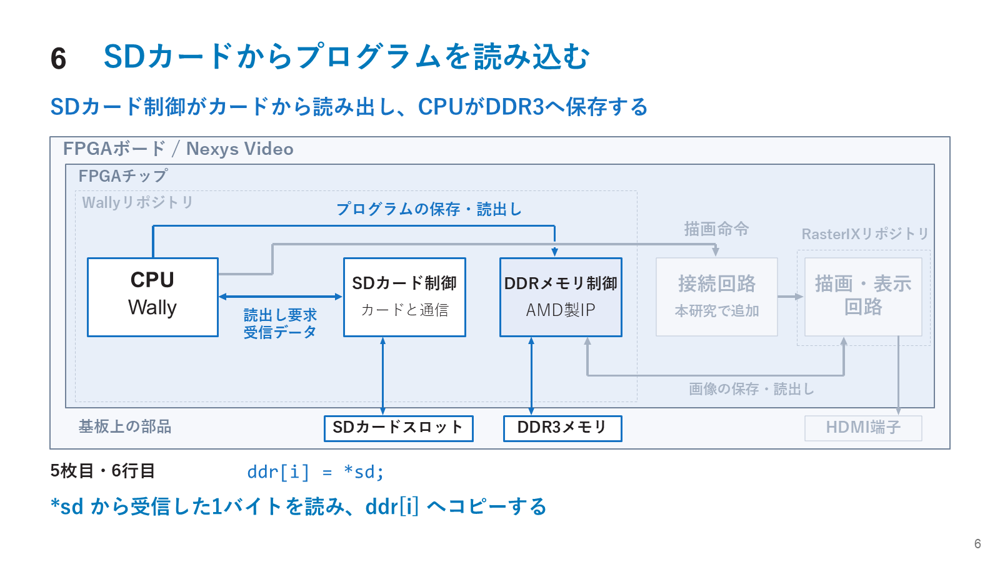

### 発表原稿

受け取ったプログラムを置くメモリがDDR3です。CPUは、ADに保存先の0x80000000、WDに受信値、WEに1を出します。今度はアドレスがDDR3の範囲なので、S1が1になります。選ばれたDDRコントローラーが、ADで指定された場所に受信値を書き込みます。このDDRコントローラーにはAMD製の回路を使っています。

補足説明と出典

DDR3の範囲は0x80000000〜0x9FFFFFFF。図は1バイトの保存先指定を示し、バスの転送幅、書込みストローブ、キャッシュ、クロック変換、メモリ仲裁は省略する。コントローラー本体はAMD MIG IPであり、生成と接続にはWallyリポジトリの仕組みを利用する。DDR3への画像保存は後の描画・表示の説明で扱う。

CPU・バス・SD制御はWallyリポジトリ（CVW）の既存RTLを利用する。DDR制御はWallyリポジトリの生成・接続の仕組みを利用し、回路本体はAMD製MIG IPである。Nexys Video用の設定は本研究で追加した。標準構成の描画本体RasterIX_IFと表示本体dvi_framebufferは、同じ公式RasterIXリポジトリから取得する。表示本体はrtl/3rdParty/core_dvi_framebufferに同梱されたultraembedded由来の回路で、RasterIXの作者がすべて新規に設計したという意味ではない。バスから描画回路への変換、画面切替などの接続処理は本研究で追加した。本資料の実機動画は、RasterIX同梱の表示本体を利用する標準構成で取得した。表示本体そのものを本研究で新規設計したという主張ではない。

出典：source/abstract/content.json; console/fpga/zsbl/boot.c; console/fpga/generator/ddr3-nexysvideo.tcl; console/fpga/generator/wally.tcl; console/src/uncore/uncore.sv.
Wally upstream: https://github.com/openhwgroup/cvw . Official RasterIX: https://github.com/ToNi3141/RasterIX/tree/9269a01c9bd4c3342bfa70ef8e3cdd751c15c6d0 . RTL: console/src/wally/wallypipelinedcore.sv; console/src/uncore/uncore.sv; console/src/uncore/spi_apb.sv; console/fpga/generator/ddr3-nexysvideo.tcl; console/fpga/generator/wally.tcl; console/fpga/src/rasterixdisplay.sv. RasterIX: rtl/RasterIX/RasterIX_IF.v; rtl/3rdParty/core_dvi_framebuffer/README.md; rtl/3rdParty/core_dvi_framebuffer/src_v/dvi_framebuffer.v. Standard-output evidence: experiments/dvi-recovery-20261109/results.json.

[移動用の目次へ戻る](#slide-14)

## 7. SDカードからDDR3へコピーする

説明時間の配分：35秒

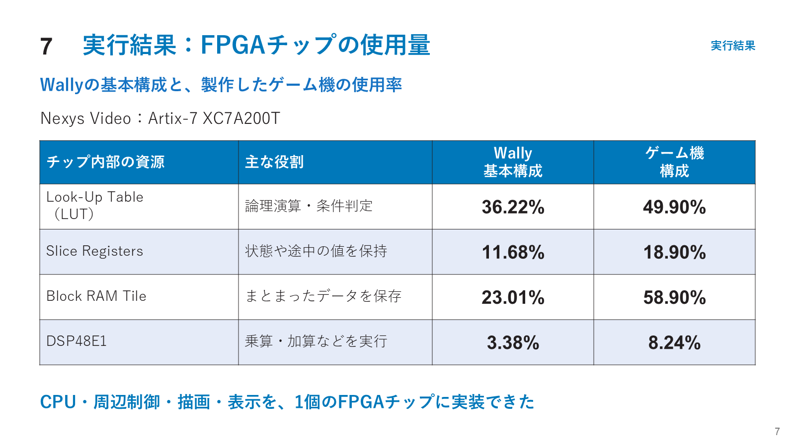

### 発表原稿

返ってきたデータは、受信用レジスタ0x1304Cから読みます。CPUはそれを、DDR3の0x80000000から順に保存します。次のデータも同じ受信用レジスタから読みますが、保存先は1バイトずつ進めます。こうしてSDカードの内容をDDR3へコピーします。

補足説明と出典

sizeはコピーするバイト数、dstは保存先の先頭、iは先頭からのバイト位置を表す。受信用レジスタの下位8ビットを保存する。CPUはSD制御からの読出しとDDR3への書込みを交互に行う。S0とS1を同時に1にする意味ではない。図では二つの処理に使う経路を青で示す。物理アドレスを直接使う概念例であり、実機のブートローダーやOSを含む起動手順の全体を置き換えるものではない。Linuxで動く実際のゲームがそのまま物理アドレスを参照するわけではなく、入出力には対応付けた領域を使う。

CPU・バス・SD制御はWallyリポジトリ（CVW）の既存RTLを利用する。DDR制御はWallyリポジトリの生成・接続の仕組みを利用し、回路本体はAMD製MIG IPである。Nexys Video用の設定は本研究で追加した。標準構成の描画本体RasterIX_IFと表示本体dvi_framebufferは、同じ公式RasterIXリポジトリから取得する。表示本体はrtl/3rdParty/core_dvi_framebufferに同梱されたultraembedded由来の回路で、RasterIXの作者がすべて新規に設計したという意味ではない。バスから描画回路への変換、画面切替などの接続処理は本研究で追加した。本資料の実機動画は、RasterIX同梱の表示本体を利用する標準構成で取得した。表示本体そのものを本研究で新規設計したという主張ではない。

出典：source/abstract/content.json; console/fpga/zsbl/spi.h; console/fpga/zsbl/boot.c; console/examples/rasterix/WallyBusConnector.hpp.
Wally upstream: https://github.com/openhwgroup/cvw . Official RasterIX: https://github.com/ToNi3141/RasterIX/tree/9269a01c9bd4c3342bfa70ef8e3cdd751c15c6d0 . RTL: console/src/wally/wallypipelinedcore.sv; console/src/uncore/uncore.sv; console/src/uncore/spi_apb.sv; console/fpga/generator/ddr3-nexysvideo.tcl; console/fpga/generator/wally.tcl; console/fpga/src/rasterixdisplay.sv. RasterIX: rtl/RasterIX/RasterIX_IF.v; rtl/3rdParty/core_dvi_framebuffer/README.md; rtl/3rdParty/core_dvi_framebuffer/src_v/dvi_framebuffer.v. Standard-output evidence: experiments/dvi-recovery-20261109/results.json.

[移動用の目次へ戻る](#slide-14)

## 8. DDR3に置いたプログラムを実行する

説明時間の配分：20秒

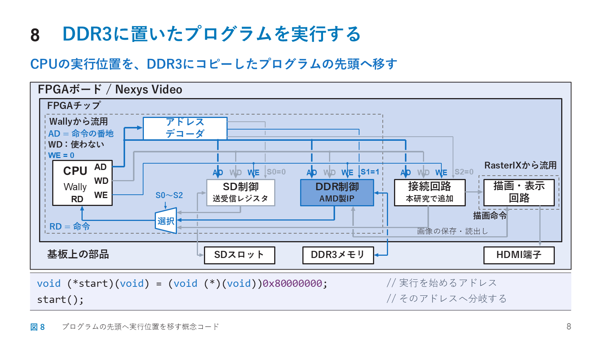

### 発表原稿

コピーが終わったら、ゲームの実行を始めます。startにプログラムの先頭アドレスを入れ、startを呼びます。CPUの実行位置がそのアドレスへ移り、DDR制御を通して命令を読みながら、DDR3に置いたゲームプログラムを実行します。

補足説明と出典

startは開始アドレスを保持する関数ポインタで、start()はそこへの呼出しとなる。コピー後の実行開始を説明する概念コードであり、実機のブート段階やOSによるプロセス起動、実行時の仮想アドレス、命令キャッシュは省略している。DDR3には既に実行できるプログラムが配置されていると仮定する。

CPU・バス・SD制御はWallyリポジトリ（CVW）の既存RTLを利用する。DDR制御はWallyリポジトリの生成・接続の仕組みを利用し、回路本体はAMD製MIG IPである。Nexys Video用の設定は本研究で追加した。標準構成の描画本体RasterIX_IFと表示本体dvi_framebufferは、同じ公式RasterIXリポジトリから取得する。表示本体はrtl/3rdParty/core_dvi_framebufferに同梱されたultraembedded由来の回路で、RasterIXの作者がすべて新規に設計したという意味ではない。バスから描画回路への変換、画面切替などの接続処理は本研究で追加した。本資料の実機動画は、RasterIX同梱の表示本体を利用する標準構成で取得した。表示本体そのものを本研究で新規設計したという主張ではない。

出典：source/abstract/content.json; console/fpga/zsbl/boot.c; console/fpga/zsbl/riscv.S.
Wally upstream: https://github.com/openhwgroup/cvw . Official RasterIX: https://github.com/ToNi3141/RasterIX/tree/9269a01c9bd4c3342bfa70ef8e3cdd751c15c6d0 . RTL: console/src/wally/wallypipelinedcore.sv; console/src/uncore/uncore.sv; console/src/uncore/spi_apb.sv; console/fpga/generator/ddr3-nexysvideo.tcl; console/fpga/generator/wally.tcl; console/fpga/src/rasterixdisplay.sv. RasterIX: rtl/RasterIX/RasterIX_IF.v; rtl/3rdParty/core_dvi_framebuffer/README.md; rtl/3rdParty/core_dvi_framebuffer/src_v/dvi_framebuffer.v. Standard-output evidence: experiments/dvi-recovery-20261109/results.json.

[移動用の目次へ戻る](#slide-14)

## 9. 描画回路へ命令を送る

説明時間の配分：25秒

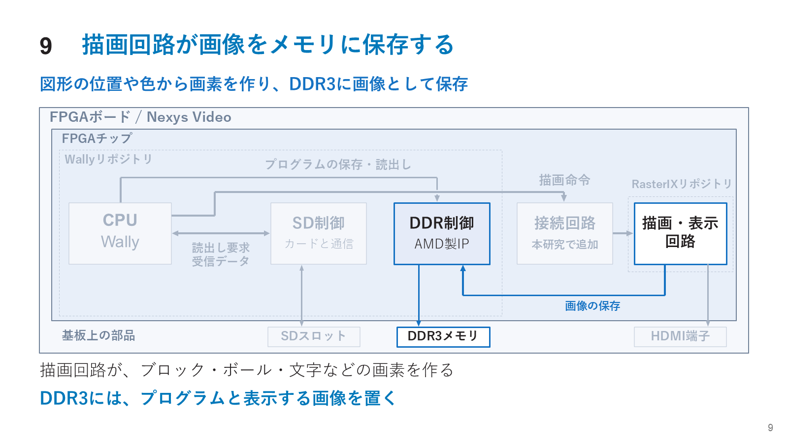

### 発表原稿

ゲームは、RasterIX付属のOpenGL互換ライブラリへ、図形の位置や色を渡します。ライブラリもCPU上で動き、描画命令を数値の列にします。CPUが0x10080000へ値を書くと、S2で選ばれた接続回路が受け取り、RasterIXへ渡します。

補足説明と出典

OpenGL互換ライブラリ本体はRasterIXのソフトウェアで、CPUが実行する。Wally用の接続部分は数値列を描画用レジスタへ書き込む。0x10080000は通常の命令語を送るポートであり、cmdはその1語。末尾通知や待ち、バッファ切替などの制御は図から省略する。公式RasterIX本体は変更していない。

CPU・バス・SD制御はWallyリポジトリ（CVW）の既存RTLを利用する。DDR制御はWallyリポジトリの生成・接続の仕組みを利用し、回路本体はAMD製MIG IPである。Nexys Video用の設定は本研究で追加した。標準構成の描画本体RasterIX_IFと表示本体dvi_framebufferは、同じ公式RasterIXリポジトリから取得する。表示本体はrtl/3rdParty/core_dvi_framebufferに同梱されたultraembedded由来の回路で、RasterIXの作者がすべて新規に設計したという意味ではない。バスから描画回路への変換、画面切替などの接続処理は本研究で追加した。本資料の実機動画は、RasterIX同梱の表示本体を利用する標準構成で取得した。表示本体そのものを本研究で新規設計したという主張ではない。

出典：Product revision 261832d48832dd6e26c4971ab8893ce61200688b. console/fpga/src/fpgaTopNexysVideo.sv; console/fpga/src/rasterix.sv; console/fpga/src/rasterix_apb.sv; console/fpga/generator/axiscdc.tcl. console/examples/rasterix/WallyBusConnector.hpp; console/addins/rasterix/lib; experiments/dvi-recovery-20261109/README.md; results.json; media-review.json. Captured 2026-11-09. Standard bitstream SHA-256: 16173de97a91e711cd7bc5389acd9739807adebedf192efc29fe78f5b96c0acf. Latest game executable SHA-256: 5c360babde59c6d9fc72fe58edc5729da2b2b8480c2f3a5208980d2f7d2c558b. Video: experiments/dvi-recovery-20261109/media/latest-standard-dvi-30s.mp4
Wally upstream: https://github.com/openhwgroup/cvw . Official RasterIX: https://github.com/ToNi3141/RasterIX/tree/9269a01c9bd4c3342bfa70ef8e3cdd751c15c6d0 . RTL: console/src/wally/wallypipelinedcore.sv; console/src/uncore/uncore.sv; console/src/uncore/spi_apb.sv; console/fpga/generator/ddr3-nexysvideo.tcl; console/fpga/generator/wally.tcl; console/fpga/src/rasterixdisplay.sv. RasterIX: rtl/RasterIX/RasterIX_IF.v; rtl/3rdParty/core_dvi_framebuffer/README.md; rtl/3rdParty/core_dvi_framebuffer/src_v/dvi_framebuffer.v. Standard-output evidence: experiments/dvi-recovery-20261109/results.json.

[移動用の目次へ戻る](#slide-14)

## 10. 接続回路が描画命令を受け渡す

説明時間の配分：25秒

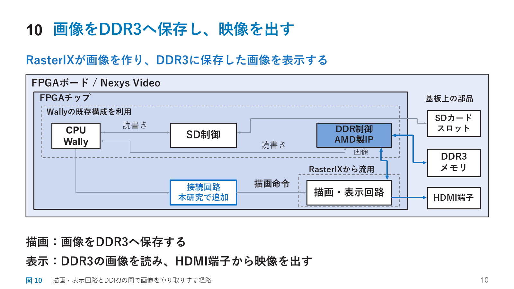

### 発表原稿

接続回路は、S2が1で選ばれ、WEが1の書込みなら、ADが命令の書込み先かを調べます。そのときWDの数値を一時保存します。保存した値は、描画回路が受け取れるときに、書かれた順に渡します。この仕組みで、CPUの書込みを描画回路への命令送信につなげました。

補足説明と出典

通常の命令語を0x10080000へ書く場合を説明する。図のS2はPSEL、WEはPWRITE、ADはPADDR、WDはPWDATAに対応する概念名である。実装はPSEL・PENABLE・PWRITE、32 bit書込みの条件、および命令ポートのアドレス条件からCommandWriteを生成する。CmdValid=CommandWrite、CmdData=WriteDataであり、接続回路が図形の意味を解析したり数値を別の描画命令へ翻訳したりするわけではない。一時保存はrasterix.svのaxiscdc commandfifoが行う。CPU側ではCmdValidとCmdReadyがともに1のときに受け取り、描画側ではGPUCmdValidとGPUCmdReadyがともに1のときに渡す。FIFOの入力が受取れない間はPREADYを下げ、CPU側の書込み完了を待たせる。本文の「そのとき取り込む」は書込みが完了したときの働きを示し、毎クロック無条件で取り込むという意味ではない。末尾用アドレス0x10080004、応答、クロック境界の実装、転送幅の選択は本図では省略する。これらを含む正確な信号条件は上記RTLに対応する。

CPU・バス・SD制御はWallyリポジトリ（CVW）の既存RTLを利用する。DDR制御はWallyリポジトリの生成・接続の仕組みを利用し、回路本体はAMD製MIG IPである。Nexys Video用の設定は本研究で追加した。標準構成の描画本体RasterIX_IFと表示本体dvi_framebufferは、同じ公式RasterIXリポジトリから取得する。表示本体はrtl/3rdParty/core_dvi_framebufferに同梱されたultraembedded由来の回路で、RasterIXの作者がすべて新規に設計したという意味ではない。バスから描画回路への変換、画面切替などの接続処理は本研究で追加した。本資料の実機動画は、RasterIX同梱の表示本体を利用する標準構成で取得した。表示本体そのものを本研究で新規設計したという主張ではない。

出典：Product revision 261832d48832dd6e26c4971ab8893ce61200688b. console/fpga/src/fpgaTopNexysVideo.sv; console/fpga/src/rasterix.sv; console/fpga/src/rasterix_apb.sv; console/fpga/generator/axiscdc.tcl. console/fpga/src/rasterix_apb.sv: CommandWrite, CmdData, CmdValid, PREADY; console/fpga/src/rasterix.sv: commandfifo, gpu.
Wally upstream: https://github.com/openhwgroup/cvw . Official RasterIX: https://github.com/ToNi3141/RasterIX/tree/9269a01c9bd4c3342bfa70ef8e3cdd751c15c6d0 . RTL: console/src/wally/wallypipelinedcore.sv; console/src/uncore/uncore.sv; console/src/uncore/spi_apb.sv; console/fpga/generator/ddr3-nexysvideo.tcl; console/fpga/generator/wally.tcl; console/fpga/src/rasterixdisplay.sv. RasterIX: rtl/RasterIX/RasterIX_IF.v; rtl/3rdParty/core_dvi_framebuffer/README.md; rtl/3rdParty/core_dvi_framebuffer/src_v/dvi_framebuffer.v. Standard-output evidence: experiments/dvi-recovery-20261109/results.json.

[移動用の目次へ戻る](#slide-14)

## 11. 画像をDDR3へ保存し、映像を出す

説明時間の配分：20秒

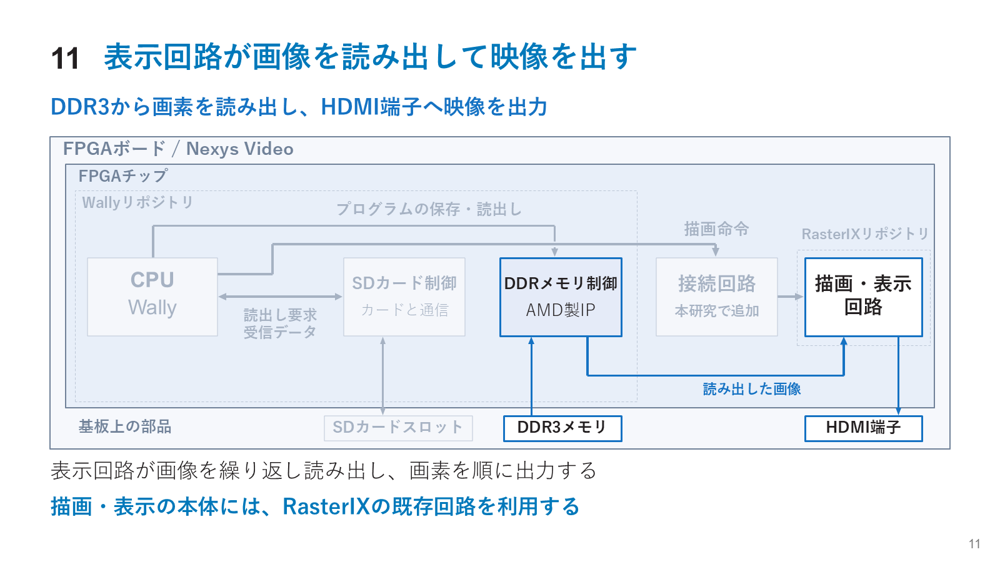

### 発表原稿

RasterIXは、描画命令に従って画像を作り、DDR制御を通してDDR3へ保存します。表示回路がその画像を読み、HDMI端子から映像を出します。描画と表示は、どちらもRasterIXに含まれる回路を利用しています。

補足説明と出典

DDR3への画像の保存と読出しはRasterIX側の回路が要求し、DDRコントローラーが処理する。描画と表示は内部ではそれぞれの回路が担当するが、提供元が同じため主図では一つの箱にまとめている。画像の切替やメモリ仲裁、画素データの形式、映像の符号化は省略している。標準表示構成の実機記録を根拠とする。

CPU・バス・SD制御はWallyリポジトリ（CVW）の既存RTLを利用する。DDR制御はWallyリポジトリの生成・接続の仕組みを利用し、回路本体はAMD製MIG IPである。Nexys Video用の設定は本研究で追加した。標準構成の描画本体RasterIX_IFと表示本体dvi_framebufferは、同じ公式RasterIXリポジトリから取得する。表示本体はrtl/3rdParty/core_dvi_framebufferに同梱されたultraembedded由来の回路で、RasterIXの作者がすべて新規に設計したという意味ではない。バスから描画回路への変換、画面切替などの接続処理は本研究で追加した。本資料の実機動画は、RasterIX同梱の表示本体を利用する標準構成で取得した。表示本体そのものを本研究で新規設計したという主張ではない。

出典：Product revision 261832d48832dd6e26c4971ab8893ce61200688b. console/fpga/src/fpgaTopNexysVideo.sv; console/fpga/src/rasterix.sv; console/fpga/src/rasterix_apb.sv; console/fpga/generator/axiscdc.tcl. console/fpga/generator/rasterixmem.tcl; console/fpga/src/rasterixdisplay.sv; experiments/dvi-recovery-20261109/README.md; results.json; media-review.json. Captured 2026-11-09. Standard bitstream SHA-256: 16173de97a91e711cd7bc5389acd9739807adebedf192efc29fe78f5b96c0acf. Latest game executable SHA-256: 5c360babde59c6d9fc72fe58edc5729da2b2b8480c2f3a5208980d2f7d2c558b. Video: experiments/dvi-recovery-20261109/media/latest-standard-dvi-30s.mp4
Wally upstream: https://github.com/openhwgroup/cvw . Official RasterIX: https://github.com/ToNi3141/RasterIX/tree/9269a01c9bd4c3342bfa70ef8e3cdd751c15c6d0 . RTL: console/src/wally/wallypipelinedcore.sv; console/src/uncore/uncore.sv; console/src/uncore/spi_apb.sv; console/fpga/generator/ddr3-nexysvideo.tcl; console/fpga/generator/wally.tcl; console/fpga/src/rasterixdisplay.sv. RasterIX: rtl/RasterIX/RasterIX_IF.v; rtl/3rdParty/core_dvi_framebuffer/README.md; rtl/3rdParty/core_dvi_framebuffer/src_v/dvi_framebuffer.v. Standard-output evidence: experiments/dvi-recovery-20261109/results.json.

[移動用の目次へ戻る](#slide-14)

## 12. ブロック崩しの実機動画

説明時間の配分：30秒

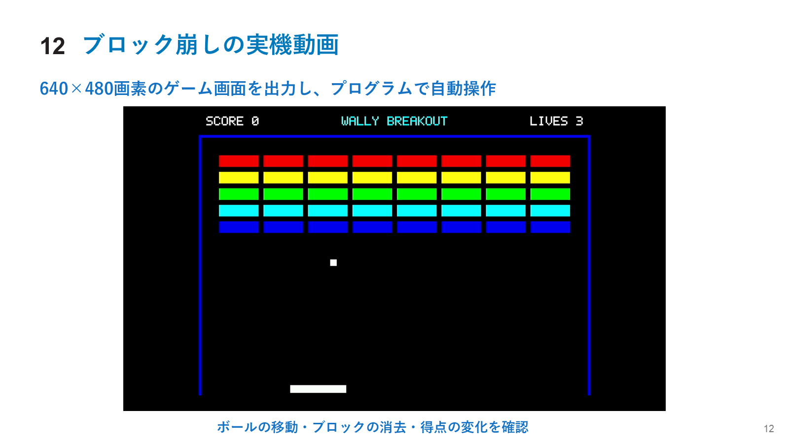

[30秒の実機動画を開く](../../source/presentation/assets/breakout-standard-dvi-compatible.mp4)

PowerPointには動画を埋め込んでいます。スライドショーで12枚目に進むと自動再生します。

### 発表原稿

こちらが実機の映像です。640かける480画素のゲーム画面をHDMI端子から出しています。ボールの移動、壁やパドルでの反射、当たったブロックの消去を確認しました。現在はプログラムがパドルを自動で動かしています。

補足説明と出典

2026年11月9日の標準表示構成による30秒の記録。RasterIX_IFと同梱dvi_framebufferを利用している。スライドショーでこのスライドに進むと動画を自動再生する。埋込み動画は同じ記録をH.264 Highへ再符号化した配布用ファイルで、映像の内容や時間は変えていない。パドルは自動操作であり、コントローラによるプレイではない。録画の保存フレームレートからゲームの描画FPSを求めていない。確認した取得条件と機器の範囲は再現資料を参照。

CPU・バス・SD制御はWallyリポジトリ（CVW）の既存RTLを利用する。DDR制御はWallyリポジトリの生成・接続の仕組みを利用し、回路本体はAMD製MIG IPである。Nexys Video用の設定は本研究で追加した。標準構成の描画本体RasterIX_IFと表示本体dvi_framebufferは、同じ公式RasterIXリポジトリから取得する。表示本体はrtl/3rdParty/core_dvi_framebufferに同梱されたultraembedded由来の回路で、RasterIXの作者がすべて新規に設計したという意味ではない。バスから描画回路への変換、画面切替などの接続処理は本研究で追加した。本資料の実機動画は、RasterIX同梱の表示本体を利用する標準構成で取得した。表示本体そのものを本研究で新規設計したという主張ではない。

出典：experiments/dvi-recovery-20261109/README.md; results.json; media-review.json. Captured 2026-11-09. Standard bitstream SHA-256: 16173de97a91e711cd7bc5389acd9739807adebedf192efc29fe78f5b96c0acf. Latest game executable SHA-256: 5c360babde59c6d9fc72fe58edc5729da2b2b8480c2f3a5208980d2f7d2c558b. Video: experiments/dvi-recovery-20261109/media/latest-standard-dvi-30s.mp4 Video: source/presentation/assets/breakout-standard-dvi-compatible.mp4
Wally upstream: https://github.com/openhwgroup/cvw . Official RasterIX: https://github.com/ToNi3141/RasterIX/tree/9269a01c9bd4c3342bfa70ef8e3cdd751c15c6d0 . RTL: console/src/wally/wallypipelinedcore.sv; console/src/uncore/uncore.sv; console/src/uncore/spi_apb.sv; console/fpga/generator/ddr3-nexysvideo.tcl; console/fpga/generator/wally.tcl; console/fpga/src/rasterixdisplay.sv. RasterIX: rtl/RasterIX/RasterIX_IF.v; rtl/3rdParty/core_dvi_framebuffer/README.md; rtl/3rdParty/core_dvi_framebuffer/src_v/dvi_framebuffer.v. Standard-output evidence: experiments/dvi-recovery-20261109/results.json.

[移動用の目次へ戻る](#slide-14)

## 13. 結論と今後の展望

説明時間の配分：25秒

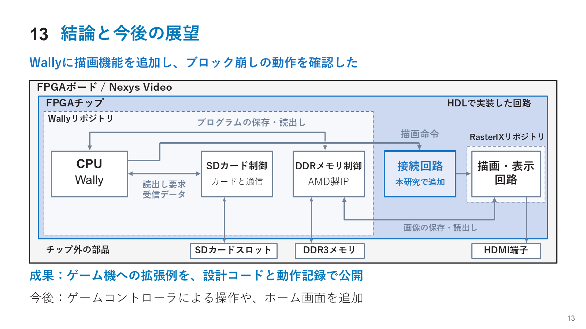

### 発表原稿

破線の枠は、各リポジトリから利用した回路です。青い接続回路を追加して、CPUや周辺回路と描画・表示回路をつなぎ、ブロック崩しが動くゲーム機を実現しました。この接続方法と実行手順を公開し、Wallyの学習者向けの拡張例を示しました。今後は、ゲームコントローラによる操作やホーム画面を追加したいと考えています。

補足説明と出典

図の位置は本編の共通図とそろえ、破線の枠は主な回路の提供元、青い実線の枠は本研究で追加した命令の接続回路を示す。CPU・アドレス選択・SD制御はWallyリポジトリの既存回路を利用し、接続先の設定を追加した。DDRコントローラー本体はAMD製IPである。描画と表示の本体はRasterIXリポジトリに含まれる。命令の受渡し、画面切替、メモリとの接続などを本研究で実装・構成し、既存回路を組み合わせた。クロック変換などには既存IPも利用しており、青い枠の内部をすべて独自発明したという意味ではない。組合せは本研究で実現した拡張を表し、世界初であると断定するものではない。教育効果を学習実験で測定したという主張ではない。現在は自動操作であり、ゲームコントローラによる操作とホーム画面などのGUIは今後の候補である。

CPU・バス・SD制御はWallyリポジトリ（CVW）の既存RTLを利用する。DDR制御はWallyリポジトリの生成・接続の仕組みを利用し、回路本体はAMD製MIG IPである。Nexys Video用の設定は本研究で追加した。標準構成の描画本体RasterIX_IFと表示本体dvi_framebufferは、同じ公式RasterIXリポジトリから取得する。表示本体はrtl/3rdParty/core_dvi_framebufferに同梱されたultraembedded由来の回路で、RasterIXの作者がすべて新規に設計したという意味ではない。バスから描画回路への変換、画面切替などの接続処理は本研究で追加した。本資料の実機動画は、RasterIX同梱の表示本体を利用する標準構成で取得した。表示本体そのものを本研究で新規設計したという主張ではない。

出典：Product revision 261832d48832dd6e26c4971ab8893ce61200688b. console/fpga/src/fpgaTopNexysVideo.sv; console/fpga/src/rasterix.sv; console/fpga/src/rasterix_apb.sv; console/fpga/generator/axiscdc.tcl. experiments/dvi-recovery-20261109/README.md; results.json; media-review.json. Captured 2026-11-09. Standard bitstream SHA-256: 16173de97a91e711cd7bc5389acd9739807adebedf192efc29fe78f5b96c0acf. Latest game executable SHA-256: 5c360babde59c6d9fc72fe58edc5729da2b2b8480c2f3a5208980d2f7d2c558b. Video: experiments/dvi-recovery-20261109/media/latest-standard-dvi-30s.mp4 source/abstract/content.json.
Wally upstream: https://github.com/openhwgroup/cvw . Official RasterIX: https://github.com/ToNi3141/RasterIX/tree/9269a01c9bd4c3342bfa70ef8e3cdd751c15c6d0 . RTL: console/src/wally/wallypipelinedcore.sv; console/src/uncore/uncore.sv; console/src/uncore/spi_apb.sv; console/fpga/generator/ddr3-nexysvideo.tcl; console/fpga/generator/wally.tcl; console/fpga/src/rasterixdisplay.sv. RasterIX: rtl/RasterIX/RasterIX_IF.v; rtl/3rdParty/core_dvi_framebuffer/README.md; rtl/3rdParty/core_dvi_framebuffer/src_v/dvi_framebuffer.v. Standard-output evidence: experiments/dvi-recovery-20261109/results.json.

[移動用の目次へ戻る](#slide-14)

## 14. 目次：発表・回答用スライド

項目名から移動できます。PowerPointでは右下の番号から、この目次へ戻れます。

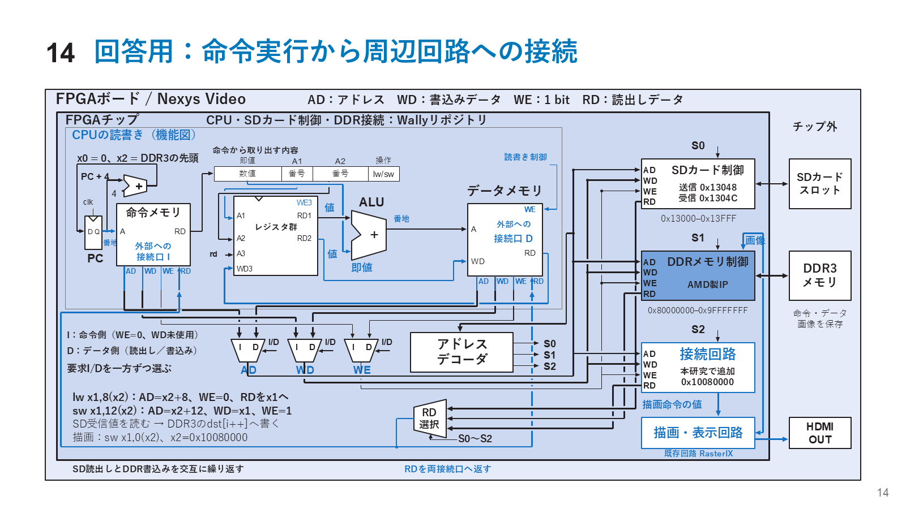

### 発表用スライド

- [1. 表紙](#slide-1)
- [2. FPGAチップと周辺部品](#slide-2)
- [3. 拡張元のWallyと研究の目的](#slide-3)
- [4. SDカードへ読出しを要求する](#slide-4)
- [5. SDカードから届いた値をCPUへ戻す](#slide-5)
- [6. 受け取った値をDDR3へ保存する](#slide-6)
- [7. SDカードからDDR3へコピーする](#slide-7)
- [8. DDR3に置いたプログラムを実行する](#slide-8)
- [9. 描画回路へ命令を送る](#slide-9)
- [10. 接続回路が描画命令を受け渡す](#slide-10)
- [11. 画像を保存し、映像を出す](#slide-11)
- [12. ブロック崩しの実機動画](#slide-12)
- [13. 結論と今後の展望](#slide-13)

### 回答用：教科書の採用例

- [15. DDCAを教材に挙げる授業](#slide-15)
- [16. RVSOCの教科書採用例](#slide-16)

### 回答用：FPGA

- [17. FPGAチップの構成要素](#slide-17)
- [18. FPGAの使用量](#slide-18)

### 回答用：命令の実行と周辺接続

- [19. 命令実行から周辺回路への接続](#slide-19)

### 回答用：回路の詳細

- [20. 詳細な全体のブロック図](#slide-20)
- [21. 描画回路のFPGAパイプライン](#slide-21)

### 目次の使い方

質問に関係する項目をクリックすると、そのスライドへ移動します。移動した後は右下のスライド番号をクリックすると、この目次へ戻れます。

補足説明と出典

表紙1枚と発表用12枚の後に置く操作用の目次である。発表用スライドと回答用スライドの両方へ移動できる。回答用スライドは、教科書の採用例、FPGAの構成要素と使用量、命令の実行から周辺回路へつながる統合図、回路の詳細の順にまとめる。回答用の7枚は通常の順送りでは表示しないが、目次から選んで開ける。本編の説明時間には目次の操作時間を含めない。

## 15. 回答用：DDCAを教材に挙げる授業の広がり

質問時に参照する資料。本編の発表時間には含めません。

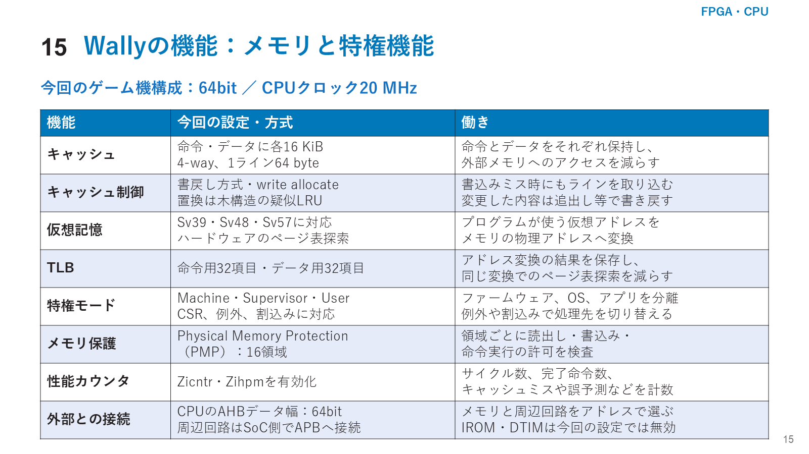

[教育機関・授業・年度・指定の種類・出典の一覧](DDCA授業利用の出典.md)

スライドに示した学校名の例：高専は豊田高専・久留米高専、大学（学部）は東京大学・京都大学・慶應義塾大学、大学院は北陸先端科学技術大学院大学（JAIST）。

### 質問時の使い方

DDCAは、高専・大学の学部・大学院の授業で、教科書や参考書として挙げられています。過去の指定も含めて、公式の公開資料から22機関・14都道府県で確認できました。1枚の地図にまとめ、同じ県で複数の区分を確認した場合は、それらの色の縞模様にしています。すべての採用校を調べたものではありません。

補足説明と出典

図は、DDCAを公式シラバス・授業資料の教科書・教材・参考書欄で確認した例を示す。日本語版と英語版、MIPS版・ARM版・RISC-V版などを含む。区分別では高専4機関、大学（学部）14機関、大学院6機関である。東京大学と広島大学は学部・大学院の両方に例があるが、全体ではそれぞれ1機関と数える。重複を除いた合計は22機関・14都道府県である。区分は学校名ではなく授業の対象課程を表す。所在地は授業のキャンパスや開催地を使い、大学本部の住所でまとめない。教科書と参考書は出典一覧で区別する。参考書欄への掲載だけから、授業で毎回使うことや全学生の購入までは分からない。年度が分かる資料は2019〜2026年度である。開志専門職大学と長崎大学は授業年度不明、京都大学は2026年度授業ページからリンクされている資料である。現在も同じ指定が続くことや、同一年度の全国分布を示すものではない。縞模様は同じ県に複数の区分があることを示し、各色の面積は機関数に比例しない。灰色はこの一覧で未確認という意味で、使う学校がないという意味ではない。全国の全校・全年度を網羅していないため、色の面積や県数を採用率・市場シェアとして解釈しない。図書館の蔵書だけや書店の取扱いだけは根拠にしない。高知大学の資料は授業名とシラバス掲載図書を対応づけた公式一覧である。長崎大学は公式学部サイトの個別授業紹介を根拠とする。DDCAの掲載例は、RVSOCの採用実績や本研究の教育効果を直接示さない。授業・年度・版・確認箇所はDDCA授業利用の出典.mdを参照。地図の着色と集計はsource/presentation/ddca-adoption/records.jsonから生成する。地図は都道府県の形を簡略化した比較用の図である。

出典：学校別の出典：docs/presentation/DDCA授業利用の出典.md。確認日：2026-10-26。
K01 東京都立産業技術高等専門学校、2021年度「コンピュータハードウェアⅠ」、教科書。https://www.metro-cit.ac.jp/contents/000006531.pdf#page=16
K02 豊田工業高等専門学校、2025年度「コンピュータアーキテクチャⅡ」、教科書／教材。https://syllabus.kosen-k.go.jp/Pages/PublicSyllabus?department_id=13&lang=ja&school_id=23&subject_code=34234&year=2022
K03 鈴鹿工業高等専門学校、2026年度「計算機工学」、参考書。https://syllabus.kosen-k.go.jp/Pages/PublicSyllabus?department_id=13&lang=ja&school_id=25&subject_id=0097&year=2023
K04 久留米工業高等専門学校、2026年度「ディジタル回路設計」、教科書。https://syllabus.kosen-k.go.jp/Pages/PublicSyllabus?department_id=03&from=curriculum&lang=ja&school_id=43&subject_code=4S18&year=2023
U01 公立はこだて未来大学、2019年度「ハードウェア基礎」、教科書。https://www.fun.ac.jp/wp/wp-content/uploads/2020/03/2019_syllabus_2.pdf#page=77
U02 法政大学、2025年度「ディジタル回路デザイン」、教科書。https://syllabus.hosei.ac.jp/web/preview.php?gakubueng=AP&nendo=2025&no_id=2513717&radd=&t_mode=sp
U03 青山学院大学、2021年度「電子計算機工学Ⅰ」、参考書。https://syllabus.aoyama.ac.jp/shousai_view2.aspx?FN=4611510-0074&YR=2021
U04 島根大学、2022年度「コンピュータハードウェア実験」、教科書。https://gkm2019-sy.shimane-u.ac.jp/syllabusHtml/2022/04/04_TB50052_ja_JP.html
U05 広島大学、2026年度「コンピューターアーキテクチャ」、教科書。https://momiji.hiroshima-u.ac.jp/syllabusHtml/2026_12_K6406020.html
U06 高知工科大学、2026年度「電子システム設計」、参考書。https://portal.kochi-tech.ac.jp/Portal/Public/Syllabus/DetailMain.aspx?lct_cd=1160018001&lct_year=2026
G01 情報セキュリティ大学院大学、2025年度「情報デバイス技術」、参考書。https://www.iisec.ac.jp/education/curriculum/2025/syllabus_14.html
G02 北陸先端科学技術大学院大学、2024年度「デジタル論理と計算機構成（I115）」、参考書。https://syllabus.jaist.ac.jp/public/web/Syllabus/WebSyllabusSansho/UI/WSL_SyllabusSansho.aspx?P1=I1151000&P2=2024&P3=20240401
G03 高知大学大学院、2026年度「計算機アーキテクチャ特論（1A305）」、教科書・参考書（区別なし）。https://www.lib.kochi-u.ac.jp/html/シラバス掲載図書：総合人間自然科学研究科修士
U07 東京大学、2022年度「計算機構成論」、教科書。https://catalog.he.u-tokyo.ac.jp/detail?code=0510019&year=2022
U08 電気通信大学、2024年度「計算機通論」、推薦図書。https://kyoumu.office.uec.ac.jp/syllabus/2024/31/31_21122106.html
U09 京都大学、2026年度「計算機科学実験及演習3（ハードウェア）」、参考書。https://isle3hw.kuis.kyoto-u.ac.jp/kuis_le3a_hdl.pdf#page=26
U10 開志専門職大学、年度不明「コンピュータアーキテクチャ」、教科書（必ず購入する書籍）。https://kaishi-pu.ac.jp/wp/wp-content/themes/kaishi/assets/pdf/openinfo/shugakushien_syllabus_info-c.pdf?ver=3#page=1
U11 長崎大学、年度不明「論理回路」、教科書・教材・参考書（資料では区別なし）。https://www.idsci.nagasaki-u.ac.jp/education/lectureintroduction/lesson16
U12 中央大学、2026年度「コンピュータ設計」、参考文献。https://syllabus.chuo-u.ac.jp/syllabus/detail/?id=10765
U13 慶應義塾大学、2026年度「計算機基礎」、参考書。https://gslbs.keio.jp/pub-syllabus/detail?entno=37331&lang=jp&ttblyr=2026
U14 金沢大学、2025年度「計算機アーキテクチャＡ」、参考書。https://eduweb.sta.kanazawa-u.ac.jp/Portal/Public/Syllabus/DetailMain.aspx?je_cd=1&lct_cd=52-42210&lct_idx=A000000000200402&lct_year=2025
G04 広島大学大学院、2026年度「システムLSI設計（System LSI Design、WSP03200）」、参考書。https://momiji.hiroshima-u.ac.jp/syllabusHtml_en/2026_E90113_WSP03200_en.html
G05 総合研究大学院大学、2026年度「計測と制御（デジタル信号処理Ⅰ・Ⅱ）」、参考書。https://openit.kek.jp/training/2026/daq
G06 東京大学大学院、2024年度「カスタムコンピューティング特論（4810-1190）」、参考書。https://catalog.he.u-tokyo.ac.jp/detail?code=4810-1190&year=2024
地図：lalamalink, https://github.com/lalamalink/japan-map-svg (CC0 1.0)。

[移動用の目次へ戻る](#slide-14)

## 16. 回答用：RVSOCの教科書採用例

質問時に参照する資料。本編の発表時間には含めません。

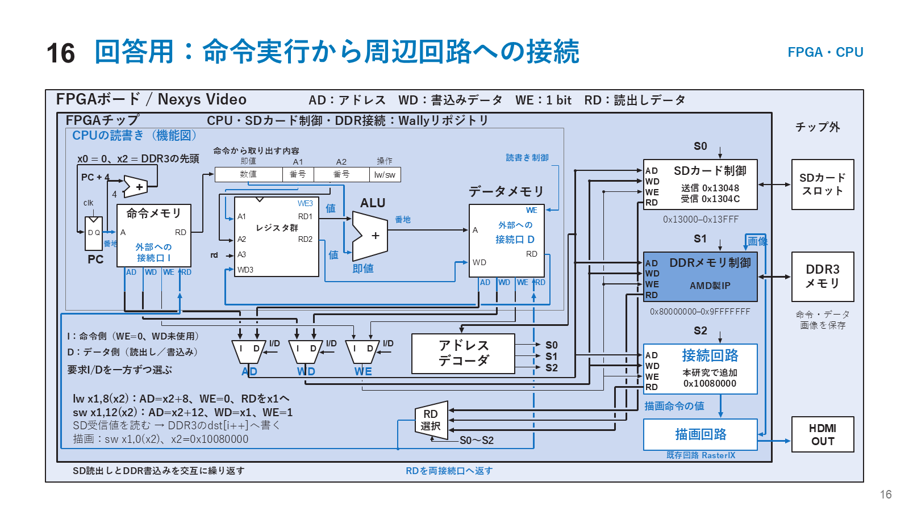

[教育機関・時期・採用根拠の一覧](RVSOC教科書採用の出典.md)

### 質問時の使い方

公開資料で確認できた例は、米国のHarvey Mudd CollegeとOklahoma State University、ドイツのダルムシュタット工科大学の3校です。Harvey Muddの2026年春の授業では教科書に指定され、ダルムシュタット工科大学の授業では主教科書と明記されています。Oklahoma State Universityでは、出版前の原稿を使って授業を行ったことが教育実践論文に報告されています。この表は過去の使用も含む確認例であり、世界の全採用校の一覧ではありません。

補足説明と出典

教科書の指定と授業での使用
RVSOCはHarrisらのRISC-V System-on-Chip Designを指す。確認日は2026年11月8日。表の時期は根拠となる授業の時期であり、全校を同じ年度の採用校として数えたものではない。

Harvey Mudd College
公式のE154授業ページは2026年春の授業として公開され、Textbookのリンクを置いている。そこから参照するシラバスのTextbook欄にも本書を指定している。2025年のASEE論文は、同校で2023〜2025年に原稿版を使用した授業も報告している。

Oklahoma State University
Thompsonら（2025）の第4節は、2023〜2024年の上級SoC設計の授業と、2024年春の計算機アーキテクチャの授業で、出版前の原稿を使ったと報告している。科目コードは同論文に示されていないため、表では授業の分野を記す。

ダルムシュタット工科大学
正式名称はTechnische Universität Darmstadt。2026/27年のComputer Architecture and Implementationの公式ページは、Lecture Study Materials欄で本書を主教科書に指定する。初回講義は2026年10月14日と記される。教科書の指定を確認したもので、受講者の学習成果を調査した結果ではない。

集計の範囲
授業での教科書指定、または教員による実際の授業使用の報告を根拠に数える。図書館の所蔵、書店の取扱い、著者の所属、Wallyを使うという情報だけでは含めない。Umm Al-Qura UniversityのCE6000では本書が参考書欄に載るが、主たる教科書は別の本であり、表の3校には含めない。参考書掲載例や除外理由の根拠はRVSOC教科書採用の出典.mdにまとめる。

質問への答え方
「1校だけですか」には「公開資料では少なくともこの3校の教科書指定・使用実績を確認しています。原稿版での過去の使用も含みます」と答える。この一覧だけから世界の採用率や、本研究の教育効果を示すことはできない。

出典：[1] Harvey Mudd College, E154, Spring 2026. https://pages.hmc.edu/harris/class/e154/ (Syllabus: Textbook; course homepage: Textbook link)
[2] Thompson et al. (2025), RISC-V System-on-Chip Design Textbook and Course. https://peer.asee.org/risc-v-system-on-chip-design-textbook-and-course (Section 4, Courses; PDF pages 8 and 10 of 12 (including cover))
[3] TU Darmstadt, Computer Architecture and Implementation, 2026/27. https://www.esa.informatik.tu-darmstadt.de/lehre/202627/cai (Lecture Study Materials; Start of Course)

[移動用の目次へ戻る](#slide-14)

## 17. 回答用：FPGAチップの構成要素

質問時に参照する資料。本編の発表時間には含めません。

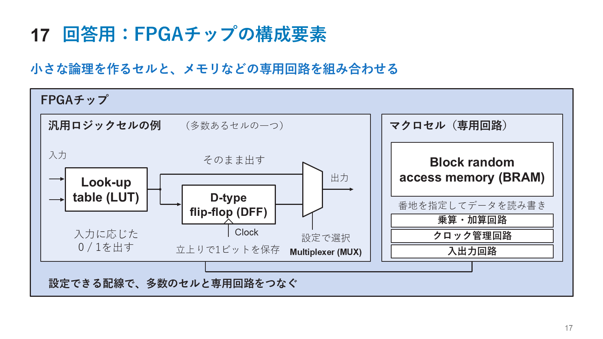

### 質問時の使い方

FPGAの中には、小さな論理回路を作るロジックセルが多数あります。一つを拡大したものが左の図です。ルックアップテーブルは、入力に対応する0または1を出して、ANDなどの論理を実現します。その出力は、そのまま使うことも、D型フリップフロップで保存してから使うこともできます。保存する場合は、クロックの立上りで入力を取り込み、次の立上りまで保持します。どちらの経路を使うかも設定できます。右は、メモリや演算などを担う専用回路です。FPro本ではマクロセルと呼び、ブロックランダムアクセスメモリや乗算回路、クロック管理回路などを挙げています。ブロックメモリは、番地を指定してまとまったデータを読み書きするための専用回路です。多数のセルや専用回路を、接続先を設定できる配線でつなぎ、CPUや描画回路を実現します。

補足説明と出典

本の分類と図の読み方
FPro本とは、Pong P. Chu著『FPGA Prototyping by SystemVerilog Examples: Xilinx MicroBlaze MCS SoC Edition』（2018年）を指す。第2章2.1.1節と図2.1は、汎用ロジックセルと、それらをつなぐプログラマブル相互接続をFPGAの基本構造として説明する。同節のMacro cellと2.1.2節は、メモリ、乗算、クロック管理、入出力などの専用回路を説明する。この図でも、ロジックセルを囲う枠の中にルックアップテーブルとD型フリップフロップを置き、ブロックメモリは別のマクロセルとして示す。ルックアップテーブル、フリップフロップ、ブロックメモリを同じ階層の三つの部品として並べる図ではない。マクロセルの枠は分類を示し、その中身が実物で一か所に集まっているという意味ではない。

配色と文字
RVSOCの図7.11と図23.2を参考に、チップ全体を青、内部のまとまりを淡い青、個々の回路を白で示す。Look-up table、D-type flip-flop、Multiplexer、Block random access memoryは、図中に英語で太字表記し、それぞれ略称LUT、DFF、MUX、BRAMを括弧で添える。同じ名前のカタカナ表記は重ねない。動作の補足は日本語で、通常の太さで示す。この色は種類や包含関係を読み取りやすくするためのものであり、使用量や動作中の信号値を表さない。FPGAの構成要素の分類はFPro本に従い、配色と線の表現をRVSOCに寄せている。

図の左側に描くロジックセルは、多数あるセルの一例である。FPro図2.1に沿って、出力をそのまま使う経路と、フリップフロップを経由する経路を描く。本書の一般的なセルの図は5入力であるが、この図では入力の配線を2本で代表している。実際の入力数を2に限定する意味ではない。Artix-7の具体的な構造や個数をそのまま描いたものではない。外側の枠はFPGAチップの境界を示し、配置、面積比、使用率は示していない。CPUや描画回路は、これらの多数の部品を組み合わせて実装する機能の名前である。CPUを一つのセルだけで作るわけではない。

ルックアップテーブル（Look-up table）
略称はLUTである。入力の組合せごとに出力する0または1を設定しておく回路と考える。例えば2入力のANDを作るなら、入力abが00、01、10のときの出力を0、11のときの出力を1と設定する。入力が11になれば、この表から1が選ばれて出る。表の内容を変えればORやXORなど別の論理を実現できる。一般にn入力なら入力の組合せは2のn乗通りあるので、その数の1ビットの値を用意する。FPGAを構成するときに用意するこの設定値と、CPUが実行中にメモリへ書くゲームのデータは区別する。

ルックアップテーブルの出力は組合せ論理であり、入力が変わると伝搬遅延の後に変わる。Artix-7では一つの6入力ルックアップテーブルで、最大6入力の任意の1ビット出力論理を実現できる。ALUの論理演算や制御の条件判定などに利用でき、複雑な機能は複数の部品を組み合わせる。加算には専用の桁上がり回路も利用する。一部のスライスではルックアップテーブルを分散メモリやシフトレジスタとして使えるため、「メモリはすべてブロックメモリで作る」という意味ではない。

D型フリップフロップ（D-type flip-flop）と二つの出力経路
略称はD FFやDFFである。Dは入力、Qは保存された値の出力を表す。図の三角印はクロックの立上りで値を取り込むことを表す。取り込んだ1ビットは、次の有効な立上りまで出力に保持される。図では、ルックアップテーブルからの線が二つに分かれる。上の経路は保存せずにそのまま選択回路へ入り、下の経路はフリップフロップで保存した値を選択回路へ渡す。選択回路はマルチプレクサとも呼ばれる。どちらを出力へ接続するかはセルの構成によって設定する。図の「設定」は構成による経路の選択を示し、CPUが毎回実行する処理を意味しない。

上の経路は入力に応じて値が変わる組合せ回路を作るのに使える。下の経路は値を保持するので、過去の状態を使う順序回路を作るのに使える。例えばPCやパイプライン段間で値を保持するときにフリップフロップを利用する。32ビットや64ビットの値なら、必要なビット数を保持できるだけの資源を使う。実物にはクロックイネーブルやリセットもあり、入力を安定させるセットアップ時間・ホールド時間の条件もあるが、この概念図では省略する。レジスタ群やFIFOの実装は合成条件や容量によって異なり、名前だけで全てフリップフロップだとは決められない。

マクロセルとブロックランダムアクセスメモリ（Block random access memory）
マクロセルは、特定の機能を担当するようにあらかじめ製造された専用回路であり、汎用ロジックセルを補う。マクロセルという名前は、このスライドではFPro本の用語に従う。ブロックランダムアクセスメモリは、その一種であり、略称BRAM、通常の呼び方はブロックRAMである。番地を指定し、その番地に対応する複数ビットのデータを読み書きするために使う。ルックアップテーブルやフリップフロップを多数使って記憶を作る以外に、まとまった記憶を実現する専用の実装先となる。

Artix-7を含む7シリーズでは、36 Kbitの同期メモリブロックを二つの18 Kbitとして使うなど、幅や深さを設定できる。読み書きはクロックに同期し、複数ブロックを組み合わせて容量や幅を増やす。キャッシュ、FIFO、描画途中の画素を保存する作業領域などに利用できる。実際に何個のメモリブロックを使うかは合成・配置配線のレポートで確認する。このスライドは使用量の測定結果ではない。

そのほかのマクロセルと配線
乗算・加算の専用回路は、汎用ロジックだけで演算回路を組む以外の実装先となる。Artix-7ではデジタル信号処理用のDSP48E1があり、25ビット×18ビットの乗算や48ビットの加算・累算などを行う。すべての加算・乗算が必ずこの専用回路を使うわけではない。クロック管理回路は、入力クロックから周波数や位相を調整したクロックを作る。入出力回路は、チップの端子を通じてボード上の機器と信号をやり取りする。図は主要な例を示し、アナログデジタル変換器など全種類を列挙するものではない。

プログラマブル相互接続は、接続先を設定できる配線とスイッチのことである。セルの内部設定と、セル同士・専用回路との接続を設定して、設計した回路を実現する。図の下の線はその接続をまとめた概念図であり、すべてを一本の共通バスにつなぐという意味ではない。また、この物理的な配線の仕組みと、CPUの通信規約としてのバスも異なる概念である。コードから新しい物理ゲートを製造するのではなく、チップに用意された部品の機能と配線の設定を変える。

Artix-7の実際のまとまり
Nexys VideoにはArtix-7 XC7A200Tが搭載されている。Artix-7の1スライスには、4個の6入力ルックアップテーブル、8個のフリップフロップ、選択回路、桁上がり用の論理がある。2スライスで1個の構成可能ロジックブロック（Configurable logic block、CLB）を構成する。FProはこのまとまりをロジックセル、スライス、CLBの順に説明する。図中の「ルックアップテーブル1個とフリップフロップ1個」は、二つの出力経路を理解するための一般的なセルの概念であり、Artix-7のスライスの全資源を示すものではない。

出典：Harris et al., RISC-V System-on-Chip Design, Figures 7.11 and 23.2: blue grouping regions, white circuit symbols and black outlines adapted for this slide. The resource hierarchy follows Chu (2018), not these RVSOC figures. https://pages.hmc.edu/harris/ddca/rvsocd.html
Pong P. Chu (2018), FPGA Prototyping by SystemVerilog Examples: Xilinx MicroBlaze MCS SoC Edition, John Wiley & Sons, Chapter 2, Sections 2.1.1-2.1.2, Figure 2.1, pp.19-21. ISBN 9781119282662. Author companion: https://academic.csuohio.edu/chu-pong/sv-mcs-book/
AMD, UG474, CLB Overview and Look-Up Table: https://docs.amd.com/r/en-US/ug474_7Series_CLB/CLB-Overview
AMD, UG473, 7 Series FPGAs Memory Resources User Guide, Block RAM: https://docs.amd.com/api/khub/documents/9gZGbqBxtlKXxBfkBt~lAg/content
AMD, UG479, 7 Series DSP48E1 Slice User Guide: https://docs.amd.com/api/khub/documents/gu4oRPFEh_Pm2uaAlfY6Kg/content
AMD, UG472, 7 Series FPGAs Clocking Resources User Guide: https://docs.amd.com/api/khub/documents/1kFbRqzm2fhwGy~cLQG2yA/content
Digilent, Nexys Video Reference Manual (2020), pp.3 and 9: https://digilent.com/reference/_media/reference/programmable-logic/nexys-video/nexys-video_rm.pdf

[移動用の目次へ戻る](#slide-14)

## 18. 回答用：FPGAの使用量

質問時に参照する資料。本編の発表時間には含めません。

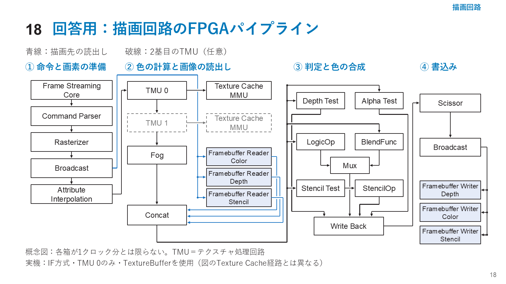

[Before／Afterの比較資料と元レポート](../../experiments/fpga-resource-comparison-20261108/README.md)

### 質問時の使い方

開発時に保存した、描画機能の追加前と追加後の使用率を比較します。BeforeはCPUと周辺回路の構成、Afterは描画・表示機能を備えた構成です。ルックアップテーブルは36.22%から50.39%、ブロックメモリは23.01%から58.63%になっています。どちらも同じFPGAに実装した回路全体について、配置配線後の記録から示しています。Afterは開発時の表示構成で、今回の動画の標準表示構成とは異なります。

補足説明と出典

比較する構成
Beforeは2026年9月8日に保存されたNexys Video対応時のCPUと周辺回路の構成、Afterは2026年11月8日の実験E8でブロック崩しの動作確認に使った描画・表示機能付きの構成である。どちらもNexys VideoのArtix-7 XC7A200T（xc7a200tsbg484-1）、Vivado 2025.2による配置配線後の記録を使う。CPU、バス、メモリ制御なども含む、FPGA内の回路全体を比較する。

Beforeの根拠
experiments/fpga-resource-comparison-20261108/before-utilization.rptに保存したレポートを使う。レポートの日付は2026年9月8日13:16:56、DesignはfpgaTop、Design StateはRoutedである。保存元は製品作業ディレクトリのfpga/generator/reports/nexysvideo_utilization.rptで、Nexys Video対応時の描画機能がない構成の記録である。レポート自体にGitリビジョンやビットストリームのハッシュは記載されていないため、特定のコミットから完全に再生成した結果とは主張しない。公開したコピーではホスト名などを伏せ、元ファイルと公開ファイルのハッシュをcomparison.jsonに区別して記録している。

Afterの根拠
experiments/basic-operation-20261108/results/implementation.jsonと、その配置配線レポートを使う。製品261832d48832dd6e26c4971ab8893ce61200688bへ研究用の表示差分を適用したE8のHDMI表示構成であり、公式RasterIX 9269a01は変更していない。差分とソースのハッシュはexperiments/basic-operation-20261108/hdmi/に記録した。今回のスライド12は標準DVI表示構成の動画であり、このAfterの回路設定データを使用していない。この表は開発時に保存した構成間の比較として示す。

比較の範囲
これは開発前後に保存した二つの実装全体の比較である。CPUのRTLなどの版やその他の実装条件を固定し、描画機能の有無だけを変えた比較実験ではない。差をすべてRasterIX単体の使用量として解釈しない。

掲載値
LUT、レジスタ、Block RAM Tile、DSPの四種類を示す。元レポートの使用率と整合する値を小数第2位まで表示する。BeforeとAfterでFPGAの資源容量が同じであることも生成時に確認する。各資源の内訳と検算用の値は、比較データと元レポートを参照できる。

出典：experiments/fpga-resource-comparison-20261108/comparison.json (historical whole-design comparison); publication/console-source.json. After bitstream SHA-256: fb0d8e9e853b51194e885662339cc0c339bdd6ea3bb19f6ca42211c14d9b87f6.

[移動用の目次へ戻る](#slide-14)

## 19. 回答用：命令実行から周辺回路への接続

質問時に参照する資料。本編の発表時間には含めません。

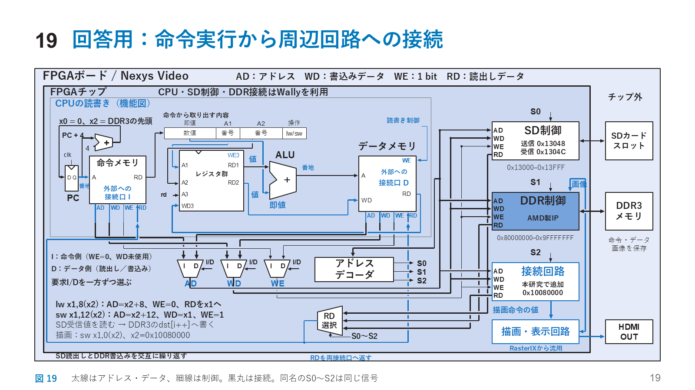

### 質問時の使い方

PCが命令の番地を出し、命令側の接続口Iから読んだ命令を解読します。レジスタ群とALUが読書きする番地と値を用意し、データ側の接続口Dから要求します。IとDの要求は一方ずつ選び、アドレスデコーダでSD制御、DDR制御、描画用の接続回路を選びます。戻りのデータも対応する回路から選び、CPUへ返します。SD受信値の読出しとDDR3への書込みを繰り返すとプログラムをコピーできます。ゲームは描画命令の値を書き込み、RasterIXがDDR3へ画像を保存して表示します。

補足説明と出典

CPUの命令実行
PC、命令メモリの箱、レジスタ群、ALU、データメモリの箱は、先の単純なCPUの横並びの配置を保つ。命令メモリとデータメモリの箱は、ここでは外部への接続口I/Dを表す。実機のローカルIROMやDTIMを有効にしたという意味ではない。実際のCPU Wallyにはパイプライン、キャッシュ、IFU、LSUなどがある。図は読書き機能を対応づけたもので、実機RTLと等価な回路図や同時刻の信号値を示す図ではない。
PC+4は分岐しない32ビット命令を順に読む例である。命令からA1、A2、A3のレジスタ番号、即値、操作の種類を取り出す。A1/A2は読出し先の番号、RD1/RD2はそのレジスタに保存された値である。rdはlwの書込み先番号で、A3へ入る。WD3はレジスタへ書く値、WE3はその許可である。x0の値は常に0。lwでは基準値と即値の和をADへ出し、返った値をレジスタへ保存する。swでは同様にADを求めるが、RD2の値をWDへ送り、レジスタへの書込みは行わない。命令のビット配置、即値生成、操作の解読と書込み許可の生成はまとめている。
図下部のlw x1,8(x2)とsw x1,12(x2)ではx2=0x80000000を例とし、それぞれDDR3の0x80000008と0x8000000Cへアクセスする。描画用の例ではx2を0x10080000に準備し直す。各行は独立した使用例であり、同じ瞬間に実行される値ではない。

接続先と応答の選択
命令メモリとデータメモリの箱は、前の説明用CPUの形と位置を引き継いだ接続口を表す。実機に二つの独立したローカルメモリを残す意味ではない。命令側は読出し専用なのでWE=0、WDは未使用として描く。データ側は読出しと書込みの両方を扱う。三つのMUXには同じ要求選択が入り、AD、WD、WEを一方の要求にそろえる。二つの出力同士をつながない。CPU WallyのebuがIFUとLSUの要求を調停する。アドレスデコーダがアドレス範囲を調べ、S0、S1、S2のうち対応する相手を選ぶ。ADの下位部分は、その回路内のレジスタやメモリ位置を指定する。接続先からのRDは読出し選択回路を通り、CPU側の両接続口へ届く。アクセスを行った側が応答を取り込む。実装では要求と応答の間に時間があるので、応答の選択には保持した選択情報を使う。この図はその機能をまとめたもので、AHB/APBやAXIの全信号、変換、待ち、キャッシュ、クロックの違いは省略する。WE=0を読む意味に使うのは有効な要求の間である。要求のない時間まで連続して読み出す意味ではない。命令側のADはPCから始まる命令読出し先、データ側のADはALUが求めた読書き先に対応する。実機はパイプラインとキャッシュを備えるため、毎命令の取得が必ず外部への要求になるわけではない。 S0、S1、S2の同名ラベルは、それぞれ同じ選択信号への接続を示す。長い制御線を図全体に重ねる代わりに、デコーダの出力、接続先の入力、RD選択の入力へ同名を付ける。要求選択のI/Dも三つのMUXに共通する。WEは1ビットで、有効な要求中の0を読出し、1を書込みとして使う。

SDコピーと描画命令
送信用レジスタ0x13048へ読出し要求を表す数値を書き、受信用レジスタ0x1304Cから届いた値を読む。CPUはこの値をDDR3の保存先へ書く。受信用レジスタのアドレスは同じまま、DDR3の保存先を1バイトずつ進める。下部のdstはDDR3の保存先、iはバイト位置を示す概念表現である。実機のSPI初期化、待ち、受信の下位8ビットの取り出し、ファイルやOSの処理は集約する。最初の起動処理はBoot ROM側から始まり、空のDDR3の命令を読み始める説明ではない。SDからDDRへ直接転送する専用DMAを新規追加したという主張ではない。
CPUが実行するswという命令と、描画回路へ送るデータとしての命令語は別のものである。OpenGL互換ライブラリが描画命令の列を作り、CPUが対応する窓口へ書き込む。OpenGLの呼出し一回がsw一回になるとは限らない。0x10080000は通常の命令語の窓口で、末尾通知、待ち、OS上のアドレス対応付けは省略する。

画像の保存と表示
RasterIXの描画回路は内部作業領域で描画し、結果をDDR制御を通して外部DDR3へ保存する。表示回路は画像を読み、映像タイミングに合わせてHDMI端子へ出す。描画・表示本体はいずれも公式RasterIXリポジトリから取得し、表示本体は同梱dvi_framebufferを利用する。共有DDRの仲裁や表示先切替、クロック変換は集約する。図の画像の双方向線は、保存・読出しに用いる複数の要求と応答をまとめたものである。画像とプログラムの領域を重ねる意味ではない。

CPU・バス・SD制御はWallyリポジトリ（CVW）の既存RTLを利用する。DDR制御はWallyリポジトリの生成・接続の仕組みを利用し、回路本体はAMD製MIG IPである。Nexys Video用の設定は本研究で追加した。標準構成の描画本体RasterIX_IFと表示本体dvi_framebufferは、同じ公式RasterIXリポジトリから取得する。表示本体はrtl/3rdParty/core_dvi_framebufferに同梱されたultraembedded由来の回路で、RasterIXの作者がすべて新規に設計したという意味ではない。バスから描画回路への変換、画面切替などの接続処理は本研究で追加した。本資料の実機動画は、RasterIX同梱の表示本体を利用する標準構成で取得した。表示本体そのものを本研究で新規設計したという主張ではない。

出典：Harris, S. L. and Harris, D., Digital Design and Computer Architecture: RISC-V Edition (2021), Chapter 7. Official figure source: https://pages.hmc.edu/harris/ddca/ddcarv.html (DDCArv_Figures.zip). Chapter 7. Harris et al., RISC-V System-on-Chip Design, Chapters 7–13, 20, 22–23. Official figure source: https://pages.hmc.edu/harris/ddca/rvsocd.html (RVSoCD_figs.zip). Chapters 9, 20, 23. Product revision 261832d48832dd6e26c4971ab8893ce61200688b. console/fpga/src/fpgaTopNexysVideo.sv; console/fpga/src/rasterix.sv; console/fpga/src/rasterix_apb.sv; console/fpga/generator/axiscdc.tcl. console/src/ebu/ebu.sv; console/src/mmu/adrdecs.sv; console/src/uncore/uncore.sv; console/fpga/zsbl; console/fpga/src/rasterix_apb.sv; console/fpga/src/rasterixdisplay.sv; console/fpga/generator/rasterixmem.tcl.
Wally upstream: https://github.com/openhwgroup/cvw . Official RasterIX: https://github.com/ToNi3141/RasterIX/tree/9269a01c9bd4c3342bfa70ef8e3cdd751c15c6d0 . RTL: console/src/wally/wallypipelinedcore.sv; console/src/uncore/uncore.sv; console/src/uncore/spi_apb.sv; console/fpga/generator/ddr3-nexysvideo.tcl; console/fpga/generator/wally.tcl; console/fpga/src/rasterixdisplay.sv. RasterIX: rtl/RasterIX/RasterIX_IF.v; rtl/3rdParty/core_dvi_framebuffer/README.md; rtl/3rdParty/core_dvi_framebuffer/src_v/dvi_framebuffer.v. Standard-output evidence: experiments/dvi-recovery-20261109/results.json.

[移動用の目次へ戻る](#slide-14)

## 20. 回答用：詳細な全体のブロック図

質問時に参照する資料。本編の発表時間には含めません。

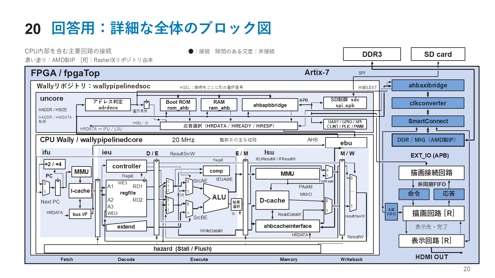

### 質問時の使い方

RVSOCのパイプライン図を基にした全体図です。PC、レジスタ群、ALU、段間レジスタ、書戻しの経路を保ち、実機のメモリ接続と本研究の描画接続を付け加えています。質問に応じて関係する経路をたどります。

補足説明と出典

図の範囲
RVSOC図7.11のパイプライン配置、図9.20のSoC階層、図9.28のアドレス判定と応答選択を基に、実機構成の主要な接続を示す。CPU・描画側の接続は製品リビジョン261832d48832dd6e26c4971ab8893ce61200688b、構成fpganexysvideo_rasterixを基にする。表示回路はRasterIXに同梱されたdvi_framebufferと、本研究の接続・制御ラッパーをまとめて示す。PC、レジスタ群、ALU、段間レジスタ、書戻しの位置関係を保つ。図は機能を追うためのブロック図であり、全RTLと等価な回路図や、物理配置図ではない。細長い箱はレジスタ、台形はMUX、切欠きのある記号はALUを表す。接続点の丸がない交差は接続を意味しない。同名のHRDATAとFlagsEは、線を引き回さず同じ信号への接続を示している。

アドレス判定と応答選択
ebuは命令側IFUとデータ側LSUの要求を仲裁して、HADDRや読み書きの要求を出す。HADDRは接続先にもadrdecsにも渡る。adrdecsはアドレスとアクセス幅を調べ、各領域を選ぶHSEL信号を出す。読み書きするデータを保存したり、中継したりする回路ではない。図のHSELの線は複数の選択信号をまとめた線で、Boot ROM、RAM、APB周辺回路、外部DDRメモリを同じ1ビットで一斉に選ぶ意味ではない。RTLではadrdecsのSelRegionsをHSELRegionsとして受け、HSELBootRom、HSELRam、HSELEXTなどに分ける。HSIZE[1:0]もadrdecsへ入力する。
読み書きには要求を受け付けてから応答するまで時間がかかるため、uncoreには選択情報を保持するレジスタと、返ってきた応答を選ぶ論理がある。図の「選択保持」と「応答選択」はこれらをまとめた表記である。HRDATAは選択された読み出しデータで、wallypipelinedcore内のIFUとLSUへ直接配られる。HRDATA自体はebuを通らない。HREADYとHRESPはebuへ戻る。HREADYは要求の進行に使われる。この版のebuはHRESPを入力端子として受けるが、内部では参照していない。HREADYは接続先や選択保持レジスタにも戻るが、その配線は省略する。AHBの要求線はアドレス、書込みデータ、制御の束であり、一つの電気信号ではない。

メモリと周辺回路
uncoreにはrom_ahbによるBoot ROMとram_ahbによるRAMがある。外付けDDR3への要求はHSELEXTで選び、ahbaxibridge、clkconverter、共有メモリ接続、MIGを通す。APB接続ではahbapbbridgeが周辺回路ごとの選択をPSELへ引き継ぎ、PRDATAとPREADYから応答を選ぶ。
SDカードにつながるのはsdcというインスタンスで、使うモジュールはspi_apbである。PSEL[5]で選択し、SDCCmd、SDCIn、SDCCLK、SDCCSをカードへつなぐ。別のspiインスタンスとは区別する。描画用の外部APB窓口はPSEL[7]をPSELEXTとして取り出し、rasterix_apbへつなぐ。UART、GPIO、通常のSPI、CLINT、PLIC、PWMは図では一つの箱にまとめる。IROMとDTIMは実機構成では無効なので、命令側とデータ側にはキャッシュとバス接続を示す。

CPU内部
レジスタ群から読み出した二つの値は段間レジスタを通り、3入力MUXで、その値、Writeback段のResultW、Memory段のIFResultMから選ぶ。その後の2入力MUXがPCや即値との選択を行う。比較器compのFlagsEはcontrollerへ渡る。ALUのアドレス出力と演算結果は別の経路である。演算結果側の「結果選択」はaltresultmuxとieuresultmuxをまとめており、「他」の入力には即値またはPCLinkEを使う経路を含む。Memory段ではFIntResMとの選択がある。これらを経た結果はM/Wレジスタを通って書戻し側へ進む。制御信号ResultSrcWと、演算結果のデータ線は別々である。
WriteDataMは、キャッシュを使う書込みではD-cacheへ、使わない書込みではahbcacheinterfaceへ届く。図では書込み値の整形、バイト選択、アトミック処理などをまとめる。読み出し値はキャッシュ側と非キャッシュ側から選ばれ、値の整形と保持処理を経てReadDataWになる。IFUの非キャッシュ命令の選択、圧縮命令の展開、予測、例外、MMU・キャッシュ内部は省略する。regfileのクロック入力の丸は立下りでの書込みを示す。段間レジスタは立上りで状態を更新する。レジスタ書込み先RdW、RegWriteW、MUXの選択信号、ハザードの入力など、すべての制御配線は描いていない。FPU・MDU・CSRの内部や、書戻し前の追加の結果選択も省略する。

描画と表示
描画接続回路はrasterix_apb、描画回路はRasterIX_IF、表示回路はrasterixdisplayに対応する。命令と応答の二つのaxiscdcは、20 MHzのCPU側と100 MHzの描画側をつなぐ。矢印はデータの進む向きを示し、逆向きのreadyなどは省略する。表示先の通知と切替完了は、描画回路と表示回路の間の制御情報である。画素をこの線で直接渡すわけではない。
CPUと描画回路は読出し・書込み、表示回路は読出し要求と画素の応答を、共有DDR3接続でやり取りする。図のSmartConnectと、描画回路の横のAXI FIFOはrasterixmem_wrapperに含まれる。後者はgpubufferであり、命令・応答のaxiscdcとは別のFIFOである。表示用AXIは、今回の標準構成では25.2 MHzである。SmartConnect側が100 MHz側との接続も扱う。描画接続回路、二つのaxiscdc、RasterIX_IF、rasterixdisplay、rasterixmem_wrapperはrasterixラッパーの内部にあるが、この外枠は省略する。映像は表示回路と差動出力を経てHDMI OUT端子から出る。状態通知の同期回路、映像クロック生成、リセット配線、割込み配線は省略する。

色の意味
詳細図の信号線と枠は黒で示す。CPU内部の各部分を本編で説明済みとして色分けしない。濃い塗りはAMD提供IP、薄い青の背景はFPGAや機能単位のまとまりを示す。

CPU・バス・SD制御はWallyリポジトリ（CVW）の既存RTLを利用する。DDR制御はWallyリポジトリの生成・接続の仕組みを利用し、回路本体はAMD製MIG IPである。Nexys Video用の設定は本研究で追加した。標準構成の描画本体RasterIX_IFと表示本体dvi_framebufferは、同じ公式RasterIXリポジトリから取得する。表示本体はrtl/3rdParty/core_dvi_framebufferに同梱されたultraembedded由来の回路で、RasterIXの作者がすべて新規に設計したという意味ではない。バスから描画回路への変換、画面切替などの接続処理は本研究で追加した。本資料の実機動画は、RasterIX同梱の表示本体を利用する標準構成で取得した。表示本体そのものを本研究で新規設計したという主張ではない。

出典：Harris et al., RISC-V System-on-Chip Design, Chapters 7–13, 20, 22–23. Official figure source: https://pages.hmc.edu/harris/ddca/rvsocd.html (RVSoCD_figs.zip). Figure 7.11 (pipeline datapath), Figures 9.20 and 9.28 (uncore, decoding and return selection), Chapters 10–13 and 23. Product revision 261832d48832dd6e26c4971ab8893ce61200688b. console/fpga/src/fpgaTopNexysVideo.sv; console/fpga/src/rasterix.sv; console/fpga/src/rasterix_apb.sv; console/fpga/generator/axiscdc.tcl. console/src/wally/wallypipelinedcore.sv; console/src/uncore/uncore.sv; console/src/ieu/datapath.sv; console/src/ifu/ifu.sv; console/src/lsu/lsu.sv. console/src/mmu/adrdecs.sv; console/src/uncore/ahbapbbridge.sv; console/src/ebu/ebu.sv; console/src/ieu/regfile.sv; console/config/derivlist.txt; console/fpga/generator/rasterixmem.tcl; console/fpga/src/rasterixdisplay.sv.
Wally upstream: https://github.com/openhwgroup/cvw . Official RasterIX: https://github.com/ToNi3141/RasterIX/tree/9269a01c9bd4c3342bfa70ef8e3cdd751c15c6d0 . RTL: console/src/wally/wallypipelinedcore.sv; console/src/uncore/uncore.sv; console/src/uncore/spi_apb.sv; console/fpga/generator/ddr3-nexysvideo.tcl; console/fpga/generator/wally.tcl; console/fpga/src/rasterixdisplay.sv. RasterIX: rtl/RasterIX/RasterIX_IF.v; rtl/3rdParty/core_dvi_framebuffer/README.md; rtl/3rdParty/core_dvi_framebuffer/src_v/dvi_framebuffer.v. Standard-output evidence: experiments/dvi-recovery-20261109/results.json.

[移動用の目次へ戻る](#slide-14)

## 21. 回答用：描画回路のFPGAパイプライン

質問時に参照する資料。本編の発表時間には含めません。

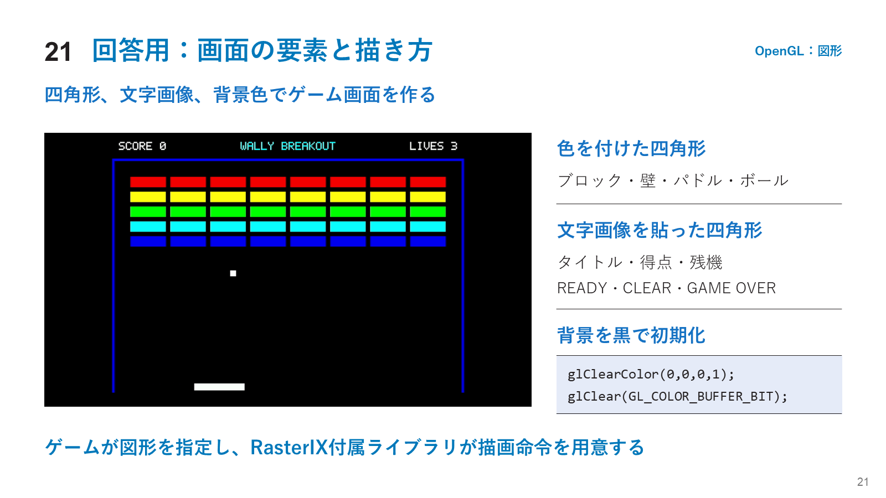

### 質問時の使い方

左から、命令の解釈と画素の準備、画素の色の計算、書き込むかどうかの判定、画像の書込みの順に追います。青線は、描画先にすでに保存されている色・深度・ステンシル値を、色の計算と並行して読む経路です。Concatで計算結果と読み出した値を対応づけ、判定や色の合成に使います。これは最新の公式資料を横長に描き直した概念図です。今回の実機はTMUが1基で、テクスチャの保存方式も図のTexture Cacheとは異なります。

補足説明と出典

この図は、公式RasterIXリポジトリのREADMEにある「FPGA pipeline」の処理と接続関係を、回答用に横長へ配置し直したものである。2026年11月8日に確認したmainの先頭は3e2ee5aa5214b829c2a824250c445ce799ac8dc0である。回路の概念的な処理経路を示しており、一つの箱が必ず1クロックで完了するという意味ではない。配線はデータの処理・参照関係を示し、全ポート、制御信号、待ち合わせ回路を網羅しない。

① Frame Streaming Coreは、ドライバから届く転送データを扱う入口である。ここでいうFrameは通信上のまとまりであり、HDMIへ映像を送り出す表示回路を指さない。Command Parserが描画命令を解釈し、Rasterizerが三角形について処理する画素の位置を求める。Broadcastから、属性の計算と描画先の読出しの両方へ情報を送る。Attribute Interpolationは、頂点で指定した色やテクスチャ座標などから、画素ごとの値を求める。

② TMUはTexture Mapping Unitであり、テクスチャから色を得て画素の色の計算に使う。TMU 1とそれに対応するTexture Cache / MMUは2基構成の場合の経路であり、破線で示す。元図と同じくTMUからキャッシュへ向かう線は参照関係を表し、読み出し結果を戻す全配線を描いたものではない。Fogは距離に応じた色の混合を行う。青線側のFramebuffer Readerは、同じ画素位置に保存済みのColor（色）、Depth（深度）、Stencil（マスク等の判定に使う値）を読む。Concatで色の計算結果とこれらの値をまとめる。「色の計算が終わってからメモリを読み始める」という直列の図ではない。

③ Concatの出力は、Depth Test、Alpha Test、LogicOp、BlendFunc、Stencil Testへ分かれる。Depth Testは既存の深度との比較、Alpha Testは画素のアルファ値の条件判定を行う。LogicOpは色のビット論理演算、BlendFuncは描く色と保存済みの色を混合する処理であり、Muxが使用する色を選ぶ。Stencil TestとStencilOpは、ステンシル値による条件判定とその更新を扱う。Write Backは判定結果と書き込む値をまとめる。五つの処理を順番に通過する直列回路としては描かない。

④ Scissorは指定した長方形の描画範囲を確認し、BroadcastからDepth、Color、Stencilの各Framebuffer Writerへ分配する。これは描画先へ書くまでの説明であり、保存した色を読み出してHDMI端子へ送る表示回路はこの図の外にある。

実機との対応：本研究の製品側が参照するRasterIXは9269a01c9bd4c3342bfa70ef8e3cdd751c15c6d0であり、この図の取得に合わせて回路を更新したわけではない。rasterix.svはRasterIX_IFをTMU_COUNT=1で使用するため、TMU 1は実装しない。ENABLE_EXTERNAL_TEXTURE_MEMORYは既定値0のままなので、テクスチャにはTextureBufferの経路を使う。最新公式図のTexture Cache / MMUを今回の実機の構成と同一視しない。IF方式では描画途中の画像を内部フレームバッファに置くため、図のFramebuffer Reader / Writerをそれぞれ直接のDDRアクセスと解釈しない。Depth、Stencil、Fogなどの箱が図にあることは、ブロック崩しの各描画でそれらを有効に使っているという主張ではない。

出典：ToNi3141/RasterIX, README "FPGA pipeline" and pictures/fpgaFlow.drawio.png, main revision 3e2ee5aa5214b829c2a824250c445ce799ac8dc0 (checked 2026-11-08). https://github.com/ToNi3141/RasterIX/blob/3e2ee5aa5214b829c2a824250c445ce799ac8dc0/pictures/fpgaFlow.drawio.png . GPL-3.0-or-later. Current console: console/fpga/src/rasterix.sv; RasterIX revision 9269a01c9bd4c3342bfa70ef8e3cdd751c15c6d0, rtl/RasterIX/RasterIX_IF.v and RasterIXRenderCore.v.

[移動用の目次へ戻る](#slide-14)

## 動作確認と詳しい実装

12枚目の動画は、[標準表示構成の30秒の実機記録](../../experiments/dvi-recovery-20261109/README.md)です。最新の文字配置のゲームを実行し、ボールの移動・反射とブロック消去を確認しました。これは自動プレイであり、コントローラによる操作ではありません。取得条件と構成の版は再現資料に保存しています。

詳しい実装と再現手順は[技術付録](../thesis/技術付録.md)にまとめています。コントローラへの対応やホーム画面などのGUIの充実は今後の拡充候補です。

## 図と書式の出典

主図はアブストと製品RTLを基にした機能図です。書式はRVSOCの図7.11・9.28・23.2を参考にしています。回答用の詳細な回路図、教科書の採用例、FPGAの構成要素・使用量、描画回路の内部については、それぞれのスライドの出典と補足を参照してください。[デザインと再生成方法](../../source/presentation/board-evolution/README.md)に実装箇所をまとめています。

## 以前の発表資料

命令の実行から順に説明した版は、[変更前のコミット40d8a51](https://github.com/SoshiroFujimori/wally-game-console-research/tree/40d8a51bd1ab0d9c9a469146c349cd31b173bdce/docs/presentation)に保存されています。命令の実行から周辺回路へつながる図は、現在の回答用19枚目に統合しています。外部メモリへの接続は、二つのメモリの箱を接続口として残し、AD・WD・WE・RDとアドレスデコーダで示します。
