# 中間発表のスライドと発表原稿

本編10枚と質問用1枚で、CPUの命令実行からゲーム画面の出力までを説明します。2枚目のlwの図を出発点に、同じ位置の回路を使ってPCの更新、sw、バス、SDカード、RasterIX、映像出力をたどります。

[PowerPoint版](中間発表_主要事項.pptx) / [アブスト](../abstract/アブスト_主要事項.md) / [論文本文](../thesis/本文.md) / [技術付録](../thesis/技術付録.md) / [図の出典・再生成](../../source/presentation/README.md)

## 図の見方

2枚目では実際のlwの命令ビットを示します。3枚目以降は、命令から取り出す即値やレジスタ番号をまとめて並べます。この並びは、実際の機械語のビット配置ではありません。PC、レジスタ群、ALUの位置を保ち、4枚目で命令とデータの両方をDDR3へつなぎます。左の命令メモリの箱は、その時点で命令側の接続回路へ置き換えます。

太い線は値や複数の信号の経路、細い線は制御を表します。三角記号を付けた端子はクロック入力です。青は説明で注目する経路です。バスの線をまとめて描くことは、電気的に別の信号を短絡することを意味しません。

5枚目では、CPUがSD制御回路へ読出しを指示し、受信した値を読み、DDR3へ書く処理を説明します。コピーしたプログラムの実行は4枚目と同じ経路です。8枚目のFPGAへの実装にも同じ簡略図を使います。

## 発表時間と質問用スライド

本編の説明に335秒を配分し、6分のうち25秒を図示と切替の余裕とします。時間は配分案で、練習の実測ではありません。11枚目の詳細なWally図は質問用です。PowerPointでは非表示スライドに設定しているため、通常のスライドショーでは本編10枚だけを表示します。編集画面や「すべてのスライドを表示」から11枚目を選ぶと質問時に参照できます。

## 目次

- [1. FPGAを用いた二次元ゲーム機の設計と実装](#slide-1)
- [2. lw：命令を読み、指定した値をレジスタへ入れる](#slide-2)
- [3. sw：PCを進め、レジスタの値をメモリへ書く](#slide-3)
- [4. 命令もデータも、バスを通してDDR3へつなぐ](#slide-4)
- [5. SDカードのプログラムを、CPUがDDR3へ移す](#slide-5)
- [6. RasterIXを追加し、swで描画命令を渡す](#slide-6)
- [7. 画像をDDR3へ保存し、HDMI端子へ出力する](#slide-7)
- [8. 説明した回路を、FPGAに実装する](#slide-8)
- [9. 接続した構成で、ブロック崩しを動かした](#slide-9)
- [10. Wallyをゲーム機へ拡張する設計例を示した](#slide-10)
- [11. 質問用：Wallyの内部構成](#slide-11)（質問用）

## 1. FPGAを用いた二次元ゲーム機の設計と実装

説明時間の配分：5秒

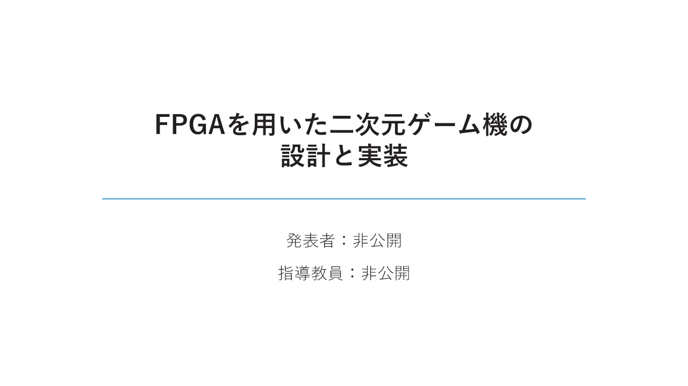

### 発表原稿

この題目で発表します。

補足説明と出典

表紙は題目と発表者・指導教員の情報のみを示す。公開版は個人情報を伏せる。

## 2. lw：命令を読み、指定した値をレジスタへ入れる

説明時間の配分：60秒

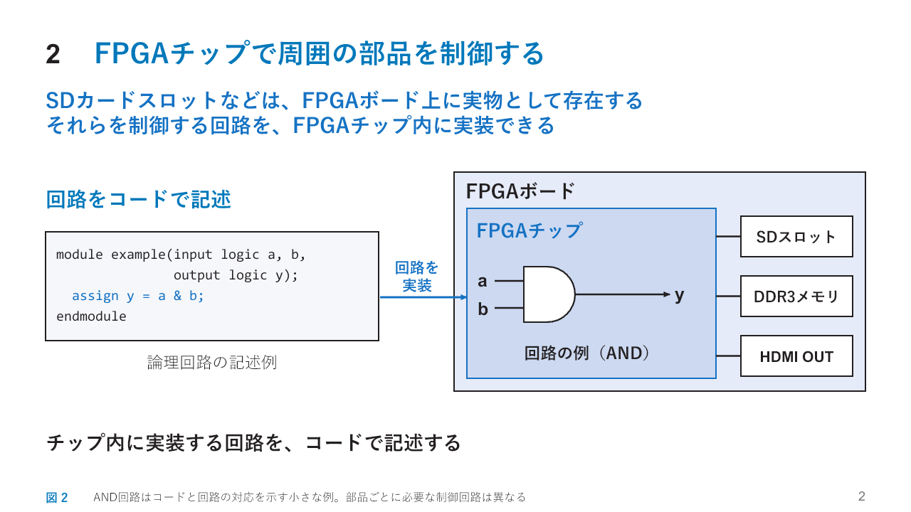

### 発表原稿

PCから現在の命令の番地が出ます。ここでは0なので、命令メモリは0番地のlw x1, 8(x0)を出します。これは、常に0であるx0の値に8を足し、その番地の値をx1へ読む命令です。実際の命令は上の32ビットです。19から15ビットの00000がA1に入り、レジスタ群はx0の値0を出します。31から20ビットの000000001000は8で、これもALUへ入ります。ALUは0足す8で番地8を作ります。そこに3があれば、メモリから3が戻ります。11から7ビットの00001は書込み先x1を選び、3を保存します。

補足説明と出典

説明用の単純なCPUであり、現在のWallyの全回路を示す図ではない。命令メモリの0番地には32ビット命令lw x1,8(x0)があり、データメモリの8番地には32ビット値3があるとする。命令の格納先0とデータの読出し先8を区別する。命令の機械語は0x00802083。I形式の[31:20]=000000001000（即値8）、[19:15]=00000（rs1=x0）、[14:12]=010、[11:7]=00001（rd=x1）、[6:0]=0000011。A1は読出しレジスタ番号、RD1はそのレジスタの値であり、番号0と値0は役割が異なる。x0は読出すと常に0になる。A3は書込み先番号、WD3は書く値、WE3は書込許可を表す。lwではメモリへの書込みは行わず、読んだ値をレジスタへ書く。今回は正の即値8だけを使うため、即値の幅を広げる回路、命令を解読して許可信号を作る回路、PCの次の値を作る回路は図示しない。線が交差しても接続点として示していない場所ではつながらない。灰色の経路はこの命令で使用しない。

出典：Harris, S. L. and Harris, D., Digital Design and Computer Architecture: RISC-V Edition (2021), Chapter 7. Official figure source: https://pages.hmc.edu/harris/ddca/ddcarv.html (DDCArv_Figures.zip). Chapter 7, single-cycle load datapath. RISC-V unprivileged ISA, RV32I load instruction format.

## 3. sw：PCを進め、レジスタの値をメモリへ書く

説明時間の配分：45秒

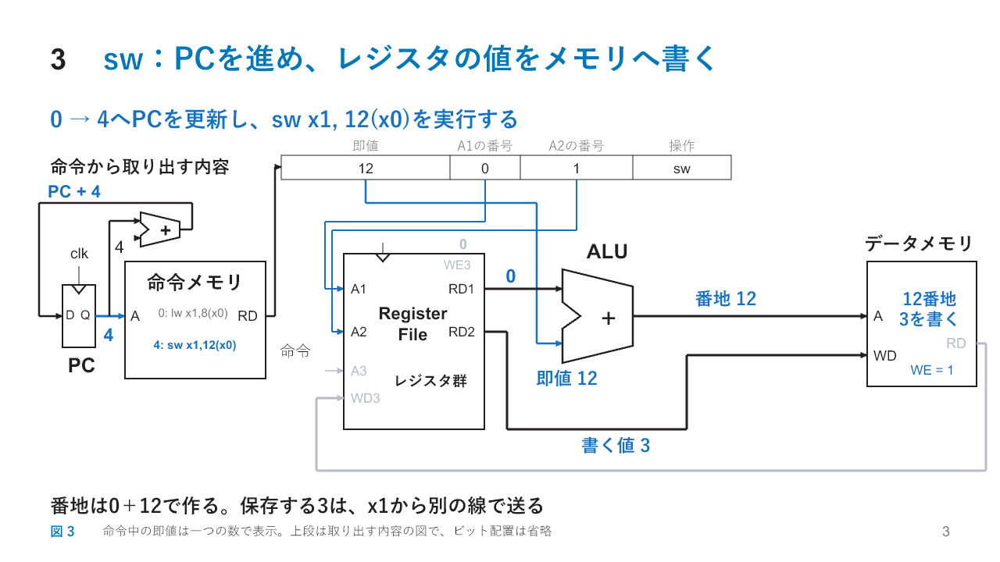

### 発表原稿

同じ図に、PCへ4を足して戻す回路を加えます。前の命令の終了時に、PCは0から4へ進みます。次に読むのは4番地のsw x1, 12(x0)です。命令から取り出した番号0がA1に、番号1がA2に入り、x0の0とx1の3が出ます。ALUには0と命令中の12を入れ、書く番地12を作ります。一方、保存する3は、x1からALUを通らない別の線でメモリへ送ります。書込みを許可すると12番地に3が保存されます。このように、番地を作る処理と、書く値を送る処理があります。

補足説明と出典

図はPC=4でswを実行している状態であり、加算器が用意する次の番地は4+4=8である。32ビットで分岐しない命令だけを例にする。図の上部は命令から取り出す内容を整理した表示で、実際の32ビット内の配置を示すものではない。即値12を一つの数として示し、ビット位置や取り出し方は展開しない。A1は基準値を読むレジスタ番号、A2は書く値を読むレジスタ番号である。swではレジスタへの書込みを許可せず、メモリへの書込みを許可する。PC、命令メモリ、レジスタ群、ALU、データメモリは前の図と同じ位置に置く。

出典：Harris, S. L. and Harris, D., Digital Design and Computer Architecture: RISC-V Edition (2021), Chapter 7. Official figure source: https://pages.hmc.edu/harris/ddca/ddcarv.html (DDCArv_Figures.zip). Chapter 7, sequential PC update and store datapath.

## 4. 命令もデータも、バスを通してDDR3へつなぐ

説明時間の配分：45秒

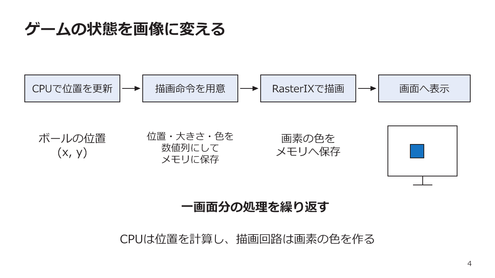

### 発表原稿

命令を読む側も、データを読み書きする側も、バスへつなぎます。右のDDR3には、プログラムの命令と、その処理に使うデータを置きます。まずPCの番地を命令側の接続回路へ渡し、バスを通してDDR3から命令を読みます。戻った命令からレジスタ番号や即値を取り出し、先ほどと同じレジスタ群とALUで処理します。lwならALUが作った番地の値をバス経由で読み、レジスタへ戻します。swならレジスタの値をバス経由で書きます。PCを更新すると、次の命令でもこの流れを繰り返します。

補足説明と出典

左の独立した命令メモリを、同じ場所の命令側接続回路に置き換える。命令の要求と戻りを別々の線でバスにつなぎ、右のDDR3を命令とデータの保存場所として示す。図は機能を追うための簡略図で、CPUの全回路や毎サイクルの動作を表さない。実機の構成はIROM_SUPPORTED=0、DTIM_SUPPORTED=0、ICACHE_SUPPORTED=1、DCACHE_SUPPORTED=1であり、すべての命令を毎回DDR3へ取りに行くという意味ではない。命令とデータの経路の仲裁、保存した内容の再利用、番地変換、応答待ちなどの内部は展開しない。0・4・8・12は前の説明用の番地であり、実機のDDR3領域は0x80000000から始まる。バスの線は複数の信号をまとめたもので、各信号を短絡する意味ではない。

出典：Harris et al., RISC-V System-on-Chip Design, Chapters 7–13, 20, 22–23. Official figure source: https://pages.hmc.edu/harris/ddca/rvsocd.html (RVSoCD_figs.zip). Chapters 9 and 23. Product revision 261832d48832dd6e26c4971ab8893ce61200688b. console/fpga/src/fpgaTopNexysVideo.sv; console/fpga/src/rasterix.sv; console/fpga/src/rasterix_apb.sv; console/fpga/generator/axiscdc.tcl.

## 5. SDカードのプログラムを、CPUがDDR3へ移す

説明時間の配分：55秒

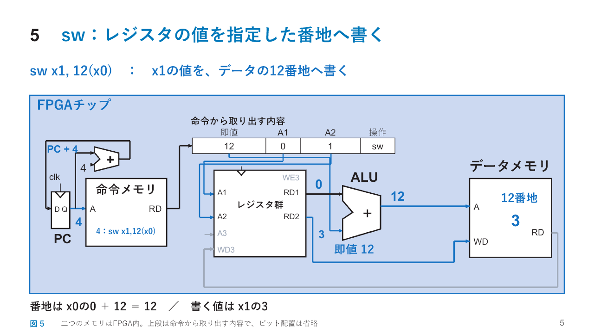

### 発表原稿

このバスへSDカードの制御回路を加えます。電源を切っても残したいゲームプログラムはSDカードに保存しておきます。実行前に、CPUが読込み用のプログラムを動かします。まずSD制御回路の決められた番地へ書き込み、カードからの読み出しを指示します。制御回路がカードと通信し、データを受け取ります。次にCPUが受取り用の番地を読むと、そのデータがバスを通ってCPUのレジスタへ戻ります。続いて、その値をDDR3の番地へ書きます。これを繰り返すと、プログラムがDDR3へコピーされます。準備ができたら、実行する命令の番地をPCに入れます。以後は前のスライドの経路で、DDR3上の命令を読んで実行します。

補足説明と出典

読み出しを指示する書込み、受信した値の読出し、DDR3への保存をCPUの仕事として説明する。SDカードからDDR3へ直接転送する専用回路を新たに設けたという図ではない。製品のSPI制御回路では受信データの読出しレジスタを介してCPUが値を受け取る。カードとの通信、ブロック単位の処理、ファイルの解釈、バッファ間のコピーなどの詳細は省略する。受信した1バイトに対して実際に必ずlwを1回、swを1回使うという実装の断定ではなく、CPUの読出しと書込みによる移動をまとめている。最初の読込みを始める処理は起動用のプログラムが担い、CPUが空のDDR3からゲームを読み始めるという説明ではない。ゲームの開始番地へ制御を移す細部は省略し、準備とゲームの実行を分けて説明する。

出典：Harris et al., RISC-V System-on-Chip Design, Chapters 7–13, 20, 22–23. Official figure source: https://pages.hmc.edu/harris/ddca/rvsocd.html (RVSoCD_figs.zip). Chapters 20 and 23. Product revision 261832d48832dd6e26c4971ab8893ce61200688b. console/fpga/src/fpgaTopNexysVideo.sv; console/fpga/src/rasterix.sv; console/fpga/src/rasterix_apb.sv; console/fpga/generator/axiscdc.tcl. console/src/uncore/spi_apb.sv; console/fpga/zsbl.

## 6. RasterIXを追加し、swで描画命令を渡す

説明時間の配分：40秒

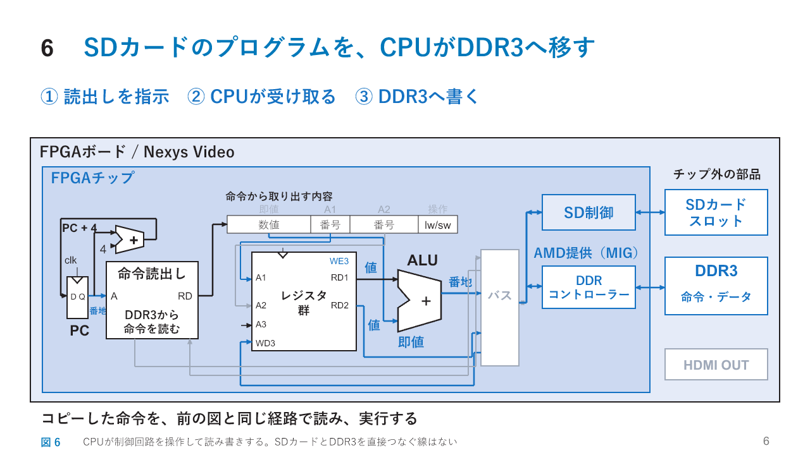

### 発表原稿

ここへ、本研究で描画用の接続回路とRasterIXを加えました。描画用の窓口にも番地を割り当てるので、先ほどのswで操作できます。例えばx2に窓口の番地B、x1に送りたい数値Dを用意します。sw x1, 0(x2)では、ALUがB足す0で番地Bを作り、x1のDを別の線で送ります。番地Bの相手はDDR3ではなく描画用の窓口なので、DをRasterIXへ渡します。描画用ソフトウェアが用意した数値列をこのように送ります。CPUが実行するsw命令と、データとして送る描画命令は別のものです。

補足説明と出典

既存CPUと公式RasterIXを利用し、その間の接続を設計した。上部には即値0、基準値を読む番号2、書く値を読む番号1を、取り出した内容として並べる。実際の機械語のビット配置は示さない。x2とx1への値の準備は省略し、レジスタ割当ては説明用とする。BはCPUから見た窓口の番地で、物理アドレスと必ず同じ値とは限らない。Dは描画命令の数値列の一語であり、RISC-V命令のswの機械語ではない。OpenGLの1回の呼出しがそのまま1回のswに対応するという意味でもない。接続回路の内部の規約や時刻合わせは一つの箱にまとめる。RasterIXによる画像の保存と表示の経路は次の図で追加する。

出典：Product revision 261832d48832dd6e26c4971ab8893ce61200688b. console/fpga/src/fpgaTopNexysVideo.sv; console/fpga/src/rasterix.sv; console/fpga/src/rasterix_apb.sv; console/fpga/generator/axiscdc.tcl. console/examples/rasterix/WallyBusConnector.hpp; console/fpga/src/rasterix_apb.sv.

## 7. 画像をDDR3へ保存し、HDMI端子へ出力する

説明時間の配分：30秒

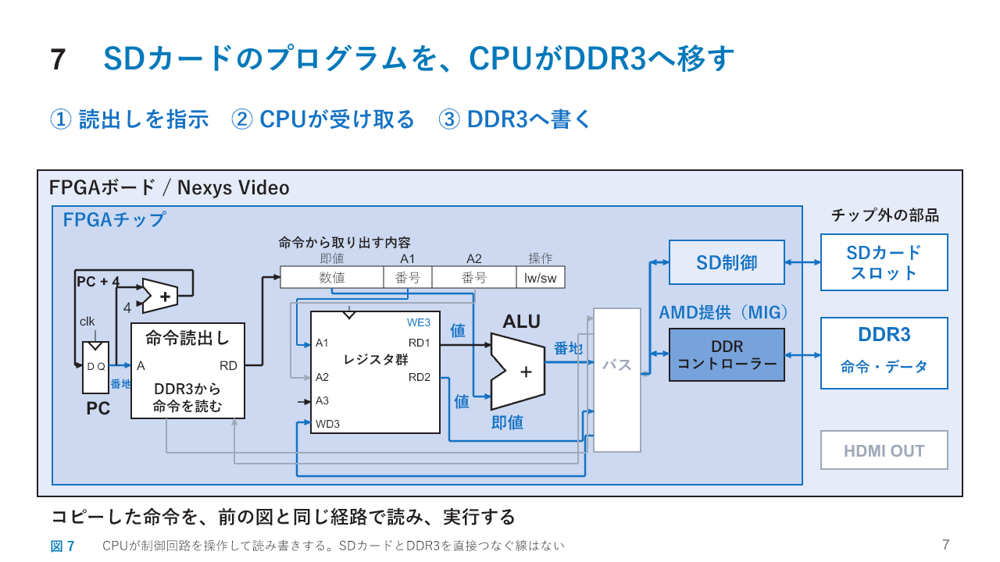

### 発表原稿

RasterIXは描画命令に従って、画面の各点の色を求めます。この一つひとつの点が画素です。作った画像は、DDR3の中でプログラムとは別に用意した領域へ保存します。表示回路はその画素の色を順に読み、画面に表示するためのタイミングに合わせてHDMI端子へ出します。CPUはゲームの処理と描画命令の送信、RasterIXは画像の作成、表示回路は画像の出力を担当します。

補足説明と出典

RasterIXのメモリへの書込み経路と、表示回路による読出し経路を同じ図へ加える。RasterIX_IFは内部の作業領域で描画し、結果を外部メモリへ転送する。内部作業領域、テクスチャ読出し、表示画像の切替、メモリ仲裁や映像符号化の内部は省略する。画像用とプログラム用にはDDR3内の別の範囲を確保する。右側の線はメモリ制御を含めた接続で、DDR3チップへの直接の電気配線を意味しない。表示回路は表示タイミングに従って読み出す。CPUの書込み1回ごとに画面全体を一回表示するものではない。

出典：Product revision 261832d48832dd6e26c4971ab8893ce61200688b. console/fpga/src/fpgaTopNexysVideo.sv; console/fpga/src/rasterix.sv; console/fpga/src/rasterix_apb.sv; console/fpga/generator/axiscdc.tcl. console/fpga/src/rasterixdisplay.sv; console/fpga/generator/rasterixmem.tcl; console/addins/rasterix/rtl/RasterIX/RasterIX_IF.v.

## 8. 説明した回路を、FPGAに実装する

説明時間の配分：25秒

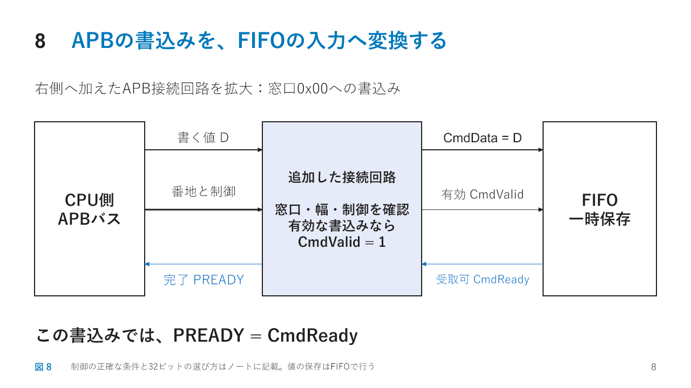

### 発表原稿

ここまでの回路の接続を、HDLという言語で記述します。例えばPCは、クロックの立上りで次の番地を取り込むレジスタとして書けます。設計ツールがこの記述からFPGA用の構成データを作ります。それを写真のFPGAチップへ設定すると、CPUや接続回路、描画回路が動きます。DDR3やSDカードはチップの外にあり、チップ内の回路からつながっています。

補足説明と出典

本編と同じ簡略図を一様に縮小して配置し、詳細なWally図への置換は行わない。回路図とHDLは接続や動作を表現する方法であり、図からHDLを自動生成した実験ではない。右のalways_ffはPCの動作を示す説明用の断片で、製品ソース全体ではない。初期化や分岐時の選択は省略する。HDLを合成・配置配線して、FPGA内部の論理と配線を設定する構成データを生成する。これはSDカードに保存したゲームプログラムをCPUが実行する経路とは異なる。図のDDR3、SDカード、HDMI端子はチップ外の機器や端子であり、図全体を一つのチップ内へ保存するという意味ではない。写真の中央の放熱器の下にArtix-7 FPGAがある。写真はDigilentの製品写真である。詳細なWallyの回路図は最後の質問用スライドに分ける。

出典：Harris, S. L. and Harris, D., Digital Design and Computer Architecture: RISC-V Edition (2021), Chapter 7. Official figure source: https://pages.hmc.edu/harris/ddca/ddcarv.html (DDCArv_Figures.zip). Harris et al., RISC-V System-on-Chip Design, Chapters 7–13, 20, 22–23. Official figure source: https://pages.hmc.edu/harris/ddca/rvsocd.html (RVSoCD_figs.zip). Chapter 23. Product revision 261832d48832dd6e26c4971ab8893ce61200688b. console/fpga/src/fpgaTopNexysVideo.sv; console/fpga/src/rasterix.sv; console/fpga/src/rasterix_apb.sv; console/fpga/generator/axiscdc.tcl. Digilent, Nexys Video product photograph: https://digilent.com/shop/nexys-video-amd-artix-7-fpga-trainer-board-for-multimedia-applications/ . Board identification: Nexys Video Reference Manual (2020), pp.3-4. Image copyright Digilent.

## 9. 接続した構成で、ブロック崩しを動かした

説明時間の配分：20秒

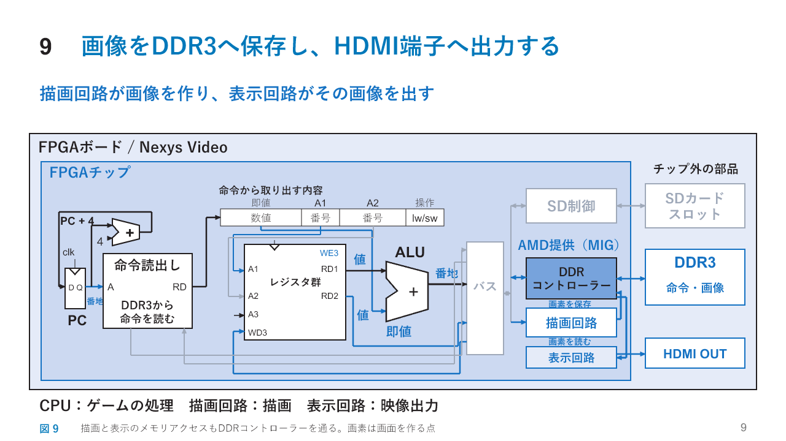

### 発表原稿

この構成で640掛ける480画素のブロック崩しが動きました。四つの条件で期待画像との一致を確認しました。さらに5分間の自動プレイを記録し、別の試行では30秒の映像を確認しました。現在は自動操作で、専用コントローラーの接続はこれからです。

補足説明と出典

4条件は3種類の描画条件と再起動後の1条件。これらの条件で全画面を期待画像と比較した。5分の記録は300.011秒の自動プレイで、30秒の取得映像とは別試行。動画のフレーム数をゲームFPSとして用いていない。ゲームには描画負荷を軽減する実装を含むが、この案はその最適化の優劣を主張しない。録画の取得経路は実験環境であり、ゲーム機の公開構成と分けている。映像を受信できない場合の条件の特定は残っており、全ての表示機器での互換性を確認したわけではない。専用コントローラーは将来項目で未検証。資料は既存実験E6の結果を示し、新たな実機計測を行ったという意味ではない。

出典：docs/thesis/再現資料/実験記録/E6/fresh-product/qualification/qualification.json; docs/thesis/再現資料/実験記録/E6/report/results/video/validation.json. Photograph: docs/thesis/figs/fifo-study-game.png. Product revision 261832d48832dd6e26c4971ab8893ce61200688b. console/fpga/src/fpgaTopNexysVideo.sv; console/fpga/src/rasterix.sv; console/fpga/src/rasterix_apb.sv; console/fpga/generator/axiscdc.tcl.

## 10. Wallyをゲーム機へ拡張する設計例を示した

説明時間の配分：10秒

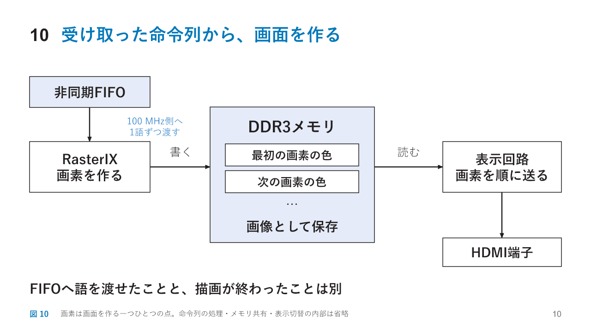

### 発表原稿

既存の読み書きの仕組みに接続回路を加え、描画命令を渡せるようにしました。Wallyを拡張する学習者に向けた設計例です。次は専用コントローラーで操作できることを確認します。

補足説明と出典

学習者向けの拡張例としての利用を想定しているが、教育効果を学習実験で評価したわけではない。CPUやRasterIX本体を新たに設計したという主張ではなく、既存回路間をつなぐアダプタ、メモリ接続、切替制御とソフトウェア側の接続を実装した。専用コントローラーは未実装・未検証であり今後の項目。実機の結果は実験E6に基づく。

出典：Product revision 261832d48832dd6e26c4971ab8893ce61200688b. console/fpga/src/fpgaTopNexysVideo.sv; console/fpga/src/rasterix.sv; console/fpga/src/rasterix_apb.sv; console/fpga/generator/axiscdc.tcl. docs/thesis/再現資料/実験記録/E6/fresh-product/qualification/qualification.json; docs/thesis/再現資料/実験記録/E6/report/results/video/validation.json. Photograph: docs/thesis/figs/fifo-study-game.png.

## 11. 質問用：Wallyの内部構成

質問時に参照する資料。本編の発表時間には含めません。

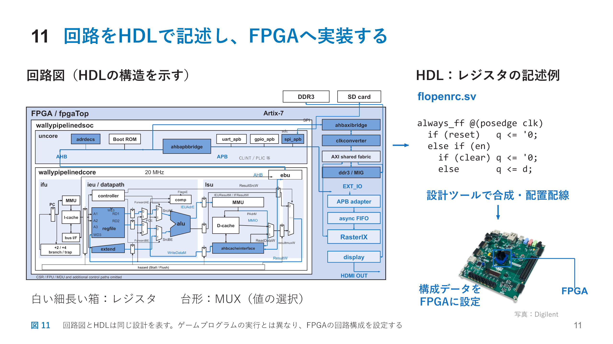

### 質問時の使い方

質問に関係する箇所を図で示すための資料です。本編の簡略図との対応を確認できます。

補足説明と出典

Wallyの主要データパスを示す。内部の回路記号と構成はRVSOC図7.3（基本ALU）、7.6（比較器）、7.7（命令解読）、7.19（ハザード）、9.14（AHB/APB）、9.25（EBU）、10.13・10.24（キャッシュ）、11.15（MMU）、20.4（GPIO）、20.11（UART）および製品RTLを基に再構成した。メモリは配列、白い細長い箱はレジスタ、台形は値を選ぶMUXである。MMUはTLBの結果と変換しない番地を選び、物理番地をPMP/PMAで検査する。キャッシュはタグを照合してデータを選ぶ。I-cacheの図にはCPUによる書込みを描いていない。ALUは加減算、シフト、論理演算などの結果を選ぶ。レジスタファイルは記憶配列と書込み先の解読、二つの読出し選択を示し、x0は0として扱う。EBUは命令側とデータ側の要求を選ぶ。AHB/APBブリッジは番地と制御の保存、書込みデータの転送、読出し応答の選択を示す。UARTは送信経路、GPIOは出力経路の代表部分を示す。hazardにはStallD=StallDCause|StallEとFlushE=(~StallE&StallD)|FlushECauseを例示する。複数の信号をまとめた接続線や省略した制御経路がある。このスライド単独は全HDL信号、全機能、配置配線後の物理形状を網羅しない。技術資料のHDL詳細図は同じ全体配置から各モジュールへ移動でき、固定した構成の展開済み端子接続・式・手続きと、ハッシュを照合した製品ソースを表示する。ベンダーIPの内部は対象外である。資料の網羅性の確認と形式的な等価性の証明は異なる。青い塗りは簡略図で説明した機能、青い枠は追加した描画接続を表す。

右にはflopenrc.svで使うalways_ffと立上りクロックの表記だけを置いた。これは完全なコードではない。技術資料のHDL詳細図では、flopenrc.svの全文、全端子、各インスタンスの接続を参照できる。同ファイルのalways_ff本文は、同期リセットを最優先し、enが1のときだけclearまたはデータdを取り込む。enが0のときは保持する。clearは常時有効な非同期リセットではない。左のRD1EReg、RD2EReg、ImmExtEReg等の段間レジスタに使われている。詳細図のコード内の0は幅に応じた全ビット0。図からコードを自動生成したという実験ではなく、図とHDLが同じ回路の構造・動作を表す関係を説明している。

HDLはCPUでゲームのように逐次実行するものではない。合成と配置配線でLUT、フリップフロップ、BRAM、配線等の構成を決め、ビットストリームをFPGAへ設定する。写真の中央の放熱器の下にArtix-7 FPGAがある。写真はDigilentの製品写真で、本研究で撮影したものではない。ゲーム用ソフトウェアのSD→DDR→CPU実行と、HDL→構成データ→FPGA設定は異なる経路である。

出典：Harris et al., RISC-V System-on-Chip Design, Chapters 7–13, 20, 22–23. Official figure source: https://pages.hmc.edu/harris/ddca/rvsocd.html (RVSoCD_figs.zip). Figure 7.11, Figure 9.20 and Chapter 23. Product revision 261832d48832dd6e26c4971ab8893ce61200688b. console/fpga/src/fpgaTopNexysVideo.sv; console/fpga/src/rasterix.sv; console/fpga/src/rasterix_apb.sv; console/fpga/generator/axiscdc.tcl. console/src/ieu/datapath.sv; console/src/generic/flop/flopenrc.sv; console/src/lsu/lsu.sv. Digilent, Nexys Video product photograph: https://digilent.com/shop/nexys-video-amd-artix-7-fpga-trainer-board-for-multimedia-applications/ . Board identification: Nexys Video Reference Manual (2020), pp.3-4. Image copyright Digilent.

## 動作確認と詳しい実装

実機の結果は既存のE6に基づきます。製品版は261832d48832dd6e26c4971ab8893ce61200688bです。4条件の画像比較、300.011秒の自動プレイ、別試行の30秒映像を区別しています。[実験記録E6](../thesis/再現資料/実験記録/E6/README.md)から条件と結果を参照できます。2・3・6枚目の命令と値は経路の説明例で、実測波形ではありません。専用コントローラーは今後の項目です。

描画処理の工夫、接続方式の比較、再現手順は[技術付録](../thesis/技術付録.md)にまとめています。本編ではそれらの最適化の優劣や教育効果を結論として主張しません。

## 図と書式の出典

CPUの簡略図はDDCA第7章、回路記号や書式はRVSOC図7.11などを参考にしています。質問用の詳細図はRVSOCと製品RTLを基に再構成した図で、全HDL信号や物理配置を網羅するものではありません。公開版の表紙では個人情報を伏せています。[デザインと出典](../../source/presentation/README.md)に省略範囲と再生成方法を記載しています。
