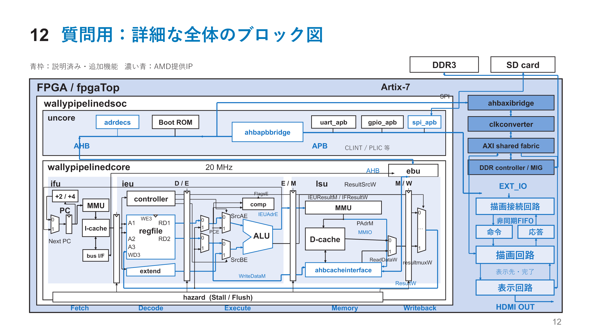
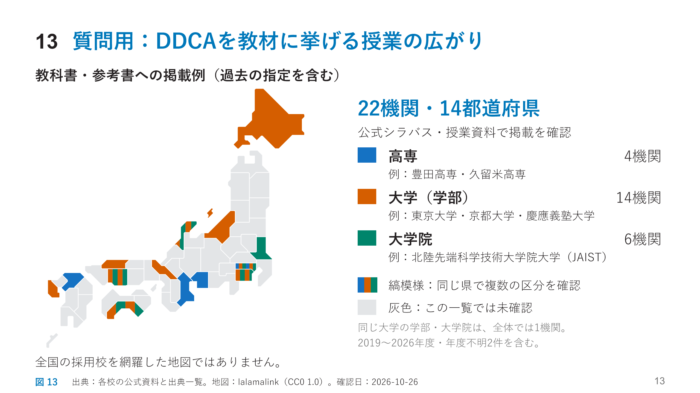

# 中間発表：FPGAを用いた二次元ゲーム機の設計と実装

本編11枚と質問用2枚です。2枚目でFPGAの仕組み、3枚目で研究の目的を説明します。4枚目でlw、5枚目でswを、FPGA内のメモリを使って説明します。6枚目では同じ図にバスと外付けDDR3への接続を加えます。その後、SDカード、描画と表示を順に加えます。

[PowerPoint版](中間発表_主要事項.pptx) / [アブスト](../abstract/アブスト_主要事項.md) / [論文本文](../thesis/本文.md) / [技術付録](../thesis/技術付録.md) / [再生成方法](../../source/presentation/board-evolution/README.md) / [DDCA授業利用の出典](DDCA授業利用の出典.md)

## 図の見方

2〜3枚目の外側の枠はFPGAボード、内側の青い枠はFPGAチップです。SDカードスロット、DDR3メモリ、HDMI端子は、チップの外に実物として取り付けられた部品です。2枚目では左のHDLコードをチップ内のAND回路と対応づけ、回路を記述して実装することを説明します。AND回路だけで周辺部品を制御するという意味ではありません。3枚目では、同じボード図のチップ内を教育用CPUと描画機能に置き換え、本研究で作るゲーム機の概要を示します。

4〜5枚目はFPGAチップの囲いだけを大きく表示し、外側のボードや周辺部品を省きます。4枚目は命令メモリとデータメモリをFPGA内に置いた構成でlwを説明します。5枚目では同じ大きさと配置の図にPC+4の経路を加え、swによってx1の値3をデータメモリの12番地へ書く流れを追います。6枚目ではその図を縮めてボード全体を示し、バスとAMD提供のDDRコントローラーを加えます。命令とデータの保存先を外付けDDR3へ広げ、「命令メモリ」の箱をバス経由の「命令読出し」の箱へ替えます。swが番地と書く値を渡す仕組みは同じです。

6〜9枚目はボード外周、青いFPGAチップの枠、右側の外付け部品を同じ位置に保ちます。SD制御回路は7枚目、描画回路は8枚目、表示回路は9枚目で接続を詳しく示します。CPU、描画回路、表示回路のメモリアクセスはDDRコントローラーを通ります。送信用アダプタは描画回路の箱に含めます。線は機能上の経路をまとめており、電気的に異なる信号を短絡する図ではありません。模式図の部品配置は、実物の配置をそのまま示すものではありません。

4〜5枚目のFPGA内メモリの構成は命令を説明するためのモデルであり、現在の実機構成を示したものではありません。0・4・8・12などの番地も説明例です。AMD提供のメモリ制御回路は、接続する端子と役割を示し、内部の作り方は展開しません。キャッシュ、番地変換、仲裁などの詳細は技術付録に記載します。

## 発表時間と質問用スライド

本編の配分は動画の再生30秒を含め355秒です。2枚目は20秒、3枚目は15秒を割り当てています。動画を再生しながら結果を説明します。6分まで5秒の余裕を置きます。これは練習を実測した時間ではありません。12〜13枚目は非表示の質問用スライドです。13枚目はDDCAの授業利用例を示す日本地図です。通常のスライドショーでは本編11枚を表示します。

## 目次

- [1. FPGAを用いた二次元ゲーム機の設計と実装](#slide-1)
- [2. FPGAチップで周囲の部品を制御する](#slide-2)
- [3. 教育用CPUに描画機能を追加する](#slide-3)
- [4. lw：命令を読み、指定した値をレジスタへ入れる](#slide-4)
- [5. sw：レジスタの値を指定した番地へ書く](#slide-5)
- [6. バスと外付けDDR3メモリ](#slide-6)
- [7. SDカードのプログラムを、CPUがDDR3へ移す](#slide-7)
- [8. 描画回路を追加し、swで描画命令を渡す](#slide-8)
- [9. 画像をDDR3へ保存し、HDMI端子へ出力する](#slide-9)
- [10. 接続した構成で、ブロック崩しを動かした](#slide-10)
- [11. 教育用CPUを拡張し、ブロック崩しを動かした](#slide-11)
- [12. 質問用：詳細な全体のブロック図](#slide-12)（質問用）
- [13. 質問用：DDCAを教材に挙げる授業の広がり](#slide-13)（質問用）

## 1. FPGAを用いた二次元ゲーム機の設計と実装

説明時間の配分：5秒

### 発表原稿

この題目で発表します。

補足説明と出典

表紙は題目と発表者・指導教員の情報のみを示す。公開版は個人情報を伏せる。

## 2. FPGAチップで周囲の部品を制御する

説明時間の配分：20秒

### 発表原稿

FPGAボードには、チップの周囲にSDカードスロットやDDR3メモリ、HDMI端子が実物として付いています。これらを制御する論理回路を、チップの中に実装できます。回路はコードで記述します。左のコードと、右のAND回路が対応する例です。

補足説明と出典

外側の薄い青の枠はFPGAボード、内側の青い枠はFPGAチップを表す。SDカードスロット、DDR3メモリ、HDMI端子はボード上に実物として取り付けられた部品であり、コードでチップ内に作る回路とは区別する。チップ内に、それらの部品を制御する論理回路を実装できる。模式図の配置は実物の物理配置ではない。左のSystemVerilogコードとチップ内のAND回路は同じ組合せ回路の例であり、aとbが両方1のときにyが1となる。AND回路だけでSDカードやDDR3を制御できるという意味ではない。周辺部品には、それぞれの信号規約に合う制御回路を用意する。回路の構成を書き込むとは、HDLから設計ツールで生成した構成データをFPGAに設定することを指す。CPUがHDLをプログラムとして実行するという意味ではない。設計ツールと構成データの図示は省略する。チップから周辺部品へ延びる線は部品間の物理的な接続をまとめている。

出典：Harris, S. L. and Harris, D., Digital Design and Computer Architecture: RISC-V Edition (2021), Chapter 7. Official figure source: https://pages.hmc.edu/harris/ddca/ddcarv.html (DDCArv_Figures.zip). Chapters 2 and 4, combinational logic and HDL. Harris et al., RISC-V System-on-Chip Design, Chapters 7–13, 20, 22–23. Official figure source: https://pages.hmc.edu/harris/ddca/rvsocd.html (RVSoCD_figs.zip). Chapter 23. Nexys Video Reference Manual (2020), pp.3–4: https://digilent.com/reference/_media/reference/programmable-logic/nexys-video/nexys-video_rm.pdf .

## 3. 教育用CPUに描画機能を追加する

説明時間の配分：15秒

### 発表原稿

本研究では、既存の教育用CPUに、ゲーム画面を作って出力する機能を追加します。この回路をFPGAチップに実装し、ボードをゲーム機として使います。教育用CPUをゲーム機へ拡張する例を示すことが目的です。

補足説明と出典

前の図と同じFPGAボード、FPGAチップ、SDカードスロット、DDR3メモリ、HDMI端子を、同じ位置と大きさで示す。チップ内部を、説明用のAND回路から研究で使う機能の概要へ置き換える。教育用CPUはWally、描画機能には既存の描画回路と表示回路、それらを利用するための接続を含む。CPUと描画回路本体を新たに設計したという主張ではない。図中のCPUと描画機能の線は機能間の接続をまとめたものであり、実際のバスや制御信号を網羅しない。SDカードやDDR3の制御回路などは、この目的説明の図では省略する。実装にはそれらの回路も含まれる。既存の教育用CPUに描画機能を追加し、ボードをゲーム機として使う拡張例を示すことが研究の目的である。教育効果を学習実験で測定したという主張ではない。

出典：Harris et al., RISC-V System-on-Chip Design, Chapters 7–13, 20, 22–23. Official figure source: https://pages.hmc.edu/harris/ddca/rvsocd.html (RVSoCD_figs.zip). Product revision 261832d48832dd6e26c4971ab8893ce61200688b. console/fpga/src/fpgaTopNexysVideo.sv; console/fpga/src/rasterix.sv; console/fpga/src/rasterix_apb.sv; console/fpga/generator/axiscdc.tcl.

## 4. lw：命令を読み、指定した値をレジスタへ入れる

説明時間の配分：60秒

### 発表原稿

ここからはFPGAチップの中を拡大します。CPUと二つのメモリをFPGA内に置いた構成で説明します。PCから現在の命令の番地が出ます。ここでは0とすると、命令メモリは0番地のlw x1, 8(x0)を出します。これは、常に0であるx0の値に8を足し、その番地の値をx1へ読む命令です。実際の命令は上の32ビットです。19から15ビットの00000がA1に入り、レジスタ群はx0の値0を出します。31から20ビットの000000001000は8で、これもALUへ入ります。ALUは0足す8で番地8を作ります。そこに3があれば、メモリから3が戻ります。11から7ビットの00001は書込み先x1を選び、3を保存します。

補足説明と出典

CPUの動きを説明するため、命令メモリとデータメモリをFPGA内部に置いた単純な構成を示す。外付けDDR3はここでは使わない。この構成を実機で試作・測定したという主張ではなく、現在のWally全体を表す図でもない。命令メモリの0番地には32ビット命令lw x1,8(x0)、データメモリの8番地には32ビット値3があるとする。命令メモリとデータメモリは別の記憶領域である。命令の格納先0とデータの読出し先8を区別する。命令の機械語は0x00802083。I形式の[31:20]=000000001000（即値8）、[19:15]=00000（rs1=x0）、[14:12]=010、[11:7]=00001（rd=x1）、[6:0]=0000011。A1は読出しレジスタ番号、RD1はそのレジスタの値であり、番号0と値0は役割が異なる。x0は読出すと常に0になる。A3は書込み先番号、WD3は書く値、WE3は書込許可を表す。lwではメモリへの書込みは行わず、読んだ値をレジスタへ書く。今回は正の即値8だけを使うため、即値の幅を広げる回路、命令を解読して許可信号を作る回路、PCの次の値を作る回路は図示しない。線が交差しても接続点として示していない場所ではつながらない。灰色の経路はこの命令で使用しない。

出典：Harris, S. L. and Harris, D., Digital Design and Computer Architecture: RISC-V Edition (2021), Chapter 7. Official figure source: https://pages.hmc.edu/harris/ddca/ddcarv.html (DDCArv_Figures.zip). Chapter 7, single-cycle load datapath. RISC-V unprivileged ISA, RV32I load instruction format.

## 5. sw：レジスタの値を指定した番地へ書く

説明時間の配分：45秒

### 発表原稿

次は、レジスタの値をメモリへ書くsw命令です。前のlwでx1には3が入りました。ここでは、命令を順に実行するため、PCに4を足して戻す回路を加えます。lwが終わるとPCは0から4へ進み、命令メモリの4番地からsw x1, 12(x0)を読みます。これは、x0の値に12を足した番地へ、x1の値を書く命令です。命令から取り出した番号0がA1に、番号1がA2に入り、レジスタ群から0と3が出ます。ALUは0足す12で書く番地12を作ります。一方、書く値3はALUを通らない線で、データメモリのWDへ届きます。こうして12番地に3を書きます。lwはメモリからレジスタへ、swはレジスタからメモリへ値を移します。

補足説明と出典

前のlwと同じく、命令メモリとデータメモリをFPGA内部に置いた説明用の構成である。バスや外付けDDR3はまだ使わない。命令メモリの0番地にlw x1,8(x0)、4番地にsw x1,12(x0)があるとする。lwで読んだ値3がx1に残っており、swがそれをデータメモリの12番地へ保存する。二つのメモリは別の記憶領域である。図はPC=4でswを実行している状態を示し、PC+4の加算器は次の番地8を用意する。PCを0から4へ進める操作は前のlwの終了時に行われる。32ビットで分岐しない命令だけを例にする。上段は命令から取り出す意味上の内容を並べた表示で、実際の32ビット内の配置ではない。即値12を一つの数として示し、ビット位置や取り出し方は省略する。A1には基準値を読む番号0、A2には保存する値を読む番号1が入る。ALUが作る番地12と、RD2からWDへ届く値3は別々の経路である。データメモリ内の3は書込みの結果を示す。swではデータメモリへの書込みを許可し、レジスタ群への書込みは許可しない。灰色の経路はswで使用しない。命令の解読、書込み許可信号の生成、即値の幅を広げる回路は省略する。メモリの書込みがどのクロックで確定するかを示す波形ではない。PC、命令メモリ、レジスタ群、ALU、データメモリの位置と大きさは前のlwの図と同じに保つ。

出典：Harris, S. L. and Harris, D., Digital Design and Computer Architecture: RISC-V Edition (2021), Chapter 7. Official figure source: https://pages.hmc.edu/harris/ddca/ddcarv.html (DDCArv_Figures.zip). Chapter 7, sequential PC update and store datapath.

## 6. バスと外付けDDR3メモリ

説明時間の配分：45秒

### 発表原稿

次に、ボード全体の図へ戻り、命令とデータの置き場所を外付けのDDR3へ広げます。CPUの命令読出し側とデータの読み書き側を、共通の経路であるバスへつなぎます。ただし、DDR3には専用の信号で読み書きする必要があります。そこでAMDが提供するDDRコントローラーを利用します。これはDDR3とのやり取りを担当する既存の回路です。CPU側から番地と読み書きの要求を渡し、必要なデータをやり取りします。PCの番地で命令を読むと、これまでと同じレジスタ群とALUで処理できます。先ほどのswでは、ALUで作った番地12と、x1からの値3をバスへ渡します。DDRコントローラーがこの要求を処理し、DDR3の12番地へ3を書き込みます。

補足説明と出典

ここで初めてバスとAMD提供のDDRコントローラーを加える。前の図でFPGA内に置いた二つのメモリに代わり、命令とデータを外付けDDR3内の別の領域に置く構成を説明する。チップ内の図を縮めてボード全体を示す。PC、レジスタ群、ALUの相対的な位置と主要経路、PC+4の経路を保つ。前の図と同じsw x1,12(x0)を例にし、書込み先がFPGA内のデータメモリから外付けDDR3へ変わることを示す。「命令メモリ」の箱は「命令読出し」へ変更し、バスへ要求を出して応答を受け取る機能をまとめた箱とする。独立した命令ROMが実機にあるという意味ではない。命令の要求と戻りを別々の線でバスにつなぐ。DDRコントローラーはFPGA内、DDR3メモリチップはFPGA外にある。製品の生成スクリプトはAMD（旧Xilinx）のmig_7seriesを生成する。MIGはMemory Interface Generatorの略で、図の箱はそれで生成したメモリ制御回路を指す。既存の回路を利用するため、DDR3のコマンド、信号のタイミング、初期化やリフレッシュを内部でどう実現するかは、この発表では展開しない。接続にはメモリ種類、ピン、クロック、リセット、CPU側との信号規約などを合わせる必要がある。「内部を作り直さず利用する」ことと「接続条件を知らなくてよい」ことは異なる。バス側の変換と仲裁は図ではまとめる。実機の構成はIROM_SUPPORTED=0、DTIM_SUPPORTED=0、ICACHE_SUPPORTED=1、DCACHE_SUPPORTED=1であり、全命令が毎回DDR3への読出しを起こすわけではない。キャッシュ、番地変換や応答待ちの内部は省略する。図中の番地は説明用で、実機のDDR3領域は0x80000000から始まる。バスの線は複数の信号をまとめており、異なる信号を電気的に短絡する意味ではない。

出典：Harris et al., RISC-V System-on-Chip Design, Chapters 7–13, 20, 22–23. Official figure source: https://pages.hmc.edu/harris/ddca/rvsocd.html (RVSoCD_figs.zip). Chapters 9 and 23. Product revision 261832d48832dd6e26c4971ab8893ce61200688b. console/fpga/src/fpgaTopNexysVideo.sv; console/fpga/src/rasterix.sv; console/fpga/src/rasterix_apb.sv; console/fpga/generator/axiscdc.tcl. console/fpga/generator/ddr3-nexysvideo.tcl; console/config/rv64gc/config.vh.

## 7. SDカードのプログラムを、CPUがDDR3へ移す

説明時間の配分：55秒

### 発表原稿

このバスに、SDカードの制御回路もつなぎます。電源を切っても残したいゲームプログラムはSDカードに保存しておきます。実行前に、CPUが読込み用のプログラムを動かします。まずSD制御回路の決められた番地へ書き込み、カードからの読み出しを指示します。制御回路がカードと通信し、データを受け取ります。次にCPUが受取り用の番地を読むと、そのデータがバスを通ってCPUのレジスタへ戻ります。続いて、その値をDDR3の番地へ書きます。この書込みもDDRコントローラーが処理します。これを繰り返すと、プログラムがDDR3へコピーされます。準備ができたら、実行する命令の番地をPCに入れます。以後は前のスライドの経路で、DDR3上の命令を読んで実行します。

補足説明と出典

読み出しを指示する書込み、受信した値の読出し、DDR3への保存をCPUの仕事として説明する。SDカードからDDR3へ直接転送する専用回路を新たに設けたという図ではない。製品のSPI制御回路では受信データの読出しレジスタを介してCPUが値を受け取る。カードとの通信、ブロック単位の処理、ファイルの解釈、バッファ間のコピーなどの詳細は省略する。受信した1バイトに対して実際に必ずlwを1回、swを1回使うという実装の断定ではなく、CPUの読出しと書込みによる移動をまとめている。最初の読込みを始める処理は起動用のプログラムが担い、CPUが空のDDR3からゲームを読み始めるという説明ではない。ゲームの開始番地へ制御を移す細部は省略し、準備とゲームの実行を分けて説明する。

出典：Harris et al., RISC-V System-on-Chip Design, Chapters 7–13, 20, 22–23. Official figure source: https://pages.hmc.edu/harris/ddca/rvsocd.html (RVSoCD_figs.zip). Chapters 20 and 23. Product revision 261832d48832dd6e26c4971ab8893ce61200688b. console/fpga/src/fpgaTopNexysVideo.sv; console/fpga/src/rasterix.sv; console/fpga/src/rasterix_apb.sv; console/fpga/generator/axiscdc.tcl. console/src/uncore/spi_apb.sv; console/fpga/zsbl.

## 8. 描画回路を追加し、swで描画命令を渡す

説明時間の配分：40秒

### 発表原稿

ここへ、本研究で描画用の接続回路と描画回路を加えました。描画用の窓口にも番地を割り当てるので、先ほどのswで操作できます。例えばx2に窓口の番地B、x1に送りたい数値Dを用意します。sw x1, 0(x2)では、ALUがB足す0で番地Bを作り、x1のDを別の線で送ります。番地Bの相手はDDR3ではなく描画用の窓口なので、Dを描画回路へ渡します。描画用ソフトウェアが用意した数値列をこのように送ります。CPUが実行するsw命令と、データとして送る描画命令は別のものです。

補足説明と出典

既存CPUと既存の描画回路を利用し、その間の接続を設計した。上部には即値0、基準値を読む番号2、書く値を読む番号1を、取り出した内容として並べる。実際の機械語のビット配置は示さない。x2とx1への値の準備は省略し、レジスタ割当ては説明用とする。BはCPUから見た窓口の番地で、物理アドレスと必ず同じ値とは限らない。Dは描画命令の数値列の一語であり、RISC-V命令のswの機械語ではない。OpenGLの1回の呼出しがそのまま1回のswに対応するという意味でもない。接続回路の内部の規約や時刻合わせは一つの箱にまとめる。前の図のCPUとバスの位置を保ち、描画回路を加える。描画回路による画像の保存と表示回路を次の図で加える。描画命令の送信用アダプタは描画回路の箱にまとめる。

出典：Product revision 261832d48832dd6e26c4971ab8893ce61200688b. console/fpga/src/fpgaTopNexysVideo.sv; console/fpga/src/rasterix.sv; console/fpga/src/rasterix_apb.sv; console/fpga/generator/axiscdc.tcl. console/examples/rasterix/WallyBusConnector.hpp; console/fpga/src/rasterix_apb.sv.

## 9. 画像をDDR3へ保存し、HDMI端子へ出力する

説明時間の配分：30秒

### 発表原稿

描画回路は描画命令に従って、画面の各点の色を求めます。この一つひとつの点が画素です。作った画像は、DDRコントローラーを通して、DDR3の画像用の領域へ保存します。表示回路もこのコントローラーを通して画素の色を順に読み、画面に表示するためのタイミングに合わせてHDMI端子へ出します。CPUはゲームの処理と描画命令の送信、描画回路は画像の作成、表示回路は画像の出力を担当します。

補足説明と出典

同じボード図の中で、描画回路のメモリへの書込み経路と、表示回路による読出し経路を詳しく示す。描画回路は内部の作業領域で描画し、結果を外部メモリへ転送する。内部作業領域、テクスチャ読出し、表示画像の切替、メモリ仲裁や映像符号化の内部は省略する。画像用とプログラム用にはDDR3内の別の範囲を確保する。描画回路による書込みと表示回路への読出しの線は、いずれもDDRコントローラーへ接続する。DDR3へ直接つないだ線ではない。実装の共有インターコネクトや仲裁は線にまとめており、別々の出力を電気的に短絡するという意味ではない。表示回路は表示タイミングに従って読み出す。CPUの書込み1回ごとに画面全体を一回表示するものではない。

出典：Product revision 261832d48832dd6e26c4971ab8893ce61200688b. console/fpga/src/fpgaTopNexysVideo.sv; console/fpga/src/rasterix.sv; console/fpga/src/rasterix_apb.sv; console/fpga/generator/axiscdc.tcl. console/fpga/src/rasterixdisplay.sv; console/fpga/generator/rasterixmem.tcl; console/addins/rasterix/rtl/RasterIX/RasterIX_IF.v.

## 10. 接続した構成で、ブロック崩しを動かした

説明時間の配分：30秒

[30秒の実機動画を開く](../thesis/再現資料/実験記録/E6/report/results/video/breakout-latest-30s.mp4)

PowerPointには動画を埋め込んでいます。スライドショー中に動画の領域をクリックして再生します。

### 発表原稿

こちらが実機で取得した30秒の動画です。この構成で640掛ける480画素のブロック崩しが動きました。四つの条件で期待画像との一致を確認しました。さらに5分間の自動プレイを記録し、別の試行では30秒の映像を確認しました。現在は自動操作で、専用コントローラーの接続はこれからです。

補足説明と出典

4条件は3種類の描画条件と再起動後の1条件。これらの条件で全画面を期待画像と比較した。5分の記録は300.011秒の自動プレイで、30秒の取得映像とは別試行。動画のフレーム数をゲームFPSとして用いていない。ゲームには描画負荷を軽減する実装を含むが、この案はその最適化の優劣を主張しない。録画の取得経路は実験環境であり、ゲーム機の公開構成と分けている。映像を受信できない場合の条件の特定は残っており、全ての表示機器での互換性を確認したわけではない。専用コントローラーは将来項目で未検証。動画はPowerPoint内へ埋め込み、スライドショー中に動画の領域をクリックして再生する。再生中に結果を説明する。音声はない。再生前は同じ試行の静止フレームを表示する。資料は既存実験E6の結果を示し、新たな実機計測を行ったという意味ではない。

出典：docs/thesis/再現資料/実験記録/E6/fresh-product/qualification/qualification.json; docs/thesis/再現資料/実験記録/E6/report/results/video/validation.json. Video: docs/thesis/再現資料/実験記録/E6/report/results/video/breakout-latest-30s.mp4 Product revision 261832d48832dd6e26c4971ab8893ce61200688b. console/fpga/src/fpgaTopNexysVideo.sv; console/fpga/src/rasterix.sv; console/fpga/src/rasterix_apb.sv; console/fpga/generator/axiscdc.tcl.

## 11. 教育用CPUを拡張し、ブロック崩しを動かした

説明時間の配分：10秒

### 発表原稿

CPUに描画回路をつなぎ、ブロック崩しを動かしました。CPUを拡張したい人が、つなぎ方と動かし方を参照できる例です。次はコントローラーで操作できるようにします。

補足説明と出典

既存の教育用CPUと描画回路を利用し、それらをつなぐ回路とソフトウェア側の接続を実装した。CPUや描画回路本体を新たに設計したという主張ではない。FPGAボード上でブロック崩しのゲーム画面を生成し、HDMI端子から出力した。現在は自動プレイであり、専用コントローラーの接続は未実装・未検証である。実機の結果は既存の実験E6に基づく。4条件の画像比較、300.011秒の自動プレイ、別試行の30秒映像を確認している。回路をどう接続し、プログラムをどう動かすかを、公開したソースと資料で参照できる拡張例としてまとめた。学習者向けの利用を想定するが、教育効果を学習実験で測定したわけではない。次の段階ではコントローラーを接続し、入力によってゲームを操作できることを確認する。

出典：Product revision 261832d48832dd6e26c4971ab8893ce61200688b. console/fpga/src/fpgaTopNexysVideo.sv; console/fpga/src/rasterix.sv; console/fpga/src/rasterix_apb.sv; console/fpga/generator/axiscdc.tcl. docs/thesis/再現資料/実験記録/E6/fresh-product/qualification/qualification.json; docs/thesis/再現資料/実験記録/E6/report/results/video/validation.json. Video: docs/thesis/再現資料/実験記録/E6/report/results/video/breakout-latest-30s.mp4

## 12. 質問用：詳細な全体のブロック図

質問時に参照する資料。本編の発表時間には含めません。

### 質問時の使い方

RVSOCのパイプライン図を基にした全体図です。PC、レジスタ群、ALU、段間レジスタ、書戻しの経路を保ち、実機のメモリ接続と本研究の描画接続を付け加えています。質問に応じて関係する経路をたどります。

補足説明と出典

RVSOC図7.11の配置と回路記号を基に、PCから命令読出し、レジスタ群、入力選択、ALU、メモリアクセス、書戻しへ進むデータパスを示す。Fetch、Decode、Execute、Memory、Writebackの位置関係、段間レジスタ、転送用MUX、下側を戻る書戻し経路を保つ。読める大きさを優先し、図7.11のすべての制御線や端子名をそのまま描き写してはいない。実機ではIROMとDTIMが無効のため、その箱を残さず、命令側をMMU・I-cache・バスI/F、データ側をMMU・D-cache・非キャッシュアクセス経路へ置き換える。命令側とデータ側の外部要求はebuからAHBへ出る。uncoreとAHB/APB変換を上部に加え、SPI、Boot ROMなどの既存周辺回路を示す。CPU側のDDR接続はAHB/AXI変換とclkconverterを通る。右側には共有AXI、MIG、描画接続回路、命令用と応答用の非同期FIFO、描画回路、表示回路を加える。CPU、描画回路、表示回路は共有AXIを介してDDR3へアクセスする。描画回路と表示回路の間の線は表示先の通知と切替確認であり、画素そのものはDDR3を介して共有する。回路内部を展開しない箱も、単なる名前の一覧ではなく入力と出力の接続を示す。細長い白い箱はレジスタ、台形はMUX、切欠きのある記号はALUを表す。段間レジスタは複数の状態をまとめた表記であり、一本の線で全制御情報を短絡する意味ではない。図は全RTLと等価な回路図や物理配置図ではない。MMUとキャッシュ内部、ALUの個々の演算回路、CSR、FPU、MDU、予測、例外、全制御線、クロックとリセットの詳細は省略する。各々の内部は別の図で扱う。青い塗りは本編で説明した機能、青い枠は追加した描画接続を表す。

出典：Harris et al., RISC-V System-on-Chip Design, Chapters 7–13, 20, 22–23. Official figure source: https://pages.hmc.edu/harris/ddca/rvsocd.html (RVSoCD_figs.zip). Figure 7.11 (pipeline datapath), Figure 9.20 (uncore), Chapters 10–11 and 23. Product revision 261832d48832dd6e26c4971ab8893ce61200688b. console/fpga/src/fpgaTopNexysVideo.sv; console/fpga/src/rasterix.sv; console/fpga/src/rasterix_apb.sv; console/fpga/generator/axiscdc.tcl. console/src/wally/wallypipelinedcore.sv; console/src/uncore/uncore.sv; console/src/ieu/datapath.sv; console/src/ifu/ifu.sv; console/src/lsu/lsu.sv.

## 13. 質問用：DDCAを教材に挙げる授業の広がり

質問時に参照する資料。本編の発表時間には含めません。

[教育機関・授業・年度・指定の種類・出典の一覧](DDCA授業利用の出典.md)

スライドに示した学校名の例：高専は豊田高専・久留米高専、大学（学部）は東京大学・京都大学・慶應義塾大学、大学院は北陸先端科学技術大学院大学（JAIST）。

### 質問時の使い方

DDCAは、高専・大学の学部・大学院の授業で、教科書や参考書として挙げられています。過去の指定も含めて、公式の公開資料から22機関・14都道府県で確認できました。1枚の地図にまとめ、同じ県で複数の区分を確認した場合は、それらの色の縞模様にしています。すべての採用校を調べたものではありません。

補足説明と出典

図は、DDCAを公式シラバス・授業資料の教科書・教材・参考書欄で確認した例を示す。日本語版と英語版、MIPS版・ARM版・RISC-V版などを含む。区分別では高専4機関、大学（学部）14機関、大学院6機関である。東京大学と広島大学は学部・大学院の両方に例があるが、全体ではそれぞれ1機関と数える。重複を除いた合計は22機関・14都道府県である。区分は学校名ではなく授業の対象課程を表す。所在地は授業のキャンパスや開催地を使い、大学本部の住所でまとめない。教科書と参考書は出典一覧で区別する。参考書欄への掲載だけから、授業で毎回使うことや全学生の購入までは分からない。年度が分かる資料は2019〜2026年度である。開志専門職大学と長崎大学は授業年度不明、京都大学は2026年度授業ページからリンクされている資料である。現在も同じ指定が続くことや、同一年度の全国分布を示すものではない。縞模様は同じ県に複数の区分があることを示し、各色の面積は機関数に比例しない。灰色はこの一覧で未確認という意味で、使う学校がないという意味ではない。全国の全校・全年度を網羅していないため、色の面積や県数を採用率・市場シェアとして解釈しない。図書館の蔵書だけや書店の取扱いだけは根拠にしない。高知大学の資料は授業名とシラバス掲載図書を対応づけた公式一覧である。長崎大学は公式学部サイトの個別授業紹介を根拠とする。DDCAの掲載例は、RVSOCの採用実績や本研究の教育効果を直接示さない。授業・年度・版・確認箇所はDDCA授業利用の出典.mdを参照。地図の着色と集計はsource/presentation/ddca-adoption/records.jsonから生成する。地図は都道府県の形を簡略化した比較用の図である。

出典：学校別の出典：docs/presentation/DDCA授業利用の出典.md。確認日：2026-10-26。
K01 東京都立産業技術高等専門学校、2021年度「コンピュータハードウェアⅠ」、教科書。https://www.metro-cit.ac.jp/contents/000006531.pdf#page=16
K02 豊田工業高等専門学校、2025年度「コンピュータアーキテクチャⅡ」、教科書／教材。https://syllabus.kosen-k.go.jp/Pages/PublicSyllabus?department_id=13&lang=ja&school_id=23&subject_code=34234&year=2022
K03 鈴鹿工業高等専門学校、2026年度「計算機工学」、参考書。https://syllabus.kosen-k.go.jp/Pages/PublicSyllabus?department_id=13&lang=ja&school_id=25&subject_id=0097&year=2023
K04 久留米工業高等専門学校、2026年度「ディジタル回路設計」、教科書。https://syllabus.kosen-k.go.jp/Pages/PublicSyllabus?department_id=03&from=curriculum&lang=ja&school_id=43&subject_code=4S18&year=2023
U01 公立はこだて未来大学、2019年度「ハードウェア基礎」、教科書。https://www.fun.ac.jp/wp/wp-content/uploads/2020/03/2019_syllabus_2.pdf#page=77
U02 法政大学、2025年度「ディジタル回路デザイン」、教科書。https://syllabus.hosei.ac.jp/web/preview.php?gakubueng=AP&nendo=2025&no_id=2513717&radd=&t_mode=sp
U03 青山学院大学、2021年度「電子計算機工学Ⅰ」、参考書。https://syllabus.aoyama.ac.jp/shousai_view2.aspx?FN=4611510-0074&YR=2021
U04 島根大学、2022年度「コンピュータハードウェア実験」、教科書。https://gkm2019-sy.shimane-u.ac.jp/syllabusHtml/2022/04/04_TB50052_ja_JP.html
U05 広島大学、2026年度「コンピューターアーキテクチャ」、教科書。https://momiji.hiroshima-u.ac.jp/syllabusHtml/2026_12_K6406020.html
U06 高知工科大学、2026年度「電子システム設計」、参考書。https://portal.kochi-tech.ac.jp/Portal/Public/Syllabus/DetailMain.aspx?lct_cd=1160018001&lct_year=2026
G01 情報セキュリティ大学院大学、2025年度「情報デバイス技術」、参考書。https://www.iisec.ac.jp/education/curriculum/2025/syllabus_14.html
G02 北陸先端科学技術大学院大学、2024年度「デジタル論理と計算機構成（I115）」、参考書。https://syllabus.jaist.ac.jp/public/web/Syllabus/WebSyllabusSansho/UI/WSL_SyllabusSansho.aspx?P1=I1151000&P2=2024&P3=20240401
G03 高知大学大学院、2026年度「計算機アーキテクチャ特論（1A305）」、教科書・参考書（区別なし）。https://www.lib.kochi-u.ac.jp/html/シラバス掲載図書：総合人間自然科学研究科修士
U07 東京大学、2022年度「計算機構成論」、教科書。https://catalog.he.u-tokyo.ac.jp/detail?code=0510019&year=2022
U08 電気通信大学、2024年度「計算機通論」、推薦図書。https://kyoumu.office.uec.ac.jp/syllabus/2024/31/31_21122106.html
U09 京都大学、2026年度「計算機科学実験及演習3（ハードウェア）」、参考書。https://isle3hw.kuis.kyoto-u.ac.jp/kuis_le3a_hdl.pdf#page=26
U10 開志専門職大学、年度不明「コンピュータアーキテクチャ」、教科書（必ず購入する書籍）。https://kaishi-pu.ac.jp/wp/wp-content/themes/kaishi/assets/pdf/openinfo/shugakushien_syllabus_info-c.pdf?ver=3#page=1
U11 長崎大学、年度不明「論理回路」、教科書・教材・参考書（資料では区別なし）。https://www.idsci.nagasaki-u.ac.jp/education/lectureintroduction/lesson16
U12 中央大学、2026年度「コンピュータ設計」、参考文献。https://syllabus.chuo-u.ac.jp/syllabus/detail/?id=10765
U13 慶應義塾大学、2026年度「計算機基礎」、参考書。https://gslbs.keio.jp/pub-syllabus/detail?entno=37331&lang=jp&ttblyr=2026
U14 金沢大学、2025年度「計算機アーキテクチャＡ」、参考書。https://eduweb.sta.kanazawa-u.ac.jp/Portal/Public/Syllabus/DetailMain.aspx?je_cd=1&lct_cd=52-42210&lct_idx=A000000000200402&lct_year=2025
G04 広島大学大学院、2026年度「システムLSI設計（System LSI Design、WSP03200）」、参考書。https://momiji.hiroshima-u.ac.jp/syllabusHtml_en/2026_E90113_WSP03200_en.html
G05 総合研究大学院大学、2026年度「計測と制御（デジタル信号処理Ⅰ・Ⅱ）」、参考書。https://openit.kek.jp/training/2026/daq
G06 東京大学大学院、2024年度「カスタムコンピューティング特論（4810-1190）」、参考書。https://catalog.he.u-tokyo.ac.jp/detail?code=4810-1190&year=2024
地図：lalamalink, https://github.com/lalamalink/japan-map-svg (CC0 1.0)。

## 動作確認と詳しい実装

実機の結果は既存のE6に基づきます。製品版は261832d48832dd6e26c4971ab8893ce61200688bです。4条件の画像比較、300.011秒の自動プレイ、別試行の30秒映像を区別しています。[実験記録E6](../thesis/再現資料/実験記録/E6/README.md)から条件と結果を参照できます。4〜6・8枚目の命令と値は経路の説明例で、実測波形ではありません。専用コントローラーは今後の項目です。

描画処理の工夫、接続方式の比較、再現手順は[技術付録](../thesis/技術付録.md)にまとめています。本編ではそれらの最適化の優劣や教育効果を結論として主張しません。

## 図と書式の出典

CPU内部の簡略図はDDCA第7章、回路記号や書式はRVSOC図7.11などを参考にしています。チップ内の拡大図からボード全体へ視野を広げ、6〜9枚目では外付け部品の位置を固定して説明します。12枚目はRVSOCと製品RTLを基にした機能単位のブロック図で、個々の論理回路や全HDL信号、物理配置を網羅するものではありません。13枚目の地図は各校の公開シラバスなどと、lalamalinkのCC0地図データを基にしています。公開版の表紙では個人情報を伏せています。[デザインと出典](../../source/presentation/board-evolution/README.md)に省略範囲と再生成方法を記載しています。
