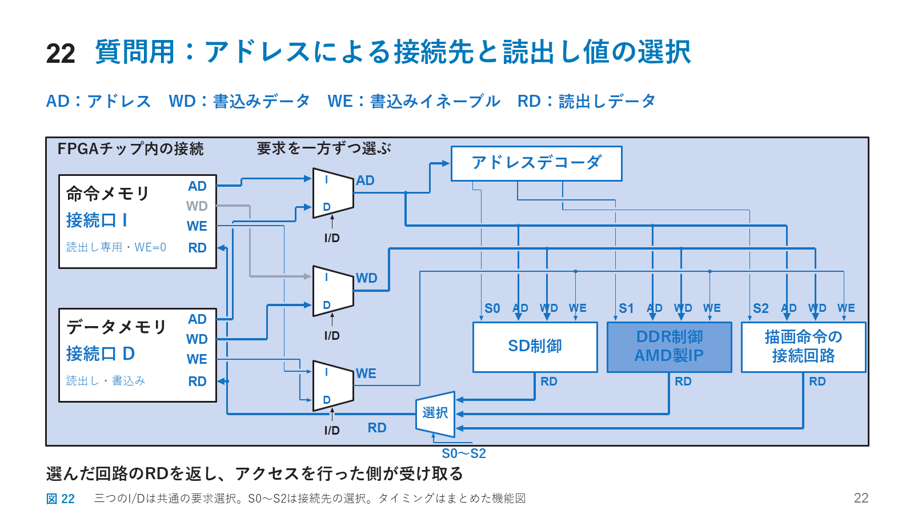
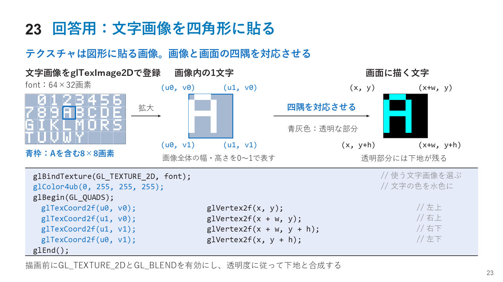
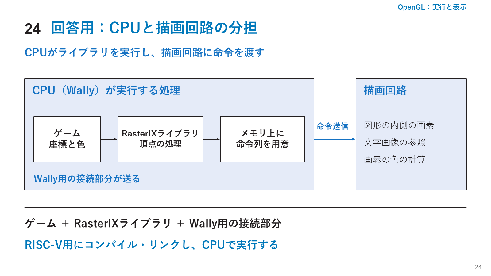
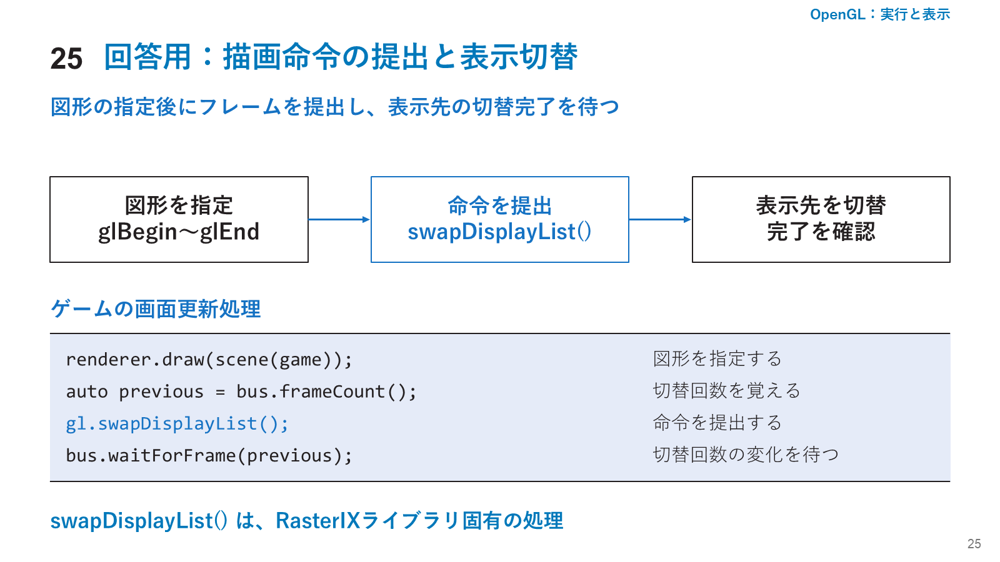
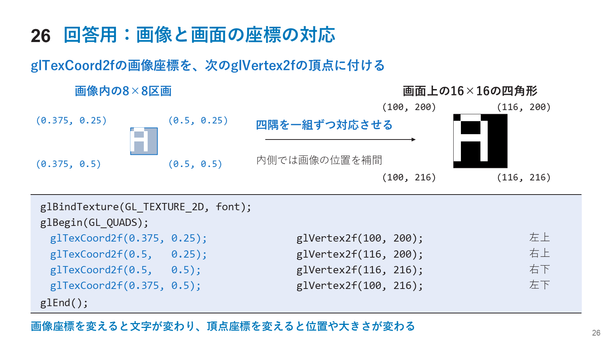

# 中間発表：FPGAを用いた2Dゲーム機の製作

本編は表紙1枚と発表用9枚の計10枚です。その後に目次1枚と回答用15枚が続き、ファイル全体は26枚です。背景、本研究の概要、ソフトウェア、ハードウェア、実行結果、まとめの順に説明します。実行結果は使用量、動画の順です。

[PowerPoint版](中間発表_主要事項.pptx) / [発表の要点](発表の要点.md) / [論文](../thesis/本文.md) / [技術付録](../thesis/技術付録.md)

## 目次

### 発表用スライド

- [1. 表紙](#slide-1)
- [2. FPGAとは](#slide-2)
- [3. 先行研究と教育現状](#slide-3)
- [4. 本研究の概要](#slide-4)
- [5. ソフトウェアの概要](#slide-5)
- [6. アドレスの割当て](#slide-6)
- [7. 接続回路](#slide-7)
- [8. FPGAの使用量](#slide-8)
- [9. ブロック崩しの実機動画](#slide-9)
- [10. まとめと今後の展望](#slide-10)

### 回答用：教科書の採用例

- [12. 回路・CPU設計の教科書の利用例](#slide-12)
- [13. SoC設計の教科書](#slide-13)

### 回答用：FPGA

- [14. FPGAチップの構成要素](#slide-14)

### 回答用：命令の実行と周辺接続

- [15. 命令実行から周辺回路への接続](#slide-15)

### 回答用：回路の詳細

- [16. 詳細な全体のブロック図](#slide-16)
- [17. 描画回路のFPGAパイプライン](#slide-17)

### 回答用：ゲームの描画

- [18. 画面の要素と描き方](#slide-18)
- [19. ゲーム画面の座標](#slide-19)
- [20. 四角形の色と四隅](#slide-20)
- [21. 文字画像の用意と登録](#slide-21)
- [22. 画像内のAを選ぶ座標](#slide-22)
- [23. 画像と画面の座標の対応](#slide-23)
- [24. 文字の色と透明な部分](#slide-24)
- [25. CPUと描画回路の分担](#slide-25)
- [26. 描画命令の提出と表示切替](#slide-26)

## 1. FPGAを用いた2Dゲーム機の製作

### 説明原稿

この題目で発表します。

補足説明と出典

教育用CPUに描画・表示機能を追加したゲーム機の製作について報告する。

[移動用の目次へ戻る](#slide-11)

## 2. FPGAとは

### 説明原稿

まず背景です。FPGAボードは、SDカードスロットやDDRメモリなどを載せた基板です。基板上にはFPGAチップもあります。このチップ内に、周囲の部品を制御するデジタル回路を実装できます。図は、チップ内に実装できる論理回路の一例です。

補足説明と出典

FPGAは、コードで記述したデジタル回路をチップ内に実装できるデバイスである。CPUも、その方法で実装する回路の一つである。SDカードなどを実際に制御するにはそれぞれの制御回路が必要であり、図のAND回路は、チップ内に実装できる論理回路の一例を示す。

出典：Harris, S. L. and Harris, D., Digital Design and Computer Architecture: RISC-V Edition (2021), Chapter 7. Official figure source: https://pages.hmc.edu/harris/ddca/ddcarv.html (DDCArv_Figures.zip). Chapters 2 and 4. Harris et al., RISC-V System-on-Chip Design, Chapters 7–13, 20, 22–23. Official figure source: https://pages.hmc.edu/harris/ddca/rvsocd.html (RVSoCD_figs.zip). Chapter 23. Nexys Video Reference Manual.

[移動用の目次へ戻る](#slide-11)

## 3. 先行研究と教育現状

### 説明原稿

FPGAにCPUや描画回路を実装する先行研究があります。CPUの例がWally、描画回路の例がRasterIXです。また、Wallyの設計を学ぶ教科書RVSOCは、ハーベイ・マッド大学、オクラホマ州立大学、ダルムシュタット工科大学で採用されています。こうした授業での採用から、CPUや周辺回路の設計を学ぶ一定の需要があると考えます。

補足説明と出典

左右はFPGAへの既存回路の実装例であり、互いに独立した図である。本研究での組合せは次のスライドで示す。WallyはCPU・SoCの設計とFPGA実装を扱う教材・公開回路の例、RasterIXは公開された描画回路と表示回路の実装例として挙げる。RasterIXの査読付き論文の存在を主張するものではない。

『RISC-V SoC設計』は英語書名RISC-V System-on-Chip Designの説明用の日本語表記である。Harvey Mudd Collegeは2026年春の授業で教科書指定、Oklahoma State Universityは2023〜2024年に出版前の原稿版を授業で使用、ダルムシュタット工科大学は2026/27年冬の授業で主教科書に指定している。過去の使用を含む確認例であり、同一年度の採用校一覧ではない。ダルムシュタットの実習はASIC設計を扱うため、3校すべてがFPGAでゲーム機を作る授業をしているという意味ではない。

教材採用という事実から、CPUや周辺回路の設計を学ぶ需要があると解釈する。本研究のゲーム機の利用希望者数や教育効果を測定した結果ではない。

出典：Wally: Thompson et al., RISC-V System-on-Chip Design Textbook and Course (2025), Section 4, https://doi.org/10.18260/1-2--57147 ; https://nemo.asee.org/public/conferences/365/papers/48675/download . Official CPU implementation: https://github.com/openhwgroup/cvw . Official RasterIX implementation: https://github.com/ToNi3141/RasterIX . RVSOC textbook adoption: docs/presentation/RVSOC教科書採用の出典.md; source/presentation/rvsoc-adoption/records.json . Harvey Mudd College E154, Spring 2026: https://pages.hmc.edu/harris/class/e154/ . Oklahoma State University, 2023–2024 manuscript use: Thompson et al. (2025), Section 4. TU Darmstadt, Winter 2026/27: https://www.esa.informatik.tu-darmstadt.de/lehre/202627/cai . Official textbook: https://pages.hmc.edu/harris/ddca/rvsocd.html .

[移動用の目次へ戻る](#slide-11)

## 4. 本研究の概要

### 説明原稿

次に、本研究の概要です。既存の教育用CPUであるWallyと、既存の描画回路であるRasterIXを組み合わせ、ゲーム機の回路を構成しました。この組合せを、教育用CPUの拡張例として示します。両回路の間には、描画回路を接続するための回路を用意しました。また、Wallyを含む既存の構成には、SDカードからプログラムを読み込んで実行する仕組みがあります。この組合せで動く、ブロック崩しのプログラムも用意しました。

補足説明と出典

主な既存回路はCPU、SDカード制御、DDRメモリ制御IP、RasterIXの描画・表示本体である。本研究ではNexys Videoへの対応、バス接続、クロック間の受渡しの構成、メモリ接続、表示の制御などを追加した。青枠は命令経路の代表的な接続部分を示す。その中にはAMD製のIPも含む。ゲームプログラムはCPU上で動くソフトウェアなので、回路の提供元を示す破線枠には含めていない。

CPU・バス・SDカード制御はWallyリポジトリ（CVW）の既存RTLを利用する。DDRメモリ制御はWallyリポジトリの生成・接続の仕組みを利用し、回路本体はAMD製MIG IPである。Nexys Video用の設定は本研究で追加した。標準構成の描画本体RasterIX_IFと表示本体dvi_framebufferは、同じ公式RasterIXリポジトリから取得する。表示本体はrtl/3rdParty/core_dvi_framebufferに同梱されたultraembedded由来の回路で、RasterIXの作者がすべて新規に設計したという意味ではない。バスから描画回路への変換、画面切替などの接続処理は本研究で追加した。本資料の実機動画は、RasterIX同梱の表示本体を利用する標準構成で取得した。表示本体そのものを本研究で新規設計したという主張ではない。

出典：Product revision 261832d48832dd6e26c4971ab8893ce61200688b. console/fpga/src/fpgaTopNexysVideo.sv; console/fpga/src/rasterix.sv; console/fpga/src/rasterix_apb.sv; console/fpga/generator/axiscdc.tcl. console/examples/rasterix/Breakout.hpp; console/examples/rasterix/BreakoutRenderer.hpp; console/examples/rasterix/WallyBusConnector.hpp; console/fpga/src/rasterixdisplay.sv.
Wally upstream: https://github.com/openhwgroup/cvw . Official RasterIX: https://github.com/ToNi3141/RasterIX/tree/9269a01c9bd4c3342bfa70ef8e3cdd751c15c6d0 . RTL: console/src/wally/wallypipelinedcore.sv; console/src/uncore/uncore.sv; console/src/uncore/spi_apb.sv; console/fpga/generator/ddr3-nexysvideo.tcl; console/fpga/generator/wally.tcl; console/fpga/src/rasterixdisplay.sv. RasterIX: rtl/RasterIX/RasterIX_IF.v; rtl/3rdParty/core_dvi_framebuffer/README.md; rtl/3rdParty/core_dvi_framebuffer/src_v/dvi_framebuffer.v. Standard-output evidence: experiments/dvi-recovery-20261109/results.json.

[移動用の目次へ戻る](#slide-11)

## 5. ソフトウェアの概要

### 説明原稿

次に、ソフトウェアの概要です。Wallyを含む既存の構成では、回路ごとにアドレスを割り当て、プログラムからアクセスできます。今回の描画回路にも、アクセスするためのアドレスを割り当てました。そこに、描画の指示を意味する数値を書き込みます。図の例では、0x10080000というアドレスへの書込みです。この数値を接続回路が描画回路へ渡すことで、画像を描画し、HDMI端子から映像を出力できます。

補足説明と出典

C言語による書込みの概念例である。commandはCPU上のライブラリが用意した描画命令列の1語を表す。実際には、命令列の複数の語を順に送り、転送完了や表示切替の制御も行う。実行可能な完全な送信プログラムではなく、アドレスへの書込みと回路の操作の対応を示す。実装はvolatile付きの入出力アクセスを使う。接続回路のコマンド送信口は0x10080000である。描画・表示回路がDDR3上の画像を介して映像を出力するため、一度の書込みだけで画面全体が完成するという意味ではない。

主な既存回路はCPU、SDカード制御、DDRメモリ制御IP、RasterIXの描画・表示本体である。本研究ではNexys Videoへの対応、バス接続、クロック間の受渡しの構成、メモリ接続、表示の制御などを追加した。青枠は命令経路の代表的な接続部分を示す。その中にはAMD製のIPも含む。ゲームプログラムはCPU上で動くソフトウェアなので、回路の提供元を示す破線枠には含めていない。

CPU・バス・SDカード制御はWallyリポジトリ（CVW）の既存RTLを利用する。DDRメモリ制御はWallyリポジトリの生成・接続の仕組みを利用し、回路本体はAMD製MIG IPである。Nexys Video用の設定は本研究で追加した。標準構成の描画本体RasterIX_IFと表示本体dvi_framebufferは、同じ公式RasterIXリポジトリから取得する。表示本体はrtl/3rdParty/core_dvi_framebufferに同梱されたultraembedded由来の回路で、RasterIXの作者がすべて新規に設計したという意味ではない。バスから描画回路への変換、画面切替などの接続処理は本研究で追加した。本資料の実機動画は、RasterIX同梱の表示本体を利用する標準構成で取得した。表示本体そのものを本研究で新規設計したという主張ではない。

出典：Product revision 261832d48832dd6e26c4971ab8893ce61200688b. console/fpga/src/fpgaTopNexysVideo.sv; console/fpga/src/rasterix.sv; console/fpga/src/rasterix_apb.sv; console/fpga/generator/axiscdc.tcl. console/examples/rasterix/WallyBusConnector.hpp; console/examples/rasterix/BreakoutRenderer.hpp; console/addins/rasterix/lib.
Wally upstream: https://github.com/openhwgroup/cvw . Official RasterIX: https://github.com/ToNi3141/RasterIX/tree/9269a01c9bd4c3342bfa70ef8e3cdd751c15c6d0 . RTL: console/src/wally/wallypipelinedcore.sv; console/src/uncore/uncore.sv; console/src/uncore/spi_apb.sv; console/fpga/generator/ddr3-nexysvideo.tcl; console/fpga/generator/wally.tcl; console/fpga/src/rasterixdisplay.sv. RasterIX: rtl/RasterIX/RasterIX_IF.v; rtl/3rdParty/core_dvi_framebuffer/README.md; rtl/3rdParty/core_dvi_framebuffer/src_v/dvi_framebuffer.v. Standard-output evidence: experiments/dvi-recovery-20261109/results.json.

[移動用の目次へ戻る](#slide-11)

## 6. ハードウェア：アドレスの割当て

### 説明原稿

次に、ハードウェアの概要です。Wallyの周辺回路には、アドレスデコーダがあります。これは、CPUからのアドレスを調べ、そのアドレスに対応する回路のイネーブル信号を出す回路です。本研究では、この既存の仕組みの設定を変更し、描画回路用のアドレス領域を割り当てました。例えば0x10080000に書き込むと接続回路が選ばれ、描画命令の数値が渡ります。

補足説明と出典

Wallyの既存の外部APB領域を有効にし、描画接続回路へ接続している。アドレスデコーダのRTLを一から書いたという意味ではなく、その既存の領域選択機能と構成パラメータを利用した。図はCPUの書込みを、アドレス、書込みデータ、書込みイネーブル、接続先の選択に分けた概念図である。実際にはAHBからAPBへの変換や転送の段階があるが、この図では省略している。有効なアクセスでWE=1が書込み、WE=0が読出しを示す。読み出しデータの戻り経路は、書込みだけを説明するこの図では省略した。0x10080000〜0x100800FFは接続回路用の領域で、その中の0x10080000が描画命令の送信口である。アドレス下位のビットが、接続回路内でアクセスするレジスタを指定する。

CPU・バス・SDカード制御はWallyリポジトリ（CVW）の既存RTLを利用する。DDRメモリ制御はWallyリポジトリの生成・接続の仕組みを利用し、回路本体はAMD製MIG IPである。Nexys Video用の設定は本研究で追加した。標準構成の描画本体RasterIX_IFと表示本体dvi_framebufferは、同じ公式RasterIXリポジトリから取得する。表示本体はrtl/3rdParty/core_dvi_framebufferに同梱されたultraembedded由来の回路で、RasterIXの作者がすべて新規に設計したという意味ではない。バスから描画回路への変換、画面切替などの接続処理は本研究で追加した。本資料の実機動画は、RasterIX同梱の表示本体を利用する標準構成で取得した。表示本体そのものを本研究で新規設計したという主張ではない。

出典：console/config/rv64gc/config.vh: EXT_IO_BASE=0x10080000, EXT_IO_RANGE=0xFF; console/config/derivlist.txt: fpganexysvideo_rasterix; console/src/mmu/adrdecs.sv; console/src/uncore/uncore.sv: PSELEXT; console/fpga/src/rasterix_apb.sv: command port.
Wally upstream: https://github.com/openhwgroup/cvw . Official RasterIX: https://github.com/ToNi3141/RasterIX/tree/9269a01c9bd4c3342bfa70ef8e3cdd751c15c6d0 . RTL: console/src/wally/wallypipelinedcore.sv; console/src/uncore/uncore.sv; console/src/uncore/spi_apb.sv; console/fpga/generator/ddr3-nexysvideo.tcl; console/fpga/generator/wally.tcl; console/fpga/src/rasterixdisplay.sv. RasterIX: rtl/RasterIX/RasterIX_IF.v; rtl/3rdParty/core_dvi_framebuffer/README.md; rtl/3rdParty/core_dvi_framebuffer/src_v/dvi_framebuffer.v. Standard-output evidence: experiments/dvi-recovery-20261109/results.json.

[移動用の目次へ戻る](#slide-11)

## 7. ハードウェア：接続回路

### 説明原稿

CPUと描画回路の間には、通信方式とクロック周波数の違いがあります。そのため、両回路の間に用意した接続回路で、この違いに対応しました。CPU側の書込みを、描画回路側で受け取れる信号のやり取りに合わせます。また、異なるクロックの間でデータを渡すために、AMD製の回路を組み込みました。これによって、CPUから描画回路へ命令を渡せるようにしました。

補足説明と出典

CPU側のAPB書込みを、RasterIX側のAXI4-Streamに対応させる部分は本研究で追加したRTLである。描画命令そのものを別の命令に変える処理ではなく、データと受渡しの制御信号を対応させる。クロック間にはAMD製AXI4-Stream Data FIFOを非同期設定で使う。標準構成はCPU側20 MHz、描画側100 MHzである。FIFOの内部回路を独自に発明した、またはこの方式が最速だという主張はしない。形式に合わせる部分は追加したRTL、クロック間の受渡しはAMD製IPである。

CPU・バス・SDカード制御はWallyリポジトリ（CVW）の既存RTLを利用する。DDRメモリ制御はWallyリポジトリの生成・接続の仕組みを利用し、回路本体はAMD製MIG IPである。Nexys Video用の設定は本研究で追加した。標準構成の描画本体RasterIX_IFと表示本体dvi_framebufferは、同じ公式RasterIXリポジトリから取得する。表示本体はrtl/3rdParty/core_dvi_framebufferに同梱されたultraembedded由来の回路で、RasterIXの作者がすべて新規に設計したという意味ではない。バスから描画回路への変換、画面切替などの接続処理は本研究で追加した。本資料の実機動画は、RasterIX同梱の表示本体を利用する標準構成で取得した。表示本体そのものを本研究で新規設計したという主張ではない。

出典：Product revision 261832d48832dd6e26c4971ab8893ce61200688b. console/fpga/src/fpgaTopNexysVideo.sv; console/fpga/src/rasterix.sv; console/fpga/src/rasterix_apb.sv; console/fpga/generator/axiscdc.tcl. console/fpga/src/rasterix_apb.sv; console/fpga/src/rasterix.sv; console/fpga/generator/axiscdc.tcl. AMD PG085: https://docs.amd.com/r/en-US/pg085-axi4stream-infrastructure/Overview-of-Features
Wally upstream: https://github.com/openhwgroup/cvw . Official RasterIX: https://github.com/ToNi3141/RasterIX/tree/9269a01c9bd4c3342bfa70ef8e3cdd751c15c6d0 . RTL: console/src/wally/wallypipelinedcore.sv; console/src/uncore/uncore.sv; console/src/uncore/spi_apb.sv; console/fpga/generator/ddr3-nexysvideo.tcl; console/fpga/generator/wally.tcl; console/fpga/src/rasterixdisplay.sv. RasterIX: rtl/RasterIX/RasterIX_IF.v; rtl/3rdParty/core_dvi_framebuffer/README.md; rtl/3rdParty/core_dvi_framebuffer/src_v/dvi_framebuffer.v. Standard-output evidence: experiments/dvi-recovery-20261109/results.json.

[移動用の目次へ戻る](#slide-11)

## 8. 実行結果：FPGAの使用量

### 説明原稿

次に、実行結果です。まず、FPGA内部のリソースの使用量を示します。FPGAには、論理回路やメモリなど、実装に使える資源の数に上限があります。表は、Wallyの基本構成と、今回のゲーム機構成の使用率です。ゲーム機では、LUTが約50%、チップ内のBlock RAMが約59%でした。CPUや周辺制御、描画・表示を含む回路を、一つのFPGAに実装できました。

補足説明と出典

比較する構成
Beforeは2026年9月8日に保存したNexys Video対応時のCPUと周辺回路、Afterは2026年10月8日に保存した標準表示のゲーム機構成である。どちらもArtix-7 XC7A200T（xc7a200tsbg484-1）、Vivado 2025.2による配置配線後の記録を使う。Afterはスライド12の実機動画と同じ回路設定データで、スライド11もこの値を示す。

Beforeの根拠
experiments/fpga-resource-comparison-20261108/before-utilization.rptを使う。日付は2026年9月8日13:16:56、DesignはfpgaTop、Design StateはRoutedである。Nexys Video対応時の描画機能がない構成として保存された記録である。レポートにGitリビジョンや回路設定データのハッシュは記載されておらず、特定のコミットから完全に再生成した結果とは主張しない。元ファイルと公開用コピーのハッシュはcomparison.jsonに区別して記録した。

Afterの根拠
experiments/standard-display-resources-20261110/implementation.jsonとutilization.rptを使う。製品RTLは261832d48832dd6e26c4971ab8893ce61200688b、公式RasterIXは9269a01c9bd4c3342bfa70ef8e3cdd751c15c6d0。回路設定データのSHA-256は16173de97a91e711cd7bc5389acd9739807adebedf192efc29fe78f5b96c0acfで、11月9日の映像記録に一致する。レポートは11月10日に保存済みの検証ディレクトリから取り出して確認し、再配置配線や新たな実機試験は行っていない。公開コピーはホスト名や個人用パスを除去した。

比較の範囲
開発前後に保存した実装全体を参考比較する。CPUのRTLなどの版や各種設定を固定して描画機能だけを追加した比較ではない。したがって、差をRasterIX単体の使用量と解釈しない。動作するゲーム機全体が対象FPGAに収まることは、Afterの実装記録と対応する実機動画から確認できる。

掲載値
LUT、Slice Registers、Block RAM Tile、DSPの四種類を示す。それぞれの搭載数に対する使用数の割合で、異なる資源の割合は合算しない。Block RAMはFPGA内のメモリで、ボード上のDDR3は含まれない。未使用資源の数だけから任意の拡張が可能とは判断できず、回路を追加する場合は配置配線とタイミングを再確認する。

出典：Before: experiments/fpga-resource-comparison-20261108/comparison.json; After: experiments/standard-display-resources-20261110/implementation.json; experiments/dvi-recovery-20261109/README.md; results.json; media-review.json. Captured 2026-11-09. Standard bitstream SHA-256: 16173de97a91e711cd7bc5389acd9739807adebedf192efc29fe78f5b96c0acf. Latest game executable SHA-256: 5c360babde59c6d9fc72fe58edc5729da2b2b8480c2f3a5208980d2f7d2c558b. Video: experiments/dvi-recovery-20261109/media/latest-standard-dvi-30s.mp4

[移動用の目次へ戻る](#slide-11)

## 9. 実行結果：ブロック崩しの動画

[実機動画を再生する](../../source/presentation/assets/breakout-standard-dvi-compatible.mp4)

### 説明原稿

こちらが、自動プレイの実機映像です。ボールがブロックに衝突すると、そのブロックが消え、ボールが跳ね返ることを確認しました。また、下のバーに当たって跳ね返ることも確認しました。バーはプログラムで自動操作しています。

補足説明と出典

2026年11月9日に取得した標準表示構成の30秒の記録。ゲーム画面は640×480画素。埋込み動画は同じ記録をH.264 Highへ再符号化した配布用ファイルで、映像内容と時間を保持している。RasterIX_IFと同梱dvi_framebufferを使う標準回路で取得した。自動操作であり、ゲームコントローラはまだ実装していない。録画のフレームレートをゲームの描画FPSとして扱わない。

CPU・バス・SDカード制御はWallyリポジトリ（CVW）の既存RTLを利用する。DDRメモリ制御はWallyリポジトリの生成・接続の仕組みを利用し、回路本体はAMD製MIG IPである。Nexys Video用の設定は本研究で追加した。標準構成の描画本体RasterIX_IFと表示本体dvi_framebufferは、同じ公式RasterIXリポジトリから取得する。表示本体はrtl/3rdParty/core_dvi_framebufferに同梱されたultraembedded由来の回路で、RasterIXの作者がすべて新規に設計したという意味ではない。バスから描画回路への変換、画面切替などの接続処理は本研究で追加した。本資料の実機動画は、RasterIX同梱の表示本体を利用する標準構成で取得した。表示本体そのものを本研究で新規設計したという主張ではない。

出典：experiments/dvi-recovery-20261109/README.md; results.json; media-review.json. Captured 2026-11-09. Standard bitstream SHA-256: 16173de97a91e711cd7bc5389acd9739807adebedf192efc29fe78f5b96c0acf. Latest game executable SHA-256: 5c360babde59c6d9fc72fe58edc5729da2b2b8480c2f3a5208980d2f7d2c558b. Video: experiments/dvi-recovery-20261109/media/latest-standard-dvi-30s.mp4 Video: source/presentation/assets/breakout-standard-dvi-compatible.mp4
Wally upstream: https://github.com/openhwgroup/cvw . Official RasterIX: https://github.com/ToNi3141/RasterIX/tree/9269a01c9bd4c3342bfa70ef8e3cdd751c15c6d0 . RTL: console/src/wally/wallypipelinedcore.sv; console/src/uncore/uncore.sv; console/src/uncore/spi_apb.sv; console/fpga/generator/ddr3-nexysvideo.tcl; console/fpga/generator/wally.tcl; console/fpga/src/rasterixdisplay.sv. RasterIX: rtl/RasterIX/RasterIX_IF.v; rtl/3rdParty/core_dvi_framebuffer/README.md; rtl/3rdParty/core_dvi_framebuffer/src_v/dvi_framebuffer.v. Standard-output evidence: experiments/dvi-recovery-20261109/results.json.

[移動用の目次へ戻る](#slide-11)

## 10. まとめと今後の展望

### 説明原稿

まとめです。既存の教育用CPUに、既存の描画回路を接続しました。両回路の間の接続回路とゲームプログラムを用意し、ブロック崩しが動作することを確認しました。今後は、ホーム画面などのGUI、またはゲームコントローラによる操作の実装に取り組みます。

補足説明と出典

結論は、接続を実装した構成で、ブロック崩しの自動操作によるゲーム進行と映像出力を確認したことである。今回の組合せを他のCPUやボードにもそのまま適用できるという結論ではない。今後の候補はゲームコントローラへの対応とホーム画面などのGUIであり、実装する項目は今後選択する。図の実線の入れ子は、ボードの上にチップがあり、その内側に回路を実装したという階層を示す。SDカードスロットやDDR3メモリはチップ外で、同じボード上にある。破線は既存回路の提供元を示し、物理的なチップの境界ではない。

CPU・バス・SDカード制御はWallyリポジトリ（CVW）の既存RTLを利用する。DDRメモリ制御はWallyリポジトリの生成・接続の仕組みを利用し、回路本体はAMD製MIG IPである。Nexys Video用の設定は本研究で追加した。標準構成の描画本体RasterIX_IFと表示本体dvi_framebufferは、同じ公式RasterIXリポジトリから取得する。表示本体はrtl/3rdParty/core_dvi_framebufferに同梱されたultraembedded由来の回路で、RasterIXの作者がすべて新規に設計したという意味ではない。バスから描画回路への変換、画面切替などの接続処理は本研究で追加した。本資料の実機動画は、RasterIX同梱の表示本体を利用する標準構成で取得した。表示本体そのものを本研究で新規設計したという主張ではない。

出典：Product revision 261832d48832dd6e26c4971ab8893ce61200688b. console/fpga/src/fpgaTopNexysVideo.sv; console/fpga/src/rasterix.sv; console/fpga/src/rasterix_apb.sv; console/fpga/generator/axiscdc.tcl. experiments/dvi-recovery-20261109/README.md; results.json; media-review.json. Captured 2026-11-09. Standard bitstream SHA-256: 16173de97a91e711cd7bc5389acd9739807adebedf192efc29fe78f5b96c0acf. Latest game executable SHA-256: 5c360babde59c6d9fc72fe58edc5729da2b2b8480c2f3a5208980d2f7d2c558b. Video: experiments/dvi-recovery-20261109/media/latest-standard-dvi-30s.mp4
Wally upstream: https://github.com/openhwgroup/cvw . Official RasterIX: https://github.com/ToNi3141/RasterIX/tree/9269a01c9bd4c3342bfa70ef8e3cdd751c15c6d0 . RTL: console/src/wally/wallypipelinedcore.sv; console/src/uncore/uncore.sv; console/src/uncore/spi_apb.sv; console/fpga/generator/ddr3-nexysvideo.tcl; console/fpga/generator/wally.tcl; console/fpga/src/rasterixdisplay.sv. RasterIX: rtl/RasterIX/RasterIX_IF.v; rtl/3rdParty/core_dvi_framebuffer/README.md; rtl/3rdParty/core_dvi_framebuffer/src_v/dvi_framebuffer.v. Standard-output evidence: experiments/dvi-recovery-20261109/results.json.

[移動用の目次へ戻る](#slide-11)

## 11. 目次：発表・回答用スライド

### 説明原稿

質問に関係する項目をクリックすると、そのスライドへ移動します。移動した後は右下のスライド番号をクリックすると、この目次へ戻れます。

補足説明と出典

表紙1枚と発表用9枚の後に置く操作用の目次である。発表用スライドと回答用スライドの両方へ移動できる。回答用スライドは、教科書の採用例、FPGAの構成要素、命令の実行から周辺回路へつながる統合図、回路の詳細、ゲームの描画の順にまとめる。この目次と回答用の15枚は通常の順送りでは表示しない。各スライド右下の番号から目次を開き、回答用スライドを選べる。本編の説明時間には目次の操作時間を含めない。

## 12. 回答用：回路・CPU設計の教科書を使う授業

### 説明原稿

DDCAは、高専・大学の学部・大学院の授業で、教科書や参考書として挙げられています。過去の指定も含めて、公式の公開資料から22機関・14都道府県で確認できました。1枚の地図にまとめ、同じ県で複数の区分を確認した場合は、それらの色の縞模様にしています。すべての採用校を調べたものではありません。

補足説明と出典

図は、DDCAを公式シラバス・授業資料の教科書・教材・参考書欄で確認した例を示す。日本語版と英語版、MIPS版・ARM版・RISC-V版などを含む。区分別では高専4機関、大学（学部）14機関、大学院6機関である。東京大学と広島大学は学部・大学院の両方に例があるが、全体ではそれぞれ1機関と数える。重複を除いた合計は22機関・14都道府県である。区分は学校名ではなく授業の対象課程を表す。所在地は授業のキャンパスや開催地を使い、大学本部の住所でまとめない。教科書と参考書は出典一覧で区別する。参考書欄への掲載だけから、授業で毎回使うことや全学生の購入までは分からない。年度が分かる資料は2019〜2026年度である。開志専門職大学と長崎大学は授業年度不明、京都大学は2026年度授業ページからリンクされている資料である。現在も同じ指定が続くことや、同一年度の全国分布を示すものではない。縞模様は同じ県に複数の区分があることを示し、各色の面積は機関数に比例しない。灰色はこの一覧で未確認という意味で、使う学校がないという意味ではない。全国の全校・全年度を網羅していないため、色の面積や県数を採用率・市場シェアとして解釈しない。図書館の蔵書だけや書店の取扱いだけは根拠にしない。高知大学の資料は授業名とシラバス掲載図書を対応づけた公式一覧である。長崎大学は公式学部サイトの個別授業紹介を根拠とする。DDCAの掲載例は、RVSOCの採用実績や本研究の教育効果を直接示さない。授業・年度・版・確認箇所はDDCA授業利用の出典.mdを参照。地図の着色と集計はsource/presentation/ddca-adoption/records.jsonから生成する。地図は都道府県の形を簡略化した比較用の図である。

出典：学校別の出典：docs/presentation/DDCA授業利用の出典.md。確認日：2026-10-26。
K01 東京都立産業技術高等専門学校、2021年度「コンピュータハードウェアⅠ」、教科書。https://www.metro-cit.ac.jp/contents/000006531.pdf#page=16
K02 豊田工業高等専門学校、2025年度「コンピュータアーキテクチャⅡ」、教科書／教材。https://syllabus.kosen-k.go.jp/Pages/PublicSyllabus?department_id=13&lang=ja&school_id=23&subject_code=34234&year=2022
K03 鈴鹿工業高等専門学校、2026年度「計算機工学」、参考書。https://syllabus.kosen-k.go.jp/Pages/PublicSyllabus?department_id=13&lang=ja&school_id=25&subject_id=0097&year=2023
K04 久留米工業高等専門学校、2026年度「ディジタル回路設計」、教科書。https://syllabus.kosen-k.go.jp/Pages/PublicSyllabus?department_id=03&from=curriculum&lang=ja&school_id=43&subject_code=4S18&year=2023
U01 公立はこだて未来大学、2019年度「ハードウェア基礎」、教科書。https://www.fun.ac.jp/wp/wp-content/uploads/2020/03/2019_syllabus_2.pdf#page=77
U02 法政大学、2025年度「ディジタル回路デザイン」、教科書。https://syllabus.hosei.ac.jp/web/preview.php?gakubueng=AP&nendo=2025&no_id=2513717&radd=&t_mode=sp
U03 青山学院大学、2021年度「電子計算機工学Ⅰ」、参考書。https://syllabus.aoyama.ac.jp/shousai_view2.aspx?FN=4611510-0074&YR=2021
U04 島根大学、2022年度「コンピュータハードウェア実験」、教科書。https://gkm2019-sy.shimane-u.ac.jp/syllabusHtml/2022/04/04_TB50052_ja_JP.html
U05 広島大学、2026年度「コンピューターアーキテクチャ」、教科書。https://momiji.hiroshima-u.ac.jp/syllabusHtml/2026_12_K6406020.html
U06 高知工科大学、2026年度「電子システム設計」、参考書。https://portal.kochi-tech.ac.jp/Portal/Public/Syllabus/DetailMain.aspx?lct_cd=1160018001&lct_year=2026
G01 情報セキュリティ大学院大学、2025年度「情報デバイス技術」、参考書。https://www.iisec.ac.jp/education/curriculum/2025/syllabus_14.html
G02 北陸先端科学技術大学院大学、2024年度「デジタル論理と計算機構成（I115）」、参考書。https://syllabus.jaist.ac.jp/public/web/Syllabus/WebSyllabusSansho/UI/WSL_SyllabusSansho.aspx?P1=I1151000&P2=2024&P3=20240401
G03 高知大学大学院、2026年度「計算機アーキテクチャ特論（1A305）」、教科書・参考書（区別なし）。https://www.lib.kochi-u.ac.jp/html/シラバス掲載図書：総合人間自然科学研究科修士
U07 東京大学、2022年度「計算機構成論」、教科書。https://catalog.he.u-tokyo.ac.jp/detail?code=0510019&year=2022
U08 電気通信大学、2024年度「計算機通論」、推薦図書。https://kyoumu.office.uec.ac.jp/syllabus/2024/31/31_21122106.html
U09 京都大学、2026年度「計算機科学実験及演習3（ハードウェア）」、参考書。https://isle3hw.kuis.kyoto-u.ac.jp/kuis_le3a_hdl.pdf#page=26
U10 開志専門職大学、年度不明「コンピュータアーキテクチャ」、教科書（必ず購入する書籍）。https://kaishi-pu.ac.jp/wp/wp-content/themes/kaishi/assets/pdf/openinfo/shugakushien_syllabus_info-c.pdf?ver=3#page=1
U11 長崎大学、年度不明「論理回路」、教科書・教材・参考書（資料では区別なし）。https://www.idsci.nagasaki-u.ac.jp/education/lectureintroduction/lesson16
U12 中央大学、2026年度「コンピュータ設計」、参考文献。https://syllabus.chuo-u.ac.jp/syllabus/detail/?id=10765
U13 慶應義塾大学、2026年度「計算機基礎」、参考書。https://gslbs.keio.jp/pub-syllabus/detail?entno=37331&lang=jp&ttblyr=2026
U14 金沢大学、2025年度「計算機アーキテクチャＡ」、参考書。https://eduweb.sta.kanazawa-u.ac.jp/Portal/Public/Syllabus/DetailMain.aspx?je_cd=1&lct_cd=52-42210&lct_idx=A000000000200402&lct_year=2025
G04 広島大学大学院、2026年度「システムLSI設計（System LSI Design、WSP03200）」、参考書。https://momiji.hiroshima-u.ac.jp/syllabusHtml_en/2026_E90113_WSP03200_en.html
G05 総合研究大学院大学、2026年度「計測と制御（デジタル信号処理Ⅰ・Ⅱ）」、参考書。https://openit.kek.jp/training/2026/daq
G06 東京大学大学院、2024年度「カスタムコンピューティング特論（4810-1190）」、参考書。https://catalog.he.u-tokyo.ac.jp/detail?code=4810-1190&year=2024
地図：lalamalink, https://github.com/lalamalink/japan-map-svg (CC0 1.0)。

[移動用の目次へ戻る](#slide-11)

## 13. 回答用：SoC設計の教科書

### 説明原稿

公開資料で確認できた例は、米国のHarvey Mudd CollegeとOklahoma State University、ドイツのダルムシュタット工科大学の3校です。Harvey Muddの2026年春の授業では教科書に指定され、ダルムシュタット工科大学の授業では主教科書と明記されています。Oklahoma State Universityでは、出版前の原稿を使って授業を行ったことが教育実践論文に報告されています。この表は過去の使用も含む確認例であり、世界の全採用校の一覧ではありません。

補足説明と出典

教科書の指定と授業での使用
RVSOCはHarrisらのRISC-V System-on-Chip Designを指す。スライドでは英語の書名を説明用に「RISC-V SoC設計」と表記しており、日本語版の刊行を意味しない。確認日は2026年11月8日。表の時期は根拠となる授業の時期であり、全校を同じ年度の採用校として数えたものではない。

Harvey Mudd College
公式のE154授業ページは2026年春の授業として公開され、Textbookのリンクを置いている。そこから参照するシラバスのTextbook欄にも本書を指定している。2025年のASEE論文は、同校で2023〜2025年に原稿版を使用した授業も報告している。

Oklahoma State University
Thompsonら（2025）の第4節は、2023〜2024年の上級SoC設計の授業と、2024年春の計算機アーキテクチャの授業で、出版前の原稿を使ったと報告している。科目コードは同論文に示されていないため、表では授業の分野を記す。

ダルムシュタット工科大学
正式名称はTechnische Universität Darmstadt。2026/27年のComputer Architecture and Implementationの公式ページは、Lecture Study Materials欄で本書を主教科書に指定する。初回講義は2026年10月14日と記される。教科書の指定を確認したもので、受講者の学習成果を調査した結果ではない。

集計の範囲
授業での教科書指定、または教員による実際の授業使用の報告を根拠に数える。図書館の所蔵、書店の取扱い、著者の所属、Wallyを使うという情報だけでは含めない。Umm Al-Qura UniversityのCE6000では本書が参考書欄に載るが、主たる教科書は別の本であり、表の3校には含めない。参考書掲載例や除外理由の根拠はRVSOC教科書採用の出典.mdにまとめる。

質問への答え方
「1校だけですか」には「公開資料では少なくともこの3校の教科書指定・使用実績を確認しています。原稿版での過去の使用も含みます」と答える。この一覧だけから世界の採用率や、本研究の教育効果を示すことはできない。

出典：[1] Harvey Mudd College, E154, Spring 2026. https://pages.hmc.edu/harris/class/e154/ (Syllabus: Textbook; course homepage: Textbook link)
[2] Thompson et al. (2025), RISC-V System-on-Chip Design Textbook and Course. https://peer.asee.org/risc-v-system-on-chip-design-textbook-and-course (Section 4, Courses; PDF pages 8 and 10 of 12 (including cover))
[3] TU Darmstadt, Computer Architecture and Implementation, 2026/27. https://www.esa.informatik.tu-darmstadt.de/lehre/202627/cai (Lecture Study Materials; Start of Course)

[移動用の目次へ戻る](#slide-11)

## 14. 回答用：FPGAチップの構成要素

### 説明原稿

FPGAの中には、小さな論理回路を作るロジックセルが多数あります。一つを拡大したものが左の図です。ルックアップテーブルは、入力に対応する0または1を出して、ANDなどの論理を実現します。その出力は、そのまま使うことも、D型フリップフロップで保存してから使うこともできます。保存する場合は、クロックの立上りで入力を取り込み、次の立上りまで保持します。どちらの経路を使うかも設定できます。右は、メモリや演算などを担う専用回路です。FPro本ではマクロセルと呼び、ブロックランダムアクセスメモリや乗算回路、クロック管理回路などを挙げています。ブロックメモリは、番地を指定してまとまったデータを読み書きするための専用回路です。多数のセルや専用回路を、接続先を設定できる配線でつなぎ、CPUや描画回路を実現します。

補足説明と出典

本の分類と図の読み方
FPro本とは、Pong P. Chu著『FPGA Prototyping by SystemVerilog Examples: Xilinx MicroBlaze MCS SoC Edition』（2018年）を指す。第2章2.1.1節と図2.1は、汎用ロジックセルと、それらをつなぐプログラマブル相互接続をFPGAの基本構造として説明する。同節のMacro cellと2.1.2節は、メモリ、乗算、クロック管理、入出力などの専用回路を説明する。この図でも、ロジックセルを囲う枠の中にルックアップテーブルとD型フリップフロップを置き、ブロックメモリは別のマクロセルとして示す。ルックアップテーブル、フリップフロップ、ブロックメモリを同じ階層の三つの部品として並べる図ではない。マクロセルの枠は分類を示し、その中身が実物で一か所に集まっているという意味ではない。

配色と文字
RVSOCの図7.11と図23.2を参考に、チップ全体を青、内部のまとまりを淡い青、個々の回路を白で示す。Look-up table、D-type flip-flop、Multiplexer、Block random access memoryは、図中に英語で太字表記し、それぞれ略称LUT、DFF、MUX、BRAMを括弧で添える。同じ名前のカタカナ表記は重ねない。動作の補足は日本語で、通常の太さで示す。この色は種類や包含関係を読み取りやすくするためのものであり、使用量や動作中の信号値を表さない。FPGAの構成要素の分類はFPro本に従い、配色と線の表現をRVSOCに寄せている。

図の左側に描くロジックセルは、多数あるセルの一例である。FPro図2.1に沿って、出力をそのまま使う経路と、フリップフロップを経由する経路を描く。本書の一般的なセルの図は5入力であるが、この図では入力の配線を2本で代表している。実際の入力数を2に限定する意味ではない。Artix-7の具体的な構造や個数をそのまま描いたものではない。外側の枠はFPGAチップの境界を示し、配置、面積比、使用率は示していない。CPUや描画回路は、これらの多数の部品を組み合わせて実装する機能の名前である。CPUを一つのセルだけで作るわけではない。

ルックアップテーブル（Look-up table）
略称はLUTである。入力の組合せごとに出力する0または1を設定しておく回路と考える。例えば2入力のANDを作るなら、入力abが00、01、10のときの出力を0、11のときの出力を1と設定する。入力が11になれば、この表から1が選ばれて出る。表の内容を変えればORやXORなど別の論理を実現できる。一般にn入力なら入力の組合せは2のn乗通りあるので、その数の1ビットの値を用意する。FPGAを構成するときに用意するこの設定値と、CPUが実行中にメモリへ書くゲームのデータは区別する。

ルックアップテーブルの出力は組合せ論理であり、入力が変わると伝搬遅延の後に変わる。Artix-7では一つの6入力ルックアップテーブルで、最大6入力の任意の1ビット出力論理を実現できる。ALUの論理演算や制御の条件判定などに利用でき、複雑な機能は複数の部品を組み合わせる。加算には専用の桁上がり回路も利用する。一部のスライスではルックアップテーブルを分散メモリやシフトレジスタとして使えるため、「メモリはすべてブロックメモリで作る」という意味ではない。

D型フリップフロップ（D-type flip-flop）と二つの出力経路
略称はD FFやDFFである。Dは入力、Qは保存された値の出力を表す。図の三角印はクロックの立上りで値を取り込むことを表す。取り込んだ1ビットは、次の有効な立上りまで出力に保持される。図では、ルックアップテーブルからの線が二つに分かれる。上の経路は保存せずにそのまま選択回路へ入り、下の経路はフリップフロップで保存した値を選択回路へ渡す。選択回路はマルチプレクサとも呼ばれる。どちらを出力へ接続するかはセルの構成によって設定する。図の「設定」は構成による経路の選択を示し、CPUが毎回実行する処理を意味しない。

上の経路は入力に応じて値が変わる組合せ回路を作るのに使える。下の経路は値を保持するので、過去の状態を使う順序回路を作るのに使える。例えばPCやパイプライン段間で値を保持するときにフリップフロップを利用する。32ビットや64ビットの値なら、必要なビット数を保持できるだけの資源を使う。実物にはクロックイネーブルやリセットもあり、入力を安定させるセットアップ時間・ホールド時間の条件もあるが、この概念図では省略する。レジスタ群やFIFOの実装は合成条件や容量によって異なり、名前だけで全てフリップフロップだとは決められない。

マクロセルとブロックランダムアクセスメモリ（Block random access memory）
マクロセルは、特定の機能を担当するようにあらかじめ製造された専用回路であり、汎用ロジックセルを補う。マクロセルという名前は、このスライドではFPro本の用語に従う。ブロックランダムアクセスメモリは、その一種であり、略称BRAM、通常の呼び方はブロックRAMである。番地を指定し、その番地に対応する複数ビットのデータを読み書きするために使う。ルックアップテーブルやフリップフロップを多数使って記憶を作る以外に、まとまった記憶を実現する専用の実装先となる。

Artix-7を含む7シリーズでは、36 Kbitの同期メモリブロックを二つの18 Kbitとして使うなど、幅や深さを設定できる。読み書きはクロックに同期し、複数ブロックを組み合わせて容量や幅を増やす。キャッシュ、FIFO、描画途中の画素を保存する作業領域などに利用できる。実際に何個のメモリブロックを使うかは合成・配置配線のレポートで確認する。このスライドは使用量の測定結果ではない。

そのほかのマクロセルと配線
乗算・加算の専用回路は、汎用ロジックだけで演算回路を組む以外の実装先となる。Artix-7ではデジタル信号処理用のDSP48E1があり、25ビット×18ビットの乗算や48ビットの加算・累算などを行う。すべての加算・乗算が必ずこの専用回路を使うわけではない。クロック管理回路は、入力クロックから周波数や位相を調整したクロックを作る。入出力回路は、チップの端子を通じてボード上の機器と信号をやり取りする。図は主要な例を示し、アナログデジタル変換器など全種類を列挙するものではない。

プログラマブル相互接続は、接続先を設定できる配線とスイッチのことである。セルの内部設定と、セル同士・専用回路との接続を設定して、設計した回路を実現する。図の下の線はその接続をまとめた概念図であり、すべてを一本の共通バスにつなぐという意味ではない。また、この物理的な配線の仕組みと、CPUの通信規約としてのバスも異なる概念である。コードから新しい物理ゲートを製造するのではなく、チップに用意された部品の機能と配線の設定を変える。

Artix-7の実際のまとまり
Nexys VideoにはArtix-7 XC7A200Tが搭載されている。Artix-7の1スライスには、4個の6入力ルックアップテーブル、8個のフリップフロップ、選択回路、桁上がり用の論理がある。2スライスで1個の構成可能ロジックブロック（Configurable logic block、CLB）を構成する。FProはこのまとまりをロジックセル、スライス、CLBの順に説明する。図中の「ルックアップテーブル1個とフリップフロップ1個」は、二つの出力経路を理解するための一般的なセルの概念であり、Artix-7のスライスの全資源を示すものではない。

出典：Harris et al., RISC-V System-on-Chip Design, Figures 7.11 and 23.2: blue grouping regions, white circuit symbols and black outlines adapted for this slide. The resource hierarchy follows Chu (2018), not these RVSOC figures. https://pages.hmc.edu/harris/ddca/rvsocd.html
Pong P. Chu (2018), FPGA Prototyping by SystemVerilog Examples: Xilinx MicroBlaze MCS SoC Edition, John Wiley & Sons, Chapter 2, Sections 2.1.1-2.1.2, Figure 2.1, pp.19-21. ISBN 9781119282662. Author companion: https://academic.csuohio.edu/chu-pong/sv-mcs-book/
AMD, UG474, CLB Overview and Look-Up Table: https://docs.amd.com/r/en-US/ug474_7Series_CLB/CLB-Overview
AMD, UG473, 7 Series FPGAs Memory Resources User Guide, Block RAM: https://docs.amd.com/api/khub/documents/9gZGbqBxtlKXxBfkBt~lAg/content
AMD, UG479, 7 Series DSP48E1 Slice User Guide: https://docs.amd.com/api/khub/documents/gu4oRPFEh_Pm2uaAlfY6Kg/content
AMD, UG472, 7 Series FPGAs Clocking Resources User Guide: https://docs.amd.com/api/khub/documents/1kFbRqzm2fhwGy~cLQG2yA/content
Digilent, Nexys Video Reference Manual (2020), pp.3 and 9: https://digilent.com/reference/_media/reference/programmable-logic/nexys-video/nexys-video_rm.pdf

[移動用の目次へ戻る](#slide-11)

## 15. 回答用：命令実行から周辺回路への接続

### 説明原稿

PCが命令の番地を出し、命令側の接続口Iから読んだ命令を解読します。レジスタ群とALUが読書きする番地と値を用意し、データ側の接続口Dから要求します。IとDの要求は一方ずつ選び、アドレスデコーダでSDカード制御、DDRメモリ制御、描画用の接続回路を選びます。戻りのデータも対応する回路から選び、CPUへ返します。SD受信値の読出しとDDR3への書込みを繰り返すとプログラムをコピーできます。ゲームは描画命令の値を書き込み、RasterIXがDDR3へ画像を保存して表示します。

補足説明と出典

CPUの命令実行
PC、命令メモリの箱、レジスタ群、ALU、データメモリの箱は、先の単純なCPUの横並びの配置を保つ。命令メモリとデータメモリの箱は、ここでは外部への接続口I/Dを表す。実機のローカルIROMやDTIMを有効にしたという意味ではない。実際のCPU Wallyにはパイプライン、キャッシュ、IFU、LSUなどがある。図は読書き機能を対応づけたもので、実機RTLと等価な回路図や同時刻の信号値を示す図ではない。
PC+4は分岐しない32ビット命令を順に読む例である。命令からA1、A2、A3のレジスタ番号、即値、操作の種類を取り出す。A1/A2は読出し先の番号、RD1/RD2はそのレジスタに保存された値である。rdはlwの書込み先番号で、A3へ入る。WD3はレジスタへ書く値、WE3はその許可である。x0の値は常に0。lwでは基準値と即値の和をADへ出し、返った値をレジスタへ保存する。swでは同様にADを求めるが、RD2の値をWDへ送り、レジスタへの書込みは行わない。命令のビット配置、即値生成、操作の解読と書込み許可の生成はまとめている。
図下部のlw x1,8(x2)とsw x1,12(x2)ではx2=0x80000000を例とし、それぞれDDR3の0x80000008と0x8000000Cへアクセスする。描画用の例ではx2を0x10080000に準備し直す。各行は独立した使用例であり、同じ瞬間に実行される値ではない。

接続先と応答の選択
命令メモリとデータメモリの箱は、前の説明用CPUの形と位置を引き継いだ接続口を表す。実機に二つの独立したローカルメモリを残す意味ではない。命令側は読出し専用なのでWE=0、WDは未使用として描く。データ側は読出しと書込みの両方を扱う。三つのMUXには同じ要求選択が入り、AD、WD、WEを一方の要求にそろえる。二つの出力同士をつながない。CPU WallyのebuがIFUとLSUの要求を調停する。アドレスデコーダがアドレス範囲を調べ、S0、S1、S2のうち対応する相手を選ぶ。ADの下位部分は、その回路内のレジスタやメモリ位置を指定する。接続先からのRDは読出し選択回路を通り、CPU側の両接続口へ届く。アクセスを行った側が応答を取り込む。実装では要求と応答の間に時間があるので、応答の選択には保持した選択情報を使う。この図はその機能をまとめたもので、AHB/APBやAXIの全信号、変換、待ち、キャッシュ、クロックの違いは省略する。WE=0を読む意味に使うのは有効な要求の間である。要求のない時間まで連続して読み出す意味ではない。命令側のADはPCから始まる命令読出し先、データ側のADはALUが求めた読書き先に対応する。実機はパイプラインとキャッシュを備えるため、毎命令の取得が必ず外部への要求になるわけではない。 S0、S1、S2の同名ラベルは、それぞれ同じ選択信号への接続を示す。長い制御線を図全体に重ねる代わりに、デコーダの出力、接続先の入力、RD選択の入力へ同名を付ける。要求選択のI/Dも三つのMUXに共通する。WEは1ビットで、有効な要求中の0を読出し、1を書込みとして使う。

SDコピーと描画命令
送信用レジスタ0x13048へ読出し要求を表す数値を書き、受信用レジスタ0x1304Cから届いた値を読む。CPUはこの値をDDR3の保存先へ書く。受信用レジスタのアドレスは同じまま、DDR3の保存先を1バイトずつ進める。下部のdstはDDR3の保存先、iはバイト位置を示す概念表現である。実機のSPI初期化、待ち、受信の下位8ビットの取り出し、ファイルやOSの処理は集約する。最初の起動処理はBoot ROM側から始まり、空のDDR3の命令を読み始める説明ではない。SDからDDRへ直接転送する専用DMAを新規追加したという主張ではない。
CPUが実行するswという命令と、描画回路へ送るデータとしての命令語は別のものである。OpenGL互換ライブラリが描画命令の列を作り、CPUが対応する窓口へ書き込む。OpenGLの呼出し一回がsw一回になるとは限らない。0x10080000は通常の命令語の窓口で、末尾通知、待ち、OS上のアドレス対応付けは省略する。

画像の保存と表示
RasterIXの描画回路は内部作業領域で描画し、結果をDDRメモリ制御を通して外部DDR3へ保存する。表示回路は画像を読み、映像タイミングに合わせてHDMI端子へ出す。描画・表示本体はいずれも公式RasterIXリポジトリから取得し、表示本体は同梱dvi_framebufferを利用する。共有DDRの仲裁や表示先切替、クロック変換は集約する。図の画像の双方向線は、保存・読出しに用いる複数の要求と応答をまとめたものである。画像とプログラムの領域を重ねる意味ではない。

CPU・バス・SDカード制御はWallyリポジトリ（CVW）の既存RTLを利用する。DDRメモリ制御はWallyリポジトリの生成・接続の仕組みを利用し、回路本体はAMD製MIG IPである。Nexys Video用の設定は本研究で追加した。標準構成の描画本体RasterIX_IFと表示本体dvi_framebufferは、同じ公式RasterIXリポジトリから取得する。表示本体はrtl/3rdParty/core_dvi_framebufferに同梱されたultraembedded由来の回路で、RasterIXの作者がすべて新規に設計したという意味ではない。バスから描画回路への変換、画面切替などの接続処理は本研究で追加した。本資料の実機動画は、RasterIX同梱の表示本体を利用する標準構成で取得した。表示本体そのものを本研究で新規設計したという主張ではない。

出典：Harris, S. L. and Harris, D., Digital Design and Computer Architecture: RISC-V Edition (2021), Chapter 7. Official figure source: https://pages.hmc.edu/harris/ddca/ddcarv.html (DDCArv_Figures.zip). Chapter 7. Harris et al., RISC-V System-on-Chip Design, Chapters 7–13, 20, 22–23. Official figure source: https://pages.hmc.edu/harris/ddca/rvsocd.html (RVSoCD_figs.zip). Chapters 9, 20, 23. Product revision 261832d48832dd6e26c4971ab8893ce61200688b. console/fpga/src/fpgaTopNexysVideo.sv; console/fpga/src/rasterix.sv; console/fpga/src/rasterix_apb.sv; console/fpga/generator/axiscdc.tcl. console/src/ebu/ebu.sv; console/src/mmu/adrdecs.sv; console/src/uncore/uncore.sv; console/fpga/zsbl; console/fpga/src/rasterix_apb.sv; console/fpga/src/rasterixdisplay.sv; console/fpga/generator/rasterixmem.tcl.
Wally upstream: https://github.com/openhwgroup/cvw . Official RasterIX: https://github.com/ToNi3141/RasterIX/tree/9269a01c9bd4c3342bfa70ef8e3cdd751c15c6d0 . RTL: console/src/wally/wallypipelinedcore.sv; console/src/uncore/uncore.sv; console/src/uncore/spi_apb.sv; console/fpga/generator/ddr3-nexysvideo.tcl; console/fpga/generator/wally.tcl; console/fpga/src/rasterixdisplay.sv. RasterIX: rtl/RasterIX/RasterIX_IF.v; rtl/3rdParty/core_dvi_framebuffer/README.md; rtl/3rdParty/core_dvi_framebuffer/src_v/dvi_framebuffer.v. Standard-output evidence: experiments/dvi-recovery-20261109/results.json.

[移動用の目次へ戻る](#slide-11)

## 16. 回答用：詳細な全体のブロック図

### 説明原稿

RVSOCのパイプライン図を基にした全体図です。PC、レジスタ群、ALU、段間レジスタ、書戻しの経路を保ち、実機のメモリ接続と本研究の描画接続を付け加えています。質問に応じて関係する経路をたどります。

補足説明と出典

図の範囲
RVSOC図7.11のパイプライン配置、図9.20のSoC階層、図9.28のアドレス判定と応答選択を基に、実機構成の主要な接続を示す。CPU・描画側の接続は製品リビジョン261832d48832dd6e26c4971ab8893ce61200688b、構成fpganexysvideo_rasterixを基にする。表示回路はRasterIXに同梱されたdvi_framebufferと、本研究の接続・制御ラッパーをまとめて示す。PC、レジスタ群、ALU、段間レジスタ、書戻しの位置関係を保つ。図は機能を追うためのブロック図であり、全RTLと等価な回路図や、物理配置図ではない。細長い箱はレジスタ、台形はMUX、切欠きのある記号はALUを表す。接続点の丸がない交差は接続を意味しない。同名のHRDATAとFlagsEは、線を引き回さず同じ信号への接続を示している。

アドレス判定と応答選択
ebuは命令側IFUとデータ側LSUの要求を仲裁して、HADDRや読み書きの要求を出す。HADDRは接続先にもadrdecsにも渡る。adrdecsはアドレスとアクセス幅を調べ、各領域を選ぶHSEL信号を出す。読み書きするデータを保存したり、中継したりする回路ではない。図のHSELの線は複数の選択信号をまとめた線で、Boot ROM、RAM、APB周辺回路、外部DDRメモリを同じ1ビットで一斉に選ぶ意味ではない。RTLではadrdecsのSelRegionsをHSELRegionsとして受け、HSELBootRom、HSELRam、HSELEXTなどに分ける。HSIZE[1:0]もadrdecsへ入力する。
読み書きには要求を受け付けてから応答するまで時間がかかるため、uncoreには選択情報を保持するレジスタと、返ってきた応答を選ぶ論理がある。図の「選択保持」と「応答選択」はこれらをまとめた表記である。HRDATAは選択された読み出しデータで、wallypipelinedcore内のIFUとLSUへ直接配られる。HRDATA自体はebuを通らない。HREADYとHRESPはebuへ戻る。HREADYは要求の進行に使われる。この版のebuはHRESPを入力端子として受けるが、内部では参照していない。HREADYは接続先や選択保持レジスタにも戻るが、その配線は省略する。AHBの要求線はアドレス、書込みデータ、制御の束であり、一つの電気信号ではない。

メモリと周辺回路
uncoreにはrom_ahbによるBoot ROMとram_ahbによるRAMがある。外付けDDR3への要求はHSELEXTで選び、ahbaxibridge、clkconverter、共有メモリ接続、MIGを通す。APB接続ではahbapbbridgeが周辺回路ごとの選択をPSELへ引き継ぎ、PRDATAとPREADYから応答を選ぶ。
SDカードにつながるのはsdcというインスタンスで、使うモジュールはspi_apbである。PSEL[5]で選択し、SDCCmd、SDCIn、SDCCLK、SDCCSをカードへつなぐ。別のspiインスタンスとは区別する。描画用の外部APB窓口はPSEL[7]をPSELEXTとして取り出し、rasterix_apbへつなぐ。UART、GPIO、通常のSPI、CLINT、PLIC、PWMは図では一つの箱にまとめる。IROMとDTIMは実機構成では無効なので、命令側とデータ側にはキャッシュとバス接続を示す。

CPU内部
レジスタ群から読み出した二つの値は段間レジスタを通り、3入力MUXで、その値、Writeback段のResultW、Memory段のIFResultMから選ぶ。その後の2入力MUXがPCや即値との選択を行う。比較器compのFlagsEはcontrollerへ渡る。ALUのアドレス出力と演算結果は別の経路である。演算結果側の「結果選択」はaltresultmuxとieuresultmuxをまとめており、「他」の入力には即値またはPCLinkEを使う経路を含む。Memory段ではFIntResMとの選択がある。これらを経た結果はM/Wレジスタを通って書戻し側へ進む。制御信号ResultSrcWと、演算結果のデータ線は別々である。
WriteDataMは、キャッシュを使う書込みではD-cacheへ、使わない書込みではahbcacheinterfaceへ届く。図では書込み値の整形、バイト選択、アトミック処理などをまとめる。読み出し値はキャッシュ側と非キャッシュ側から選ばれ、値の整形と保持処理を経てReadDataWになる。IFUの非キャッシュ命令の選択、圧縮命令の展開、予測、例外、MMU・キャッシュ内部は省略する。regfileのクロック入力の丸は立下りでの書込みを示す。段間レジスタは立上りで状態を更新する。レジスタ書込み先RdW、RegWriteW、MUXの選択信号、ハザードの入力など、すべての制御配線は描いていない。FPU・MDU・CSRの内部や、書戻し前の追加の結果選択も省略する。

描画と表示
描画接続回路はrasterix_apb、描画回路はRasterIX_IF、表示回路はrasterixdisplayに対応する。命令と応答の二つのaxiscdcは、20 MHzのCPU側と100 MHzの描画側をつなぐ。矢印はデータの進む向きを示し、逆向きのreadyなどは省略する。表示先の通知と切替完了は、描画回路と表示回路の間の制御情報である。画素をこの線で直接渡すわけではない。
CPUと描画回路は読出し・書込み、表示回路は読出し要求と画素の応答を、共有DDR3接続でやり取りする。図のSmartConnectと、描画回路の横のAXI FIFOはrasterixmem_wrapperに含まれる。後者はgpubufferであり、命令・応答のaxiscdcとは別のFIFOである。表示用AXIは、今回の標準構成では25.2 MHzである。SmartConnect側が100 MHz側との接続も扱う。描画接続回路、二つのaxiscdc、RasterIX_IF、rasterixdisplay、rasterixmem_wrapperはrasterixラッパーの内部にあるが、この外枠は省略する。映像は表示回路と差動出力を経てHDMI OUT端子から出る。状態通知の同期回路、映像クロック生成、リセット配線、割込み配線は省略する。

色の意味
詳細図の信号線と枠は黒で示す。CPU内部の各部分を本編で説明済みとして色分けしない。濃い塗りはAMD提供IP、薄い青の背景はFPGAや機能単位のまとまりを示す。

CPU・バス・SDカード制御はWallyリポジトリ（CVW）の既存RTLを利用する。DDRメモリ制御はWallyリポジトリの生成・接続の仕組みを利用し、回路本体はAMD製MIG IPである。Nexys Video用の設定は本研究で追加した。標準構成の描画本体RasterIX_IFと表示本体dvi_framebufferは、同じ公式RasterIXリポジトリから取得する。表示本体はrtl/3rdParty/core_dvi_framebufferに同梱されたultraembedded由来の回路で、RasterIXの作者がすべて新規に設計したという意味ではない。バスから描画回路への変換、画面切替などの接続処理は本研究で追加した。本資料の実機動画は、RasterIX同梱の表示本体を利用する標準構成で取得した。表示本体そのものを本研究で新規設計したという主張ではない。

出典：Harris et al., RISC-V System-on-Chip Design, Chapters 7–13, 20, 22–23. Official figure source: https://pages.hmc.edu/harris/ddca/rvsocd.html (RVSoCD_figs.zip). Figure 7.11 (pipeline datapath), Figures 9.20 and 9.28 (uncore, decoding and return selection), Chapters 10–13 and 23. Product revision 261832d48832dd6e26c4971ab8893ce61200688b. console/fpga/src/fpgaTopNexysVideo.sv; console/fpga/src/rasterix.sv; console/fpga/src/rasterix_apb.sv; console/fpga/generator/axiscdc.tcl. console/src/wally/wallypipelinedcore.sv; console/src/uncore/uncore.sv; console/src/ieu/datapath.sv; console/src/ifu/ifu.sv; console/src/lsu/lsu.sv. console/src/mmu/adrdecs.sv; console/src/uncore/ahbapbbridge.sv; console/src/ebu/ebu.sv; console/src/ieu/regfile.sv; console/config/derivlist.txt; console/fpga/generator/rasterixmem.tcl; console/fpga/src/rasterixdisplay.sv.
Wally upstream: https://github.com/openhwgroup/cvw . Official RasterIX: https://github.com/ToNi3141/RasterIX/tree/9269a01c9bd4c3342bfa70ef8e3cdd751c15c6d0 . RTL: console/src/wally/wallypipelinedcore.sv; console/src/uncore/uncore.sv; console/src/uncore/spi_apb.sv; console/fpga/generator/ddr3-nexysvideo.tcl; console/fpga/generator/wally.tcl; console/fpga/src/rasterixdisplay.sv. RasterIX: rtl/RasterIX/RasterIX_IF.v; rtl/3rdParty/core_dvi_framebuffer/README.md; rtl/3rdParty/core_dvi_framebuffer/src_v/dvi_framebuffer.v. Standard-output evidence: experiments/dvi-recovery-20261109/results.json.

[移動用の目次へ戻る](#slide-11)

## 17. 回答用：描画回路のFPGAパイプライン

### 説明原稿

左から、命令の解釈と画素の準備、画素の色の計算、書き込むかどうかの判定、画像の書込みの順に追います。青線は、描画先にすでに保存されている色・深度・ステンシル値を、色の計算と並行して読む経路です。Concatで計算結果と読み出した値を対応づけ、判定や色の合成に使います。これは最新の公式資料を横長に描き直した概念図です。今回の実機はTMUが1基で、テクスチャの保存方式も図のTexture Cacheとは異なります。

補足説明と出典

この図は、公式RasterIXリポジトリのREADMEにある「FPGA pipeline」の処理と接続関係を、回答用に横長へ配置し直したものである。2026年11月8日に確認したmainの先頭は3e2ee5aa5214b829c2a824250c445ce799ac8dc0である。回路の概念的な処理経路を示しており、一つの箱が必ず1クロックで完了するという意味ではない。配線はデータの処理・参照関係を示し、全ポート、制御信号、待ち合わせ回路を網羅しない。

① Frame Streaming Coreは、ドライバから届く転送データを扱う入口である。ここでいうFrameは通信上のまとまりであり、HDMIへ映像を送り出す表示回路を指さない。Command Parserが描画命令を解釈し、Rasterizerが三角形について処理する画素の位置を求める。Broadcastから、属性の計算と描画先の読出しの両方へ情報を送る。Attribute Interpolationは、頂点で指定した色やテクスチャ座標などから、画素ごとの値を求める。

② TMUはTexture Mapping Unitであり、テクスチャから色を得て画素の色の計算に使う。TMU 1とそれに対応するTexture Cache / MMUは2基構成の場合の経路であり、破線で示す。元図と同じくTMUからキャッシュへ向かう線は参照関係を表し、読み出し結果を戻す全配線を描いたものではない。Fogは距離に応じた色の混合を行う。青線側のFramebuffer Readerは、同じ画素位置に保存済みのColor（色）、Depth（深度）、Stencil（マスク等の判定に使う値）を読む。Concatで色の計算結果とこれらの値をまとめる。「色の計算が終わってからメモリを読み始める」という直列の図ではない。

③ Concatの出力は、Depth Test、Alpha Test、LogicOp、BlendFunc、Stencil Testへ分かれる。Depth Testは既存の深度との比較、Alpha Testは画素のアルファ値の条件判定を行う。LogicOpは色のビット論理演算、BlendFuncは描く色と保存済みの色を混合する処理であり、Muxが使用する色を選ぶ。Stencil TestとStencilOpは、ステンシル値による条件判定とその更新を扱う。Write Backは判定結果と書き込む値をまとめる。五つの処理を順番に通過する直列回路としては描かない。

④ Scissorは指定した長方形の描画範囲を確認し、BroadcastからDepth、Color、Stencilの各Framebuffer Writerへ分配する。これは描画先へ書くまでの説明であり、保存した色を読み出してHDMI端子へ送る表示回路はこの図の外にある。

実機との対応：本研究の製品側が参照するRasterIXは9269a01c9bd4c3342bfa70ef8e3cdd751c15c6d0であり、この図の取得に合わせて回路を更新したわけではない。rasterix.svはRasterIX_IFをTMU_COUNT=1で使用するため、TMU 1は実装しない。ENABLE_EXTERNAL_TEXTURE_MEMORYは既定値0のままなので、テクスチャにはTextureBufferの経路を使う。最新公式図のTexture Cache / MMUを今回の実機の構成と同一視しない。IF方式では描画途中の画像を内部フレームバッファに置くため、図のFramebuffer Reader / Writerをそれぞれ直接のDDRアクセスと解釈しない。Depth、Stencil、Fogなどの箱が図にあることは、ブロック崩しの各描画でそれらを有効に使っているという主張ではない。

出典：ToNi3141/RasterIX, README "FPGA pipeline" and pictures/fpgaFlow.drawio.png, main revision 3e2ee5aa5214b829c2a824250c445ce799ac8dc0 (checked 2026-11-08). https://github.com/ToNi3141/RasterIX/blob/3e2ee5aa5214b829c2a824250c445ce799ac8dc0/pictures/fpgaFlow.drawio.png . GPL-3.0-or-later. Current console: console/fpga/src/rasterix.sv; RasterIX revision 9269a01c9bd4c3342bfa70ef8e3cdd751c15c6d0, rtl/RasterIX/RasterIX_IF.v and RasterIXRenderCore.v.

[移動用の目次へ戻る](#slide-11)

## 18. 回答用：画面の要素と描き方

### 説明原稿

このゲームの描画を三つに分けます。ブロック、壁、パドル、ボールは色を付けた四角形です。タイトルや数字は、文字の画像を四角形に貼ります。背景は黒で初期化します。OpenGLは、こうした位置や色、画像をプログラムから指定するために使っています。

補足説明と出典

画面にはブロック40個、三辺の壁、パドル、ボール、タイトル、得点、残機がある。ゲームの状態に応じてREADY、CLEAR、GAME OVERも表示する。実機画像を加工せず縮小配置した。全状態の文字を同時に表示した画像ではない。scene()が各図形と文字の情報を作り、Rendererが描画用の関数を呼ぶ。
OpenGLは描画APIであり、関数の実装にはRasterIX付属ライブラリを使用する。本研究でglBeginなどを新規実装したわけではない。ゲームの表示内容とWally用の接続部分を作成した。
背景のglClearColor(0,0,0,1)は消去色の設定、glClear(GL_COLOR_BUFFER_BIT)はその色による消去の指定である。実際のゲームで全画面のglClearを毎回呼ぶとは説明しない。ここでは初期化として示す。
質問例：ボールも四角形なのか。回答：描画は10×10画素の白い四角形です。ゲーム状態のボール位置を使って、その四角形を配置しています。

出典：https://github.com/SoshiroFujimori/wally-game-console/blob/ed6a1c09b34d597dcde92ec26a4f5a97cbf18a17/examples/rasterix/BreakoutRenderer.hpp
https://github.com/SoshiroFujimori/wally-game-console/blob/ed6a1c09b34d597dcde92ec26a4f5a97cbf18a17/examples/rasterix/Breakout.hpp

[移動用の目次へ戻る](#slide-11)

## 19. 回答用：ゲーム画面の座標

### 説明原稿

ゲームでは左上をゼロとし、右へx、下へyが増える座標を使います。幅640、高さ480の範囲です。右側の設定で、ゲームで使う座標を描画領域へ対応させています。例えば左上のブロックはxが44、yが76の位置に置きます。

補足説明と出典

glViewport(0,0,640,480)は変換後の図形を置くウィンドウ領域を設定する。glOrtho(0,640,480,0,-1,1)は、左端0・右端640・下端480・上端0とした直交投影を設定する。bottomとtopをこの順に渡すため、ゲーム座標は下へyが増える。OpenGLが常に左上原点という意味ではない。
glMatrixMode(GL_PROJECTION)で投影行列を選び、glLoadIdentity()で単位行列にしてからglOrthoを適用する。GL_MODELVIEWも初期化する。実装にはさらにglTranslatef(-0.5f,0.5f,0)というサンプル位置の調整がある。図はゲーム座標の対応を示すもので、この調整や境界画素の規則を表示していない。画面端の640、480は範囲の境界で、最後の画素の番号とは区別する。
glVertex2f(x,y)はx,yを指定し、API上のz=0,w=1を伴う頂点として扱う。深度テスト、裏面除去、照明は無効にしている。2Dの図形でも既存の頂点処理を通す。
質問例：左上原点はOpenGLの仕様なのか。回答：このゲームで投影の上下を設定してそう使っています。

出典：https://github.com/SoshiroFujimori/wally-game-console/blob/ed6a1c09b34d597dcde92ec26a4f5a97cbf18a17/examples/rasterix/BreakoutRenderer.hpp
https://learn.microsoft.com/en-us/windows/win32/opengl/input-data

[移動用の目次へ戻る](#slide-11)

## 20. 回答用：四角形の色と四隅

### 説明原稿

赤いブロック一個を例にします。glColor4ubで赤を指定し、glVertex2fで四隅を順に渡します。左上が44、76で、幅62、高さ18なので、右端は106、下端は94です。GL_QUADSは四つの頂点を一つの四角形として扱う指定です。この内側を同じ赤で塗ります。

補足説明と出典

コードは実装のcolor()とquad()を、左上のブロックの値で展開した概念的な抜粋である。図のP0〜P3は説明用の頂点名。GL_TEXTURE_2DとGL_BLENDを無効にした図形描画の設定を前提とする。glColor4ubのRGBは各0〜255で、四つ目の255は不透明度。glColorは現在の色を設定し、続くglVertexがその色を持つ頂点を追加する。四頂点の色を同じにしているため、塗る色は一定になる。
glBeginからglEndの区間は頂点のまとまりを指定する区間であり、glEndが戻ることは画面への表示完了を意味しない。四頂点を渡しており、一画素ごとにglVertexを呼ぶわけではない。
使用版のPrimitiveAssemblerはGL_QUADSを二つの三角形に組み立てる。図の対角線はこの内部処理を説明する線で、実際のブロックに線を描く指示ではない。三角形を使うことは立体ゲームを意味しない。
質問例：GL_QUADSは現在のOpenGLで使えるのか。回答：このプログラムはRasterIXが実装する固定機能の従来型APIを使います。現代のcore profile向けコードとしては説明していません。
質問例：VBOを使わないのか。回答：現在はglBegin/glVertex方式で実装しています。使用版にはVBO実装もありますが、今回このゲームでの比較実験は行っていません。方式の速度上の優位性は主張しません。

出典：https://github.com/SoshiroFujimori/wally-game-console/blob/ed6a1c09b34d597dcde92ec26a4f5a97cbf18a17/examples/rasterix/BreakoutRenderer.hpp
https://github.com/SoshiroFujimori/wally-game-console/blob/ed6a1c09b34d597dcde92ec26a4f5a97cbf18a17/examples/rasterix/Breakout.hpp
https://learn.microsoft.com/en-us/windows/win32/opengl/glbegin
https://github.com/ToNi3141/RasterIX/blob/9269a01c9bd4c3342bfa70ef8e3cdd751c15c6d0/lib/gl/vertexpipeline/VertexQueue.hpp
https://github.com/ToNi3141/RasterIX/blob/9269a01c9bd4c3342bfa70ef8e3cdd751c15c6d0/lib/gl/transform/PrimitiveAssembler.cpp
https://github.com/ToNi3141/RasterIX/blob/9269a01c9bd4c3342bfa70ef8e3cdd751c15c6d0/lib/gl/vertexpipeline/VertexBuffer.hpp
https://github.com/ToNi3141/RasterIX/blob/9269a01c9bd4c3342bfa70ef8e3cdd751c15c6d0/README.md

[移動用の目次へ戻る](#slide-11)

## 21. 回答用：文字画像の用意と登録

### 説明原稿

文字は小さな画像で用意します。一文字に8掛ける8画素の場所を使い、数字とアルファベットを一枚に並べています。各画素には赤、緑、青、不透明度の四つの値を入れます。文字の形を白く不透明にし、周囲は透明にします。この配列をglTexImage2Dに渡して登録します。fontは、その画像を識別する番号です。

補足説明と出典

createFont()は文字列「 0123456789ABCDEGIKLMORSTUVWY」の順に、8列×4行の領域へ字形を置く。画像全体は64×32画素、一区画は8×8画素、実際の字形は5×7画素である。図の字形は製品のglyph()から生成しており、画像ファイルから読み込んだフォントではない。
pixelsはRGBA各8ビットの配列で、入力データは64×32×4=8192バイトである。すべてのRGBを白の255にし、字形の画素はA=255、周囲はA=0とする。図の青灰色は透明な場所を見せるための色で、配列のRGBはその場所も白である。
glGenTexturesはテクスチャ名を取得する。glBindTextureは操作・描画に使うテクスチャを選ぶ。fontは識別子であり、DDRのアドレスやpixels配列ではない。glTexImage2Dは画像の大きさ、形式、画素配列をライブラリへ渡す。この呼出しだけで画面上の文字の位置が決まるわけではない。
引数は二次元画像、レベル0、内部形式RGBA、幅64、高さ32、境界0、入力RGBA、各成分がunsigned byte、配列の先頭である。使用版のImageConverterはRGBA入力をRGBA4444の内部形式へ変換するため、転送用の画素表現まで常に4バイト/画素と説明しない。実装ではMIN/MAG_FILTERをGL_NEAREST、WRAP_S/TをGL_CLAMP_TO_EDGEに設定する。
質問例：文字を描く関数がOpenGLにあるのか。回答：このゲームでは、用意した字形の画像を四角形に貼ることで文字を描いています。

出典：https://github.com/SoshiroFujimori/wally-game-console/blob/ed6a1c09b34d597dcde92ec26a4f5a97cbf18a17/examples/rasterix/BreakoutRenderer.hpp
https://github.com/SoshiroFujimori/wally-game-console/blob/ed6a1c09b34d597dcde92ec26a4f5a97cbf18a17/examples/rasterix/Breakout.hpp
https://github.com/ToNi3141/RasterIX/blob/9269a01c9bd4c3342bfa70ef8e3cdd751c15c6d0/lib/gl/opengl/glTexImage.cpp
https://learn.microsoft.com/en-us/windows/win32/opengl/glteximage2d

[移動用の目次へ戻る](#slide-11)

## 22. 回答用：画像内のAを選ぶ座標

### 説明原稿

登録した画像からAの区画を選びます。Aの区画は横が24から32、縦が8から16です。テクスチャ座標では、画像の幅全体と高さ全体をそれぞれ1とします。そのため横は64、縦は32で割ります。例えばAの左上は0.375、0.25になります。

補足説明と出典

この図のu,vは、APIがs,tと呼ぶ二次元テクスチャ座標と同じ役割である。Aは文字列の11番目（0始まり）、左から4列目、先頭行から2行目にある。区画の境界はx=24〜32、y=8〜16である。正規化した値はu0=0.375、u1=0.5、v0=0.25、v1=0.5。これは文字の不透明な画素だけではなく8×8の区画全体の境界である。
このゲームは配列の先頭行をv=0側に用意し、その側を画面上の文字の上辺へ対応させる。図もその並びで示す。一般的な画像ファイルの上下方向についての規則として受け取らない。
画面上の位置を変えても、Aを使う限りこの画像内の範囲は変えない。例えばSCOREの文字列では、文字ごとに区画を選び直し、画面上のxを進める。
質問例：0から1以外の値は使えないのか。回答：OpenGLの一般的なテクスチャ座標は範囲外も指定できます。このゲームの文字選択では画像内の0〜1を使い、画像端にはCLAMP_TO_EDGEを設定しています。
質問例：隣の文字が混ざらないのか。回答：このゲームはGL_NEARESTで最も近い画素を選びます。文字の一部を選ぶ座標は区画の境界として与え、図形内の画素位置に応じて参照します。

出典：https://github.com/SoshiroFujimori/wally-game-console/blob/ed6a1c09b34d597dcde92ec26a4f5a97cbf18a17/examples/rasterix/BreakoutRenderer.hpp
https://github.com/SoshiroFujimori/wally-game-console/blob/ed6a1c09b34d597dcde92ec26a4f5a97cbf18a17/examples/rasterix/Breakout.hpp
https://learn.microsoft.com/en-us/windows/win32/opengl/input-data

[移動用の目次へ戻る](#slide-11)

## 23. 回答用：画像と画面の座標の対応

### 説明原稿

画像内の位置と画面上の位置を、一組ずつ渡します。最初のglTexCoord2fでAの左上を選び、すぐ後のglVertex2fで画面上の左上を100、200にします。残りの三隅も同じように指定します。8掛ける8の区画が、画面の16掛ける16の四角形に貼られます。四隅の対応から、内側で画像のどこを使うかが求められます。

補足説明と出典

左図は画像内の8×8区画、右図は画面上の16×16の四角形を同じ倍率で拡大して示す。右の幅と高さは左の2倍である。例の画面位置100,200は説明用で、ゲームのタイトルそのものの配置ではない。
glTexCoord2fは現在のテクスチャ座標を設定する。続くglVertex2fは、その時点の色とテクスチャ座標を持った頂点を追加する。glTexCoordが単独で画像を切り出して描くわけではない。四頂点を渡すと、図形内部の位置から参照するテクスチャ座標を補間できる。今回の直交投影では奥行きによる遠近の変化はない。
コードはテクスチャとブレンドを有効にし、描画色を白にした後の一文字分の抜粋である。左上(0.375,0.25)を(100,200)、右上(0.5,0.25)を(116,200)、右下(0.5,0.5)を(116,216)、左下(0.375,0.5)を(100,216)へ対応させる。
画像の区画を変えると別の文字になる。画面の四頂点を動かすと位置が変わり、間隔を広げると文字が大きくなる。Renderer::drawGlyph()は1文字の区画を8*scale四方へ貼る。文字列ではaddText()がxを6*scaleずつ進める。字形5画素幅と1画素の間隔を使うため、8画素の区画全体の幅とは一致しない。
質問例：一画素ごとにこの関数を呼ぶのか。回答：一文字の四隅を指定します。内側で画像を参照する処理はライブラリと描画回路が行います。

出典：https://github.com/SoshiroFujimori/wally-game-console/blob/ed6a1c09b34d597dcde92ec26a4f5a97cbf18a17/examples/rasterix/BreakoutRenderer.hpp
https://github.com/SoshiroFujimori/wally-game-console/blob/ed6a1c09b34d597dcde92ec26a4f5a97cbf18a17/examples/rasterix/Breakout.hpp
https://github.com/ToNi3141/RasterIX/blob/9269a01c9bd4c3342bfa70ef8e3cdd751c15c6d0/lib/gl/vertexpipeline/VertexQueue.hpp
https://learn.microsoft.com/en-us/windows/win32/opengl/input-data

[移動用の目次へ戻る](#slide-11)

## 24. 回答用：文字の色と透明な部分

### 説明原稿

文字画像は白なので、設定した色を掛けると、その色の文字になります。水色を指定すれば、同じAの画像を水色で使えます。また、文字の形に当たる画素は不透明、周囲は透明にしてあります。ブレンドを有効にすると、透明な画素では元の画面の色が残ります。

補足説明と出典

テクスチャの合成は使用版の既定設定MODULATEである。RGB各成分を0〜1で表すと、白(1,1,1)に頂点色の水色(0,1,1)を掛けた結果は水色になる。glColor4ubの255は正規化すると1。テクスチャの透明な場所もRGBは白で、Aだけが0である。
glEnable(GL_TEXTURE_2D)で画像の参照を有効にし、glEnable(GL_BLEND)でフレームバッファの元の色との合成を有効にする。glBlendFunc(GL_SRC_ALPHA,GL_ONE_MINUS_SRC_ALPHA)は、各RGB成分について出力色=文字の色*a+元の色*(1-a)という合成を指定する。ここでaはテクスチャと頂点色から得た描画側の不透明度を0〜1で表したもの。a=1では文字色、a=0では元の色となる。
ゲームの文字画像のAは0か255、頂点のAは255である。図は青灰色の下地に文字を重ねた説明図で、記録済みのゲーム画面を加工した画像ではない。実ゲームは主に黒背景を使う。
タイトルの水色、得点・残機の白、READYの黄色、CLEARの緑、GAME OVERの赤は同じ文字画像と色指定の組合せで描く。GL_NEARESTは最も近い画素を選ぶ設定で、拡大時に文字の画素の形を保つ。照明、深度テスト、裏面除去は無効である。前後関係は描く順序と色の合成で決まる。
質問例：アルファを0にすれば必ず透明になるのか。回答：不透明度だけを用意するのではなく、このゲームではブレンドを有効にして上記の合成式を設定しています。

出典：https://github.com/SoshiroFujimori/wally-game-console/blob/ed6a1c09b34d597dcde92ec26a4f5a97cbf18a17/examples/rasterix/BreakoutRenderer.hpp
https://github.com/ToNi3141/RasterIX/blob/9269a01c9bd4c3342bfa70ef8e3cdd751c15c6d0/lib/gl/renderer/registers/TexEnvReg.hpp
https://learn.microsoft.com/en-us/windows/win32/opengl/glblendfunc

[移動用の目次へ戻る](#slide-11)

## 25. 回答用：CPUと描画回路の分担

### 説明原稿

OpenGLの関数はCPUが実行するライブラリです。ゲームから渡した位置や色をライブラリが処理し、描画回路へ送る命令をメモリに用意します。Wally用の接続部分が命令を送り、描画回路が図形の内側の画素を塗り、文字画像を参照します。ゲームとライブラリをRISC-V用にコンパイル、リンクしてCPUで実行しています。

補足説明と出典

使用しているのは公式RasterIXのlib/glである。glBeginはVertexQueueの開始、glColorは現在色の設定、glTexCoordは現在テクスチャ座標の設定、glVertexは属性を持つ頂点の追加、glEndはまとまった頂点をVertexPipelineへ渡す処理へ進む。呼び出した関数名をそのままFPGAへ送る仕組みではない。
RasterIXの頂点処理にはソフトウェアのPrimitiveAssemblerや変換処理が含まれる。GL_QUADSを三角形へ組み立て、描画命令を用意する。本構成はThreadedVertexTransformerを使用するが、NoThreadRunnerでCPU上の処理として実行する。描画回路ではラスタライズ、属性の補間、テクスチャ参照、画素の色の処理を行う。一般的なGPUが行うすべての処理をここでハードウェア化したという意味ではない。
WallyBusConnectorはIBusConnectorを実装し、命令列の語をMMIOへ書く。標準ゲームの命令送信はCPUによる書込みであり、コマンドDMAを使った成果として説明しない。描画・表示回路がDDRへアクセスする経路は、この命令送信の話とは区別して説明する。
CMakeはRasterIXをサブディレクトリとして取り込み、ゲームをglなどにリンクする。Wally用のアドレスや転送方法はWallyBusConnector、解像度やメモリ配置などは構成設定へ記述する。汎用コンパイラがボードのアドレスを自動推測するわけではない。
質問例：OpenGLを自分で実装したのか。回答：関数の実装は公式RasterIXのライブラリを利用しました。本研究では、Wallyから描画回路へ命令を送る部分と、ゲームからの呼出しを実装しました。
質問例：VBOならすべてGPUへ任せられるのでは。回答：使用版のVBOはCPU側のバッファとして実装されています。API名だけからハードウェア上の処理範囲や高速化を判断していません。

出典：https://github.com/SoshiroFujimori/wally-game-console/blob/ed6a1c09b34d597dcde92ec26a4f5a97cbf18a17/examples/rasterix/BreakoutRenderer.hpp
https://github.com/ToNi3141/RasterIX/blob/9269a01c9bd4c3342bfa70ef8e3cdd751c15c6d0/lib/gl/vertexpipeline/VertexQueue.hpp
https://github.com/ToNi3141/RasterIX/blob/9269a01c9bd4c3342bfa70ef8e3cdd751c15c6d0/lib/gl/transform/PrimitiveAssembler.cpp
https://github.com/SoshiroFujimori/wally-game-console/blob/ed6a1c09b34d597dcde92ec26a4f5a97cbf18a17/examples/rasterix/WallyBusConnector.hpp
https://github.com/SoshiroFujimori/wally-game-console/blob/ed6a1c09b34d597dcde92ec26a4f5a97cbf18a17/examples/rasterix/CMakeLists.txt
https://github.com/ToNi3141/RasterIX/blob/9269a01c9bd4c3342bfa70ef8e3cdd751c15c6d0/lib/gl/vertexpipeline/VertexBuffer.hpp
https://github.com/ToNi3141/RasterIX/blob/9269a01c9bd4c3342bfa70ef8e3cdd751c15c6d0/README.md

[移動用の目次へ戻る](#slide-11)

## 26. 回答用：描画命令の提出と表示切替

### 説明原稿

図形を指定した後、用意した命令を提出し、表示が切り替わるのを待ちます。glEndは図形の頂点を渡す区間の終わりです。その後、RasterIX固有のswapDisplayListを呼んでフレームを提出します。このゲームは、表示切替のカウンタが変わったことを確認してから次へ進みます。

補足説明と出典

コードはbreakout.cppのpresentラムダから、glGetErrorの確認を除いた主要部分である。glはrr::RIXGL::getInstance()で得たライブラリのインスタンスであり、swapDisplayListは標準OpenGL関数ではない。Renderer::swapDisplayList()は描画のコミットと画面切替のコマンドを加え、テクスチャと命令列を送信し、次のフレームの準備へ進む。
renderer.draw(scene(game))はゲーム状態に応じた図形を指定する。bus.frameCount()は表示切替の完了を数える回路側のカウンタを読む。bus.waitForFrame(previous)は値が変わるまで確認し、タイムアウト時は異常として扱う。CPUがMMIOへ最後の語を書き終えただけで全描画が完了したとは判断していない。
表示用にはDDR3上の二つの領域を使用し、描画する領域と読み出して表示する領域の役割を交替する。構成はENABLE_VSYNC=true。RasterIX_IF内部の描画作業領域と、表示する画像を置くDDR3上の領域は、物理的には別の場所である。
質問例：glEndで画面に出るのか。回答：glEndは頂点の指定を終える呼出しです。ゲームではその後にRasterIX固有の提出処理を呼び、表示切替の完了を待っています。
質問例：glFinishやglFlushを使ったのか。回答：このゲームの主要経路は上記の固有の提出とカウンタ確認です。名前が似た関数の意味へ置き換えず、実装した経路を説明します。
質問例：録画が60fpsならゲームも60fpsか。回答：録画のフレームレートと、ゲームが新しい画像を作る速さは同じ値とは限りません。この動画の60fpsをゲームFPSとして報告していません。

出典：https://github.com/SoshiroFujimori/wally-game-console/blob/ed6a1c09b34d597dcde92ec26a4f5a97cbf18a17/examples/rasterix/breakout.cpp
https://github.com/SoshiroFujimori/wally-game-console/blob/ed6a1c09b34d597dcde92ec26a4f5a97cbf18a17/examples/rasterix/WallyBusConnector.hpp
https://github.com/ToNi3141/RasterIX/blob/9269a01c9bd4c3342bfa70ef8e3cdd751c15c6d0/lib/gl/renderer/Renderer.cpp
https://github.com/SoshiroFujimori/wally-game-console/blob/ed6a1c09b34d597dcde92ec26a4f5a97cbf18a17/examples/rasterix/CMakeLists.txt

[移動用の目次へ戻る](#slide-11)

## 詳しい説明と以前の資料

本編の計画上の時間配分は動画30秒を含め330秒です。実測した発表時間ではありません。目次11枚目と回答用12〜26枚目は非表示で、通常の順送りでは10枚目のまとめで終了します。右下の番号から目次へ移動し、回答用スライドを選べます。

[以前の資料](https://github.com/SoshiroFujimori/wally-game-console-research/tree/55c3d006e68652b288fdc91a579cf6d6a1f3794d/docs/presentation)と、[OpenGLの説明と想定質問](OpenGLの説明と想定質問.md)も参照できます。

回路の役割と提供元、記録した構成の版、比較範囲は各スライドの補足に示します。[再生成方法](../../source/presentation/board-evolution/README.md)から公開ソースを確認できます。
