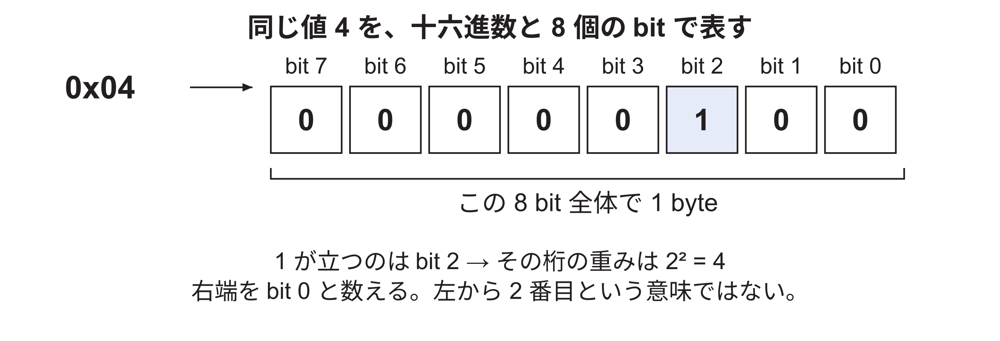
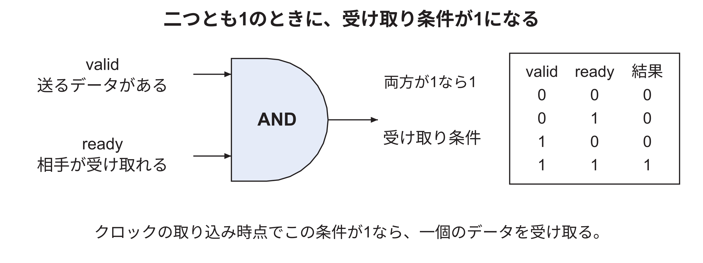
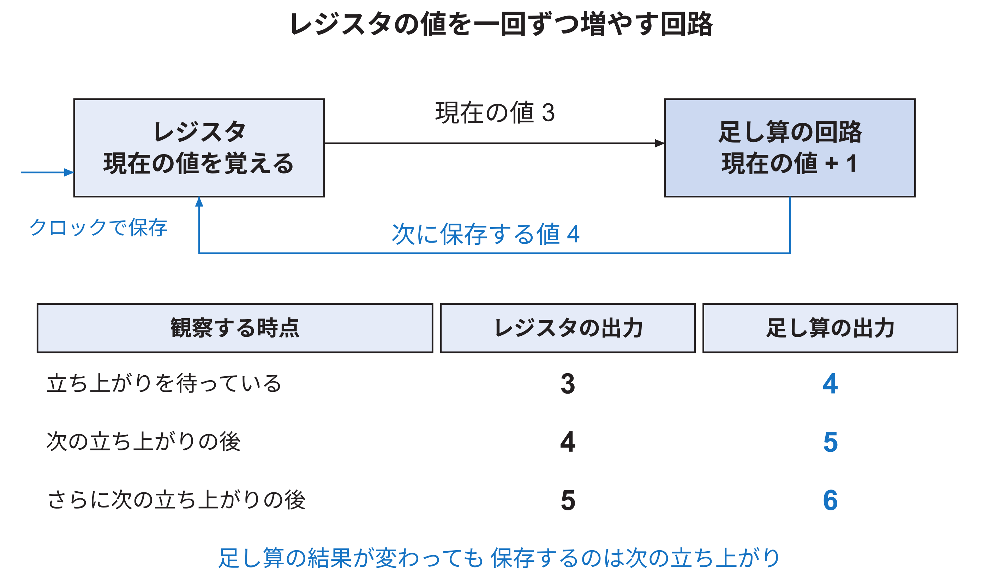
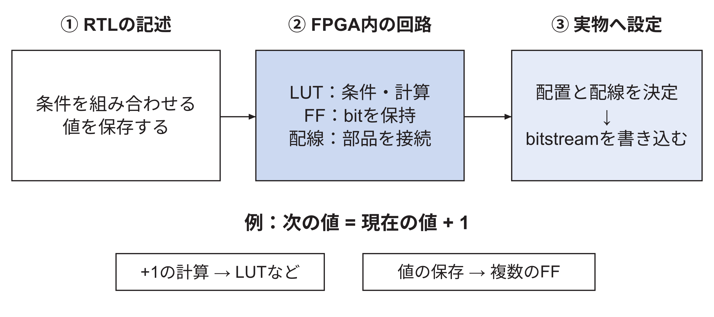
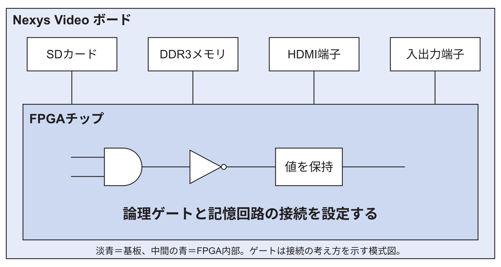

<!-- appendix-content:start -->
<a id="ch_k"></a>
# 付録K 回路とFPGAの基礎
<!-- appendix-content:end -->

[付録の総目次](../../技術付録.md) ｜ [論文本文](../../本文.md) ｜ [参考文献](../references.md)

[第I部 HDLとFPGAによるデジタル回路設計](README.md)

ファイルパスの表記は、[資料フォルダー](../../README.md)を基準とする。

## このページの目次

- [K.1 0と1で値を表す](#s_k_1)
  - [bitとbyteと16進数を小さな数で読む](#h0301)
- [K.2 論理ゲートをつないで回路にする](#s_k_2)
  - [論理ゲートをつなぐと何ができるか](#h0315)
- [K.3 値を覚える回路](#s_k_3)
  - [計算する回路と覚える回路を組み合わせる](#h0325)
- [K.4 CPUがプログラムを実行する](#s_k_4)
- [K.5 FPGAの中へ回路を作る](#s_k_5)
  - [論理式がFPGAの中へ入るまで](#h0342)
  - [CPUをFPGAに作った後、ゲームのfor文はどこで動くか](#h0347)
- [K.6 FPGAチップと基板を区別する](#s_k_6)

<!-- appendix-content:start -->
<a id="s_k_1"></a>
## K.1 0と1で値を表す

デジタル回路は、電気信号を0と1の二つの状態として扱う。実際の電圧は基板や端子の規格によって異なるが、論理の説明では0と1に整理する。一つの0または1をビットと呼ぶ。八つのビットをまとめた単位がバイトである。

二つのビットなら00、01、10、11の四通りを区別できる。数字に対応させれば0、1、2、3を表せる。三つなら八通り、八つなら256通りになる。一般にnビットで区別できる組合せは2のn乗通りである。32ビットの信号とは、32本分の0または1を同時に扱うまとまりである。

同じ32ビットでも、位置、色、命令、住所に相当する番号など、意味は用途によって違う。回路は名前から意味を理解するのではなく、設計した決まりに従ってそのビット列を処理する。送信側と受信側が同じ決まりを使うことが必要になる。

<a id="h0301"></a>
### bitとbyteと16進数を小さな数で読む

bitは0か1を入れる一桁である。二桁なら00、01、10、11の四通りを区別できる。三桁なら八通り、八桁なら256通りを区別できる。8 bitをまとめた単位が1 byteである。32 bitは4 byte、64 bitは8 byteになる。

ソース中の0xは「後ろの数を16進数で読む」という印である。16進数は0〜9の次にA、B、C、D、E、Fを使い、その次に桁が上がって10になる。したがって0x10は十進数の16であり、十進数の10ではない。先頭の0x自体は数値に含めない。

| 十進数 | 4 bitの二進数 | 16進数 | この論文での例 |
|---:|---|---|---|
| 0 | 0000 | 0x0 | 最初の要素や通常命令口 |
| 4 | 0100 | 0x4 | 32 bit一個分のbyte数 |
| 8 | 1000 | 0x8 | 状態レジスタまでの差 |
| 12 | 1100 | 0xc | 識別値レジスタまでの差 |
| 15 | 1111 | 0xf | 4 bitをすべて1にした値 |

16進数の一桁は4 bitに対応する。0x04の下位4 bitを二進数で書くと0100なので、右端をbit 0として数えたbit 2が1になる。この関係を使い、[付録B](../04-rasterix/appendix-b.md#ch_b)では0x00と0x04の操作で64 bitデータのどちら半分を選ぶかを説明する。

図K.1は、0x04を8 bitで書き直したものである。箱一個をbit一桁とし、右端から番号を付けている。薄い青の箱は1が入った桁であり、その桁の値を読む。



この図では、1が入っているのはbit 2だけなので、値は2の2乗で4になる。左側の0は、桁をそろえるために表示している。例えばbit 2を取り出す回路は、数値の「2」を取り出すのではなく、この列の特定の一桁を取り出す。


容量のKiBとMiBは、それぞれ1,024 byteと1,048,576 byteを単位にする。例えば512 MiBは512×1,048,576 byteである。「512」という数字だけでは、画素数かbyte数か回路の個数か分からないため、単位まで一緒に読む。

<a id="s_k_2"></a>
## K.2 論理ゲートをつないで回路にする

ANDゲートは、二つの入力が両方1のときだけ1を出す。NOTゲートは0を1へ、1を0へ反転する。例えば、「指示がある」と「受け取れる」が両方1なら受け渡す、という条件はANDで表せる。このように、複数の信号から条件を計算する回路を組み合わせ回路と呼ぶ。

入力が変われば出力も変わるが、現実の回路には変化が伝わる時間がある。たくさんのゲートを順につなぐと、その時間が積み重なる。後で説明するクロックを速くしすぎると、計算結果が安定する前に次の回路が値を読み取る可能性がある。

```systemverilog
assign Transfer = Valid & Ready;
```

これはSystemVerilogという回路記述言語の例である。Validは「渡したいデータがある」、Readyは「受け取れる」を表す信号名として使っている。&はビットごとのANDであり、ここでは二つが両方1ならTransferを1にする。assignは、この関係を持つ回路の接続を表す。プログラムの一行が一度だけ実行される、という意味ではない。

<a id="h0315"></a>
### 論理ゲートをつなぐと何ができるか

「書き込み要求がある」と「受け取る場所が空いている」を、それぞれ1 bitの信号で表す。要求をValid、空きをReadyと名付けると、両方が1のときだけ転送を成立させたい。その条件を計算するのがANDゲートである。



図K.2の左側二本は別の信号であり、右側は条件を計算した結果である。入力が1と0なら右側は0、1と1なら右側は1になる。ここで計算しているのは「今回受け取るか」であり、描画命令の32 bitデータそのものではない。実際の接続には、条件を伝える信号と、中身を運ぶ信号の両方がある。

`assign Transfer = Valid & Ready;`は、そのANDの関係を回路として書いた記述である。CPUがこの一行を繰り返し実行して条件を調べる、という意味ではない。FPGAには入力の組合せに応じて出力が変わる回路が用意される。

<a id="s_k_3"></a>
## K.3 値を覚える回路

ゲームには前の位置が必要であり、接続回路にも前に受け取った命令を覚える場所が必要である。そこで、値を保持する回路を使う。ある決めたタイミングで入力を取り込み、その後は次の取り込み時点まで値を保つ回路がフリップフロップである。複数のビットをまとめて保持する部分をレジスタと呼ぶことがある。

```systemverilog
always_ff @(posedge clk)
  if (reset) Count <= 0;
  else if (Transfer) Count <= Count + 1;
```

この説明用回路は、転送回数を覚える。clkが0から1へ変わる時点をposedgeと書く。その時点でresetが1ならCountを0にする。resetが0でTransferが1なら、前のCountに1を加えた値を保存する。それ以外では前の値を保つ。<=は、この取り込み時点で次の値を記憶するための記法である。

ここまでを組み合わせると、「いつ受け渡しが起こるかをANDで決め、その回数をレジスタへ覚える」という回路を作れる。後で登場する表示切り替えの回数も、同じように出来事を数えた値である。

<a id="h0325"></a>
### 計算する回路と覚える回路を組み合わせる

ANDゲートのように、現在の入力から現在の出力を決める部分を組合せ回路と呼ぶ。それだけでは「さっき何回受け取ったか」を覚えられない。回数を覚えるには記憶素子が必要になる。クロックに合わせて値を記憶するものを、この論文ではレジスタと呼ぶ。

例えばCountが4を覚えているとき、組合せ回路で4+1=5を求める。受け取り条件Transferが1なら、次のクロックの立ち上がりで5をCountへ保存する。Transferが0なら4を保持する。次のクロックでは、保持された値から再び次の候補を計算する。



図K.3の箱のCountが現在の値、足し算の先が次の候補である。矢印で戻っているのは、記憶した値を次の計算へ使うためである。時計の一回の合図で一回保存するので、足し算の出力ができた瞬間に何度も増え続ける回路ではない。

`always_ff @(posedge clk)`は「clkが0から1へ変わるときに記憶を更新する」と読む。`Count <= Count + 1`の右辺は更新前の値、左辺は次に保存する値である。`<=`をここでは大小比較と読まない。`if`は、次に保存する候補をどちらから選ぶかを決める。

一つのalways_ffの中で、Countと別のレジスタを更新していても、記述した順に古い値が順次上書きされるC言語の代入と同じには扱えない。本稿の回路例では、立ち上がり直前の値から、立ち上がり後に保持する値を考える。

<a id="s_k_4"></a>
## K.4 CPUがプログラムを実行する

[第2章](../../本文.md#ch_2)では「CPUがballXへ3を加える」と説明した。CPUの中にも、前節で扱った値を覚える回路と、足し算などを行う回路がある。CPUは、メモリから読み出した機械語命令に従って、どの値を読み、何を計算し、どこへ結果を残すかを選ぶ。

例えばballXが100のときは、値100をCPU内で使える場所へ読み、3を加え、得られた103を次の計算で使えるように保存する。CPU内で少量の値を覚える場所をレジスタという。よく使う値を毎回外部メモリから取り出す代わりに、レジスタに置いたまま計算を続ける場合もある。したがって、C++の一行が必ず一回の外部メモリ読み出しと書き込みになるわけではない。

C++をCPU用の機械語命令へ変換する道具がコンパイラである。CPU自身がC++の文章を読んで解釈するのではなく、変換後の命令列を実行する。同じように、描画ライブラリのglVertex2fという関数も、実行時にはCPUの命令列になる。「関数を一回呼ぶ」とは、CPUがその関数の中の処理へ進み、必要な計算をして戻ることであり、一つの論理ゲートだけを動かすことではない。

ここでいうCPUの機械語命令と、[第2章](../../本文.md#ch_2)の描画命令は別のものである。CPUは機械語命令を実行して計算やメモリへの保存を行う。その処理によって、描画回路へ渡すための描画命令をデータとして作る。後で描画命令を受け取って実行するのは描画回路である。「命令」という語を読むときは、どちらの回路に対する指示なのかを区別する。

RISC-Vは、この機械語命令やレジスタの使い方などの決まりの名前である。Wallyは、その決まりに従って命令を実行する具体的な回路設計である。FPGAは、そのWallyの回路を組み立てる場所になる。RISC-V、Wally、FPGAは同じ物の別名ではなく、それぞれ「命令の決まり」「CPUの設計」「回路を実現する部品」を指している。

<a id="s_k_5"></a>
## K.5 FPGAの中へ回路を作る

FPGAには、論理機能、値を覚える回路、内部メモリ、配線を切り替える仕組みなどが用意されている。設定データによって、それらをどのようにつなぐかを決める。この設定によってCPUや描画回路を構成する。CPUという別の物理チップをFPGAへ載せる操作ではない。

論理機能を作る主な部品がLUTである。LUTは入力の組合せに対する出力を記憶する表のように働く。例えば二入力ANDなら、00、01、10には0、11には1を対応させればよい。実際のFPGAのLUTはもっと多くの入力を扱えるが、必要な論理を小さな表へ割り当てるという考え方は同じである。

Block RAM、略してBRAMは、FPGA内にあらかじめ用意されたメモリのまとまりである。多くの値を保存する用途に使う。DSPは乗算などの計算に使える専用回路である。これらの使用率は、FPGAに用意された数のうち、作った回路がどれだけ使ったかを表す。

<a id="h0342"></a>
### 論理式がFPGAの中へ入るまで

FPGAには、組合せの計算に使うLUT、値を覚えるレジスタ、まとまった量を覚えるBlock RAM、配線の接続を選ぶ仕組みなどが用意されている。LUTは、入力の組合せに対する答えを保持する小さな表として理解できる。先ほどのANDなら、00、01、10には0、11には1という答えを設定する。

Vivadoは、回路ソースに書かれた計算や記憶を、これらの実物の部品へ割り当てる。この対応付けの大枠を作る処理が合成である。さらに、どの場所の部品を使い、どの配線を通るかを決める処理が配置配線である。最後に、その設定をFPGAへ送るbitstreamを作る。



図K.4は、説明用の小さな回路を資源へ対応させる考え方である。一つのANDが必ず一個のLUTになるという個数の予測図ではない。Vivadoは複数の式をまとめたり、不要な計算を消したりできる。実際に使った個数は[第13章](../../本文.md#ch_13)の配置配線後のレポートで確かめる。

<a id="h0347"></a>
### CPUをFPGAに作った後、ゲームのfor文はどこで動くか

FPGAへWallyの回路を設定すると、FPGA内に機械語命令を読んで実行するCPUができる。そのCPUが、SDカードから起動したLinux上でゲームの実行ファイルを動かす。ゲームのfor文やwhile文は、このCPUが繰り返し命令を実行することで進む。本研究では、ゲームのC++を直接、ボール専用の論理回路へ変換しているわけではない。

一方、描画回路の信号の接続やFIFOの容量は、FPGAへ設定する回路の一部である。ゲームを終了して別のゲームを起動しても、この配線や容量は変わらない。変えるには回路の設定ファイルを作り直す。ここが、ゲームのプログラムを変更する場合と、ゲーム機そのものの回路を変更する場合の違いである。

20 MHzというCPUのクロックは、毎秒2,000万回、回路の値を更新するための基準が来ることを示す。一回の基準でゲーム画面が一枚できるという意味ではない。CPUは多数の命令を実行し、メモリや周辺回路を待つこともある。そのためゲームの描画回数は、CPUのクロックの数字だけからは求められない。

<a id="s_k_6"></a>
## K.6 FPGAチップと基板を区別する

Nexys Videoは、FPGAチップの周りにDDR3メモリ、microSDスロット、映像端子、スイッチ、LEDなどを載せた基板である[NexysVideo](../references.md#ref_nexysvideo)。DDR3は基板上の別のメモリ部品であり、FPGA内のBRAMとは別である。画像を保存する大きな領域にはDDR3を使い、描画途中の作業などにはBRAMも使う。



図のゲートは、回路をつなぐという考え方を示した小さな例である。実際のCPUを数個のゲートだけで実装したという意味ではない。FPGAの外側の部品と、内側の制御回路を分けて描いている。基板上の配線は製造時に決まっており、設計者はその配線につながるFPGAの端子を使う。
<!-- appendix-content:end -->

---

[前：第8章 Wally開発者の設計・実装規律](chapter-08.md) ｜ [次：第9章 Wallyの階層と構成を読む](../02-wally/chapter-09.md)
