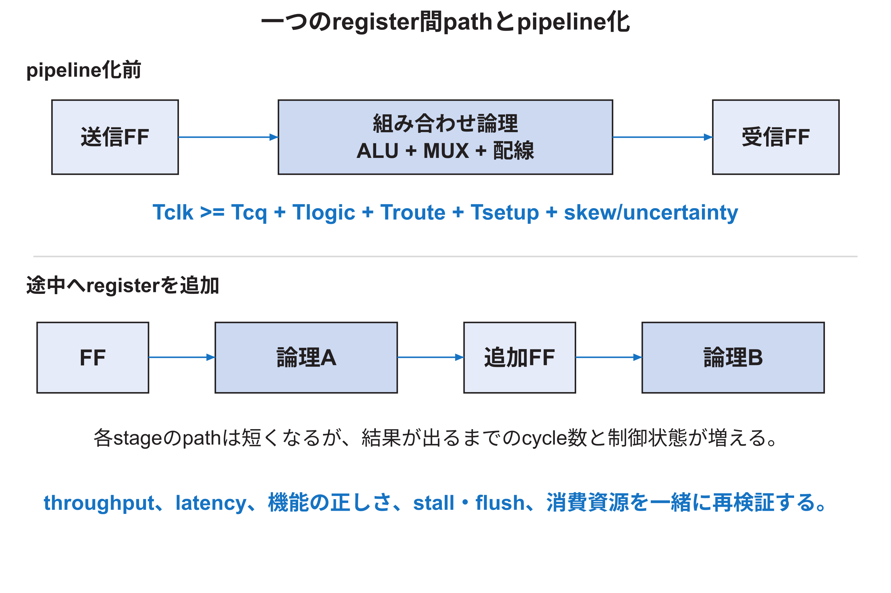
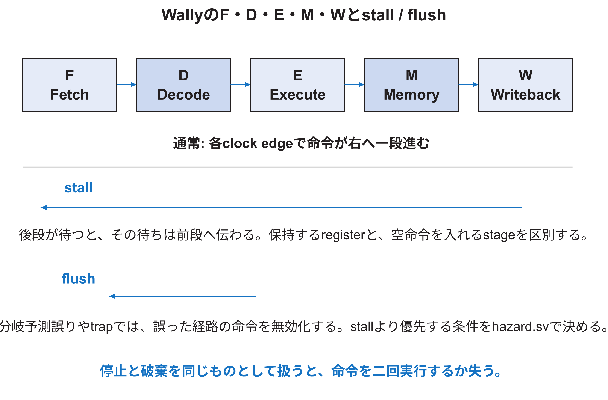

<!-- appendix-content:start -->
<a id="ch_4"></a>
# 第4章 Timing closureとpipeline設計
<!-- appendix-content:end -->

[付録の総目次](../../技術付録.md) ｜ [論文本文](../../本文.md) ｜ [参考文献](../references.md)

[第I部 HDLとFPGAによるデジタル回路設計](README.md)

ファイルパスの表記は、[資料フォルダー](../../README.md)を基準とする。

## このページの目次

- [4.1 register間pathの時間予算](#s_4_1)
- [4.2 setupとholdを分ける](#s_4_2)
- [4.3 WNS、TNS、failing endpoint](#s_4_3)
- [4.4 pipeline化が変えるもの](#s_4_4)
- [4.5 WallyのF、D、E、M、W](#s_4_5)
- [4.6 stallは保持、flushは無効化](#s_4_6)
- [4.7 forwardingとload-use hazard](#s_4_7)
- [4.8 critical pathをreportから読む](#s_4_8)
- [4.9 timing修正の順序](#s_4_9)
- [4.10 latency、throughput、clock frequencyを区別する](#s_4_10)
- [4.11 timing closureの完了条件](#s_4_11)

<!-- appendix-content:start -->
<a id="s_4_1"></a>
## 4.1 register間pathの時間予算

同期回路の代表的なsetup条件は、概念的に次である。

```text
Tclock >= Tcq + Tlogic + Troute + Tsetup + Tskew/uncertainty
```

送信FFがclock edge後に出力を変える時間、組み合わせ論理、配線、受信FFのsetup要求、clock差とuncertaintyを合計し、次の有効edgeまでに収める。Vivadoのslackはrequired timeとarrival timeの差としてreportされ、setupでは負なら指定周期を満たさない。[AMD906](../references.md#ref_amd906)



式は理解用の分解であり、実際のreportではclock path、data path、uncertainty、clock pessimismなどをtoolの定義で読む。単にRTLの演算子数を数えてdelayを決めない。

<a id="s_4_2"></a>
## 4.2 setupとholdを分ける

setup checkはdataが遅すぎないかを見る。hold checkは、同じedge直後にdataが早く変わり過ぎ、受信FFが古い値を保持すべき時間を破らないかを見る。clockを遅くすればsetupは改善しやすいが、holdは単純にclock周期を長くしても解決しない。

implementation toolはhold修正のためdata pathへdelayを加える場合がある。その変更がsetupを悪化させ得るため、max delayとmin delayの両方を見る。WNSだけを見て「timing成功」とせず、unconstrained path、clock interaction、hold violationも確認する。[AMD903](../references.md#ref_amd903)[AMD906](../references.md#ref_amd906)

<a id="s_4_3"></a>
## 4.3 WNS、TNS、failing endpoint

WNSは最悪pathのslack、TNSは負slackの総和である。一つのpathだけ大きく違反する場合と、多数のpathが少しずつ違反する場合では対策が異なる。endpoint数とclock groupを併記する。

達成可能な最大周波数を一回のWNSから断定しない。配置配線はstrategyやseedで変動し、異なるclock groupもある。固定条件で複数runを比較し、完全にrouteしたdesignの結果を使う。[AMD949](../references.md#ref_amd949)

<a id="s_4_4"></a>
## 4.4 pipeline化が変えるもの

組み合わせ論理の途中にregisterを入れると、一stageのpathを短くできる。しかし出力までのcycle数が増え、valid、stall、flush、exception、feedback loopを変更する。throughputが一cycle一件のままでもlatencyは増える。依存する命令やprotocolが追加latencyを許さない場合、bypassや待ち制御が必要になる。

pipeline化はtiming修正であると同時に機能変更である。registerだけを追加してtestが通るとは限らない。各stageの「data」と「そのdataが有効であるというcontrol」を一緒に遅らせる。

<a id="s_4_5"></a>
## 4.5 WallyのF、D、E、M、W

Wallyの基本pipelineはFetch、Decode、Execute、Memory、Writebackの五段で読む。IFUがPCと命令取得、IEUがdecode・整数演算、LSUがload/store、privileged unitがCSRとtrap、hazard unitがstall/flushを調整する。[Harris26](../references.md#ref_harris26)[Wally](../references.md#ref_wally)



stage suffixを手掛かりに、`InstrD`はDecode、`PCE`はExecute、`ReadDataW`はWritebackの値として読む。ただしすべてのsignalが単純に一stageだけに属するとは限らない。exception原因、cache stall、分岐予測情報は複数stageをまたぐため、宣言と接続を追う。

<a id="s_4_6"></a>
## 4.6 stallは保持、flushは無効化

stallはstageの内容を保持して進行を待つ。flushはそのstageの命令を無効化し、後でarchitectural stateへ影響しないようにする。Wallyの`hazard.sv`は、後段stallを前段へ伝え、最初に進めるstageへbubbleを入れる規則と、trap・return・CSR write・branch mispredictionによるflushをまとめる。[Wally](../references.md#ref_wally)

同じcycleにstallとflush原因がある場合の優先順位が重要である。例えば誤った経路の除算命令、cache miss中のtrap、WFIの割込みなどは、単純な全段clearでは扱えない。既存コメント、式、testを読み、変更前の不変条件を列挙する。

<a id="s_4_7"></a>
## 4.7 forwardingとload-use hazard

前の命令の結果がregister fileへ書き戻される前に、後の命令が必要とする場合がdata hazardである。ALU結果は後段からforwardできる場合がある。load dataはmemory access完了まで得られないため、直後の依存命令を一cycle以上stallする場合がある。

forwarding pathは性能を上げる一方、operand MUXと比較論理を増やし、Execute stageのcritical pathになり得る。新しい結果sourceを追加するときは、正しさ、priority、x0除外、valid、timingを同時に検討する。

<a id="s_4_8"></a>
## 4.8 critical pathをreportから読む

critical pathでは、startpoint、endpoint、clock group、logic level、cell delay、net delay、fanoutを読む。source fileの長さや、目立つ大きなmoduleだけで原因を推測しない。よく現れるcellやnetが複数のworst pathへ共通するかも調べる。[AMD906](../references.md#ref_amd906)[AMD949](../references.md#ref_amd949)

Wallyを20 MHzで動かしてtimingに余裕があっても、別domainの100 MHz RasterIXやpixel clockのpathは別groupである。また、unconstrained pathは「余裕がある」のではなく、正しく検査されていない可能性がある。

<a id="s_4_9"></a>
## 4.9 timing修正の順序

1. clockとgenerated clock、I/O delay、clock relationが正しいか確認する。
2. false pathやmulticycle pathが本当に仕様上成立するか確認する。
3. worst pathの論理とfanoutを特定する。
4. 不要なpriority、幅、重複計算を直す。
5. 必要ならpipeline、register複製、memory latency変更を設計する。
6. place/route strategyやphysical optimizationを比較する。
7. 同じ機能testとtiming reportで再確認する。

制約を緩めて赤いreportを消すことは、回路を高速化したことではない。false pathは、そのpathを機能上決してcaptureしないことを説明できる場合にだけ使う。multicycle pathは、受信側が何cycle後のedgeでcaptureするかをprotocolとして保証する必要がある。[AMD903](../references.md#ref_amd903)

<a id="s_4_10"></a>
## 4.10 latency、throughput、clock frequencyを区別する

clock frequencyは一秒あたりのcycle数、latencyは一件の開始から完了まで、throughputは定常状態で一秒または一cycleに完了できる件数である。100 MHzの回路が20 MHzの回路より常に五倍速いとは限らない。100 MHz側が一件に100 cycle、20 MHz側が一件に1 cycleなら結果は逆になる。

本研究の命令FIFOでも、CPU 20 MHzとRasterIX 100 MHzだけから満杯・空を予測できない。一命令当たりの語数、CPUのstore間隔、RasterIXの命令種類、memory stall、display operationを測る。

<a id="s_4_11"></a>
## 4.11 timing closureの完了条件

| 確認 | 失敗時に意味すること |
|---|---|
| `check_timing`に重大な未制約がない | 検査対象が欠けている可能性 |
| setup/hold slackが全groupで非負 | 指定条件のtiming違反 |
| `report_clock_interaction`が意図と一致 | clock関係またはexceptionの誤り |
| `report_cdc`の違反を説明できる | CDC構造の不足または認識漏れ |
| 機能testが変更前後で一致 | pipeline・reset・制約変更の機能破壊 |
| 実機で持続動作する | board、電源、温度、I/Oを含む問題 |

正slackだけで完了とせず、正しいconstraintの下で正slackであることを確認する。
<!-- appendix-content:end -->

---

[前：第3章 資源効率を決めるRTL設計](chapter-03.md) ｜ [次：第5章 FPGAへ実装されるまで](chapter-05.md)
