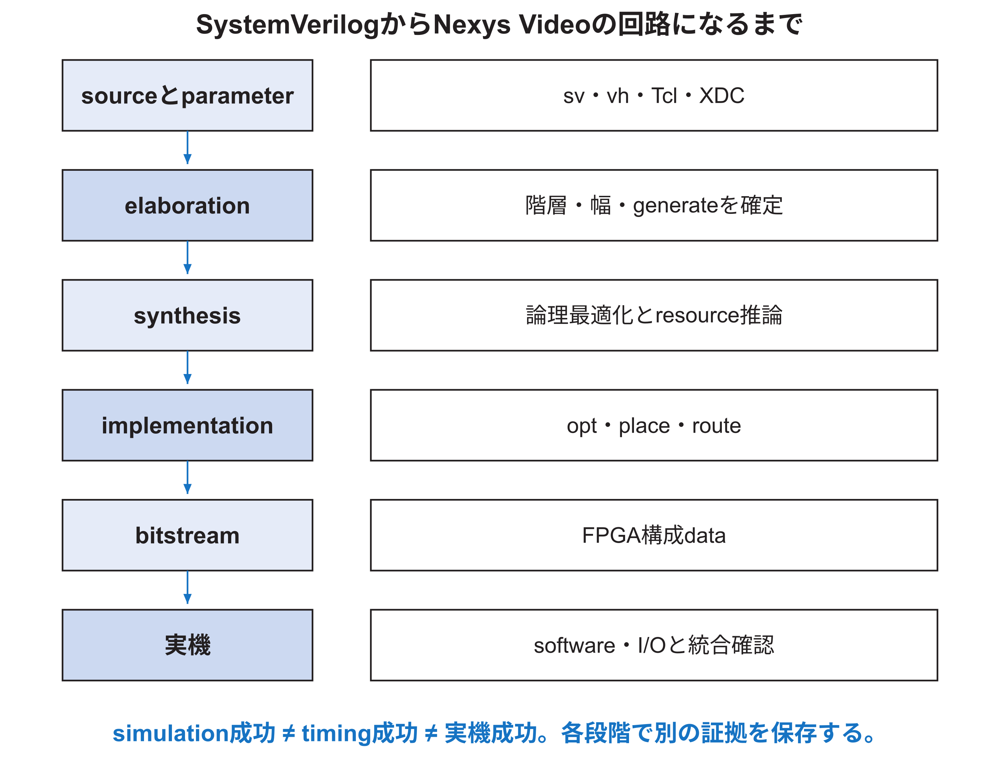

<!-- appendix-content:start -->

# 第5章 FPGAへ実装されるまで
<!-- appendix-content:end -->

[付録の総目次](../../技術付録.md) ｜ [論文本文](../../本文.md) ｜ [参考文献](../references.md)

[第I部 HDLとFPGAによるデジタル回路設計](README.md)

ファイルパスの表記は、[資料フォルダー](../../README.md)を基準とする。

## このページの目次

- [5.1 Artix-7の主な資源](#s_5_1)
- [5.2 build flowの各段階](#s_5_2)
- [5.3 compile orderとpackage](#s_5_3)
- [5.4 合成後netlistと配置配線後netlist](#s_5_4)
- [5.5 XDCはpin表だけではない](#s_5_5)
- [5.6 primary clockとgenerated clock](#s_5_6)
- [5.7 input/output delay](#s_5_7)
- [5.8 false pathとasynchronous clock group](#s_5_8)
- [5.9 utilizationと配置可能性](#s_5_9)
- [5.10 bitstreamとsoftware imageを区別する](#s_5_10)
- [5.11 build結果の保存単位](#s_5_11)

<!-- appendix-content:start -->

## 5.1 Artix-7の主な資源

Nexys VideoのArtix-7には、組み合わせ論理を実装するLUT、状態を保存するFF、分散memory、block RAM、乗算・積和に向くDSP、clock管理、I/O buffer、serializerなどがある。DDR3 controllerのPHYやclocking wizardはdevice固有資源とvendor IPを使う。[NexysVideo](../references.md#ref_nexysvideo)[AMD901](../references.md#ref_amd901)

同じ論理機能でも、どの資源へmappingされるかで面積、速度、powerが変わる。sourceの演算子名から最終資源を断定せず、synthesis reportとschematicを確認する。

## 5.2 build flowの各段階

elaborationはparameter、generate、幅、階層を確定する。synthesisはRTLを論理netlistへ変換する。optimizationは定数伝搬、不要論理削除などを行う。placementはcellの場所、routingは配線を決める。bitstream generationは配置配線結果をFPGA設定dataへする。[AMD901](../references.md#ref_amd901)[AMD949](../references.md#ref_amd949)

`fpga/generator/wally.tcl`はsource/IP/constraintを読み、compile orderを更新し、synthesisとimplementationを実行し、timing、utilization、CDC report、simulation netlist、bitstreamを生成する。どの段階で失敗したかをlogから分ける。[Console26](../references.md#ref_console26)

## 5.3 compile orderとpackage

SystemVerilog packageやtypedefは、利用するmoduleより先にcompileする必要がある。`include_dirs`はfileを自動でcompileする指定ではなく、`` `include ``の探索場所を定める。fileを置いただけではVivado projectへ入らない。

同名moduleを別libraryに置く場合、どのinstanceがどのlibraryを参照するかを管理する。RasterIX sourceを別libraryへ置く処理は、Wally側の同名dependencyとの衝突を避けるためである。compile order reportを保存する。

## 5.4 合成後netlistと配置配線後netlist

合成後netlistはlogical optimizationとtechnology mapping後の構造で、まだ最終配線遅延を持たない。配置配線後netlistは実際の配置・配線を反映する。functional simulation netlistは論理動作、timing simulationはSDF遅延を用いる。

timing simulationを行っても、analog signal integrity、電源noise、温度全範囲、外部deviceの全挙動を完全には再現しない。STA、CDC、simulation、実機試験を役割分担する。

## 5.5 XDCはpin表だけではない

XDCにはpackage pin、IOSTANDARD、drive、slew、clock、I/O delay、timing exception、physical constraintが入る。XDC commandはTclとして順に評価されるため、対象objectが存在する時点とfile orderが重要である。[AMD903](../references.md#ref_amd903)

Nexys Videoの`constraints-nexysvideo.xdc`ではboard pinと電気規格、非同期input、SD I/O delay、TMDS出力などを指定する。誤ったIOSTANDARDは機能不良だけでなく電気的問題を起こし得る。board manualとbank voltageを照合する。

## 5.6 primary clockとgenerated clock

外部oscillatorへ`create_clock`を与え、MMCM/PLL出力はgenerated clockとして関係をtoolへ伝える。vendor IPが制約を生成する場合、同じclockへ重複・矛盾した定義を加えない。`report_clocks`と`report_clock_interaction`で認識結果を確認する。[AMD903](../references.md#ref_amd903)

RTLのsignal名が`clk100`だから100 MHzとしてtiming解析されるわけではない。constraint objectがperiodとsource relationを定義する。

## 5.7 input/output delay

外部deviceとの同期interfaceでは、board上の相手がいつdataを出し、いつcaptureするかを基準clockに対して指定する。`set_input_delay`はFPGA pinまでの外部arrival、`set_output_delay`は外部receiverの要求を表す。値はFPGA内部delayを手入力するためのものではない。

UARTのような非同期signalはsynchronizerとprotocol samplingで扱う。SD SPIのようにCPU clockからedgeを作る経路では、card/PCBのreturn budgetと内部pathを分けてconstraintする。仮の数値を「規格保証」として扱わない。

## 5.8 false pathとasynchronous clock group

metastabilityを受けるsynchronizerの最初のFFまでのpathなど、通常の同期captureとして解析できないpathへ例外を置く場合がある。しかしexceptionはCDC回路を作らない。false pathを付けても、dataが安全に渡るわけではない。

clock間をasynchronousと宣言すると、それらの通常timing解析を止める。代わりにsynchronizer/FIFO構造、`report_cdc`、protocol testで安全性を確認する。domain内pathは引き続きtiming解析する。

## 5.9 utilizationと配置可能性

device全体のLUT使用率が50%でも、特定clock regionやBRAM columnへ偏ればroutingが混雑する。hierarchical utilization、pblock、congestion、clock regionを読む。RasterIXとCPUを同時実装した構成では、全体量だけでなくmemory、wide bus、display経路の物理分布が重要になる。

place directiveで結果が改善しても、原因をRTL変更と混同しない。strategyは再現条件として保存する。

## 5.10 bitstreamとsoftware imageを区別する

bitstreamはFPGA回路を設定する。Linux kernel、device tree、OpenSBI、game executableはsoftware imageであり、SDまたはmemoryへ置かれる。RTLだけ直して古いbitstreamを使う、device treeだけ直して古いSDを使う、といった取り違えをhashで防ぐ。

board上のCPUが同じでも、bitstreamが違えばperipheral mapやclockが変わる。softwareは実機のhardware構成と一致する情報を使う必要がある。

## 5.11 build結果の保存単位

保存すべきものは、source commit、submodule commit、Vivado版、target part、environment、Tcl/XDC、strategy、主要report、bitstream hashである。generated IPをGitへ含めるか再生成するかはproject方針で決めるが、再生成手順とtool版を失わない。
<!-- appendix-content:end -->

---

[前：第4章 Timing closureとpipeline設計](chapter-04.md) ｜ [次：第6章 Clock domain crossingとreset設計](chapter-06.md)
