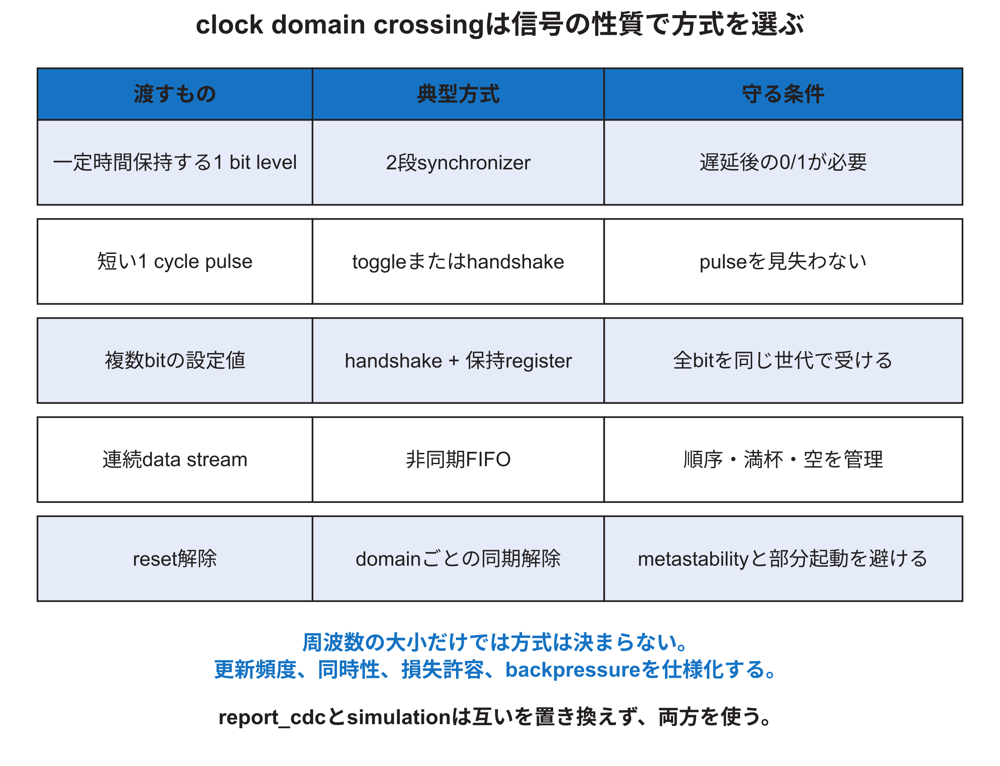

<!-- appendix-content:start -->

# 第6章 Clock domain crossingとreset設計
<!-- appendix-content:end -->

[付録の総目次](../../技術付録.md) ｜ [論文本文](../../本文.md) ｜ [参考文献](../references.md)

[第I部 HDLとFPGAによるデジタル回路設計](README.md)

ファイルパスの表記は、[資料フォルダー](../../README.md)を基準とする。

## このページの目次

- [6.1 clock domainを先に色分けする](#s_6_1)
- [6.2 metastabilityはsimulationだけでは見えない](#s_6_2)
- [6.3 一bit levelの二段synchronizer](#s_6_3)
- [6.4 pulse、toggle、handshake](#s_6_4)
- [6.5 複数bitを個別同期しない](#s_6_5)
- [6.6 reset assertionとdeassertion](#s_6_6)
- [6.7 resetで初期化すべき状態](#s_6_7)
- [6.8 clock enableと新しいclock domain](#s_6_8)
- [6.9 本構成の主な境界](#s_6_9)
- [6.10 CDC review checklist](#s_6_10)

<!-- appendix-content:start -->

## 6.1 clock domainを先に色分けする

一つのclock edgeで更新されるregister群をclock domainとして考える。Wally CPU clock、RasterIX clock、pixel clock、DDR user clockなどをブロック図で色分けする。各interfaceにsource domain、destination domain、data性質、更新頻度、resetを記録する。

clock周波数が同じでも、位相関係が保証されなければasynchronous crossingである。逆に同じMMCMから生成され、関係をtoolへ伝えられるclockはsynchronousに解析できる場合がある。

## 6.2 metastabilityはsimulationだけでは見えない

非同期signalがFFのsetup/hold window付近で変化すると、FF出力が一定時間0/1の中間状態になり得る。digital RTL simulationは通常このanalog現象を再現しない。synchronizerはmetastabilityの発生を0にするのではなく、次段へ伝わる確率を下げる。

MTBFはclock、data toggle rate、device特性、解決時間に依存する。二段FFという形だけで、任意の安全要求を自動達成するとは限らない。

## 6.3 一bit levelの二段synchronizer

一定時間保持されるenableやstatus levelは、destination clockで二段以上のFFを通す典型方式がある。最初のFFがmetastableになっても、二段目で使うまでに解決時間を与える。source側の短いpulseは、destinationが一度もsampleせず消える可能性があるため、この方式だけでは不十分である。

## 6.4 pulse、toggle、handshake

短いeventはsource側でtoggle bitを反転し、destination側で同期後の変化を検出できる。eventが次々に来る場合、前の変化をdestinationが観測する前に再反転すると失う。request/acknowledge handshakeなら一件ずつ確実に渡せるが、往復latencyがある。

event lossを許すか、複数件を数えるか、sourceを待たせられるかで方式を選ぶ。

## 6.5 複数bitを個別同期しない

複数bit busを各bitの二段FFへ入れると、各bitの解決時刻が異なり、存在しなかった組合せを受ける可能性がある。ゆっくり変わる設定値なら、sourceで値を保持し、同期したrequestを渡し、destinationでまとめてcaptureし、ackを返す。

連続streamには非同期FIFOを用い、data memoryとpointer同期で順序を守る。Gray codeはpointer更新時に変化するbit数を一つへ抑えるが、CDC constraintと同期FFが不要になるわけではない。

## 6.6 reset assertionとdeassertion

外部resetを非同期assertし、clockが安定した後に各domainで同期deassertする方式がよく使われる。assertを早く効かせつつ、解除edgeをdomain clockへそろえるためである。複数domainが通信する場合、片側だけ先に動いて要求を出さないようstartup protocolを設ける。

`ClockLocked`やDDR calibration完了をCPU reset解除へ使う場合、それらのdomainと同期、glitch、再lock時の挙動を確認する。LED表示は観測補助であり、reset sequenceの形式的保証ではない。

## 6.7 resetで初期化すべき状態

control FSM、valid bit、FIFO pointer、protocol stateは既知状態が必要である。data array全体はvalidが0なら読まれない設計にできる場合がある。大きなmemoryを一cycleで全clearする記述は物理的に実現できず、FFへ展開されるか、複数cycle clear FSMが必要になる。

起動時のframebuffer初期化では、resetで全画素を同時clearするのではなく、commandまたはCPUが領域を書き、完了を待つ。制御stateのresetと画像dataの初期化を分ける。

## 6.8 clock enableと新しいclock domain

低速動作が必要なだけなら、元clockでcounter enableを作り、registerを一部cycleだけ更新する方が、新しいlogic-generated clockを作るより安全なことが多い。新しいclock domainを作ると、clock buffer、constraint、CDC、resetが増える。

外部protocolが特定edgeを要求する場合や、pixel serializerのように専用clockが必要な場合は、MMCM/PLLとclocking resourceを使う。

## 6.9 本構成の主な境界

| 境界 | 運ぶもの | 採用する仕組み |
|---|---|---|
| CPU→RasterIX | 32 bit commandと終端 | AXI4-Stream非同期FIFO |
| RasterIX→CPU | status/response | response経路と同期 |
| GPU→pixel | frame切替要求・address | handshake型制御 |
| DDR user clock間 | memory transaction | vendor AXI clock converter/IP |
| 外部button/UART | 一bit非同期入力 | synchronizerとprotocol sampling |

名称だけで安全とせず、source/destination clock、reset、full/empty、request/ackの各signalを固定版sourceで確認する。

## 6.10 CDC review checklist

1. すべてのregisterをclock domainへ分類したか。
2. crossing signalのbit数と意味を分類したか。
3. pulseを失う可能性を評価したか。
4. busの同時性を守る仕組みがあるか。
5. backpressure時にdataを保持するか。
6. reset中と片側だけ起動した状態を扱うか。
7. `report_cdc`のwarningを一件ずつ説明したか。
8. 非同期位相を変えたsimulationまたはformal propertyがあるか。

「二段FFを入れた」だけを完了条件にしない。
<!-- appendix-content:end -->

---

[前：第5章 FPGAへ実装されるまで](chapter-05.md) ｜ [次：第7章 検証を層に分ける](chapter-07.md)
