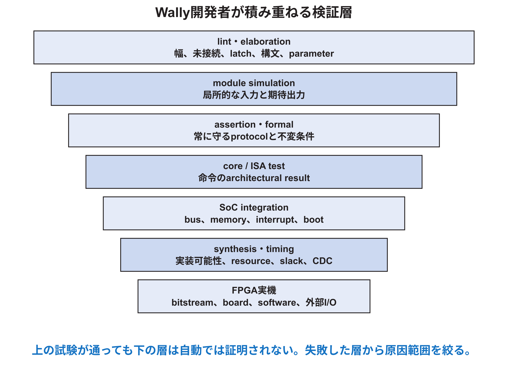

<!-- appendix-content:start -->
<a id="ch_7"></a>
# 第7章 検証を層に分ける
<!-- appendix-content:end -->

[付録の総目次](../../技術付録.md) ｜ [論文本文](../../本文.md) ｜ [参考文献](../references.md)

[第I部 HDLとFPGAによるデジタル回路設計](README.md)

ファイルパスの表記は、[資料フォルダー](../../README.md)を基準とする。

## このページの目次

- [7.1 test caseより先にpropertyを書く](#s_7_1)
- [7.2 lintとelaboration](#s_7_2)
- [7.3 module simulation](#s_7_3)
- [7.4 assertion](#s_7_4)
- [7.5 formal verification](#s_7_5)
- [7.6 core-levelとISA test](#s_7_6)
- [7.7 differential verificationとRVVI](#s_7_7)
- [7.8 integration simulation](#s_7_8)
- [7.9 合成後・配置配線後の確認](#s_7_9)
- [7.10 FPGA実機とILA](#s_7_10)
- [7.11 coverage](#s_7_11)
- [7.12 bug reportを再現可能にする](#s_7_12)

<!-- appendix-content:start -->
<a id="s_7_1"></a>
## 7.1 test caseより先にpropertyを書く

propertyは常に守るべき条件、test caseは特定の入力例である。例えばvalid/ready interfaceでは「validが1でreadyが0の間、dataとlastを保持する」がpropertyである。readyを3cycle下げる試験はその一例である。

要求をpropertyへ変換すると、正常例だけでなく境界と停止条件が見える。入力範囲、reset、同時event、overflow、illegal accessを列挙する。



<a id="s_7_2"></a>
## 7.2 lintとelaboration

lintは未使用signal、幅変換、multiple driver、latch、unreachable code、coding styleなどを早期に見つける。elaborationはparameterとgenerateを確定し、存在しないportや幅不一致を検出する。warningを数で無視せず、新規warningがない状態を保つ。

lint cleanは機能正しさを証明しないが、後段debugのnoiseを減らす。意図的な例外は狭い範囲で理由をコメントし、全体disableを避ける。[AMD901](../references.md#ref_amd901)[AMD949](../references.md#ref_amd949)

<a id="s_7_3"></a>
## 7.3 module simulation

小さなmoduleへ直接入力し、全分岐と境界を試す。combinational moduleなら全入力を総当たりできる場合がある。FSMなら各状態・遷移・wait・resetを試す。random testは広い探索に有効だが、seedと失敗入力を保存する。

clocked interfaceでは、値だけでなくcycleとhandshakeを検査する。dataが正しくても一cycle早い、wait中に変化する、二回side effectを起こす場合は失敗である。

<a id="s_7_4"></a>
## 7.4 assertion

assertionはsimulation中またはformal toolでproperty違反を検出する。例として、streamの停止中にdataを保持するpropertyは次の考え方になる。

```systemverilog
assert property (@(posedge clk) disable iff (reset)
  valid && !ready |=> valid && $stable({data, last}));
```

実際に導入するときは、protocolがvalid取消しを許すか、reset極性、unknown値、連続stallを仕様と照合する。assertionをtestbenchだけに置くかinterface近くへbindするかもproject方針で決める。

<a id="s_7_5"></a>
## 7.5 formal verification

formalは、定めた前提の下で全状態・全入力についてpropertyの反例を探索できる。小さなdecoder、arbiter、FIFO control、算術等価性に有効である。state explosionがあるため、SoC全体を無条件に証明するより、境界を分ける。

「solverがunsat」とは、model化した論理式と前提の範囲で反例がない意味である。RTL全体、synthesis、analog、softwareまで自動で証明した意味に広げない。[付録Z](../04-rasterix/appendix-z.md#ch_z)はこの範囲分けを実例で示す。

<a id="s_7_6"></a>
## 7.6 core-levelとISA test

ISA testは命令のarchitectural動作を調べる。Wally testbenchはELFを読み、構成に応じたtest群を選び、結果を照合する。新しいmicroarchitecture最適化では、対応する命令testと回帰testを実行する。[Wally](../references.md#ref_wally)

ISA testが通っても、未試験のinterrupt timing、cache競合、peripheral integration、Linux workloadは残る。coverageとsystem testを追加する。

<a id="s_7_7"></a>
## 7.7 differential verificationとRVVI

reference modelとretired instruction traceを比較すると、同じ命令列でarchitectural stateが一致するかを確認できる。内部pipeline timingは異なってよい。比較interfaceは、PC、instruction、register write、memory effect、trapなど、commit時の情報を正確に対応付ける。

reference model自身の構成、ISA extension、未定義動作をそろえる。差分が出た最初のretire位置から原因を絞る。

<a id="s_7_8"></a>
## 7.8 integration simulation

core、uncore、memory、peripheralを接続し、address decode、bridge、interrupt、bootを試す。周辺回路追加では、ID read、read/write register、wait state、illegal access、reset、interruptを段階化する。RasterIXではAPB wrapper単体、FIFO、display swap、共有DDR、実gameの順に広げた。

一度にLinux bootだけを試すと、失敗原因が広過ぎる。小さなbare-metal testでregister accessを確認してからOSへ進む。

<a id="s_7_9"></a>
## 7.9 合成後・配置配線後の確認

RTL simulationと合成結果が異なる原因には、Xの扱い、初期値、範囲外index、複数driver、unsupported constructがある。必要な境界では合成後functional simulationを行う。timing simulationは遅延を含むが、実行時間が長く、全system回帰の代わりにはしにくい。

本研究のFloatToInt監査では、未変更RTLの4値simulationとArtix-7合成後functional netlistで結果が異なった。これは、どちらか一方だけで全入力の正しさを主張してはいけない例である。

<a id="s_7_10"></a>
## 7.10 FPGA実機とILA

実機はclock、reset、DDR calibration、board pin、外部device、softwareを含む統合証拠を与える。内部signalを観測するILAは有効だが、probe追加でplacement/timingが変わる可能性がある。trigger条件、capture depth、clock domainを記録する。

LEDやUARTは低costの観測点である。意味をsourceと対応付け、点灯だけから未観測の内部全体を正常と断定しない。

<a id="s_7_11"></a>
## 7.11 coverage

code coverageはline、branch、toggle、FSM stateなど、simulationが通った場所を示す。functional coverageは仕様上の組合せを定義する。100% code coverageでもassertionが不十分ならbugは残る。未到達codeがdeadなのかtest不足かを判断する。

parameter構成ごとに存在するhardwareが違うため、一構成のcoverageを全構成へ一般化しない。

<a id="s_7_12"></a>
## 7.12 bug reportを再現可能にする

最低限、commit、submodule、tool版、parameter、test名、seed、command、期待値、実測値、最初の失敗cycle、logを残す。実機ならboard、bitstream hash、SD image、接続、電源投入順も含める。

「たまに止まる」から、例えば「reset解除後の第127回commandで`valid=1, ready=0`中に`data`が変化する」まで狭めると、修正と回帰testを作れる。
<!-- appendix-content:end -->

---

[前：第6章 Clock domain crossingとreset設計](chapter-06.md) ｜ [次：第8章 Wally開発者の設計・実装規律](chapter-08.md)
