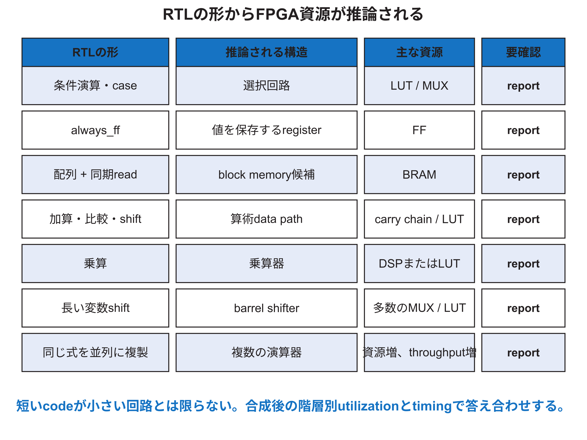

<!-- appendix-content:start -->

# 第4章 資源効率を決めるRTL設計
<!-- appendix-content:end -->

[付録の総目次](../../技術付録.md) ｜ [論文本文](../../本文.md) ｜ [参考文献](../references.md)

[第I部 HDLとFPGAによるデジタル回路設計](README.md)

ファイルパスの表記は、[資料フォルダー](../../README.md)を基準とする。

## このページの目次

- [4.1 「好ましい書き方」の意味](#s_3_1)
- [4.2 MUXとpriority論理](#s_3_2)
- [4.3 演算子と専用資源](#s_3_3)
- [4.4 bit幅は面積と遅延の設計値である](#s_3_4)
- [4.5 memoryをBRAMへ推論させる](#s_3_5)
- [4.6 register enableとclock gating](#s_3_6)
- [4.7 hardwareの並列化と資源共有](#s_3_7)
- [4.8 fanout、logic depth、routing](#s_3_8)
- [4.9 hierarchyを保つ理由とflattenする理由](#s_3_9)
- [4.10 resource reportを読む](#s_3_10)
- [4.11 最適化の前後で保存する証拠](#s_3_11)

<!-- appendix-content:start -->
FPGAの使用量は、ソースの行数ではなく、同時に存在させる計算器や保存場所の数と大きさで決まる。例えば一つの乗算器を順番に使う案と、二つを並べる案では、同じ二回の乗算でも回路と待ち時間が違う。ここでは、何を共有し、何を同時に動かすかを決めてから、合成結果を読む。

## 4.1 「好ましい書き方」の意味

資源効率のよいRTLには、単一の万能な書式はない。望むハードウェアを明確に暗示し、対象 deviceが持つ専用資源へtoolが推論でき、timing制約と機能要求を満たす書き方が好ましい。可読性だけ、行数だけ、LUT数だけで決めない。[Harris26](../references.md#ref_harris26)[AMD901](../references.md#ref_amd901)[AMD949](../references.md#ref_amd949)

最適化前に、baselineの機能、クロック、utilization、timing、power条件を保存する。変更後は同じ条件で比較する。異なるVivado版、strategy、constraintを混ぜると、RTL変更の効果とtool設定の効果を分離できない。

## 4.2 MUXとpriority論理

三項演算子や`case`はMUXを推論する。互いに排他的な選択なら平衡したMUXになりやすい。長い`if`/`else if` chainは先頭条件に優先順位を与え、priority chainを作る可能性がある。優先順位が仕様なら正しいが、不要な優先順位はlogic depthを増やし得る。

one-hot selectをORでまとめる場合は、本当に同時に一つしか立たないことをassertする。Wallyのuncore読出しMUXは番地 decodeの選択を前提に複数dataをまとめる。decoderとMUXを別々に読むだけでなく、選択の排他性、未選択時のready、errorを一組で確認する。

## 4.3 演算子と専用資源

加算・減算はFPGAのcarry chainを使いやすい。定数shiftは配線変更だけで済むことが多いが、可変shiftはMUX段を持つbarrel shifterになり得る。乗算は幅や設定によりDSPへmappingされるかLUTへ実装される。除算は組み合わせで大きな回路にするか、複数周期の反復器にするかで面積と遅延が大きく異なる。

演算子を手作りgateへ展開すれば必ず小さくなるわけではない。合成toolは既知の演算構造を認識して最適化する。専用資源を使いたい場合は、AMDの推論template、synthesis report、technology schematicを照合する。[AMD901](../references.md#ref_amd901)

## 4.4 bit幅は面積と遅延の設計値である

data幅を64 bitから32 bitへ減らせば、加算器、MUX、レジスタ、配線の多くは小さくなる。ただし、architectureが64 bitを要求する経路を狭めれば機能を壊す。番地全体、data全体、index、offset、counterなど、必要範囲を別々に求める。

counterが0から999までなら10 bitで足りるが、将来パラメータを増やすなら`$clog2`の境界、値1、power-of-two、最大値を確認する。`$clog2(1)`が0になる状況で0幅vectorを作らないよう、最小幅を定める。

## 4.5 memoryをBRAMへ推論させる

大きな配列をFFで作ると資源を大量に使う。Vivadoは特定の同期read/write idiomからblock RAMを推論できる。非同期read、port数、byte enable、read-during-writeの意味、リセット方法がprimitiveの能力と合わない場合、distributed RAMやFFへ崩れることがある。[AMD901](../references.md#ref_amd901)

Wallyの`src/generic/mem`には、用途別のメモリ wrapperがある。設計者は個々のモジュールで独自配列を乱立させず、必要なport、遅延、byte enable、初期化、ASIC/FPGA差をwrapperへ集約する。メモリの出力だけをリセットできる場合と、配列全bitをリセットしようとしてBRAM推論を失う場合を区別する。

## 4.6 register enableとclock gating

値を更新しない周期では、`if (en) q <= d;`というクロック enableを使う。FPGAのFFにはenable機能があり、合成toolが利用できる。一般RTLで`clk & en`を作り、それを新しいクロックとして配ると、glitch、skew、未制約クロックを招く。クロックを止める必要がある場合は専用clocking resourceと設計methodologyを使う。

enableにもcostがある。多数のレジスタへ一つのenableを配るとhigh fanout netになる。data側MUXと専用enableのどちらになるか、fanout、placement、powerをreportで確認する。

## 4.7 hardwareの並列化と資源共有

二つの演算を同じ周期に実行するなら、原則として二つ分の演算資源が必要になる。一つの乗算器を二周期で共有すれば面積を減らせるが、MUX、FSM、レジスタが増え、遅延とthroughputが変わる。資源共有は「同時に必要でない」ことをscheduleとして設計する作業である。

CPU パイプラインでは、各段が異なる命令を同時処理する。ALUを別段の処理と安易に共有すると、structural hazardが生じる。共有するならstall条件と性能影響まで設計する。

## 4.8 fanout、logic depth、routing

一つの信号が数千のendpointを駆動すると、driverの複製や長いroutingが必要になる。RTL上の論理段数が少なくても、routing delayがcritical pathの大半になる場合がある。リセット、stall、global enable、wide decodeはhigh fanoutになりやすい。

対策には、階層ごとのlocal decode、レジスタ複製、パイプライン、物理的に近い階層分割がある。ただし手動複製は等価性と更新の同時性を守る。まずtiming reportでlogic delayとnet delay、fanoutを確認し、想像だけで複製しない。[AMD906](../references.md#ref_amd906)[AMD949](../references.md#ref_amd949)

## 4.9 hierarchyを保つ理由とflattenする理由

モジュール階層は理解、再利用、局所検証に役立つ。一方、強い階層境界が最適化を妨げることもある。Vivadoは階層をflattenまたはrebuiltし、境界を越えて最適化できる。debugしやすさ、incremental build、OOC IP、timing最適化のtrade-offを考える。

ソース上のモジュール名が合成後に残るとは限らない。階層別utilizationを比較したい場合は、同じflatten方針とreport条件を固定する。

## 4.10 resource reportを読む

総使用率だけでなく、階層別のLUT、LUTRAM、FF、BRAM、DSP、BUFGを読む。利用率が低くてもtimingは失敗し得る。逆に高利用率でも、配置可能でslackが正なら動作し得るが、routing congestionや将来拡張の余裕は小さい。

LUT数が減ってFF数が増えるパイプライン化、BRAMが増えてLUTRAMが減るメモリ推論など、一種類だけの増減で優劣を決めない。目的が最高クロック、最低面積、最低遅延、最低powerのどれかを明示する。

## 4.11 最適化の前後で保存する証拠

| 種類 | 最低限保存するもの | 比較時の注意 |
|---|---|---|
| ソース | commitとdiff | generated ファイルだけを比較しない |
| 機能 | 同じtestと結果 | 入力seed、パラメータを固定する |
| 合成 | utilization階層表 | 対象 device、strategyを固定する |
| timing | worst path、WNS、TNS | クロックとexceptionを固定する |
| 実機 | bitstream hash、条件、log | 古いbitstreamとの取り違えを防ぐ |

「資源効率がよい」と主張するなら、少なくとも機能が同じであることと、比較したresource指標を示す。「高速化した」と主張するなら、timing closureと実行性能のどちらを意味するかを分ける。
<!-- appendix-content:end -->

---

[前：第3章 SystemVerilogから回路を読み取る](systemverilog-circuits.md) ｜ [次：第5章 クロックとリセットからFPGAの実装結果を読む](timing-fpga.md)
