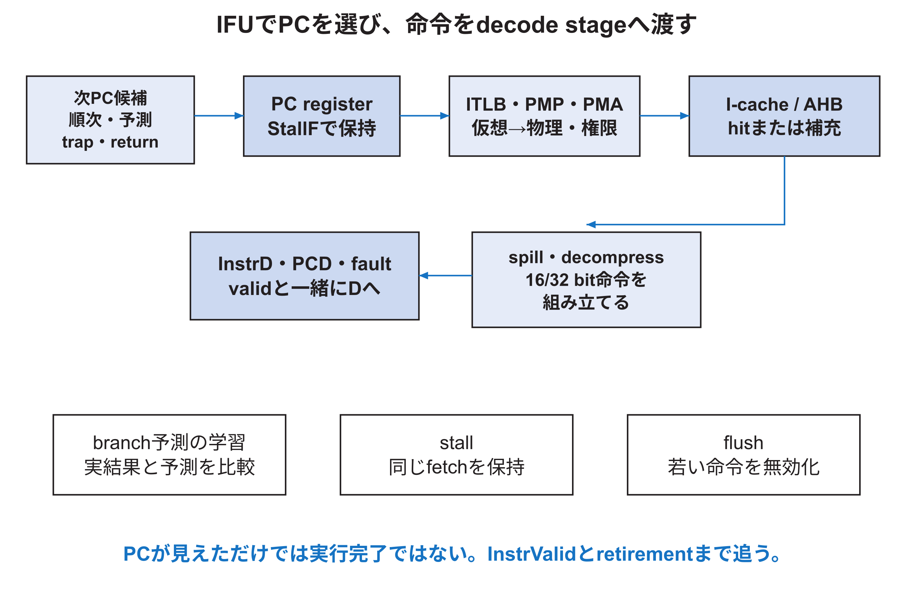

<!-- appendix-content:start -->

# 第14章 IFUと命令取得を深く読む
<!-- appendix-content:end -->

[付録の総目次](../../技術付録.md) ｜ [論文本文](../../本文.md) ｜ [参考文献](../references.md)

[第II部 Wally CPUとSoCアーキテクチャ](README.md)

ファイルパスの表記は、[資料フォルダー](../../README.md)を基準とする。

## このページの目次

- [14.1 IFUの責務](#s_14_1)
- [14.2 PCはどこから選ばれるか](#s_14_2)
- [14.3 圧縮命令と境界をまたぐ命令](#s_14_3)
- [14.4 branch predictorの予測と学習](#s_14_4)
- [14.5 命令cacheとuncached access](#s_14_5)
- [14.6 instruction-side MMU](#s_14_6)
- [14.7 stall中とflush時の命令](#s_14_7)
- [14.8 一命令をsourceで追う手順](#s_14_8)

<!-- appendix-content:start -->

## 14.1 IFUの責務

Instruction Fetch Unitは、次に実行するPCを選び、そのaddressから命令bitを得て、decode stageへ渡す。単にmemoryを一回読むだけではない。分岐予測、圧縮命令、命令cache、仮想address変換、access権、bus待ち、例外、stallとflushを一つの流れへ統合する。[Harris26](../references.md#ref_harris26)[RISCVUnpriv26](../references.md#ref_riscvunpriv26)[RISCVPriv26](../references.md#ref_riscvpriv26)

固定版の入口は`src/ifu/ifu.sv`である。外側からは`StallF`、`FlushD`、privilegeとSATP、PMP設定を受け、EBUへ`IFUHADDR`、`IFUHTRANS`などを出す。decode側へは`InstrD`、`InstrValidD`、PC関連値、fault情報を渡す。

## 14.2 PCはどこから選ばれるか

通常の次PCは、現在の命令長を足した値である。RISC-V C extensionがあると命令は16 bitまたは32 bitなので、常にPC+4ではない。分岐予測が有効なら予測先、execute stageで予測誤りが分かれば正しいbranch先、trapならtrap vector、returnならEPCを選ぶ。

PC selectionはpriorityが重要である。trapを処理すべきcycleに予測器の値を選べば、architectural control flowを失う。sourceを読むときはMUXの入力名だけでなく、select条件の優先順位と、それぞれが確定するpipeline stageを見る。

## 14.3 圧縮命令と境界をまたぐ命令

16 bit命令を許すと、32 bit命令がfetch wordの境界をまたぐ場合がある。`src/ifu/spill.sv`は、前回fetchした一部と次の一部を組み合わせる。`src/ifu/decompress.sv`は16 bit compressed instructionを、後段が扱う32 bit形式へ展開する。

ここで「memoryから32 bit読めば一命令」とは限らない。fetch単位、cache line、bus beat、ISA上の命令長は異なる。PCの下位bit、前半の保持、access faultがどの半分で起きたかを追う必要がある。

## 14.4 branch predictorの予測と学習

`src/ifu/bpred`には方向予測、Branch Target Buffer、Return Address Stack、命令class予測などがある。予測器はarchitectural stateではない。予測が外れても、誤った命令をretireさせず、正しいPCからやり直せばISA上の結果は同じである。

方向予測はbranchを取るか、BTBは予測先address、RASは関数return先を予測する。executeまたはmemory stageで実際の結果と比較し、`BPWrongE`などを作る。`hazard.sv`はその信号を使って後続命令をflushする。

性能評価では予測精度だけでなく、誤予測一回のpenalty、predictorのaccess timing、storage量を見る。精度が高くてもcritical pathを延ばしclockを下げれば、全体性能が悪化し得る。

## 14.5 命令cacheとuncached access

命令cache hitなら、必要なwordを短い経路で返す。missならcache lineを外部memoryから補充し、その間`IFUStallF`でpipelineを止める。PMAでcacheableではない領域なら、cacheを迂回してbus accessする。

cache lineは複数命令を含む。tagはどのmemory blockか、indexはどのsetか、offsetはline内の位置かを示す。hit判定、valid bit、replacement、refillのFSMを分けて読む。cacheを大きくする変更はhit率だけでなくBRAM数、tag比較、配線、refill時間へ影響する。

## 14.6 instruction-side MMU

Linuxのuser processが使うPCは仮想addressである。instruction TLBに変換があれば物理addressへ直す。TLB missならHardware Page Table Walkerがpage tableをmemoryから読み、PTEを調べる。permissionやPTE不正ならinstruction page faultを発生させる。

仮想address変換とPMP/PMAは目的が違う。page tableはOSが作る仮想から物理への対応とpermission、PMPはmachine modeが物理領域への権限を制限する仕組み、PMAはその物理領域がmemoryかI/Oか、cache可能かなどの属性である。順序を混ぜず、最終的な物理addressとfault原因を追う。

## 14.7 stall中とflush時の命令

stallはstage registerを保持する。flushはそのstageの命令を無効にする。IFUがbus待ちでも、同じcycleに古い命令がtrapを起こす可能性がある。固定版の`hazard.sv`は、IFU stallをflush原因でgateする条件を持ち、trapやbranch correctionを優先できるようにする。

波形ではPCの数値だけを見ず、`InstrValidD`、`StallF/D`、`FlushD/E`、fault signalを一緒に見る。同じPCが数cycle続くことはstallなら正常であり、同じ命令が複数回retireすることとは異なる。

## 14.8 一命令をsourceで追う手順

1. 逆assemblyで対象命令のPCとbit列を得る。
2. IFUでPC selectionとcache/TLB pathを確認する。
3. `InstrD`と`InstrValidD`へ入るcycleを波形で探す。
4. branchなら予測値と実際値、loadなら後続LSU pathへつなぐ。
5. RVVIまたはretirement logでarchitectural resultを確認する。

`InstrD`が見えたことは、その命令が実行完了した証拠ではない。flushされた可能性がある。最後にretireまたはarchitectural stateの更新へ到達したかを確認する。
<!-- appendix-content:end -->

---

[前：第13章 Wallyの構成値が回路になるまで](chapter-13.md) ｜ [次：第15章 IEUとpipeline hazardを深く読む](chapter-15.md)
