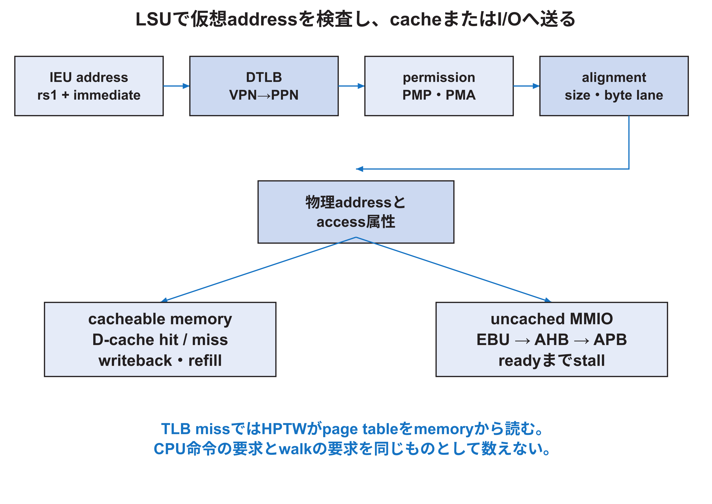

<!-- appendix-content:start -->

# 第16章 LSUとmemory hierarchyを深く読む
<!-- appendix-content:end -->

[付録の総目次](../../技術付録.md) ｜ [論文本文](../../本文.md) ｜ [参考文献](../references.md)

[第II部 Wally CPUとSoCアーキテクチャ](README.md)

ファイルパスの表記は、[資料フォルダー](../../README.md)を基準とする。

## このページの目次

- [16.1 loadとstoreの入口](#s_16_1)
- [16.2 access size、alignment、byte lane](#s_16_2)
- [16.3 TLB hitとpage table walk](#s_16_3)
- [16.4 PMAとPMP](#s_16_4)
- [16.5 cache hit、miss、eviction](#s_16_5)
- [16.6 MMIOとcacheを分ける](#s_16_6)
- [16.7 atomic命令とLR/SC](#s_16_7)
- [16.8 共有DDR3と二つのmaster](#s_16_8)
- [16.9 memory問題を切り分ける観察点](#s_16_9)

<!-- appendix-content:start -->

## 16.1 loadとstoreの入口

Load Store Unitは、IEUが計算したeffective addressを受け、alignment、仮想address変換、permission、PMA/PMP、cacheまたはbus access、subword処理、atomic操作を行う。固定版の入口は`src/lsu/lsu.sv`である。

load/store命令のaddressは通常`rs1 + sign-extended immediate`で作る。softwareがC++で`regs[3]`を読む場合も、compilerはbase addressへoffsetを足すload命令を生成する。その物理addressが最終的にRasterIX registerを選ぶまで、LSUとuncoreを通る。

## 16.2 access size、alignment、byte lane

load/storeはbyte、halfword、word、doublewordなどのsizeを持つ。address下位bitはbusのどのbyte laneを使うかを決め、store strobeは有効なbyteを示す。loadは読んだbus wordから対象byteを選び、符号付きならsign extensionする。

misaligned accessをhardwareで分割して扱うか、exceptionにするかは構成とISA条件による。MMIO registerは32 bit aligned accessだけを許す設計が多い。RasterIX側はaligned 32 bit wordを契約としているため、8 bit storeを勝手に一commandとして扱わない。

## 16.3 TLB hitとpage table walk

LinuxのU-mode processは仮想addressを使う。DTLBはVPNからPPNへの最近の変換を保持する。hitならpermissionを確認して物理addressを作る。missならHPTWが`SATP`からpage table rootを得て、PTEを段階的に読む。

Sv48では仮想addressを複数のVPN segmentへ分ける。各levelのPTE addressは、前levelが示すPPNと次のVPN indexから計算する。leaf PTEでR/W/XやU、A、Dなどを確認する。invalid、permission違反、misaligned superpageなどはpage faultになる。[RISCVPriv26](../references.md#ref_riscvpriv26)

HPTW自身もmemoryを読むため、通常のload/store pathとbusを共有する。`SelHPTW`のような選択信号を追い、CPU命令の要求とwalk要求を混同しない。

## 16.4 PMAとPMP

Physical Memory Attributeは、物理領域がmain memory、I/O、cacheable、idempotent、atomic対応など、platformとして持つ性質を表す。Physical Memory Protectionは、M-modeが物理address範囲とR/W/X権限を設定する機構である。

RasterIX register領域は通常memoryのように投機的に何度も読んだりcacheしたりしてはいけない。readにside effectがなくてもwrite commandはnon-idempotentである。同じstoreを二度出せば二語送信される。このためaddress decodeだけでなく、PMA上のI/O属性とsoftware mappingを一致させる。

## 16.5 cache hit、miss、eviction

data cache accessでは、indexでsetを選び、各wayのtagと比較する。hitしたwayのdataを読む。store hitではwrite policyに従ってlineとdirty bitを更新する。miss時に置換対象がdirtyならwritebackし、その後新しいlineをrefillする。

cache FSMは複数cycleにわたりbus transferを行う。`LSUStallM`はpipelineへ未完了を伝える。HREADYが一度0になっただけでerrorではない。要求のaddress/controlをprotocolどおり保持し、responseが完了してから命令を進める。

## 16.6 MMIOとcacheを分ける

MMIOはload/store命令を使うが、通常RAMとは性質が異なる。cacheへ入れると、command writeがdeviceへ届かなかったり、status readが古い値になったりする。PMAとaddress regionでuncached pathへ送る。

software側の`volatile`はcompilerによる省略や統合を制限する。hardware cacheability、CPUのI/O ordering、device完了は別問題である。固定版`WallyBusConnector.hpp`は`volatile uint32_t*`でregisterへaccessし、送信後にRISC-V `fence iorw, iorw`を置く。ただしfenceは描画完了を待つ命令ではなく、必要なorderingを作る。display swapの完了はframe counterを観察する。

## 16.7 atomic命令とLR/SC

A extensionではAMOとLR/SCを扱う。LRはaddressへのreservationを作り、SCはreservationが有効ならstoreする。interrupt、別access、cache eventなどでreservationが失われ得る。AMOはread-modify-writeを不可分に実行する。

MMIO peripheralがatomicを意味ある形で支えるとは限らない。PMAで許可されない領域へAMOを行えばaccess faultとすべきである。software lockにatomic命令を使う話と、device registerにatomic commandを書く話を分ける。

## 16.8 共有DDR3と二つのmaster

本構成ではWallyとRasterIXがDDR3を共有する。CPUはLinux、program、dataに使い、RasterIXはtextureとdisplay bufferを使う。AXI interconnectが要求を仲裁するが、address領域を予約しただけでcache coherenceが自動的に生まれるわけではない。

device treeの`reserved-memory`と`no-map`は、Linuxの通常allocatorと標準mappingから領域を外す。RasterIXへ渡すbuffer addressを他のprocessが使わないために重要である。一方、hardwareが誤addressへ書くことを防ぐ境界検査ではない。address計算、buffer size、owner切替を別に検証する。

## 16.9 memory問題を切り分ける観察点

| 観察点 | 分かること | まだ分からないこと |
|---|---|---|
| load/storeの仮想address | applicationが何を要求したか | 物理address、device到達 |
| TLB/HPTW結果 | 変換とpermission | cache/bus完了 |
| cache hit/miss | local memory path | DDR dataの正しさ全体 |
| AHB request/response | core外へ出たtransfer | APB peripheral内部 |
| APB handshake | register access成立 | RasterIX描画完了 |
| framebuffer readback | memory上の画素 | 外部映像の受理 |

一つの段階で期待値と比較し、最初に異なる境界を探す。画面が出ないという最終症状だけでcache、DDR、displayのどれかを選ばない。
<!-- appendix-content:end -->

---

[前：第15章 IEUとpipeline hazardを深く読む](chapter-15.md) ｜ [次：第17章 特権機構、trap、interruptを深く読む](chapter-17.md)
