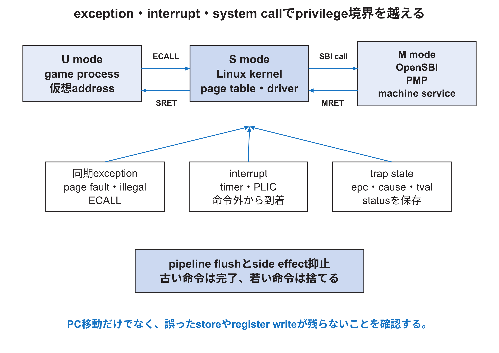

<!-- appendix-content:start -->

# 第17章 特権機構、trap、interruptを深く読む
<!-- appendix-content:end -->

[付録の総目次](../../技術付録.md) ｜ [論文本文](../../本文.md) ｜ [参考文献](../references.md)

[第II部 Wally CPUとSoCアーキテクチャ](README.md)

ファイルパスの表記は、[資料フォルダー](../../README.md)を基準とする。

## このページの目次

- [17.1 三つのprivilege mode](#s_17_1)
- [17.2 CSR read-modify-write](#s_17_2)
- [17.3 exceptionとinterrupt](#s_17_3)
- [17.4 delegationとOpenSBI](#s_17_4)
- [17.5 timerとCLINT](#s_17_5)
- [17.6 PLICと外部interrupt](#s_17_6)
- [17.7 trapとpipeline flush](#s_17_7)
- [17.8 Linux system callをCPU側から見る](#s_17_8)
- [17.9 trap問題の切り分け](#s_17_9)

<!-- appendix-content:start -->

## 17.1 三つのprivilege mode

RISC-VのM-modeは最も高い権限を持ち、OpenSBIが動く。S-modeはLinux kernel、U-modeはgameなどのprocessが動く。固定版の`src/privileged/privileged.sv`はCSR、trap、privilege mode、interrupt、PMPなどをまとめる。[RISCVPriv26](../references.md#ref_riscvpriv26)

modeはsoftwareの肩書きではなく、実行できる命令、access可能なCSR、page table permission、trapの委譲先へ影響するarchitectural stateである。Linux processが直接`mstatus`を書けないのは、compilerの制限ではなくCPUが権限を検査するためである。

## 17.2 CSR read-modify-write

CSR命令は、指定CSRを読み、registerまたはimmediateと組み合わせて書き戻す。readだけに見える命令でもrdやsourceがx0かでside effect条件が変わる。`src/privileged/csr.sv`と`privdec.sv`でaddress、権限、read/write、illegal条件を追う。

CSRは単一の大きなregister fileとは限らない。machine、supervisor、counter、interruptなどのsubmoduleに分かれ、read dataをMUXする。write enableは命令valid、trap、privilege、read-only属性を含めて決める。

## 17.3 exceptionとinterrupt

exceptionは実行中の命令に同期して起こる。illegal instruction、page fault、access fault、ECALLなどが例である。interruptはtimerや外部deviceなど、命令列の外から到着する。どちらもtrapを起こすが、原因の記録と再開PCの意味が異なる。

trap時にはcause、faultに関係する値、戻りPCをCSRへ保存し、statusのinterrupt enableとprevious privilegeを更新し、trap vectorへPCを移す。正確な例外では、faulting instructionより古い命令は完了し、若い命令はarchitectural effectを残さない。

## 17.4 delegationとOpenSBI

M-modeは一部のexceptionやinterruptをS-modeへ委譲できる。Linuxが直接扱うべきpage faultやsupervisor timer interruptなどはdelegation CSRでS-modeへ送る。platform固有のM-mode serviceはSBI callとしてOpenSBIへ依頼する。

OpenSBIはLinuxより前に起動し、hardwareを初期化し、delegationやPMPを設定し、S-modeへ移る。LinuxがM-modeを「置き換える」のではない。実行中もSBI callやM-mode trapでOpenSBIへ入る場合がある。

## 17.5 timerとCLINT

`uncore.sv`のCLINTは`MTIME`、timer compare、software interruptを提供する。`MTIME`はCPU pipeline clockと別のTIMECLKを使い得るため、CSR側へ値を渡す同期も重要になる。device treeの`timebase-frequency`は、このcounterが一秒に何回進むかをLinuxへ伝える。

clockを20 MHzから変えたのにtimebase-frequencyを変えないと、timer tickや時刻換算がずれる。UARTと同様に、「hardwareの実周波数」と「softwareへ伝えた周波数」を照合する。

## 17.6 PLICと外部interrupt

PLICは複数の外部interrupt sourceを受け、priority、pending、enable、thresholdを用いてhartへ通知する。softwareはclaim registerでsource IDを取得し、device側の原因を処理し、completeを書き戻す。

interrupt lineがlevelでassertされ続けるdeviceでは、PLICをcompleteしてもdevice原因をclearしなければ再度pendingになる。逆に先にdeviceをclearする必要がある場合もある。新しいcontroller回路をinterrupt化するなら、RTL line、PLIC source ID、device tree、kernel driver、handlerのclear順を一つの契約にする。

## 17.7 trapとpipeline flush

trapはmemory stageで確定する信号を含む。既にW stageにある古い命令はcommitできるが、若い命令は捨てる。faulting storeのwrite enableが外部busへ出た後にtrapを決める設計ではprecise性を壊すため、side effectの成立時点とexception確定時点を揃える。

波形では`TrapM`、`EPCM`、`TrapVectorM`、`FlushD/E/M/W`、register write、memory writeを同時に見る。trap vectorへPCが移っただけでは、若いside effectが抑止された証明にならない。

## 17.8 Linux system callをCPU側から見る

U-mode programが`write`などを呼ぶと、C libraryがargumentをABIでregisterへ置き、ECALL命令を実行する。CPUはenvironment call exceptionを起こし、LinuxのS-mode trap handlerへ入る。kernelはsystem call番号とargumentを読み、検査して処理し、`sret`でU-modeへ戻る。

`/dev/mem`の`open`と`mmap`もsystem callを通る。mapping後の`regs[0]=word`は通常のsystem callを毎回呼ぶのではなく、processのpage tableへdevice physical pageを対応付けた後、CPUのstore命令として実行される。この違いはMMIO性能と権限を理解するうえで重要である。

## 17.9 trap問題の切り分け

CSR値、faulting PC、instruction bit、virtual/physical address、privilege mode、delegation、page table entryを保存する。Linux logだけで不明なら、逆assemblyとRVVI traceを対応させる。hardware faultかsoftware bugかを「Linuxが止まった」という症状だけで決めない。
<!-- appendix-content:end -->

---

[前：第16章 LSUとmemory hierarchyを深く読む](chapter-16.md) ｜ [次：第18章 EBU、uncore、周辺回路拡張を深く読む](chapter-18.md)
