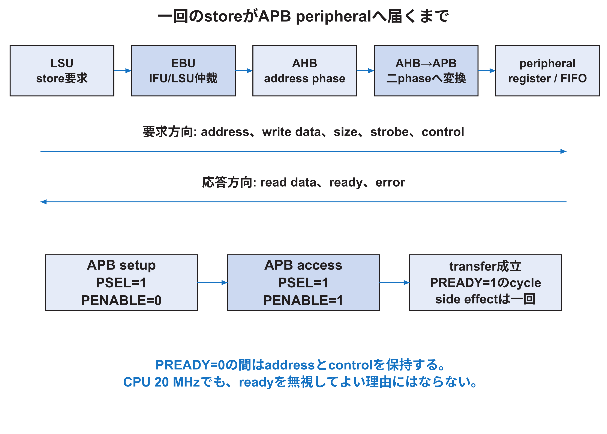

<!-- appendix-content:start -->

# 第18章 EBU、uncore、周辺回路拡張を深く読む
<!-- appendix-content:end -->

[付録の総目次](../../技術付録.md) ｜ [論文本文](../../本文.md) ｜ [参考文献](../references.md)

[第II部 Wally CPUとSoCアーキテクチャ](README.md)

ファイルパスの表記は、[資料フォルダー](../../README.md)を基準とする。

## このページの目次

- [18.1 coreとuncoreの境界](#s_18_1)
- [18.2 EBUの仲裁](#s_18_2)
- [18.3 AHB-Liteの一transfer](#s_18_3)
- [18.4 address decodeと重複](#s_18_4)
- [18.5 AHBからAPBへの変換](#s_18_5)
- [18.6 外部APB portの設計意図](#s_18_6)
- [18.7 RasterIX adapterが守る三つの契約](#s_18_7)
- [18.8 register mapはhardwareとsoftwareのABIである](#s_18_8)
- [18.9 周辺回路を追加する完全な影響範囲](#s_18_9)
- [18.10 開発者としての読解課題](#s_18_10)

<!-- appendix-content:start -->

## 18.1 coreとuncoreの境界

`wallypipelinedcore.sv`の外側には一組のAHB-Lite master interfaceがある。IFUとLSUはそれぞれ要求を持つが、EBUが仲裁し、core外へ一つのbusとして出す。`wallypipelinedsoc.sv`はcoreとuncoreを実体化し、board topはその外でDDR controllerやRasterIXへつなぐ。

uncoreは「重要でない外側」という意味ではない。boot ROM、RAM、CLINT、PLIC、UART、GPIO、SPI、SD controller、PWM、外部memory、外部APB interfaceを持ち、CPUがsystemとして動くためのhardwareを提供する。

## 18.2 EBUの仲裁

IFUは命令fetch、LSUはload/storeまたはpage table walkのmemory requestを出す。同じ外部busを同時に使えない場合、EBUはpriorityとownershipを決める。選ばれなかった側はreadyが戻るまでstallする。

仲裁では要求を途中で切り替えない。AHBのaddress phaseとdata phaseが重なるため、現在のresponseがどのmasterの要求かを保持する。HREADYが0の間にowner、address、controlを変えると別要求のresponseとして解釈する危険がある。

## 18.3 AHB-Liteの一transfer

masterはaddress、HTRANS、HWRITE、HSIZEなどをaddress phaseへ出す。次cycleのdata phaseでwrite dataまたはread dataとresponseを扱う。slaveはHREADYを0にしてwait stateを追加できる。address phaseとdata phaseがpipelineされるため、現在busに見えるaddressと、返っているread dataが同じtransferとは限らない。

`uncore.sv`はaddress decoderのselectをregisterへ保存する。commentにあるように、response MUXのselectはdata phaseの要求に対応しなければならず、wait中は古いselectを保持する。これは単なる一cycle遅延ではなく、protocolのphase対応を守る状態である。

## 18.4 address decodeと重複

`src/mmu/adrdecs.sv`は物理addressを各BASE/RANGEと比較し、region selectを作る。`uncore.sv`はそのvectorをRAM、boot ROM、external memory、APB bridgeなどへ分解する。

二領域が重なると、複数selectが同時に1になり、read dataのOR MUXやready logicが壊れる。未割当領域ではHSELNoneDを使いbusを固めない設計になっているが、返す値やerror方針は仕様として確認する。新領域を足したら、BASE、終端、隣接境界、未選択、重複をtestする。

## 18.5 AHBからAPBへの変換

APBはsetupとaccessの二phaseで、周辺回路向けに単純化されている。`ahbapbbridge.sv`はAHB transferを受け、setup cycleでPSELとaddress/controlを出し、access cycleでPENABLEを1にする。peripheralがPREADYを返すまでaccessを保持し、完了をAHBのHREADYへ返す。

transfer成立は`PSEL && PENABLE && PREADY`である。PREADY=0のcycleにもPSELとPENABLEは1のままなので、side effectを`PSEL && PENABLE`だけで起こすと同じwriteを複数回実行する。周辺register更新、FIFO push、clear-on-readは完了eventへ結び付ける。

## 18.6 外部APB portの設計意図

固定版は、RasterIX固有のportを`wallypipelinedsoc`へ直接多数追加せず、一般的な外部APB interfaceを一組出す。`uncore.sv`はPADDR、PWDATA、PSTRB、PWRITE、PENABLE、PSELを外へ出し、PRDATAとPREADYを受ける。

この境界により、Wally coreとuncoreは特定deviceの内部command形式を知らない。board topまたはadapterがAPBをRasterIX command streamへ変換する。将来別のAPB peripheralを接続できるが、同時に複数deviceを置くなら外側にdecoderまたはbusを追加する必要がある。

## 18.7 RasterIX adapterが守る三つの契約

第一はAPB契約である。aligned 32 bit access、PREADYによる待機、read data、side effectの成立cycleを守る。第二はcommand stream契約である。data、valid、ready、TLASTの順序を守る。第三はclock domain crossing契約である。20 MHz側で成立したwordを100 MHz側へ順番どおり一度だけ渡す。

非同期FIFOは三契約のうちCDCとbufferingを担当する。APB handshakeを正しく作る責任や、RasterIX command packetの意味までは自動で保証しない。層を分けてassertionとtestbenchを置く。

## 18.8 register mapはhardwareとsoftwareのABIである

RasterIX adapterはoffset 0x00をcommand word、0x04をTLAST付きcommand、0x08をstatus、0x0cをID、0x10をswap count、0x14をacknowledged framebuffer addressとしている。offset、幅、read/write、side effect、reset値はC++とRTLの双方が共有するABIである。

ID `0x52495831`を最初に読むことで、間違ったbitstreamまたはaddressを早く検出する。ID一致はcommand path全体の動作証明ではないが、少なくともCPU load、address decode、APB read、adapter read dataの往復を確認するcanaryになる。

## 18.9 周辺回路を追加する完全な影響範囲

新しいperipheralを追加する場合、次を確認する。

| 領域 | 必要な設計 |
|---|---|
| address | BASE、RANGE、重複検査、PMA属性 |
| RTL | interface、register/FIFO、reset、error、interrupt |
| bus | APB/AHB protocol、wait、幅、byte strobe |
| clock | domain、CDC、generated clock constraint |
| board | pin、I/O standard、外部device timing |
| OS | device tree、reserved memory、driverまたはmapping |
| application | API、ordering、timeout、error処理 |
| verification | unit、bus、CDC、SoC、timing、実機 |

「uncoreへmoduleを一個置いた」だけではsystem integrationは完了しない。この表の各行にsourceと試験を一つずつ対応させる。

## 18.10 開発者としての読解課題

`WallyBusConnector::writeData`の一回の`regs[0]=data[i]`を選び、次を説明する。

1. compilerが生成するstore命令とaddress。
2. U-mode page tableから物理addressへの変換。
3. LSUのuncached accessとEBUの仲裁。
4. AHB address/data phase。
5. uncore decoderとAHB-APB bridge。
6. APB完了条件とPREADY wait。
7. async FIFOへのpush。
8. RasterIX側のvalid/ready transfer。
9. どの段階までをstore命令完了が保証するか。
10. 描画またはdisplay swap完了を別にどう観察するか。

これを説明できれば、softwareの一行とhardwareの信号を別世界として扱わず、一つのsystem動作として追えている。
<!-- appendix-content:end -->

---

[前：第17章 特権機構、trap、interruptを深く読む](chapter-17.md) ｜ [次：第19章 開発用PCからFPGA上のprocessまでを分ける](../03-linux/chapter-19.md)
