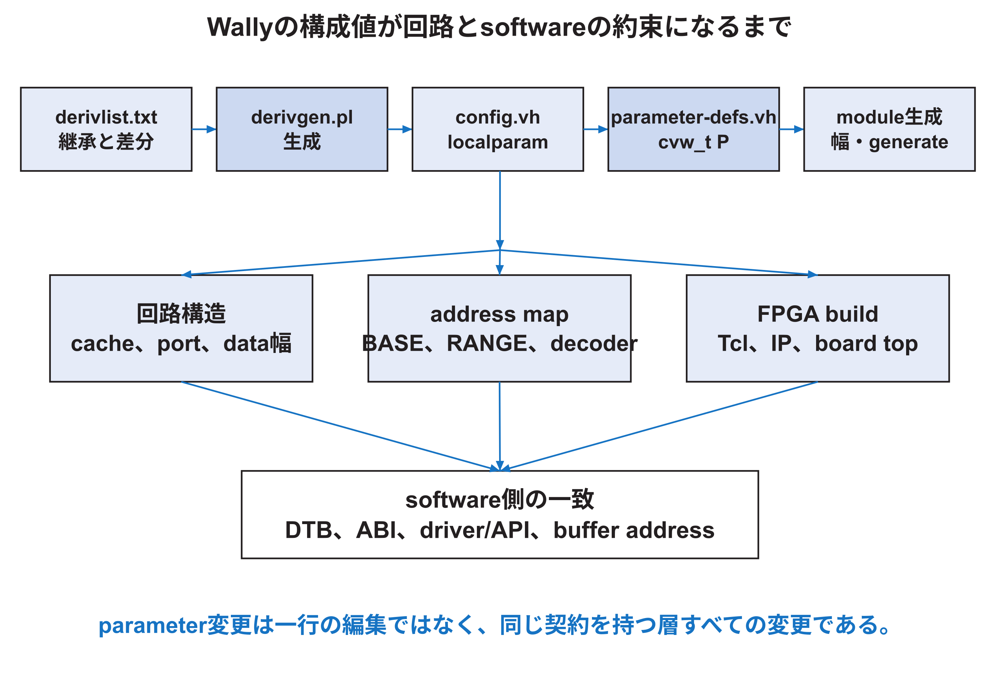

<!-- appendix-content:start -->
<a id="ch_13"></a>
# 第18章 Wallyの構成値が回路になるまで
<!-- appendix-content:end -->

[付録の総目次](../../技術付録.md) ｜ [論文本文](../../本文.md) ｜ [参考文献](../references.md)

[第II部 Wally CPUとSoCアーキテクチャ](README.md)

ファイルパスの表記は、[資料フォルダー](../../README.md)を基準とする。

## このページの目次

- [18.1 構成値は単なる一覧ではない](#s_13_1)
- [18.2 `derivlist.txt`から`config.vh`が生まれる](#s_13_2)
- [18.3 `cvw_t`は型付きの構成契約である](#s_13_3)
- [18.4 BASEとRANGEの読み方](#s_13_4)
- [18.5 構成値と生成条件を混同しない](#s_13_5)
- [18.6 同じ値をhardwareとsoftwareへ二重に書く危険](#s_13_6)
- [18.7 parameter変更の影響範囲を調べる](#s_13_7)
- [18.8 この章を使った自己確認](#s_13_8)

<!-- appendix-content:start -->
設定値の変更には、既にある回路の値を実行中に変える場合と、生成する回路自体を変える場合がある。Wallyの構成値は後者にも使われる。この章では、一つの設定が信号の幅、回路の有無、番地の範囲へどう反映されるかを追う。

<a id="s_13_1"></a>
## 18.1 構成値は単なる一覧ではない

Wallyは、同じRTLからRV32またはRV64、キャッシュの有無、仮想メモリの方式、周辺回路、分岐予測器などが異なるprocessorを作れる。これを可能にするのが構成値である。しかし、構成値をソフトウェアの設定ファイルと同じだと思うと不十分である。値によってbit幅が変わり、`generate`でモジュールそのものが存在しなくなり、番地 decoderの論理も変わる。すなわち、構成値はelaboration時に作る回路を決める設計入力である。[Harris26](../references.md#ref_harris26)[Console26](../references.md#ref_console26)

固定版では、Nexys Video単体の派生構成が`fpganexysvideo`、RasterIXを加える派生構成が`fpganexysvideo_rasterix`である。後者は前者を継承し、`EXT_IO_SUPPORTED`だけを追加で有効化する。この分離により、基板対応と、特定の外部周辺回路の接続を同じ変更として扱わずに済む。



<a id="s_13_2"></a>
## 18.2 `derivlist.txt`から`config.vh`が生まれる

構成のソース of truthは`config/derivlist.txt`である。`deriv fpganexysvideo fpga`は、`fpga`の値を受け継いでNexys Video固有の変更を加える関係を表す。`deriv fpganexysvideo_rasterix fpganexysvideo`は、その上へRasterIX接続に必要な値を加える。

`bin/derivgen.pl`はこの継承関係を読み、`config/deriv/<名前>/config.vh`を生成する。生成物を直接直すと、次にderivgenを実行したとき変更が消える。したがって、値を永続的に変える入口は`derivlist.txt`または基底構成であり、生成済み`config.vh`は答え合わせの対象である。

```bash
cd "$WALLY"
perl bin/derivgen.pl
grep -n 'EXT_IO_SUPPORTED\|EXT_MEM_RANGE' \
  config/deriv/fpganexysvideo_rasterix/config.vh
```

成功条件は、選んだ派生構成の生成ファイルに意図した値が一度だけ現れ、親から受け継ぐ値も保持されることである。生成時刻だけを見ず、`git diff -- config/deriv`で意図しない派生構成まで変わっていないか確認する。

<a id="s_13_3"></a>
## 18.3 `cvw_t`は型付きの構成契約である

`src/cvw.sv`は`cvw_t`というpacked structを定義する。そこには`XLEN`、`PA_BITS`、キャッシュのway数とline長、各ISA extension、各メモリ領域のBASEとRANGE、周辺回路の有効値などが入る。`config/shared/parameter-defs.vh`は、`config.vh`のlocalparamを同じfieldへ詰め、`localparam cvw_t P = '{ ... };`を作る。

各モジュールは`import cvw::*; #(parameter cvw_t P)`として同じ契約を受け取る。例えば`P.XLEN`はdata pathの幅、`P.PA_BITS`は物理番地の幅、`P.EXT_IO_SUPPORTED`は外部APB portを生成するかを決める。structへまとめる利点は、数十個のパラメータをモジュールごとに別順序で渡さず、field名で意味を固定できることである。

一方、`P`の値がすべてruntimeに保存されたレジスタになるわけではない。多くはelaboration時の定数であり、使われない分岐を合成前に消す。値を読み出すソフトウェア用レジスタが必要なら、別途RTLで実装しなければならない。

<a id="s_13_4"></a>
## 18.4 BASEとRANGEの読み方

Wallyの番地領域は`BASE`と`RANGE`で表す。`src/cvw.sv`のcommentが示すように、RANGEは下位bitが連続して1になるthermometer codeを想定する。例えば32 MiBならサイズは`0x02000000`、RANGEはその一つ下の`0x01ffffff`である。decoderは、番地の可変部分をmaskし、BASEと一致するかを調べる。

`BASE + RANGE`は含まれる最後の番地であり、領域のbyte数は`RANGE + 1`である。`0x10080000`をBASE、`0x000000ff`をRANGEにすると、`0x10080000`から`0x100800ff`までの256 byteを選ぶ。ソフトウェアの`mmap`長4096 byteと、ハードウェア レジスタ領域256 byteは別の値である。

番地範囲を変えるときは、次の四者を比較する。

| 層 | 具体的な場所 | 一致させる内容 |
|---|---|---|
| Wally構成 | `config/derivlist.txt` | BASE、RANGE、有効値 |
| RTL接続 | `uncore.sv`とboard top | decoderで選ばれる相手 |
| OSの説明 | `.dts`の`reg` | 物理番地と長さ |
| application | `mmap`のoffset、レジスタ index | accessする番地と幅 |

<a id="s_13_5"></a>
## 18.5 構成値と生成条件を混同しない

`EXT_IO_SUPPORTED=1`は、Wally SoCの外へAPB信号を出す回路を有効にする。これだけでRasterIXは生成されない。board buildでは`RASTERIX=1`も使い、RasterIXのソースとIPを読み、board topで外部APB portへ接続する。つまり、Wally側interfaceの存在と、接続相手の存在は別条件である。

固定版の`fpga/generator/Makefile`にある`nexysvideo-rasterix` 対象は、`CONFIG=fpganexysvideo_rasterix`と`RASTERIX=1`を組み合わせる。`wally.tcl`は選択した`config.vh`を調べ、RasterIX buildなのに外部APBが無効ならerrorにする。この検査は、片方だけ有効にした不完全なbitstreamを早い段階で止める。

<a id="s_13_6"></a>
## 18.6 同じ値をhardwareとsoftwareへ二重に書く危険

CPU クロック 20 MHzは、Clocking Wizardが作る物理クロック、UART divisorの計算、device treeの`clock-frequency`と`timebase-frequency`に関係する。DDR3 512 MiBは、MIGの実物設定、Wallyの外部メモリ範囲、device treeのメモリ node、boot imageの配置に関係する。一つの値でも、ハードウェアを作る記述と、ソフトウェアへハードウェアを説明する記述がある。

device treeを20 MHzと書いても、実際のクロックは変わらない。Clocking Wizardだけを25 MHzへ変え、device treeを20 MHzのままにすると、LinuxのtimekeepingやUARTの想定が現実とずれる。二重記述を完全に消せない場合は、build時のassertion、生成script、表による照合で不一致を検出する。

<a id="s_13_7"></a>
## 18.7 parameter変更の影響範囲を調べる

値を変える前に、定義、参照、生成物、ソフトウェア契約を検索する。例えば`EXT_IO_BASE`なら次を実行する。

```bash
rg -n 'EXT_IO_BASE' config src fpga linux examples
```

検索結果を、定義、structへの格納、番地 decode、ソフトウェア記述、documentへ分類する。文字列が現れない経路にも注意する。C++側では数値`0x10080000`が直接書かれており、field名では検索できない。数値表記も検索する。

変更後は、elaboration成功だけで完了にしない。番地の境界値、無効構成、重複領域、ソフトウェアからのID read、既存周辺回路への非干渉を確認する。構成値の意味が広いほど、試験も複数層にまたがる。

<a id="s_13_8"></a>
## 18.8 この章を使った自己確認

次の問いにソース pathを添えて答える。

1. `fpganexysvideo_rasterix`は何を継承し、何だけを追加するか。
2. `EXT_IO_SUPPORTED=1`だけではRasterIXが存在しないのはなぜか。
3. `RANGE=0xff`が256 byteになる理由は何か。
4. `P.XLEN`を変えたとき、port幅だけでなくソフトウェア ABIも調べる必要があるのはなぜか。
5. generated `config.vh`を直接編集しない理由は何か。

答えは値の定義だけで終えず、その値が生成する回路、ソフトウェアから見える約束、検証方法まで含める。
<!-- appendix-content:end -->

---

[前：第17章 メモリシステムとチップ内バス](memory-system.md) ｜ [次：第19章 IFUによる命令の取得](instruction-fetch.md)
