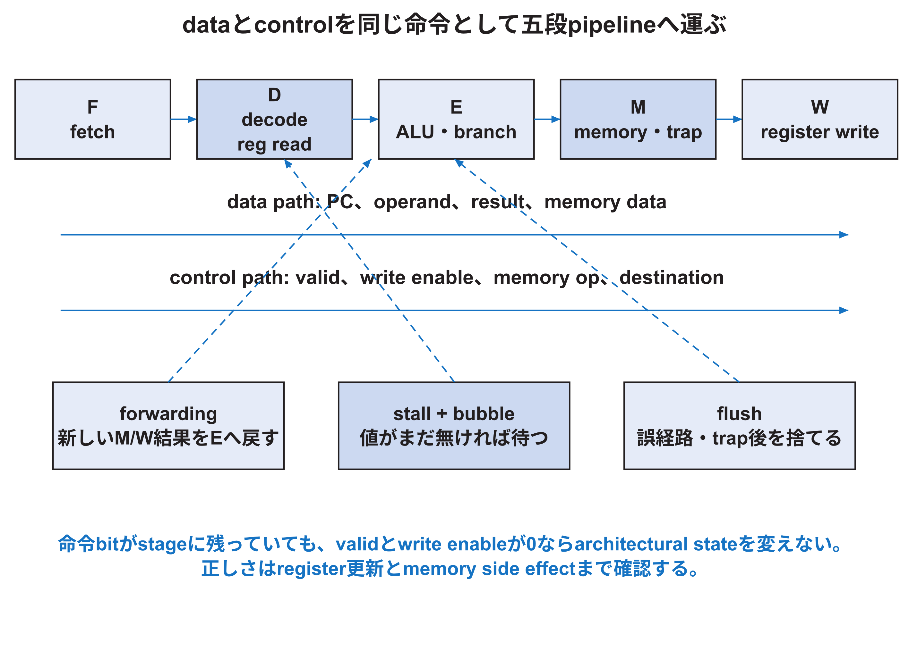

<!-- appendix-content:start -->
<a id="ch_15"></a>
# 第20章 IEUの命令実行と依存関係による停止
<!-- appendix-content:end -->

[付録の総目次](../../技術付録.md) ｜ [論文本文](../../本文.md) ｜ [参考文献](../references.md)

[第II部 Wally CPUとSoCアーキテクチャ](README.md)

ファイルパスの表記は、[資料フォルダー](../../README.md)を基準とする。

## このページの目次

- [20.1 IEUの役割を四つへ分ける](#s_15_1)
- [20.2 decodeはbit列から意味を取り出す](#s_15_2)
- [20.3 register fileとx0](#s_15_3)
- [20.4 ALU sourceとimmediate](#s_15_4)
- [20.5 forwardingの必要性](#s_15_5)
- [20.6 load-use hazardだけは待つ場合がある](#s_15_6)
- [20.7 long-latency unitとstructural hazard](#s_15_7)
- [20.8 branch、trap、stallの優先順位](#s_15_8)
- [20.9 CPIを原因別に考える](#s_15_9)
- [20.10 前の命令の結果がまだない場合を追う](#s_app_20_10)

<!-- appendix-content:start -->
前の命令が作る値を次の命令が使う場合、次の命令は古い値で計算してはいけない。この章では、結果を直接渡して進められる場合と、結果がまだないため待つ場合を分ける。実行部の信号を読むときも、どの命令の値を、どの周期に使うかを確認する。

<a id="s_15_1"></a>
## 20.1 IEUの役割を四つへ分ける

Integer Execution Unitは、命令decode、レジスタ ファイルのread/write、immediate生成、ALUとbranch判定、パイプライン レジスタとforwardingを扱う。固定版の入口は`src/ieu/ieu.sv`、controlは`controller.sv`、data pathは`datapath.sv`、演算は`alu.sv`や`shifter.sv`などに分かれる。

「命令を解読する」と「値を計算する」を分ける。controllerはopcodeやfunct fieldからcontrol 信号を作る。datapathはレジスタ値とimmediateを選び、ALUへ渡し、結果を後段へ運ぶ。control 信号も同じパイプライン 段へ遅延させないと、別の命令のdataへ作用する。



<a id="s_15_2"></a>
## 20.2 decodeはbit列から意味を取り出す

32 bit命令にはopcode、rd、funct3、rs1、rs2、funct7などのfieldがある。命令形式により同じbit位置の用途が変わる。controllerはcase表でALU ソース、レジスタ write、メモリ read/write、branch、CSRなどを決める。未対応encodingはillegal instructionとして扱う。

decodeを変更するときは、似たopcodeとの重なり、extensionの有効条件、RV32/RV64差、compressed命令の展開後形式を確認する。`casex`やwildcardで広く一致させると、将来extensionまたはreserved encodingを誤って受け入れる危険がある。

<a id="s_15_3"></a>
## 20.3 register fileとx0

RISC-V integer レジスタは32本で、x0はreadすると常に0、writeは無視される。decode 段でrs1とrs2を読み、writeback 段でrdへ書く。readとwriteが同じ周期に同じレジスタを指す場合の値は、レジスタ ファイル実装とbypassで定義する。

architectural レジスタ ファイルと、パイプライン レジスタを区別する。x5の値はarchitectural stateだが、`RdE`や`RdM`は「現在その段にいる命令のdestination番号」という一時的な制御状態である。flushされた命令は、その一時状態がbitとして残っていてもwrite enableを無効化し、architectural stateを変えてはならない。

<a id="s_15_4"></a>
## 20.4 ALU sourceとimmediate

ALUの入力Aはrs1、PC、0など、入力Bはrs2、immediateなどから選ぶ。immediateはI/S/B/U/J形式ごとに命令bitを並べ直し、XLENへsign extensionする。branch offsetの下位0やJALのbit順は連続していないため、図とcodeを照合する。

bit幅とsignednessは回路の意味を変える。signed less-thanとunsigned less-than、算術右shiftと論理右shiftは同じbit列でも結果が違う。SystemVerilogの暗黙castに任せず、operandの型と必要なextensionを確認する。

<a id="s_15_5"></a>
## 20.5 forwardingの必要性

次の二命令を考える。

```text
add x5, x1, x2
sub x6, x5, x3
```

二命令目がdecodeでx5を読む時点では、一命令目がまだwritebackしていない可能性がある。しかし結果はexecuteまたはメモリ 段に既にある。forwarding MUXは、その新しい結果をレジスタ ファイル read値の代わりにALU入力へ渡す。

priorityは最も新しいproducerを選ぶ必要がある。同じrdへ連続writeする場合、W 段よりM 段の結果が新しい。x0、write enable、命令valid、結果が利用可能になる段を条件へ含める。

<a id="s_15_6"></a>
## 20.6 load-use hazardだけは待つ場合がある

loadのdataはメモリ 段の後半まで得られない。直後の命令がexecute 段でその値を必要とすると、通常のforwardingだけでは間に合わない。そのため一周期 stallし、後続命令を待たせる。これはdata依存があるすべての組合せを止めるのではなく、結果の利用可能時点とconsumerの必要時点が合わない場合である。

stall時にはF/Dを保持し、Eへbubbleを入れる必要がある。すべてを単に保持するとload命令自体も進まず、deadlockになり得る。`hazard.sv`の「次段がstallなら前もstall」「最初にstallしていない段をflush」という規則は、このbubble生成を一般化する。

<a id="s_15_7"></a>
## 20.7 long-latency unitとstructural hazard

divisionや一部FPU操作は一周期で終わらない。execute 段のunitがbusyなら、そこへ新しい命令を入れず、前段をstallする。二つの命令が同じハードウェア resourceを同時に必要とする場合はstructural hazardである。

resourceを複製すればthroughputを上げられる場合があるが、LUT/DSP/配線が増える。共有すれば資源は減るが、arbitrationとstallが増える。正しい選択はworkloadと対象 クロックを測って決める。

<a id="s_15_8"></a>
## 20.8 branch、trap、stallの優先順位

branch mispredictionはexecute 段で分かり、若い命令をflushする。trapはメモリ 段で確定し、より広い範囲をflushする。division中、WFI、IFU/LSU stallが同時に起こる場合もある。priorityを局所モジュールごとにばらばらに決めると、あるFSMだけがstallを見続けるなどの不整合が起きる。

固定版`hazard.sv`はflush causeとstall causeを分け、各段の最終信号を作る。reviewでは真理値表またはpropertyを用意し、trap時に誤ったstoreがcommitしない、branch修正時にdivideを不正に捨てない、stall解除後に一回だけ進むことを確認する。

<a id="s_15_9"></a>
## 20.9 CPIを原因別に考える

理想的な五段パイプラインは、充填後に一周期一命令をretireできる。しかしキャッシュ miss、load-use、branch misprediction、division、I/O waitがbubbleを作る。実行時間は概ね次の関係で考えられる。

```text
実行時間 = 命令数 × CPI × clock周期
CPI = 1 + 各stall・flushが加えるcycle / retired命令数
```

クロックを高くする変更がCPIを悪化させる場合も、命令数を減らすソフトウェア変更がキャッシュ miss率を変える場合もある。一つのcounterだけで原因を断定せず、命令数、周期、各event、wall timeを同じ区間で測る。

<a id="s_app_20_10"></a>
## 20.10 前の命令の結果がまだない場合を追う

説明用に、`lw t0, 0(a0)`でメモリから値を読み、その直後の`addi t1, t0, 3`で3を足す二命令を考える。後の加算が必要とするのは、ロードが今回読んだ値である。レジスタに残っている以前の`t0`ではない。

加算の入力を選ぶ時刻にロードの結果が既に使えるなら、その結果を途中の段から直接渡せる。この経路がフォワーディングである。しかしメモリからまだ値が戻っていないなら、配線を増やしても未知の値は渡せない。そこで加算へ進む命令を保持し、実行段へ誤った仕事を流さないようにする。

待つ周期数は、ロードの段配置、キャッシュの命中、バスの応答などに依存する。ここで説明した二命令だけから実機の周期数を固定しない。Wallyの波形では、命令の有効状態、停止信号、オペランドの選択、ロード結果が有効になる周期を組として確認する。
<!-- appendix-content:end -->

---

[前：第19章 IFUによる命令の取得](instruction-fetch.md) ｜ [次：第21章 LSUの読書きとキャッシュと番地変換](load-store-cache.md)
