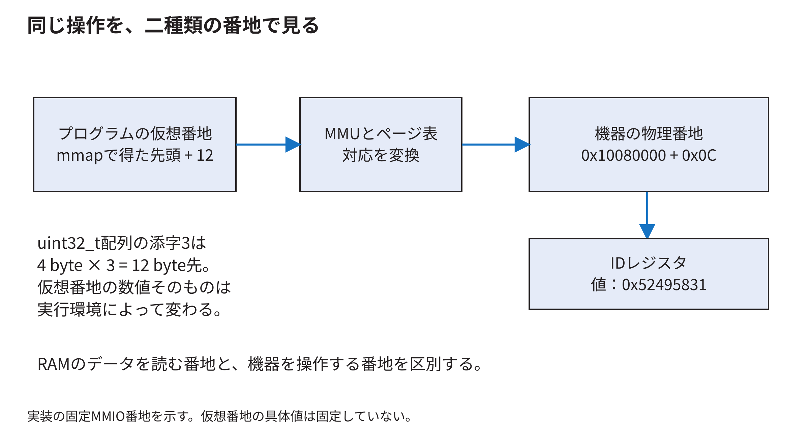
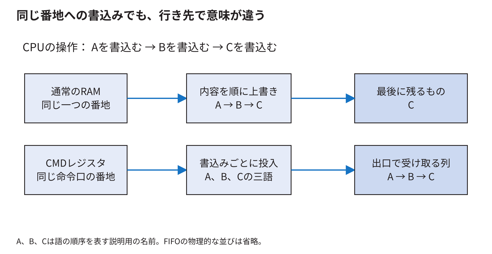

<!-- appendix-content:start -->
<a id="ch_g_memory_bus"></a>
# 第16章 番地とメモリとバスを混同せずに追う
<!-- appendix-content:end -->

[付録の総目次](../../技術付録.md) ｜ [論文本文](../../本文.md) ｜ [参考文献](../references.md)

[第II部 Wally CPUとSoCアーキテクチャ](README.md)

ファイルパスの表記は、[資料フォルダー](../../README.md)を基準とする。

## このページの目次

- [16.1 byte番地と32ビット語](#s_g_memory_bus_1)
- [16.2 同じstoreでもRAMとMMIOでは効果が違う](#s_g_memory_bus_2)
- [16.3 物理番地は行き先を選ぶ](#s_g_memory_bus_3)
- [16.4 仮想番地はプログラムから見える番地](#s_g_memory_bus_4)
- [16.5 TLBはデータそのものを保存するキャッシュではない](#s_g_memory_bus_5)
- [16.6 キャッシュが保存するまとまり](#s_g_memory_bus_6)
- [16.7 書いた値がまだDDR3へ届いていない場合](#s_g_memory_bus_7)
- [16.8 このゲーム機にある三種類の保存場所](#s_g_memory_bus_8)
- [16.9 共有DDR3にも同時アクセスの調整が要る](#s_g_memory_bus_9)
- [16.10 DDR3の幅と回路内の幅](#s_g_memory_bus_10)
- [16.11 予約領域と番地の見え方](#s_g_memory_bus_11)
- [16.12 ここまで理解したか確認する](#s_g_memory_bus_12)
- [16.13 同じ番地への三回の書込みを比較する](#s_app_16_13)

<!-- appendix-content:start -->

メモリという言葉には、CPUの作業用RAM、キャッシュ、画像の保存場所、回路内部の小さな保存場所が含まれる。番地にも複数の種類がある。この章では「誰が、何番地として、どの保存場所を読むか」を明確にする。

<a id="s_g_memory_bus_1"></a>
## 16.1 byte番地と32ビット語

ここで扱うCPUの通常の番地はbyte単位である。32ビットは4 byteなので、32ビットの配列の隣の要素は4番地先になる。

```text
uint32_tの配列の先頭が 0x1000 の場合
要素0: 0x1000〜0x1003
要素1: 0x1004〜0x1007
要素2: 0x1008〜0x100b
```

C++で`uint32_t* p`に対して`p[3]`と書くと、先頭から3 byte先ではなく12 byte先を読む。本研究の`regs[3]`がオフセット`0x0c`のIDを読む理由はこれである。

リトルエンディアンでは`0x12345678`を通常のメモリへ保存すると、低い番地から`78 56 34 12`というbyte列になる。値の桁の順序と、番地を小さい方から読む順序を混同しない。32ビットloadで読み戻せば元の値として扱える。

<a id="s_g_memory_bus_2"></a>
## 16.2 同じstoreでもRAMとMMIOでは効果が違う

RAMへの書込みは、その番地の内容を置き換える。MMIOへの書込みは、周辺機器へ操作を依頼する場合がある。RasterIXの命令口へA、B、Cを同じ番地で連続して書くと、三つの語を順に渡す。最後のCだけが変数として残ればよい、という契約ではない。

読出しにも副作用がある。通常のRAMを二度読んでも同じ内容が得られる場合が多いが、応答FIFOの出口を二度読めば、二つの語を消費する場合がある。本構成の`RESP`はその種類の入口である。デバッグのための追加の読出しが動作を変える理由になる。

<a id="s_g_memory_bus_3"></a>
## 16.3 物理番地は行き先を選ぶ

CPUの外へ出た番地を、番地選択回路が調べる。DDR3の範囲ならメモリの経路へ、UARTの範囲ならUARTへ、RasterIXの範囲なら追加の周辺回路へ送る。物理番地という言葉は、実際の配置場所の何mm先を指すという意味ではない。SoC内で取引先を選ぶ番号である。

[Wallyのuncore.sv](https://github.com/SoshiroFujimori/wally-game-console/blob/cdf907bc1752b0f300e4fc70b9a51b2bae983b7f/src/uncore/uncore.sv)で、選択信号、読出し値の戻し方、完了信号のまとめ方を読む。番地を追加したら、重複する範囲がないか、未選択時に止まり続けないか、リセット中はどうなるかまで確認する。

<a id="s_g_memory_bus_4"></a>
## 16.4 仮想番地はプログラムから見える番地

Linux上のプロセスは、通常、仮想番地を使う。MMUはページテーブルなどに基づいて、仮想番地を物理番地へ変換し、アクセス権も確認する。プログラムが`0x10080000`という整数をポインタにしただけでは、同じ物理番地を必ず操作できるわけではない。



説明用に4 KiBページを考える。仮想番地`0x40001234`が属するページを物理ページ`0x90002000`へ対応付けたなら、ページ内の`0x234`を保って物理番地`0x90002234`になる。実機の特定プロセスでこの対応が使われたという値ではない。

ページは4096 byte、キャッシュラインは別の単位、RasterIXのテクスチャページも別の単位である。「ページ」という名前が同じでも、管理する主体が違う。

<a id="s_g_memory_bus_5"></a>
## 16.5 TLBはデータそのものを保存するキャッシュではない

ページテーブルを毎回たどると、番地変換のためにさらにメモリを読む必要がある。TLBは、最近の番地変換と権限の情報を保存して、その手間を減らす。

データキャッシュは実際のデータの写しを保存する。TLBには「仮想ページVは物理ページPに対応する」といった情報、データキャッシュには「その場所には値Dがある」という情報がある。TLBミスとデータキャッシュミスは原因も処理も異なる。

ページテーブルを書き換えたとき、古いTLBの対応が残る問題がある。RISC-Vの`SFENCE.VMA`はこの種の番地変換の順序・同期に関係する。一般のI/O順序を扱う`FENCE`と同じ命令ではない。[RISC-V supervisor仕様](https://docs.riscv.org/reference/isa/priv/supervisor.html)

<a id="s_g_memory_bus_6"></a>
## 16.6 キャッシュが保存するまとまり

説明用に「64 byteのライン、4個のセット、各セットに1ライン」の小さな直接マップキャッシュを考える。これはWallyの今回の実設定ではない。

番地`0x120`を64で割ると、ライン番号4、ライン内の位置32になる。ライン番号4を4セットで割った余りは0なのでセット0に入る。番地`0x220`もセット0に入るが、別のラインである。両方を交互に読むと、容量が空いて見えても同じセットで追い出しが起こり得る。

tagは、そのセットにどのラインが入っているかを区別する情報である。validはその内容を使ってよいか、dirtyは書き戻す必要のある変更があるかを表す。データ配列だけ見てもキャッシュの動作全体は分からない。

<a id="s_g_memory_bus_7"></a>
## 16.7 書いた値がまだDDR3へ届いていない場合

書戻し型のキャッシュでは、CPUが値を書いた後、最新値がキャッシュだけにあり、DDR3は以前の値を持っている期間があり得る。CPU自身は最新値を読めても、別の機器がDDR3を直接読むと古い値を見る問題が起こり得る。

これがDMAなどで共有メモリを扱うときの整合性の問題である。順序を守る命令を置くだけで、必要な書戻しや無効化まで自動的に行われるとは限らない。一般のLinuxドライバでは、適切なDMA APIとその所有権の規則を使う。[Linux DMA mapping guide](https://docs.kernel.org/core-api/dma-api-howto.html)

今回のCPU側命令配列は、Wallyが普通のRAMから読み、MMIOへ一語ずつコピーする経路である。RasterIXがそのC++配列の仮想ポインタを直接DMA読出しする経路ではない。実験E7では、別に確保した物理領域へコピーしてDMAで読む方式も調べた。通常のAPB送信と同じ前提では扱えないため、その結果と制約は[技術付録第72章](../05-integration/command-dma-comparison.md#ch_30)に分けて示す。

<a id="s_g_memory_bus_8"></a>
## 16.8 このゲーム機にある三種類の保存場所

| 保存するもの | 主に書く主体 | 次に読む主体 | 役割 |
|---|---|---|---|
| CPU側の描画命令配列 | CPU上の描画ライブラリ | CPU上の転送コード | 回路へ渡す数値列を用意する |
| RasterIX_IFの内部作業領域 | RasterIXの画素処理 | 書戻しや後続の画素処理 | 一部の画面を描く |
| DDR3の表示用画像 | RasterIXなどのメモリ書込み経路 | 表示回路 | 画面へ繰り返し送る画像を保存する |

このほかに命令FIFO、応答FIFO、テクスチャなどもある。名前にbufferが付くからといって、同じ内容を同じ場所へ重複して保存しているわけではない。どの主体が何をいつまで持つかで分類する。

<a id="s_g_memory_bus_9"></a>
## 16.9 共有DDR3にも同時アクセスの調整が要る

CPUはプログラムとデータを読み書きし、RasterIXはテクスチャや描画先を読み書きし、表示回路は画面の画素を読む。全員が同時に要求できても、DDR3の端子やコントローラの処理能力は有限である。仲介する回路が要求を選び、必要に応じて待たせる。

AXIでは読出し要求、読出しデータ、書込み番地、書込みデータ、書込み応答を別のチャネルで扱う。一つのreadyだけ見て、すべての要求が完了したと解釈しない。番地を受け付けた後、データが戻るまで複数周期かかり、その間にも別の要求を扱える実装がある。

表示用の次の画素が時間に間に合わないと、画面の連続性に影響する。平均帯域に余裕があっても、長い停止を吸収できるかという条件が残る。

<a id="s_g_memory_bus_10"></a>
## 16.10 DDR3の幅と回路内の幅

FPGA外のDDR3端子が運ぶ幅と、コントローラが回路へ見せるAXIの幅は同じとは限らない。複数の転送をまとめ、異なるクロックで扱うことで、内部では広いデータを受け渡せる。

従って「AXIが64ビットだから、基板のDDR3データ端子も64本」とは言えない。MIGの設定、外部メモリの型番と配線、内部の周波数とデータ幅を別々に確認する。[技術付録のボード対応](../05-integration/nexys-video-files.md#ch_e)は、その対応を追う入口になる。

<a id="s_g_memory_bus_11"></a>
## 16.11 予約領域と番地の見え方

固定版のRasterIX用device treeは、`0x9e000000`から32 MiBを予約している。32 MiBは`0x02000000` byteなので、範囲の終端直後は`0xa0000000`である。最後のbyteの番地は`0x9fffffff`になる。

この予約は、Linuxが通常の空きRAMとしてその範囲を配ってしまうことを避けるためのものだ。予約しただけで画像が消えるわけでも、GPUとCPUのすべての整合性問題が解決するわけでもない。

CPUが見るDDR3の基準と、DDRコントローラの入力に渡すオフセットが異なることもある。本構成の[rasterix.sv](../../再現資料/接続ソース/fpga/src/rasterix.sv)では、DDR要求の番地の扱いを確認できる。どの基準からのオフセットかを明示しない16進数の説明は、同じ場所を別物だと思わせやすい。

<a id="s_g_memory_bus_12"></a>
## 16.12 ここまで理解したか確認する

`regs[6]`のbyteオフセットは24、すなわち`0x18`である。ただし`regs`が32ビット型のポインタの場合である。

画面用メモリと命令配列は同じではない。前者には画素の色、後者には回路への指示を表す語がある。命令数byteを画面へそのまま送れば絵になるわけではない。

仮想番地を機器へ渡してはいけない理由は、機器が同じMMUの変換を使うとは限らないためである。具体的なユーザープログラムの接続は[LinuxとMMIO](../03-linux/linux.md)へ進む。

<a id="s_app_16_13"></a>
## 16.13 同じ番地への三回の書込みを比較する

説明用の値A、B、Cを、同じ番地へこの順に書く。行き先が通常のRAMなら、AをBが上書きし、そのBをCが上書きする。最後にその場所を読むとCが残る。途中のAとBを別の場所へ保存しなければ、三語の列としては残らない。



一方、行き先が本構成の`CMD`レジスタなら、書込みが一回完了するたびに一語を命令入力へ渡す。A、B、Cという三回の操作そのものが意味を持つ。ソフトウェア側で三回を一回へまとめてしまえば、二語を送らなかったことになる。`volatile`を使う理由の一つは、この種のアクセスを通常の変数の上書きと同じように省略させないためである。

ただし、`volatile`だけで別装置が読むメモリの内容や全ての順序を保証できるわけではない。MMIOへの順序、キャッシュに残る値、DMAへの引渡しは、[技術付録第31章](../03-linux/mmio-ordering.md#ch_24)で個別に扱う。
<!-- appendix-content:end -->

---

[前：第15章 命令の流れとプログラムから見えるCPUの状態](instruction-state.md) ｜ [次：第17章 メモリシステムとチップ内バス](memory-system.md)
