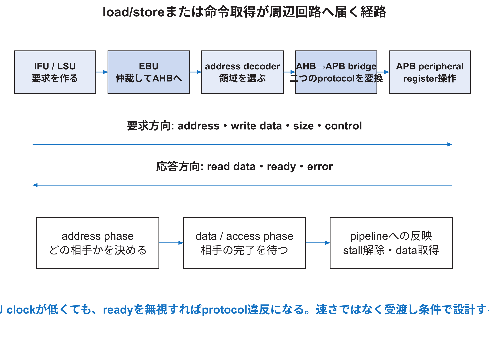

<!-- appendix-content:start -->

# 第17章 メモリシステムとチップ内バス
<!-- appendix-content:end -->

[付録の総目次](../../技術付録.md) ｜ [論文本文](../../本文.md) ｜ [参考文献](../references.md)

[第II部 Wally CPUとSoCアーキテクチャ](README.md)

ファイルパスの表記は、[資料フォルダー](../../README.md)を基準とする。

## このページの目次

- [17.1 addressは相手を選ぶ契約である](#s_11_1)
- [17.2 cache line、tag、index、offset](#s_11_2)
- [17.3 write policyとdirty data](#s_11_3)
- [17.4 IFU・LSUからEBUへ](#s_11_4)
- [17.5 AHBのaddress phaseとdata phase](#s_11_5)
- [17.6 address decoderの正しさ](#s_11_6)
- [17.7 AHBからAPBへのbridge](#s_11_7)
- [17.8 APB peripheralのregister map](#s_11_8)
- [17.9 valid/readyとbackpressure](#s_11_9)
- [17.10 FIFOの必要性を速度だけで説明しない](#s_11_10)
- [17.11 memory ordering、`volatile`、fence](#s_11_11)
- [17.12 cache coherenceと共有DDR](#s_11_12)
- [17.13 bandwidth、latency、outstanding数](#s_11_13)

<!-- appendix-content:start -->
CPUが出す読書き要求は、番地によってDDR3へ向かうことも、UARTやRasterIXへ向かうこともある。この章では、番地を選ぶ回路、キャッシュ、バス変換のそれぞれが何を受け取り、何を待つかを追う。速度だけでなく、同じ値を同じ順序で渡せることも確認する。

## 17.1 addressは相手を選ぶ契約である

CPUが出す番地は、DRAMのbyte位置だけを表すとは限らない。物理 番地 spaceの範囲ごとに、RAM、ROM、CLINT、PLIC、UART、SD、外部I/Oなどが割り当てられる。memory-mapped I/Oでは、通常のload/store命令が周辺レジスタのread/writeになる。[Harris26](../references.md#ref_harris26)[Wally](../references.md#ref_wally)

番地 mapにはbaseとrange、alignment、access size、read/write可否、cacheability、side effectが必要である。RTL decoder、PMA/PMP、device tree、ソフトウェア定数の値を一致させる。baseだけ一致しrangeが違う場合、隣のdeviceと重なるか、未選択領域が生じる。

## 17.2 cache line、tag、index、offset

キャッシュはメモリの一部をline単位で保持する。番地をtag、set index、line内offsetへ分ける。hitはvalidでtagが一致することを意味する。set associative キャッシュでは複数wayを並列比較し、replacement stateでmiss時のwayを選ぶ。[Harris26](../references.md#ref_harris26)

キャッシュ容量だけで性能は決まらない。line size、way数、miss penalty、access pattern、BRAM port、クロック frequencyが関係する。way数を増やすとconflict missを減らせる可能性があるが、tag比較とMUXが増え、timingと資源へ影響する。

## 17.3 write policyとdirty data

write-throughはstoreを下位メモリへも送る。write-backはキャッシュ lineをdirtyにし、追出し時に書き戻す。Wallyの固定構成で採用したpolicyはソースとパラメータで確認する。一般論だけで「キャッシュの値は直ちにDDRへ書かれる」と決めない。

memory-mapped I/Oをキャッシュすると、read side effectやcontrol writeが遅延・統合される危険がある。PMAでuncacheable領域として扱い、ordering要求を守る。RasterIXのcontrol レジスタと共有framebufferでは、レジスタ access、CPU キャッシュ、DMA相当の外部master、reserved メモリを分ける。

## 17.4 IFU・LSUからEBUへ

IFUはinstruction fetch、LSUはdata accessを要求する。両方が同時に外部busを必要とする場合、EBUが仲裁する。仲裁はどちらを先に進めるかを決め、選ばれなかった側へstallを返す。long-latency accessでは、要求を出した側と応答を受ける側の対応を保持する。

`src/ebu/ebu.sv`、`busfsm.sv`、`controllerinput.sv`を組にして読む。FSMだけでは、address/data MUXとパイプラインへのstallが見えない。

## 17.5 AHBのaddress phaseとdata phase

AHBはaddress/control phaseとdata phaseを重ねられる。現在の番地が選んだperipheralと、次周期のdata/readyが対応するため、selectをレジスタで遅らせる必要がある。Wallyの`uncore.sv`は`HSELRegions`を`HREADY`でenableされたレジスタへ保持し、read dataとreadyのMUXに使う。[Wally](../references.md#ref_wally)[Harris26](../references.md#ref_harris26)

peripheralが`HREADY`を下げる間、controllerはtransactionを保持する。番地が次へ進んでも、完了していないdata phaseの相手を失ってはならない。波形では、単一周期の縦断面だけでなく、連続する二つ以上のtransactionを追う。

## 17.6 address decoderの正しさ

decoderは`address`と各領域のbase/rangeからone-hot selectを作る。確認すべき性質は、正しい範囲で選ばれる、異なる領域が同時選択されない、未定義番地でbusが永久停止しない、access属性が一致することである。

範囲をthermometer maskとして表す設計では、任意のサイズを指定できるとは限らない。base alignmentとrange形式を構成生成時に検査する。新しいperipheralを追加するときはdecoder bit、select vector幅、read/ready MUX、interrupt ソースを一組で増やす。

## 17.7 AHBからAPBへのbridge

APBはsetup phaseとaccess phaseを持つ。setupでは`PSEL`、番地、write control、write dataを準備し、accessでは`PENABLE`を上げる。peripheralは完了まで`PREADY`を0にできる。bridgeはAHB側の要求をAPBの二phaseへ変換し、完了をAHBへ返す。[Harris26](../references.md#ref_harris26)

APBは単純だが、`PSEL & PENABLE`のlevelを毎周期新しい書込みとして数えると、wait中にside effectを複数回発生させる。実際の受渡しは`PSEL & PENABLE & PREADY`が成立した完了周期として設計する。

## 17.8 APB peripheralのregister map

周辺回路を設計する前に、offset、幅、read/write、リセット値、side effectを表にする。

| offset | 名前 | access | 意味 | side effect |
|---:|---|---|---|---|
| 0x00 | ID | R | 固定識別値 | なし |
| 0x04 | CONTROL | R/W | enable、mode | write時に更新 |
| 0x08 | STATUS | R | busy、error | なし |
| 0x0C | DATA | W | command data | 完了時にFIFOへ投入 |

reserved bitのread値、部分writeの`PSTRB`、illegal offset、連続accessを決める。read-clearやwrite-one-to-clearは便利だが、ソフトウェアが読むだけで状態が変わるため明記する。

## 17.9 valid/readyとbackpressure

valid/ready interfaceでは、transferは両方が1の周期だけ成立する。送り手はvalidを上げた後、readyになるまでdataを保持する。受け手は受け取れるときreadyを上げる。readyが0だからdataが無効になるわけではない。

APBからAXI4-Streamへbridgeする場合、APBの`PREADY`をstream側`TREADY`と関係付ける。FIFOが満杯ならCPU accessを待たせるか、明示的なerrorを返す。silent dropはcommand列を壊す。

## 17.10 FIFOの必要性を速度だけで説明しない

FIFOは、到着と処理の一時的なずれを、空き容量の範囲で吸収する。平均して到着が処理より速い状態が続けば、有限のFIFOはいずれ満杯になり、処理能力の不足そのものは解消しない。受け取り停止への対応はAPBの待ちでも実現でき、クロック間の受け渡しにもFIFO以外の方法がある。E6では1語ずつ渡す4相方式、16語FIFO、512語FIFOを実装して比べ、512語FIFOでCPUのAPB待ちが短くなることを確認した。全候補中の最適性や512語すべての必要性を示した実験ではない。詳しい回路と計測は[技術付録第71章](../05-integration/fifo-comparison.md#ch_29)にある。[E6](../references.md#ref_e6)

FIFO採用理由は「受け手が永久に遅い」ではなく、readyが一時的に下がってもprotocolを守り、二つのクロック domain間でdataと順序を保つことである。容量理由は別に、最大burst、停止時間、通知遅延から評価する。[技術付録第44章](../04-rasterix/command-clock-boundary.md#ch_i)でこの設計を詳しく扱う。

## 17.11 memory ordering、`volatile`、fence

`volatile`はコンパイラへaccessを省略・統合しないよう伝えるが、CPU、キャッシュ、bus、deviceの完了を単独で保証しない。RISC-Vのメモリ ordering、I/O属性、fence、device-specific statusを組み合わせる。[RISCVUnpriv26](../references.md#ref_riscvunpriv26)

commandを書き終えたこと、RasterIXがcommandを受理したこと、描画を完了したこと、displayが新frameを読み始めたことは別の時点である。ソフトウェア APIは必要な完了段階を明示する。単なる固定`usleep`は、完了を観察せず時間を推測している。

## 17.12 cache coherenceと共有DDR

CPU キャッシュと、CPU キャッシュを経由しないハードウェア masterが同じDDR領域を共有すると、古いキャッシュ lineを読む問題が生じる。解決はハードウェア coherence、uncached mapping、キャッシュ clean/invalidate、所有権移譲protocolなどである。採用方式をソースとOS設定で確認する。

本研究のreserved-memoryはLinuxの通常allocatorから領域を除外するが、それだけでキャッシュ coherenceやハードウェア protectionを作らない。誰がいつ書き、誰がいつ読むかという所有権と、可視化の操作を別に設計する。

## 17.13 bandwidth、latency、outstanding数

bandwidthは単位時間に運べるdata量、遅延は一要求の応答時間である。wide busでも、一要求ずつ完了を待てば遅延に支配される。split transactionや複数outstanding requestは遅延を隠せるが、IDと順序管理を増やす。

測定では、payload byteだけでなくprotocol overhead、burst長、wait、クロック crossing、DDR効率を含める。理論最大値は上限であり、applicationの達成値ではない。
<!-- appendix-content:end -->

---

[前：第16章 番地とメモリとバスを混同せずに追う](memory-bus.md) ｜ [次：第18章 Wallyの構成値が回路になるまで](configuration.md)
