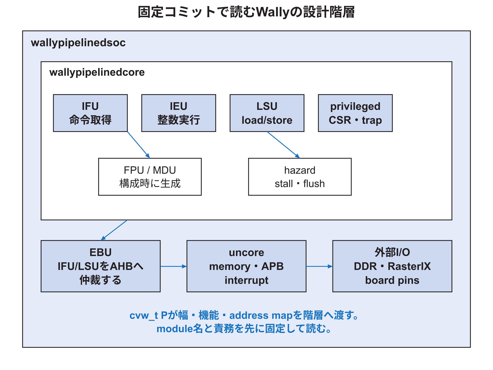

<!-- appendix-content:start -->

# 第14章 Wallyの階層と構成を読む
<!-- appendix-content:end -->

[付録の総目次](../../技術付録.md) ｜ [論文本文](../../本文.md) ｜ [参考文献](../references.md)

[第II部 Wally CPUとSoCアーキテクチャ](README.md)

ファイルパスの表記は、[資料フォルダー](../../README.md)を基準とする。

## このページの目次

- [14.1 core、SoC、board topを区別する](#s_9_1)
- [14.2 `wallypipelinedcore`の主要unit](#s_9_2)
- [14.3 `cvw_t`は構成契約である](#s_9_3)
- [14.4 configurationから回路が生成されるまで](#s_9_4)
- [14.5 interfaceから階層を理解する](#s_9_5)
- [14.6 IFUを読む観点](#s_9_6)
- [14.7 IEUを読む観点](#s_9_7)
- [14.8 LSU、cache、MMUを読む観点](#s_9_8)
- [14.9 privileged unitを読む観点](#s_9_9)
- [14.10 新しい機能をどこへ置くか](#s_9_10)

<!-- appendix-content:start -->
新しい周辺回路を加えるとき、CPUの演算器を直すのか、CPUの外の接続を直すのかを最初に決める必要がある。その判断のために、命令を実行するコア、メモリや周辺回路まで含むSoC、基板の端子まで含む最上位回路の境界を整理する。

## 14.1 core、SoC、board topを区別する

`wallypipelinedcore`は命令を実行するcoreである。`wallypipelinedsoc`はcoreとuncoreを組み合わせ、メモリやperipheralへ接続する。FPGA最上位はboardのpin、クロック生成、DDR controller、リセット、Wally SoCを結ぶ。これらをすべてCPUと呼ぶと、変更場所を誤る。[Wally](../references.md#ref_wally)[Console26](../references.md#ref_console26)

RasterIX追加では、RISC-V命令実行器の内部へ描画パイプラインを入れたのではない。uncoreの外部APB interfaceとboard topに描画回路を接続した。ゲームソフトウェアは通常のstoreで命令語を送り、RasterIXはCPUと並列に動く。

## 14.2 `wallypipelinedcore`の主要unit

| unit | 主な責務 | 入口となるソース |
|---|---|---|
| IFU | PC、命令取得、予測、I-cache | `src/ifu/ifu.sv` |
| IEU | decode、レジスタ ファイル、ALU、control | `src/ieu/ieu.sv` |
| LSU | load/store、D-cache、MMUとの接続 | `src/lsu/lsu.sv` |
| privileged | CSR、trap、interrupt、権限 | `src/privileged/privileged.sv` |
| HZU | stallとflush | `src/hazard/hazard.sv` |
| FPU | 浮動小数点演算 | `src/fpu/fpu.sv` |
| MDU | 乗算・除算 | `src/mdu/mdu.sv` |
| EBU | IFU/LSU要求を外部busへ | `src/ebu/ebu.sv` |

モジュールを読むときは、全信号を一度に暗記しない。責務ごとにportを分け、要求data、応答data、valid/ready、stall/flush、exception、configurationに色分けする。

## 14.3 `cvw_t`は構成契約である

`src/cvw.sv`の`cvw_t`にはXLEN、ISA extension、キャッシュ形状、TLB、番地 map、peripheralの有無などがまとまる。各モジュールは`#(parameter cvw_t P)`を受け、`P.XLEN`などを参照する。構成をpackageへ集めることで、global macroの名前衝突と、階層ごとのばらばらな値を減らす。[Wally](../references.md#ref_wally)[Harris26](../references.md#ref_harris26)

ただし値を一か所へ集めただけで整合が自動保証されるとは限らない。boardのDDR容量、device tree、boot ソフトウェア、C++定数など、SystemVerilog外にも同じ事実の表現がある。変更影響を列挙し、生成物を更新する。

## 14.4 configurationから回路が生成されるまで

`config/derivlist.txt`などの派生構成から`config.vh`とパラメータ定義が作られ、testbenchやFPGA buildが`P`を組み立てる。`P.F_SUPPORTED`や`P.BUS_SUPPORTED`はgenerate条件として使われ、不要unitを物理回路から除ける。

実行時にfeature bitを0へ書けば回路が消えるわけではない。compile/elaboration時パラメータと、ソフトウェアから書き換えるcontrol レジスタを区別する。前者はbitstreamを作り直す必要がある。

## 14.5 interfaceから階層を理解する

大きなモジュールを読む順番は次である。

1. パラメータとclock/resetを読む。
2. 入出力を機能別に分ける。
3. 内部信号の段 suffixと幅を確認する。
4. submodule instanceをブロック図へ置く。
5. 各submodule間の要求・応答を一経路ずつ追う。
6. generateの有効・無効両方で未駆動がないか確認する。

`wallypipelinedcore.sv`を先頭から逐語的に読むより、IFU→IEU→LSU→EBU、privileged→hazardという経路を選んだ方が理解しやすい。

## 14.6 IFUを読む観点

IFUは次に取得するPCを選び、instruction メモリまたはI-cacheへ要求し、得た命令をDecodeへ渡す。branch predictionが有効なら、予測PCと後で判明した正しいPCを比較する。compressed instruction対応では、16 bit単位の境界と命令の組立ても関係する。

確認する状態は、PC レジスタ、fetch buffer、cache/TLB state、予測器stateである。stall時にPCを保持する条件、flush時に次PCを切り替える条件、instruction access faultがどの段へ届くかを追う。

## 14.7 IEUを読む観点

IEUは命令fieldをdecodeし、レジスタ ファイルからoperandを読み、immediateを生成し、ALU・branch・CSR・load/store制御を作る。Decodeで決めるcontrolと、Execute/Memoryへパイプライン レジスタで運ぶcontrolを分ける。

data path変更では、値だけでなく、結果を選ぶMUX、write enable、destination レジスタ番号、exception条件、forwarding ソースを追う。新しい演算をALUへ加えても、decodeとwriteback selectionがなければarchitectural resultへ届かない。

## 14.8 LSU、cache、MMUを読む観点

LSUはeffective 番地、byte/half/wordのalignment、loadの符号拡張、store byte mask、atomic、D-cache、番地 translation、PMP/PMA、bus requestを結ぶ。単にメモリを読むモジュールではない。

virtual 番地から物理 番地への変換、cacheableか、alignment違反か、access権があるかを順に区別する。Linux構成でpage faultとbus errorを同じ原因として扱わない。キャッシュ missではパイプライン stallとline refillが起こり、uncached MMIOでは周辺回路のreadyを待つ。

## 14.9 privileged unitを読む観点

privileged unitはCSR、現在のprivilege mode、interrupt、exception、trap vector、returnを扱う。RISC-V privileged specificationはソフトウェアから見える動作を定め、Wally RTLはそれをパイプラインへ統合する。[RISCVPriv26](../references.md#ref_riscvpriv26)

precise exceptionでは、trapより前の命令は完了し、後の命令はarchitectural stateを変更してはならない。exceptionを検出した段、CSRへ記録するPCと原因、パイプライン flush、進行中メモリ operationを対応付ける。

## 14.10 新しい機能をどこへ置くか

| 要求 | 通常の配置候補 | 避けるべき混同 |
|---|---|---|
| 新しいRISC-V命令 | decode、data path、CSR、test | 周辺レジスタ追加と同一視する |
| memory-mapped peripheral | uncore、APB、番地 map | ALUへ直接置く |
| 高bandwidth accelerator | bus/stream、DMA、メモリ契約 | APB レジスタだけでdata全量を送る |
| board pin追加 | FPGA top、XDC、I/O回路 | core RTLへboard名を埋め込む |
| software-only機能 | driver/application | 不要なハードウェア stateを増やす |

責務の近い階層へ置けば、coreの再利用性と検証範囲を保ちやすい。RasterIXのようなacceleratorでも、control path、command path、bulk メモリ path、display pathを別々に設計する。
<!-- appendix-content:end -->

---

[前：第13章 Wallyが一つのプログラムを実行する過程](cpu.md) ｜ [次：第15章 命令の流れとプログラムから見えるCPUの状態](instruction-state.md)
