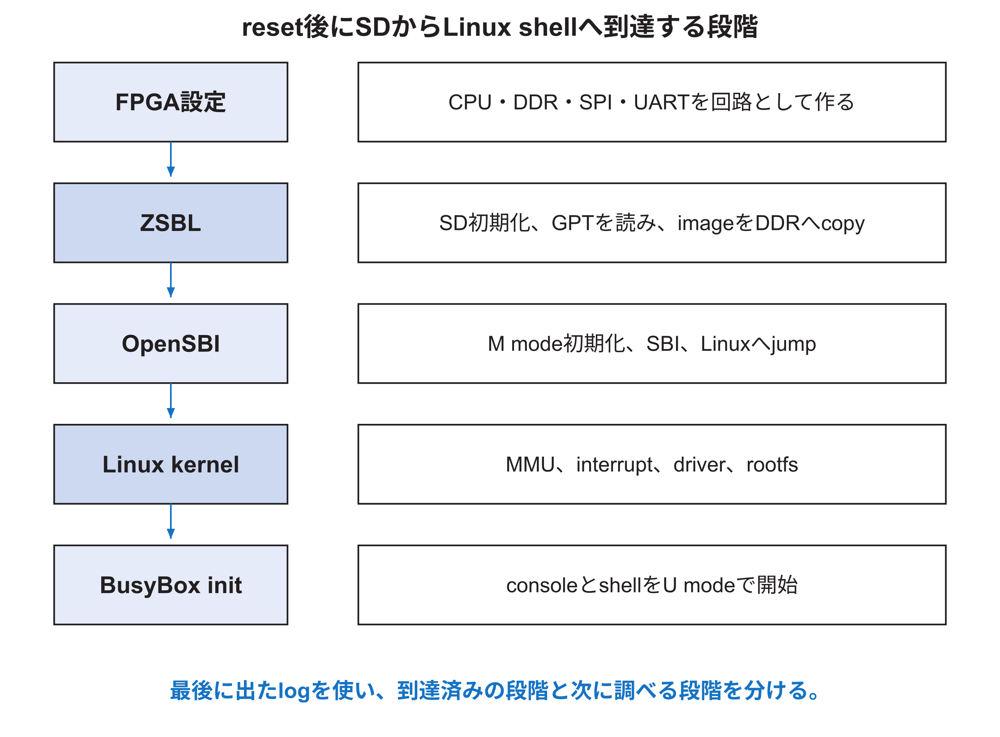

<!-- appendix-content:start -->

# 第21章 SDカードからLinuxが起動するまで
<!-- appendix-content:end -->

[付録の総目次](../../技術付録.md) ｜ [論文本文](../../本文.md) ｜ [参考文献](../references.md)

[第III部 Linuxとシステムソフトウェア](README.md)

ファイルパスの表記は、[資料フォルダー](../../README.md)を基準とする。

## このページの目次

- [21.1 bitstreamを書いただけではLinuxは始まらない](#s_21_1)
- [21.2 ZSBLの役割](#s_21_2)
- [21.3 SD SPI初期化](#s_21_3)
- [21.4 GPT partitionとload address](#s_21_4)
- [21.5 OpenSBIの役割](#s_21_5)
- [21.6 Linux kernelの初期化](#s_21_6)
- [21.7 initramfsとBusyBox](#s_21_7)
- [21.8 Buildrootの入力と出力](#s_21_8)
- [21.9 boot failureを段階で判断する](#s_21_9)

<!-- appendix-content:start -->

## 21.1 bitstreamを書いただけではLinuxは始まらない

bitstreamはFPGA内部の回路と一部memory初期値を設定する。Wallyがreset vectorから実行を始めた後、SDカードにあるdevice tree、OpenSBI、Linux kernelをDDR3へ移し、段階的に権限と実行環境を整える必要がある。

## 21.2 ZSBLの役割

Zero Stage Boot Loaderは小さく、`fpga/zsbl`にある。`bios.S`はstackやregisterを準備しC codeへ入り、`boot.c`はUARTとSDを初期化する。`gpt.c`はGUID Partition Tableを読み、最初の三partition entryをdevice tree、OpenSBI、Linux kernelとして扱う。

固定版ではdevice treeを`FDT_ADDRESS`、OpenSBIを`EXT_MEM_BASE`、kernelを`0x80200000`へcopyする。copy後、assemblyがOpenSBIへjumpする。ZSBLはfile system名でfileを探すのではなく、GPT partitionのLBA範囲をraw blockとして読む。

## 21.3 SD SPI初期化

SDカードはpower-on後に特定command sequenceでSPI modeへ入り、低いclockから開始する。`sd.c`はcommand、response、CRC、token、multi-block readを実装する。chip select、dummy clock、timeoutを守る必要がある。

SDに一度読めた経験があっても、最大clockを上げればsignal integrityまたはcard差で失敗し得る。boot logの「initializing」「partition」「loading」のどこまで出たかで、UART、SD initialization、GPT parse、DDR copyを分ける。

## 21.4 GPT partitionとload address

GPT headerはLBA1、partition entryは後続LBAにある。`gpt_load_partitions`はentryのfirst LBAとlast LBAからsector数を計算し、512 byte単位でDDRへcopyする。partition順を変えると別imageを別addressへloadするため、flash scriptとbootloaderの期待を揃える。

load先領域が重なると、後からcopyしたimageが前のimageを壊す。kernel size、device tree address、OpenSBI領域、stack、reserved RasterIX領域をmemory map上で確認する。512 MiBの上端32 MiBをRasterIXに予約している構成では、通常のLinux配置がそこへ入らないことを確かめる。

## 21.5 OpenSBIの役割

OpenSBIはM-mode firmwareで、machine-level初期化、hart、timer、IPI、consoleなどのstandard SBI serviceをS-modeへ提供する。`fw_jump.bin`は指定addressの次段へjumpする形式で、device tree addressをLinuxへ渡す。[OpenSBI](../references.md#ref_opensbi)

OpenSBI bannerが出ればZSBLからのjump、DDR上のfirmware fetch、UART出力が進んだと分かる。Linux bannerが出ない場合は、kernel load address、DTB pointer、ISA extension、PMP、delegation、kernel entry付近を調べる。

## 21.6 Linux kernelの初期化

kernelはS-modeへ入り、初期page tableを作り、`satp`を書いてvirtual memoryを有効にする。物理addressとlink時のvirtual addressが異なるため、切替直後のPCとmappingを理解する。trap vector、timer、memory allocator、driver、scheduler、VFSを初期化する。

kernelはDTBを読み、memory容量、CPU clock、UART、PLIC、CLINT、SPI/SDなどを発見する。device treeが間違っていてもhardware回路は変わらないが、kernelが誤ったaddressまたはclockでdriverを動かす。

## 21.7 initramfsとBusyBox

Buildrootは`rootfs.cpio`を作り、kernelがinitramfsとして展開する。root filesystemにはdevice node、library、BusyBox、設定file、shellが入る。最初のU-mode processである`init`が`/etc/inittab`を読み、consoleやserviceを開始する。

BusyBoxは多くのcommandを一つのbinaryで提供する。`ls`、`mount`、`dmesg`などが同じbinaryへのlinkになっていても正常である。promptが出るまでには、kernelがU-modeへ遷移し、rootfsとconsoleが使える必要がある。

## 21.8 Buildrootの入力と出力

固定版`linux/Makefile`はBuildroot 2026.02.xを取得し、`linux/br2-external-tree/configs/wally_defconfig`を適用する。custom Linux config、BusyBox config、rootfs overlay、post-image scriptを使い、`Image`、`fw_jump.bin`、`fw_jump.elf`、`rootfs.cpio`、`vmlinux`、`busybox`を生成する。

| file | 性質 | 主な用途 |
|---|---|---|
| `Image` | raw kernel image | bootloaderがDDRへcopy |
| `vmlinux` | symbol付きELF kernel | debug、objdump |
| `fw_jump.bin` | raw OpenSBI | boot |
| `fw_jump.elf` | ELF OpenSBI | symbol、debug |
| `rootfs.cpio` | archive | initramfs |
| `.dtb` | flattened device tree | hardware description |

## 21.9 boot failureを段階で判断する

| 最後に見えた表示 | 到達した範囲 | 次に調べる入口 |
|---|---|---|
| 何もない | reset、clock、UART以前を含む | LED、bitstream、UART wiring |
| ZSBL banner | CPU、ROM、UART | SD初期化log |
| SD initialized | SPI/SD基本動作 | GPTとpartition image |
| OpenSBI banner | DDRとfirmware jump | DTB pointer、kernel entry |
| Linux banner | kernel entry | DT、memory、driver、rootfs |
| shell prompt | U-modeとrootfs | applicationとdevice mapping |

各段階はそれ以前すべてを完全証明するわけではないが、原因候補を大幅に減らす。
<!-- appendix-content:end -->

---

[前：第20章 cross compile、ELF、ABIを深く理解する](chapter-20.md) ｜ [次：第22章 Linuxのprocess、仮想memory、system call](chapter-22.md)
