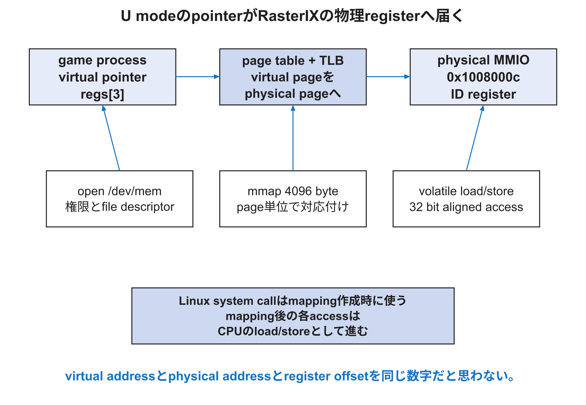

<!-- appendix-content:start -->

# 第22章 Linuxのprocess、仮想memory、system call
<!-- appendix-content:end -->

[付録の総目次](../../技術付録.md) ｜ [論文本文](../../本文.md) ｜ [参考文献](../references.md)

[第III部 Linuxとシステムソフトウェア](README.md)

ファイルパスの表記は、[資料フォルダー](../../README.md)を基準とする。

## このページの目次

- [22.1 processが見るaddressと物理address](#s_22_1)
- [22.2 virtual memoryの目的](#s_22_2)
- [22.3 kernel modeへ入る三つの経路](#s_22_3)
- [22.4 file descriptorとdevice](#s_22_4)
- [22.5 page faultは常にbugではない](#s_22_5)
- [22.6 schedulingとgameの時間](#s_22_6)
- [22.7 signalと終了処理](#s_22_7)

<!-- appendix-content:start -->

## 22.1 processが見るaddressと物理address

U-mode processのpointerは仮想addressである。MMUはpage tableとTLBを使い、物理pageへ変換する。同じ仮想addressを別processが使っても、別物理pageへ対応できる。kernelはprocessごとにaddress space、register、file descriptorなどを管理する。

## 22.2 virtual memoryの目的

virtual memoryは、process間の隔離、連続したaddress空間、共有、copy-on-write、file mapping、permissionを提供する。page単位でread/write/execute/userなどを設定する。CPUのTLBは最近の変換をcacheし、miss時にpage tableをたどる。

address変換があるからprogramはhardwareから完全に独立するわけではない。device MMIOをmappingすれば、そのvirtual pageへのload/storeが物理deviceへ届く。mappingのcache属性とpermissionを正しく選ぶ必要がある。

## 22.3 kernel modeへ入る三つの経路

U-modeからS-modeへは主にsystem call、exception、interruptで入る。system callはECALL、exceptionはpage faultやillegal instruction、interruptはtimerやexternal deviceである。kernelはtrap frameへregisterを保存し、原因を判定する。

system callはfunction callと違いprivilege boundaryを越える。argument検査、pointerのuser access、schedulerによるcontext switchが起こり得る。`open`や`mmap`はsystem callだが、mapping後の各MMIO storeは通常kernel functionを毎回呼ばない。

## 22.4 file descriptorとdevice

Linuxではregular file、terminal、deviceなどをfile descriptorで表す。`open("/dev/mem", O_RDWR | O_SYNC)`はphysical memory accessを提供するcharacter deviceを開く。成功には通常root権限とkernel設定が必要である。

file descriptor自体はaddressではない。`mmap`が指定physical offsetのpageをprocess virtual addressへ対応付け、その戻りpointerを使ってload/storeする。`close(fd)`後もmappingは`munmap`するまで残るため、固定版constructorはmmap後にfdを閉じられる。

## 22.5 page faultは常にbugではない

processがまだmappingされていない合法virtual pageへ初めてaccessすると、demand pagingのためpage faultが起き、kernelがpageを用意して再実行することがある。permission違反や存在しないaddressならSIGSEGVになる。

MMIO mappingでSIGBUSまたはmachine checkになる場合は、physical region、access width、hardware responseを調べる。virtual pointer値だけを見てdevice physical addressだと思わない。`/proc/<pid>/maps`とpage offsetを確認する。

## 22.6 schedulingとgameの時間

Linuxは複数processをtime sliceで実行する。20 MHzのsingle-core Wallyでは、kernel workやinterruptがgameを中断する。`steady_clock`で測るwall timeには、そのprocessが実行されていない時間も含まれる。

CPU time、wall time、frame completion intervalを区別する。game simulationは固定60 Hz tickをaccumulateし、render回数が減ってもsimulation stepを飛ばさない設計になっている。これは描画throughputとgame speedを分離する。

## 22.7 signalと終了処理

Ctrl-Cはterminal driverからSIGINTをprocessへ送る。固定版handlerは`sig_atomic_t` flagだけを更新し、main loopが安全な場所で終了する。signal handler内で複雑なC++処理や非async-signal-safe functionを呼ばない。

正常終了とsignal終了の両方でRasterIX context、device、mappingを正しい順序で破棄する。強制電源断ではdestructorが走らないため、hardware側も次回起動時に初期化できる設計が必要である。
<!-- appendix-content:end -->

---

[前：第21章 SDカードからLinuxが起動するまで](chapter-21.md) ｜ [次：第23章 device treeをhardwareとLinuxの契約として読む](chapter-23.md)
