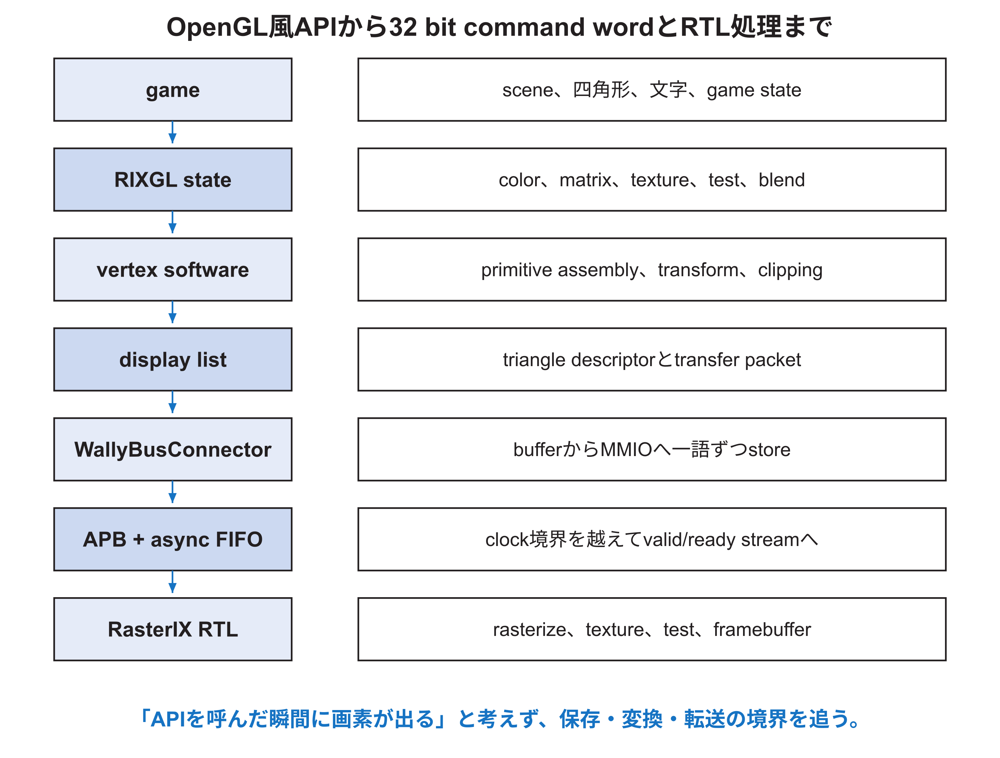

<!-- appendix-content:start -->

# 第25章 RasterIXのsoftware stackを深く追う
<!-- appendix-content:end -->

[付録の総目次](../../技術付録.md) ｜ [論文本文](../../本文.md) ｜ [参考文献](../references.md)

[第III部 Linuxとシステムソフトウェア](README.md)

ファイルパスの表記は、[資料フォルダー](../../README.md)を基準とする。

## このページの目次

- [25.1 一つのOpenGL風呼出しは直接register一語ではない](#s_25_1)
- [25.2 API stateとdraw call](#s_25_2)
- [25.3 `ThreadedVertexTransformer`と本構成](#s_25_3)
- [25.4 command用buffer](#s_25_4)
- [25.5 二層のpacket](#s_25_5)
- [25.6 software処理とhardware処理の分担](#s_25_6)
- [25.7 `RIXGL` instanceと初期化](#s_25_7)
- [25.8 errorの伝わり方](#s_25_8)
- [25.9 sourceを追う具体的な入口](#s_25_9)

<!-- appendix-content:start -->

## 25.1 一つのOpenGL風呼出しは直接register一語ではない

gameは`glBegin`、`glVertex`、`glColor`などのAPIを使う。RasterIXのsoftware側はcurrent state、頂点配列、matrix、primitive assembly、clipping、triangle descriptor、display listを処理し、最終的に32 bit word列を`IBusConnector`へ渡す。

## 25.2 API stateとdraw call

OpenGLのimmediate modeでは、`glColor`は以後の頂点に関連付くcurrent colorを変える。`glBegin`はprimitive種別を開始し、`glVertex`は頂点を蓄え、`glEnd`でまとまりを処理する。関数名一つがその場でpixelを塗るとは限らない。

matrix、viewport、texture enable、depth test、blendなどもstateである。draw時に現在stateと頂点を組み合わせ、hardware commandへ変換する。state changeの順序が描画結果を変える。

## 25.3 `ThreadedVertexTransformer`と本構成

upstream softwareはworkerとtransfer runnerを抽象化し、並列実行可能な構造を持つ。本構成はsingle-core Wallyで`NoThreadRunner`を使い、処理と転送を順次実行する。class名にThreadedとあっても、実際に別threadが走るかは渡したrunnerで決まる。

この選択は正しさと初期統合を単純にする。将来thread化しても20 MHz single-coreでは同時実行のhardware coreが増えるわけではなく、context switchと同期costがある。測定して判断する。

## 25.4 command用buffer

`WallyBusConnector`は複数の`std::vector<uint32_t>`を持ち、upstreamからwrite bufferを要求されたときspanを返す。softwareはまずhost-side bufferへword列を作り、`writeData`でMMIOへ順番に送る。

これは「GPUがC++ vectorを直接読む」方式ではない。vectorはWallyのprocess memoryにあり、connectorが各wordをAPB registerへstoreする。最後のwordだけoffset 0x04へ書きTLASTを示す。buffer index、size、offsetは範囲と4 byte alignmentを検査する。

## 25.5 二層のpacket

RasterIXには、device data uploadなどを扱う外側のtransfer framingと、rasterizerが解釈する内側のrender commandがある。word列を観察するときは、どのlayerのlength、type、TLASTかを区別する。

一語欠けると後続wordの境界までずれる可能性がある。色だけがおかしい場合、triangle descriptorのfieldかもしれないが、全commandが停止するならpacket length、TLAST、ready/validを先に疑う。

## 25.6 software処理とhardware処理の分担

固定版RasterIXでは、頂点変換や一部triangle setupをsoftware側が行い、RTL側はdescriptorからpixel/fragmentを生成し、texture、test、blend、framebuffer処理を行う。したがって「RasterIXはすべてのOpenGL処理をhardwareで行う」ではない。

性能を調べるとき、CPU側command preparation、MMIO transfer、GPU execution、DDR commit、display waitを分ける。本研究で測定した準備時間は、software側のdraw call数やcommand作成方法で変わる。

## 25.7 `RIXGL` instanceと初期化

`RIXGL::createInstance`はdeviceとsoftware stackを結び、OpenGL風APIのcontextを用意する。resolution変更前後には内部display listがflushされるため、固定版gameはclearを先に実行し、その後resolutionを設定する。これは起動時に古い内部pixelが残る問題と関係する。

初期化順は偶然ではない。transport、uploader、runner、device、contextの依存方向を図にし、破棄は逆順にする。constructorが途中でexceptionを投げた場合も既に獲得したresourceが解放されるか確認する。

## 25.8 errorの伝わり方

MMIO mapping失敗、ID不一致、response timeout、display timeoutはC++ exceptionとしてmainへ伝わり、stderrへ表示して非zero終了する。OpenGL state errorは`glGetError`で確認する。

hardwareが返すerror bit、transport timeout、API misuseを同じ文字列にまとめない。error code、stage、address、last command countを記録できると診断しやすい。prototypeでもsilent failureを避ける。

## 25.9 sourceを追う具体的な入口

1. `examples/rasterix/breakout.cpp`の`present` lambda。
2. `BreakoutRenderer.hpp`のdraw sequence。
3. upstream `RIXGL`とvertex pipeline。
4. `DeviceDataUploader`とdisplay list。
5. `WallyBusConnector::writeData`。
6. APB adapterのregister map。
7. async FIFOと`RasterIX_IF`。
8. CommandParser、Rasterizer、PerFragmentPipeline。

各段階でinput型、output型、所有するstate、完了条件を書く。関数名だけを矢印で結ばず、一つの四角形について実際の頂点値とword数を追う。
<!-- appendix-content:end -->

---

[前：第24章 MMIO、`mmap`、`volatile`、fenceを深く理解する](chapter-24.md) ｜ [次：第26章 game loop、入力、時間、描画を深く理解する](chapter-26.md)
