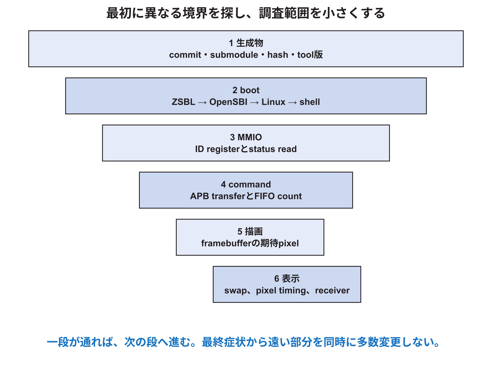

<!-- appendix-content:start -->
<a id="ch_27"></a>
# 第27章 softwareとhardwareを層ごとに診断する
<!-- appendix-content:end -->

[付録の総目次](../../技術付録.md) ｜ [論文本文](../../本文.md) ｜ [参考文献](../references.md)

[第III部 Linuxとシステムソフトウェア](README.md)

ファイルパスの表記は、[資料フォルダー](../../README.md)を基準とする。

## このページの目次

- [27.1 最初に同じ版を動かしているか確かめる](#s_27_1)
- [27.2 hostで確認するcommand](#s_27_2)
- [27.3 target Linuxで確認するcommand](#s_27_3)
- [27.4 UART logの読み方](#s_27_4)
- [27.5 register canary](#s_27_5)
- [27.6 waveformとsoftware logを時刻で結ぶ](#s_27_6)
- [27.7 error injection](#s_27_7)
- [27.8 assertionとsoftware invariant](#s_27_8)
- [27.9 診断記録の書式](#s_27_9)

<!-- appendix-content:start -->
<a id="s_27_1"></a>
## 27.1 最初に同じ版を動かしているか確かめる

診断前に、source commit、submodule、bitstream、DTB、kernel、rootfs、applicationを固定する。古いSD copyを動かした状態では、codeを直しても症状が変わらない。実機起動logとbinary hashを試行ごとに保存する。



<a id="s_27_2"></a>
## 27.2 hostで確認するcommand

```bash
git status --short
git rev-parse HEAD
git submodule status
file rasterix-build/rasterix-breakout
riscv64-buildroot-linux-gnu-readelf -h rasterix-build/rasterix-breakout
dtc -I dtb -O dts wally-nexysvideo-rasterix.dtb -o decoded.dts
```

Vivado reportではutilization、timing、clock、CDC、DRCを保存する。build successだけでWNSやunconstrained pathを見落とさない。

<a id="s_27_3"></a>
## 27.3 target Linuxで確認するcommand

環境に存在する範囲で次を使う。

```bash
uname -a
cat /proc/cpuinfo
cat /proc/iomem
cat /proc/interrupts
dmesg | tail -n 100
sha256sum ./rasterix-breakout
```

BusyBox構成では一部commandやoptionがない場合がある。command不在をhardware failureと解釈せず、rootfs configを確認する。

<a id="s_27_4"></a>
## 27.4 UART logの読み方

UARTはboot初期から使え、画面が出ない場合にも役立つ。logへtimestampまたは段階名を入れ、ZSBL、OpenSBI、kernel、applicationを区別する。binary dataや大量traceを低速UARTへ出すとsystem timingを大きく変える。

文字化けはbaud、input clock、data bit、parity、line endingを確認する。何も出ない場合はTX pin、USB port、reset、bitstream、terminal deviceの順に分ける。

<a id="s_27_5"></a>
## 27.5 register canary

ID register readは小さいend-to-end testである。期待値が返れば、process mapping、MMU、LSU、bus、decoder、APB read、adapterの一部が通った。次にstatus、単一command、frame countへ段階を進める。

ID不一致でtriangle codeを直しても意味がない。最初に失敗した境界より後の処理をいったん候補から外す。

<a id="s_27_6"></a>
## 27.6 waveformとsoftware logを時刻で結ぶ

simulationまたはILAではAPB handshake、FIFO write/read、AXI stream、DDR request、swap handshakeを見る。software logにはcommand sequence番号やframe countを出す。共通counterまたはtrigger eventで両者を対応付ける。

logic analyzerを入れるとresourceとtimingが変わることがある。debug buildの結果をproduction buildの性能値として使わず、観察用構成を明記する。

<a id="s_27_7"></a>
## 27.7 error injection

PREADYを数cycle下げる、FIFOを小さくする、TLASTを一度欠かす、DTB addressを意図的にずらすなど、制御されたfaultを入れるとerror detectionを確認できる。元sourceと実験branchを分け、必ず戻せるようにする。

timeoutが働くか、silent dropしないか、reset後に回復するか、error messageが原因stageを示すかを見る。正常caseだけの試験ではbackpressureやrecoveryは確認できない。

<a id="s_27_8"></a>
## 27.8 assertionとsoftware invariant

hardwareでは「FIFO full時にwriteしない」「valid中readyまでdataを保持」「APB writeは一回だけpush」などをassertionにする。softwareではbuffer index、sizeの4 byte alignment、address range、context lifetimeをcheckする。

両側の検査は重複ではない。hardwareは悪いsoftwareからも内部整合を守り、softwareはerrorを早く説明可能にする。

<a id="s_27_9"></a>
## 27.9 診断記録の書式

一試行ごとに、目的、固定版、変更一つ、予想、command、入力、観察、結果、artifact pathを書く。成功画像だけでなく、UART log、counter、report、hashを保存する。予想と異なった結果も削除せず、次の仮説の根拠にする。
<!-- appendix-content:end -->

---

[前：第26章 game loop、入力、時間、描画を深く理解する](chapter-26.md) ｜ [次：第28章 hardware software協調で性能を測る](chapter-28.md)
