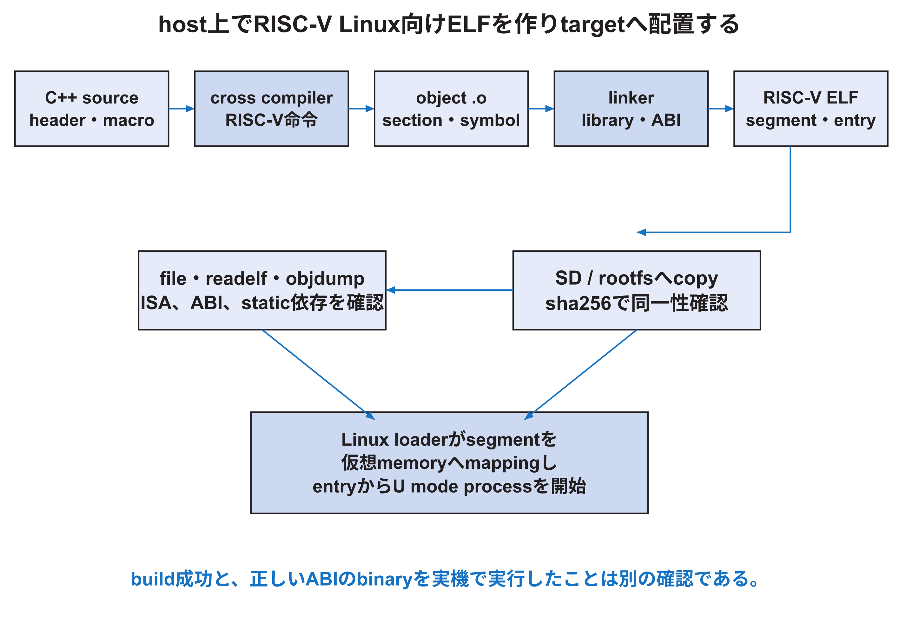

<!-- appendix-content:start -->
<a id="ch_20"></a>
# 第27章 クロスコンパイルと実行ファイルと呼出し規約
<!-- appendix-content:end -->

[付録の総目次](../../技術付録.md) ｜ [論文本文](../../本文.md) ｜ [参考文献](../references.md)

[第III部 Linuxとシステムソフトウェア](README.md)

ファイルパスの表記は、[資料フォルダー](../../README.md)を基準とする。

## このページの目次

- [27.1 compilerはsourceを別CPUの命令へ変える](#s_20_1)
- [27.2 前処理、compile、assembly、link](#s_20_2)
- [27.3 ELFに入るもの](#s_20_3)
- [27.4 ISA optionとABI](#s_20_4)
- [27.5 static linkとdynamic link](#s_20_5)
- [27.6 C++ object lifetimeとresource](#s_20_6)
- [27.7 optimization optionを正しく比較する](#s_20_7)
- [27.8 Buildroot toolchainとapplication toolchain](#s_20_8)
- [27.9 reproducible buildの最低条件](#s_20_9)

<!-- appendix-content:start -->
ゲームのソースは、そのままWallyで実行されるファイルではない。コンパイラがCPU命令へ変換し、リンカが必要な処理とデータを一つの実行ファイルへまとめる。この章では、そのファイルに何が入り、関数どうしが引数や戻り値をどの規則で渡すかを扱う。

<a id="s_20_1"></a>
## 27.1 compilerはsourceを別CPUの命令へ変える

cross コンパイラはhost上で動き、対象 ISAのmachine codeを生成する。`riscv64-buildroot-linux-gnu-g++`はRISC-V 64 bit Linux向けC++ コンパイラである。`riscv64-unknown-elf-gcc`は主にbare-metal用で、Linux user プログラム用libcやdynamic loaderを前提としない。名前が似ていても出力環境が違う。[Buildroot](../references.md#ref_buildroot)



<a id="s_20_2"></a>
## 27.2 前処理、compile、assembly、link

C/C++ buildは概念上、前処理、compile、assembly、linkへ分かれる。headerとmacroを展開し、言語を中間表現とassemblyへ変換し、object ファイルを作り、最後にlibraryと結合してELF executableを作る。

```bash
riscv64-buildroot-linux-gnu-g++ -E breakout.cpp -o breakout.ii
riscv64-buildroot-linux-gnu-g++ -S -O2 breakout.cpp -o breakout.s
riscv64-buildroot-linux-gnu-g++ -c -O2 breakout.cpp -o breakout.o
```

実際のprojectではCMakeがinclude path、define、library順、link optionを組み立てる。問題調査では`cmake --build ... --verbose`で最終commandを確認する。

<a id="s_20_3"></a>
## 27.3 ELFに入るもの

ELFはmachine codeだけでなく、entry point、プログラム header、section、symbol、relocation、ABI情報を持つ。`.text`は実行code、`.rodata`はread-only data、`.data`は初期値付きwritable data、`.bss`はzero初期化領域である。プログラム headerはloaderがメモリへどうmappingするかを示す。

```bash
file rasterix-build/rasterix-breakout
riscv64-buildroot-linux-gnu-readelf -h -l -S rasterix-build/rasterix-breakout
riscv64-buildroot-linux-gnu-objdump -drC rasterix-build/rasterix-breakout | less
```

`file`でRISC-V 64 bitか、staticまたはdynamicかを確認する。`readelf -l`でinterpreterが必要か、segmentのR/W/X、entryを確認する。`objdump -d`はC++ symbolを`-C`でdemangleすると関数名を追いやすい。

<a id="s_20_4"></a>
## 27.4 ISA optionとABI

`-march`は使ってよい命令extension、`-mabi`は関数call、レジスタ、data型、浮動小数点argumentなどの約束を決める。例えばRV64GCとLP64Dの組合せでは64 bit integer レジスタとdouble-precision FP calling conventionを使う。

CPUが対応しないextensionをコンパイラが使うとillegal instructionになる。CPUがF/Dを持っていても、libraryとapplicationのABIが一致しなければlinkまたは実行時に問題が起こる。kernel、OpenSBI、rootfs、applicationを別toolchainで作る場合は、ISA/ABIの共通部分を確認する。[RISCVABI](../references.md#ref_riscvabi)

<a id="s_20_5"></a>
## 27.5 static linkとdynamic link

固定版の`examples/rasterix/CMakeLists.txt`は既定で`-static`を付ける。static executableは必要なlibrary codeを一つのファイルへ含めるため、対象 rootfsに同じC++ runtimeやshared libraryがなくても動かしやすい。その代わりファイルが大きくなり、library更新は再linkが必要である。

dynamic executableは小さく、複数プログラムでlibrary pageを共有できるが、対象にdynamic loaderと互換shared libraryが必要である。`readelf -d`、`readelf -l`、対象の`ldd`で依存を確認する。staticならハードウェアに近いという意味ではなく、deployment方法の選択である。

<a id="s_20_6"></a>
## 27.6 C++ object lifetimeとresource

`WallyBusConnector`はconstructorで`/dev/mem`を開いて`mmap`し、IDを確認する。destructorは`munmap`する。copyを削除しているため、同じmappingを二objectが所有して二重解放するのを防ぐ。

`breakout.cpp`はRasterIX contextをdeviceやtransportより先に破棄する必要があるため、local `Context` structのdestructorで`RIXGL::destroy()`と`device.deinit()`を呼ぶ。C++ではlocal objectは逆順に破棄される。正常終了だけでなくexception経路でもresourceを解放するRAIIの例である。

<a id="s_20_7"></a>
## 27.7 optimization optionを正しく比較する

`Release` buildは通常最適化を有効にし、debug symbolやassertionの扱いが変わる場合がある。`-O0`と`-O2`では命令数、inlining、メモリ access、timingが変わる。ソース上の一行とassemblyの一対一対応も崩れる。

性能比較ではコンパイラ version、flags、link方式を固定する。原因調査では`-g`を付けても最適化は可能だが、変数が消えることがある。正しさを比較するとき、未定義動作が最適化で表面化する可能性も考える。

<a id="s_20_8"></a>
## 27.8 Buildroot toolchainとapplication toolchain

WallyのBuildroot configはkernel、OpenSBI、BusyBox、rootfs、host toolchainを同じ構成から生成する。applicationをその`output/host/bin`のコンパイラで作ると、対象 rootfsとのABI整合を取りやすい。

ただし固定版の`wally_defconfig`ではC++ toolchain生成が無効になっている版もある。C++ exampleをbuildするには、C++を有効にした互換Buildroot toolchainを使うか、同じISA/ABIとlibcを持つtoolchainを用意する。コンパイラ commandが存在することだけで互換性を断定せず、`file`、`readelf`、実機実行で確認する。

<a id="s_20_9"></a>
## 27.9 reproducible buildの最低条件

ソース commit、submodule commit、コンパイラとBuildroot版、CMake キャッシュ、build type、command、生成物hashを残す。build directoryを使い回した場合は古いキャッシュが影響し得るため、再現確認では空のbuild directoryから作る。

```bash
cmake -S "$WALLY/examples/rasterix" -B rasterix-build-clean \
  -DCMAKE_SYSTEM_NAME=Linux -DCMAKE_SYSTEM_PROCESSOR=riscv64 \
  -DCMAKE_C_COMPILER=riscv64-buildroot-linux-gnu-gcc \
  -DCMAKE_CXX_COMPILER=riscv64-buildroot-linux-gnu-g++ \
  -DCMAKE_BUILD_TYPE=Release
cmake --build rasterix-build-clean --parallel --verbose
```

binary hashが毎回一致しない場合でも直ちに機能不一致ではない。timestamp、build ID、path埋込みなどを調べる。再現性の主張はbit-identicalか、機能同一かを明示する。
<!-- appendix-content:end -->

---

[前：第26章 開発用PCとFPGA上の実行環境](host-and-target.md) ｜ [次：第28章 SDカードからLinuxが起動するまで](boot-chain.md)
