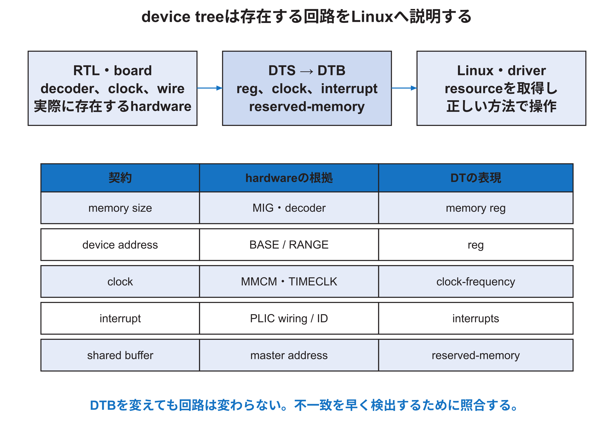

<!-- appendix-content:start -->
<a id="ch_23"></a>
# 第30章 デバイスツリーで回路の情報をLinuxへ伝える
<!-- appendix-content:end -->

[付録の総目次](../../技術付録.md) ｜ [論文本文](../../本文.md) ｜ [参考文献](../references.md)

[第III部 Linuxとシステムソフトウェア](README.md)

ファイルパスの表記は、[資料フォルダー](../../README.md)を基準とする。

## このページの目次

- [30.1 device treeは回路を作らない](#s_23_1)
- [30.2 rootのcell数](#s_23_2)
- [30.3 memory node](#s_23_3)
- [30.4 reserved-memoryと`no-map`](#s_23_4)
- [30.5 `compatible`とdriver binding](#s_23_5)
- [30.6 clockとtimebase](#s_23_6)
- [30.7 interrupt記述](#s_23_7)
- [30.8 DTSからDTBを作り、戻して比較する](#s_23_8)
- [30.9 DTの検証表](#s_23_9)

<!-- appendix-content:start -->
Linuxは、FPGA内へ今回どの回路を作ったかをHDLから自動的に読み取るわけではない。デバイスツリーは、存在するメモリや周辺回路の情報をソフトウェアへ渡す。この章では回路の番地設定と対応付けて、説明の不一致がどんな不具合になるかを考える。

<a id="s_23_1"></a>
## 30.1 device treeは回路を作らない

Device Tree Sourceは、存在するハードウェアをOSへ説明するdataである。node名、`compatible`、`reg`、クロック、interrupt、メモリなどを記述し、`dtc`がbinary DTBへ変換する。DTBを書き換えてもFPGAのdecoderやpin接続は変わらない。[LinuxDT](../references.md#ref_linuxdt)



<a id="s_23_2"></a>
## 30.2 rootのcell数

`#address-cells = <2>`と`#size-cells = <2>`なら、childの`reg`は番地二cellとsize二cellで一組を表す。一cellは32 bitである。

```dts
reg = <0 0x9e000000 0 0x02000000>;
```

これは番地 `0x000000009e000000`、size `0x0000000002000000`、すなわち32 MiBである。四つの独立値や開始・終了の組ではない。parent nodeごとにcell数が異なり得るため、対象nodeのparentを確認する。

<a id="s_23_3"></a>
## 30.3 memory node

Nexys Videoの`memory@80000000`は開始`0x80000000`、size`0x20000000`、すなわち512 MiBをLinuxへ伝える。kernelの物理 page allocatorはこの範囲を基礎にする。

MIGが実際に512 MiBへ接続されていないのにDTだけ512 MiBにすると、kernelは存在しないメモリを使いfaultする。逆に実物より小さく書けば未使用領域ができる。ハードウェア、Wally構成、DTを一致させる。

<a id="s_23_4"></a>
## 30.4 reserved-memoryと`no-map`

RasterIX用DTSは最後の32 MiB、`0x9e000000`から`0x9fffffff`をreserved-memoryにする。Linuxの通常allocatorがkernel pageやプロセス pageへ使わないためである。`no-map`はOSに標準のvirtual mappingを作らないよう指示する。

この予約はIOMMUやハードウェア firewallではない。RasterIXが範囲外へ書くのを止めず、applicationのoffset計算も検査しない。shared buffer allocatorとRTL 番地幅を別に検証する。

<a id="s_23_5"></a>
## 30.5 `compatible`とdriver binding

`compatible`はdriverが対応deviceを選ぶ文字列である。一般に具体的な文字列から互換fallbackへ並べる。RasterIX nodeは`openhwgroup,wally-rasterix`を持つが、固定版applicationは専用kernel driverではなく`/dev/mem`を使うため、この文字列から自動でgame APIが生成されるわけではない。

将来platform driverを作る場合、`of_match_table`でcompatibleを照合し、`reg` resource、reserved メモリ、interruptを取得する。DT nodeだけを追加してdriverがない状態も合法であり、kernelが操作するとは限らない。

<a id="s_23_6"></a>
## 30.6 clockとtimebase

CPU nodeの`clock-frequency`はCPU クロック、`timebase-frequency`はRISC-V timer counterの周波数を伝える。本構成ではともに20 MHzだが、概念上は別である。UART nodeにも入力クロックがあり、baud divisor計算に使う。

値が一致していることを、Clocking Wizardの出力、CLINT/TIMECLK接続、UART RTL、DTSで確認する。ソフトウェアが表示するMHzだけでハードウェア クロックを測定したことにはならない。

<a id="s_23_7"></a>
## 30.7 interrupt記述

`interrupt-parent`はどのinterrupt controllerへ接続するか、`interrupts`はcontroller固有のソース番号やflagsを表す。PLIC node自身はCPU interrupt controllerへの`interrupts-extended`を持つ。

RTLでソース IDを変えたらDTSも変える。DTSだけ変えてもwireは付け替わらない。driverがclaimしたID、PLIC設定、device pending、CPU trap causeを一続きで確認する。

<a id="s_23_8"></a>
## 30.8 DTSからDTBを作り、戻して比較する

```bash
dtc -I dts -O dtb -i "$WALLY/linux/devicetree" \
  -o wally-nexysvideo-rasterix.dtb \
  "$WALLY/linux/devicetree/wally-nexysvideo-rasterix.dts"
dtc -I dtb -O dts wally-nexysvideo-rasterix.dtb \
  -o decoded.dts
```

include後の最終内容はdecoded側で確認できる。実機Linuxでは`/sys/firmware/fdt`や`/proc/device-tree`からboot時DTを確認できる環境もある。hostで作ったDTBと実機が受け取ったDTBをhashまたは内容で照合する。

<a id="s_23_9"></a>
## 30.9 DTの検証表

| property | RTLまたは基板側の根拠 | ソフトウェアでの確認 |
|---|---|---|
| メモリ `reg` | MIG容量、decoder | boot logのメモリ |
| CPU クロック | MMCM出力 | timekeeping、DTS dump |
| UART clock/address | UART RTL、decoder | console、driver resource |
| RasterIX `reg` | EXT_IO BASE/RANGE | ID read |
| reserved-memory | framebuffer配置 | `/proc/iomem`、DT dump |
| interrupt | PLIC wiring/ID | `/proc/interrupts`、handler |
<!-- appendix-content:end -->

---

[前：第29章 Linuxのプロセスと仮想メモリとシステムコール](processes-virtual-memory.md) ｜ [次：第31章 MMIOの番地対応とアクセス順序](mmio-ordering.md)
