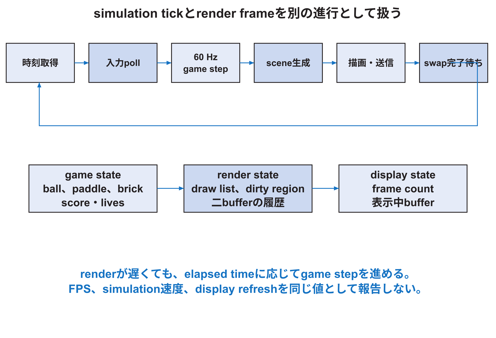

<!-- appendix-content:start -->
<a id="ch_26"></a>
# 第33章 ゲームの繰返し処理と入力と時間と描画
<!-- appendix-content:end -->

[付録の総目次](../../技術付録.md) ｜ [論文本文](../../本文.md) ｜ [参考文献](../references.md)

[第III部 Linuxとシステムソフトウェア](README.md)

ファイルパスの表記は、[資料フォルダー](../../README.md)を基準とする。

## このページの目次

- [33.1 一frameの仕事](#s_26_1)
- [33.2 固定timestep](#s_26_2)
- [33.3 render frameとdisplay refresh](#s_26_3)
- [33.4 inputのsampling](#s_26_4)
- [33.5 game stateとrender state](#s_26_5)
- [33.6 全体描画、呼出し統合、部分描画](#s_26_6)
- [33.7 text rendering](#s_26_7)
- [33.8 game loopの単体試験](#s_26_8)

<!-- appendix-content:start -->
ゲームは、入力を読み、ボールなどの状態を進め、その状態を画面へ描く処理を繰り返す。状態を進める速さと、描画が終わる速さが違うと、見た目や操作感も変わる。この章では時間の数え方と、ゲームの状態と画像を分ける設計を扱う。

<a id="s_26_1"></a>
## 33.1 一frameの仕事

game loopは概ね、時間取得、入力、simulation update、scene作成、描画command生成、送信、表示完了確認を繰り返す。これらを一つの「描画時間」にまとめると、どこを改善したか説明できない。



<a id="s_26_2"></a>
## 33.2 固定timestep

固定版はelapsed nanosecondsへ60を掛けてaccumulatorへ加え、10億以上になるごとにgameを一step進める。これは一tickを1/60秒とし、整数除算による周期丸めを避ける方法である。

```text
accumulated += elapsed_ns × 60
while accumulated >= 1,000,000,000:
    game.step(input)
    accumulated -= 1,000,000,000
```

renderが10 FPSでも、時間に応じて複数tickを進めるためgame speedを概ね実時間へ保つ。ただし処理が長時間追いつかないと、catch-up loopが増えてさらにrenderが遅れるspiral of deathが起こり得る。最大step数やoverload方針を設計する。

<a id="s_26_3"></a>
## 33.3 render frameとdisplay refresh

gameが一枚分のcommandを生成した回数、RasterIXがframebufferへcommitした回数、displayがbuffer swapを認めた回数、HDMI receiverが映像を取得した回数は同じとは限らない。計測名を区別する。

固定版`present`はsceneをdrawし、swap前のframe countを読み、`swapDisplayList`を呼び、counterが変わるまで待つ。これにより同じbufferを表示側が読む前に再利用する競合を避ける。counter増加はdisplay handshakeの観察であり、cameraで測るvisual FPSとは別である。

<a id="s_26_4"></a>
## 33.4 inputのsampling

現行gameはterminalをnonblockingでpollし、A/D/S/Spaceなどをinput stateへ変換する。movementは停止または反対入力まで保持し、launchは一回だけ使うeventとして`takeInput`後にclearする。

controllerを追加する場合も、raw I2C byteからbutton/axis、debounce/calibration、game actionへ層を分ける。ハードウェア read周期と60 Hz game tickが違う場合、最新stateを保持し、短いeventを失わない方法を決める。

<a id="s_26_5"></a>
## 33.5 game stateとrender state

ball position、paddle position、brick alive、score、livesはgame stateである。vertex list、color、dirty rectangle、二つのframebufferごとの過去sceneはrender stateである。同じものに見えても責務が違う。

game logicを一step進めず何度renderしても、同じsceneになるべきである。逆にrenderをskipしてもgame stateは時間に従って進められる。この分離はtestを容易にし、描画最適化がgame判定を変えないことを確認できる。

<a id="s_26_6"></a>
## 33.6 全体描画、呼出し統合、部分描画

全体描画は毎frame背景と全objectを描くため単純で、初期正解として使える。呼出し統合は、同じstateの四角形をまとめてdraw call数とcommand準備を減らす。部分描画は、前frameから変わった領域だけを消し、重なるobjectを正しい順で描き直す。

部分描画では二つのdisplay bufferそれぞれの過去状態を管理する。現在画面に見えているbufferと、次に描くbufferが交互に変わるため、一つ前のframeだけを覚えると消し残しが出る。起動時は履歴がないため両bufferを全体描画で初期化する。

<a id="s_26_7"></a>
## 33.7 text rendering

一般的なreal-time graphicsではglyph atlas テクスチャを使い、各文字をテクスチャ付きquadとして描くことが多い。固定版の文字も複数の小図形またはテクスチャとして表現できる。重要なのは、文字一個を一draw callにするとcommand preparation costが増える点である。

文字の見た目、font data生成、glyph placement、draw batchingを分ける。文字化けまたは欠けが性能問題とは限らない。glyph geometry、buffer lifetime、state change、clippingを検査する。

<a id="s_26_8"></a>
## 33.8 game loopの単体試験

ハードウェアなしでも、同じinput sequenceでball、collision、scoreが期待値になるかをtestできる。rendererはsceneから生成したprimitive数、dirty region、draw orderを検査できる。transportはfake connectorでword列を保存し、expected packetと比較できる。

実機testだけにすると、game bug、ソフトウェア rendering bug、bus bug、RTL bug、display bugが同時に候補になる。純粋なlogicから外側へtestを重ねる。
<!-- appendix-content:end -->

---

[前：第32章 RasterIXの描画ソフトウェアの処理経路](graphics-software-stack.md) ｜ [次：第34章 入力機器を追加するときに設計する境界](peripherals.md)
