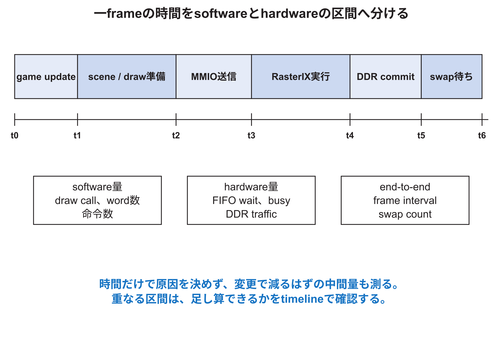

<!-- appendix-content:start -->

# 第36章 ソフトウェアと回路の仕事を対応付けて測る
<!-- appendix-content:end -->

[付録の総目次](../../技術付録.md) ｜ [論文本文](../../本文.md) ｜ [参考文献](../references.md)

[第III部 Linuxとシステムソフトウェア](README.md)

ファイルパスの表記は、[資料フォルダー](../../README.md)を基準とする。

## このページの目次

- [36.1 end-to-end latencyを分解する](#s_28_1)
- [36.2 timestampの置き場所](#s_28_2)
- [36.3 throughputとlatency](#s_28_3)
- [36.4 Littleの法則とqueue](#s_28_4)
- [36.5 因果を示す比較](#s_28_5)
- [36.6 正しさを性能と同時に守る](#s_28_6)
- [36.7 CPU最適化とhardware最適化](#s_28_7)
- [36.8 報告する最小dataset](#s_28_8)
- [36.9 この技術付録で到達する理解](#s_28_9)

<!-- appendix-content:start -->
CPUが送信している間に描画回路も働くため、区間ごとの時間を単純に足すと一フレームを重複して数えることがある。この章では、時間を測り始める出来事と測り終える出来事を先に決め、ソフトウェアの時計と回路の計数値を対応付ける。

## 36.1 end-to-end latencyを分解する

一frameの時間は、game update、CPU側描画準備、MMIO転送、RasterIX実行、DDR commit、display swap待ちに分けられる。重なって実行できる区間もあるため、単純に足し算できるかを先に確認する。

## 36.2 timestampの置き場所

区間の境界に`steady_clock` timestampを置く。関数全体だけでなく、scene構築前後、display list生成前後、MMIO write前後、swap request前後を測る。ハードウェア counterがあればCPU timestampと併用する。

クロック readにもcostがあり、非常に短い区間では影響が大きい。同じ区間を多数回測り、空の測定、warm-up、中央値や分布を見る。nanosecond型で返ることとnanosecond精度があることは別である。

## 36.3 throughputとlatency

command一語の遅延が長くてもパイプラインで連続wordを一周期ごとに受けられればthroughputは高い。逆に最初の応答が速くても、一wordごとにソフトウェアが完了待ちすればthroughputは低い。

FPSはend-to-end throughputである。command words/s、triangles/s、fragments/s、DDR bytes/sを別に測る。どのrateが飽和したかで改善対象が変わる。

## 36.4 Littleの法則とqueue

安定したqueueでは、平均滞留数L、到着率λ、平均滞留時間Wに`L = λW`の関係がある。FIFO occupancy、command rate、wait timeを同時に測れば、bufferがburstを吸収しているのか、長期的に処理が追いついていないのかを考えられる。

FIFOを深くしても、平均consumer rateがproducer rateより低ければ最終的にfullになる。深さは一時burstと停止時間を吸収する設計値であり、計算能力そのものを増やさない。

## 36.5 因果を示す比較

同じgame state、resolution、コンパイラ、クロック、bitstreamで、一要因だけを変える。全体描画、呼出し統合、部分描画を同じexecutableのoptionで選べばbuild差を減らせる。命令数、command word数、MMIO時間、frame timeを合わせて保存する。

時間が減っただけで原因を決めず、変更によって減ると予想した中間量も測る。draw call統合ならcall数とword数、部分描画なら更新面積とprimitive数、wait改善ならsleep時間とcounter待ち時間を見る。

## 36.6 正しさを性能と同時に守る

速くなっても、brickが消える、二重bufferの片方に残像が出る、game tickが遅くなるなら同じ処理の改善ではない。固定inputとstate、framebuffer hash、選択frameの画素比較、game resultを使う。

画素完全一致が必要な比較と、見た目同等でよい比較を区別する。blendやfixed-point順序を変える最適化では、許容誤差を先に定義する。

## 36.7 CPU最適化とhardware最適化

CPU側ではdraw call削減、data structure、allocation削減、コンパイラ最適化、batchingがある。ハードウェア側ではクロック、parallelism、パイプライン、メモリ width、キャッシュ、FIFO、RasterIX パラメータがある。ソフトウェア変更でCPU準備が支配的でなくなれば、次のbottleneckがハードウェアへ移る。

最適化は一度で終わらない。測定、支配区間の特定、変更、正しさ確認、再測定を繰り返す。ただし研究発表では、探索したすべてではなく、主張を支える比較と限界を示す。

## 36.8 報告する最小dataset

| 種類 | 保存する値 |
|---|---|
| 固定条件 | commit、bitstream、DTB、binary hash、クロック、resolution |
| workload | game state、実行時間、input、描画方式 |
| ソフトウェア | command準備、call数、word数、CPU time |
| ハードウェア | FIFO wait、busy、swap count、メモリ traffic |
| end-to-end | frame interval、完了frame数、visual確認 |
| correctness | state、pixel/hash、error、timeout |

## 36.9 この技術付録で到達する理解

ハードウェア側では、RTLの記述からresourceとtimingを予想し、Wallyの命令・メモリ・bus・privilegeを追い、CDCと周辺回路を設計し、reportと波形で確認する。ソフトウェア側では、cross build、boot、kernel、virtual メモリ、MMIO、RasterIX API、game loopを追い、実行binaryとハードウェアの契約を検証する。

最終目標は用語を暗記することではない。新しいcontroller、表示方式、resolution、クロック、キャッシュ構成を提案されたとき、変更箇所、守る契約、起こり得るfailure、必要なtest、性能と資源のtrade-offを自分で列挙できる状態である。
<!-- appendix-content:end -->

---

[前：第35章 ソフトウェアとハードウェアの不具合を切り分ける](system-diagnosis.md) ｜ [次：第37章 白い四角形を一つ表示するまで](../04-rasterix/walkthrough.md)
