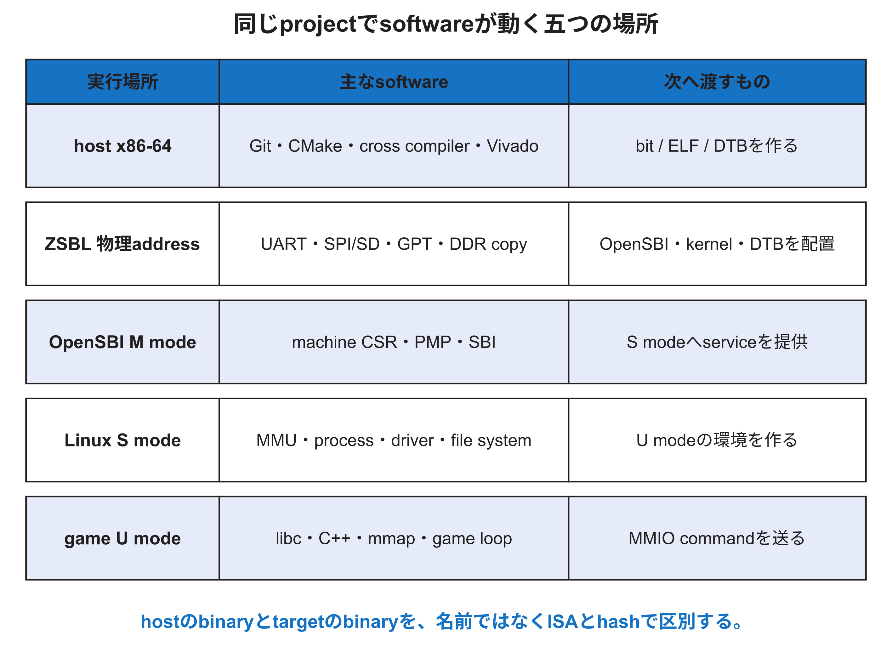

<!-- appendix-content:start -->
<a id="ch_19"></a>
# 第26章 開発用PCとFPGA上の実行環境
<!-- appendix-content:end -->

[付録の総目次](../../技術付録.md) ｜ [論文本文](../../本文.md) ｜ [参考文献](../references.md)

[第III部 Linuxとシステムソフトウェア](README.md)

ファイルパスの表記は、[資料フォルダー](../../README.md)を基準とする。

## このページの目次

- [26.1 softwareは一つの場所で動いていない](#s_19_1)
- [26.2 五つの実行環境](#s_19_2)
- [26.3 source、build directory、生成物、配置先](#s_19_3)
- [26.4 buildと実行を証拠で結ぶ](#s_19_4)
- [26.5 hardwareとsoftwareの境界を契約として読む](#s_19_5)
- [26.6 「Linuxが動く」の中身](#s_19_6)

<!-- appendix-content:start -->
同じ端末に見える操作でも、開発用PCで実行するものと、FPGA上のWallyで実行するものでは使うCPUもファイルも違う。この章では、コマンドを実行する場所、作るファイル、転送先、最終的な実行場所を分ける。

<a id="s_19_1"></a>
## 26.1 softwareは一つの場所で動いていない

本研究には、開発用PCのUbuntuで動くプログラム、FPGAの起動ROMで動くZSBL、M-modeで動くOpenSBI、S-modeで動くLinux kernel、U-modeで動くBusyBoxとgameがある。すべてC/C++またはassemblyで書かれていても、実行するCPU、利用できるservice、番地、コンパイラ、ファイル formatが違う。

hostはx86-64 Windows/WSL環境、対象はNexys Video上のRISC-V Wallyである。hostで生成したRISC-V executableはhostでは直接実行できない。逆にhost用`cmake`やVivadoをSDカードへコピーしてもWallyで動かない。



<a id="s_19_2"></a>
## 26.2 五つの実行環境

| 実行環境 | 代表例 | 使える機能 | 主な出力 |
|---|---|---|---|
| host user space | Git、CMake、コンパイラ、dtc、Vivado | host OS、ファイル system、network | bitstream、ELF、DTB |
| ZSBL | `fpga/zsbl` | UART、SPI/SD、DDRへの直接access | imageをDDRへcopy |
| OpenSBI M-mode | `fw_jump.bin` | machine CSR、PMP、SBI service | Linuxへ制御を渡す |
| Linux S-mode | `Image` | プロセス、virtual メモリ、driver、system call | U-mode環境 |
| 対象 U-mode | BusyBox、`rasterix-breakout` | libc、ファイル、`/dev/mem` mapping | game処理とMMIO |

同じ「load」でも、ZSBLではpagingなしで物理番地を読むことが多く、U-mode プロセスでは仮想番地をpage tableで変換する。同じUART出力でも、ZSBLのレジスタ access、OpenSBI console、Linux driver、user プロセスの`printf`では経路が違う。

<a id="s_19_3"></a>
## 26.3 source、build directory、生成物、配置先

ソース treeへ生成物を混ぜると、どのファイルが人間の入力か分からなくなる。CMakeは`-S`でソース、`-B`でbuild directoryを分ける。Buildrootは`output/build`へ展開ソース、`output/host`へhost toolchain、`output/images`へ対象 imageを置く。[Buildroot](../references.md#ref_buildroot)

生成物はさらに、hostに存在する場所と、SDカードまたは対象 root filesystem上の場所を区別する。hostの`rasterix-build/rasterix-breakout`を更新しても、SDカード側のcopyを更新しなければ実機は古いbinaryを実行する。

<a id="s_19_4"></a>
## 26.4 buildと実行を証拠で結ぶ

次の値を保存すると取り違えを減らせる。

```bash
git rev-parse HEAD
git submodule status
sha256sum fpga/generator/*.bit
sha256sum rasterix-build/rasterix-breakout
file rasterix-build/rasterix-breakout
```

対象でも可能なら`sha256sum`を実行し、hostのbinaryと比較する。実行logにはcommit、build type、コンパイラ version、DTB名、bitstream hash、command lineを残す。「ソースを変更した」と「その変更を含むbinaryを実機で実行した」を分ける。

<a id="s_19_5"></a>
## 26.5 hardwareとsoftwareの境界を契約として読む

ソフトウェアからハードウェアへ渡る主な契約は、ISA、ABI、メモリ map、device tree、レジスタ map、interrupt、DMA/shared メモリ layoutである。ハードウェアが同じでもABIが違えばプログラムは動かず、ソフトウェアが同じでもレジスタ offsetが違えば別機能へ書く。

契約ごとにownerを決める。

| 契約 | ハードウェア側 | ソフトウェア側 |
|---|---|---|
| ISA | decodeとexecution | コンパイラの`-march` |
| ABI | レジスタ、stack、exception support | コンパイラの`-mabi`、libc |
| メモリ map | decoder、PMA/PMP | linker、DT、mapping |
| レジスタ map | peripheral RTL | header/API |
| shared buffer | メモリ master、番地幅 | allocator、reserved-memory、offset |
| completion | status/counter/interrupt | poll、timeout、handler |

<a id="s_19_6"></a>
## 26.6 「Linuxが動く」の中身

Linux promptが表示された場合、CPUが多くの命令を実行し、DDR、UART、timer、interrupt、privilege、virtual メモリ、kernelとroot filesystemの少なくとも一部が動いたことを示す。しかしRasterIX レジスタ、shared DDR、display経路までは証明しない。

逆にgameが失敗してもLinux全体が壊れたとは限らない。ID read、command send、frame counter、framebuffer、videoの順に境界を確認する。ソフトウェアの層を分ける目的は用語を増やすことではなく、失敗範囲を小さくすることである。
<!-- appendix-content:end -->

---

[前：第25章 Linuxの起動から描画回路への書込みまで](linux.md) ｜ [次：第27章 クロスコンパイルと実行ファイルと呼出し規約](compiler-elf-abi.md)
