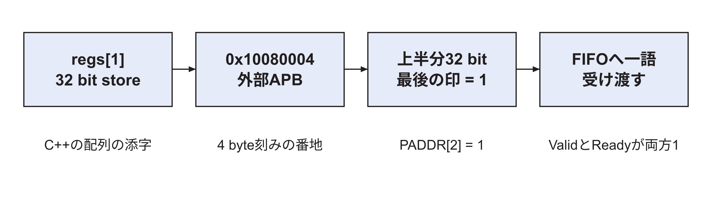
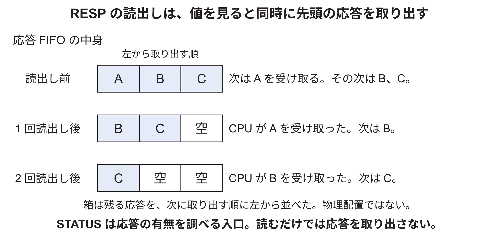

<!-- appendix-content:start -->
<a id="ch_24"></a>
# 第31章 MMIOの番地対応とアクセス順序
<!-- appendix-content:end -->

[付録の総目次](../../技術付録.md) ｜ [論文本文](../../本文.md) ｜ [参考文献](../references.md)

[第III部 Linuxとシステムソフトウェア](README.md)

ファイルパスの表記は、[資料フォルダー](../../README.md)を基準とする。

## このページの目次

- [31.1 MMIOとは何か](#s_24_1)
- [31.2 固定版のmapping](#s_24_2)
- [31.3 register indexとbyte offset](#s_24_3)
- [31.4 `volatile`が保証すること](#s_24_4)
- [31.5 RISC-V fence](#s_24_5)
- [31.6 pollingとtimeout](#s_24_6)
- [31.7 `/dev/mem`を使う理由と限界](#s_24_7)
- [31.8 専用driverへ移すなら](#s_24_8)
- [31.9 32 bitの一語を送る処理を最後まで追う](#s_app_31_9)
- [31.10 受信レジスタを読むことにも副作用がある](#s_app_31_10)
- [31.11 volatileとfenceが担当する仕事](#s_app_31_11)

<!-- appendix-content:start -->
回路を操作するC++の代入には、アクセス先を対応付ける準備と、その値を相手が使う順序を守る準備が要る。この章では、番地の対応付け、コンパイラによる省略や並替え、CPUやバスの順序、キャッシュの内容を別の問題として扱う。

<a id="s_24_1"></a>
## 31.1 MMIOとは何か

Memory-mapped I/Oは、load/storeの物理 番地範囲をRAMではなくdevice レジスタへ割り当てる方式である。CPU命令の形はメモリ accessだが、readでstatusを得たり、writeでFIFOへcommandを投入したりする。

普通のメモリと違い、read/writeにside effectがあり、同じaccessの繰返しが同じ結果になるとは限らない。キャッシュ、speculation、reordering、access幅をdevice契約へ合わせる。

<a id="s_24_2"></a>
## 31.2 固定版のmapping

`WallyBusConnector`は`/dev/mem`を`O_RDWR | O_SYNC`で開き、物理 `0x10080000`から4096 byteを`PROT_READ | PROT_WRITE`、`MAP_SHARED`でmappingする。戻り値を`volatile uint32_t*`へ変換する。

4096 byteはpage mappingの単位であり、ハードウェア レジスタが4096 byteある意味ではない。DTSのレジスタ regionは256 byteである。C++側は定義したindexだけをaccessする。

<a id="s_24_3"></a>
## 31.3 register indexとbyte offset

`regs`は`uint32_t*`なので、`regs[n]`のbyte offsetは`4n`である。`regs[3]`はoffset 0x0cのID、`regs[4]`は0x10のframe countである。

```text
virtual_base + 4 × index
   ↓ page table mapping
0x10080000 + 4 × index
   ↓ Wally address decode
APB peripheral register
```

ポインタ arithmeticをbyte単位と誤解すると四倍違うレジスタへaccessする。RTLのPADDR sliceとC++ indexを表で照合する。

<a id="s_24_4"></a>
## 31.4 `volatile`が保証すること

`volatile` accessは、そのC++ abstract machine上でコンパイラがread/writeを不要と判断して消したり、一つにまとめたりするのを制限する。status polling loopで毎回loadを生成させるために必要である。

しかし`volatile`は次を単独では保証しない。

- CPU ハードウェアによるメモリ orderingすべて。
- cacheabilityまたはdevice属性。
- bus transferの完了後にdevice内部処理が完了したこと。
- 複数thread間のC++ data race防止。
- DMAとのキャッシュ coherence。

<a id="s_24_5"></a>
## 31.5 RISC-V fence

`fence iorw, iorw`は先行するI/Oとメモリ accessが、後続accessよりordering上先になるよう制約する。固定版はMMIO command wordを書き終えた後に実行する。コンパイラ barrierの`"memory"` clobberも、コンパイラが周辺メモリ operationを跨いで動かすのを抑える。

fence完了はRasterIXが全triangleをrasterizeし、framebufferをDDRへcommitし、displayがswapしたことを意味しない。それぞれ別のqueueと状態を持つ。必要な完了段階に対応するstatusまたはcounterを待つ。

<a id="s_24_6"></a>
## 31.6 pollingとtimeout

status pollingは、条件が成立するまでレジスタを繰り返し読む。sleepを入れないbusy waitは反応が速いがCPUを占有する。低速single-coreでは他プロセスのscheduleにも影響する。timeoutがなければハードウェア停止時に永久loopになる。

固定版は30秒deadlineを使い、responseとdisplay swapを待つ。timeout値は正常性能の保証値ではなく、異常を有限時間で報告する保護である。性能測定区間ではtimeout判定用クロック readのcostも分けて考える。

<a id="s_24_7"></a>
## 31.7 `/dev/mem`を使う理由と限界

研究用prototypeでは、小さなC++ connectorでレジスタを直接操作でき、kernel driver実装を省ける。ID、status、commandを早く検証するには有効である。

一方、root権限が必要で、プロセス間の排他、buffer管理、interrupt、security、power management、DMA mappingをkernelが管理しない。公開する一般systemなら、platform driverとcharacter deviceまたはDRMなどのsubsystemを検討する。固定版の選択はprototypeの範囲に対するもので、最終的なproduction APIの最適解を意味しない。

<a id="s_24_8"></a>
## 31.8 専用driverへ移すなら

driverはDTのresourceを取得し、`ioremap`でレジスタをmappingし、accessorでread/writeする。user APIは`ioctl`、`write`、`mmap`、poll、interrupt completionなどから選ぶ。shared bufferはDMA APIまたはreserved メモリの管理を使う。

driver化してもハードウェア protocolは同じである。利点は権限、lifetime、排他、error、キャッシュ属性を一箇所へ集められることだ。overheadと複雑さも増えるため、研究の目的と利用者を明確にする。

<a id="s_app_31_9"></a>
## 31.9 32 bitの一語を送る処理を最後まで追う

ここでは、CPUから値`0x12345678`を一語だけ渡す例を使う。この値は受け渡しを説明するための仮のデータであり、有効なRasterIXの描画命令ではない。実機へそのまま送る手順ではない。目的は、データの内容を描画命令と切り離して、どこを通るかを見ることである。

[論文本文6.6節](../../本文.md#s_6_6)の表で示したとおり、`regs[1]`は、対応付けた先頭の物理アドレス`0x10080000`から4 byte先の`0x10080004`を操作する。この終端用の入口へ最後の一語を書く。[Console26](../references.md#ref_console26)

最後の一語はCMD_LASTへ書く。書き込み命令を実行したCPUは、Wallyのアドレス判定を経て、外部APBの番地を選ぶ。`uncore.sv`にあるAHB–APBブリッジが、CPU側の要求をAPBの信号へ変える。`rasterix_apb.sv`は下位8 bitのアドレスを受け取り、0x04への書き込みだと判断する。



ここでAPBは64 bit幅だが、ソフトウェアは32 bitを書いている。そのため、0x04なら上半分の`PWDATA[63:32]`を選び、対応する4 byteの有効印`PSTRB[7:4]`を調べる。これを省いて常に下半分を使うと、CPUが正しい値を書いても別の32 bitを描画回路へ渡してしまう。

```systemverilog
assign WriteData = PADDR[2] ? PWDATA[63:32] : PWDATA[31:0];
assign WordWrite = PADDR[2] ? &PSTRB[7:4] : &PSTRB[3:0];
```

この二行は`rasterix_apb.sv`の64 bit構成からの抜粋である。`条件 ? A : B`は、条件が1ならA、0ならBを選ぶ。`&PSTRB[7:4]`の先頭の`&`は四つのbitをすべてANDし、全部1なら1を返す。すなわち、この実装は選んだ32 bit全体が書かれる場合に限り、命令として受け付ける。

命令口への32 bit書き込みで、`PSEL=1`、`PENABLE=1`、`PWRITE=1`がそろうと、`CmdValid`が1になる。FIFOに空きがあって`CmdReady=1`でもあるクロックの立ち上がりで、FIFOへ一語が入る。この立ち上がりではAPBの`PREADY`も1なので、CPU側のその書き込みも完了する。立ち上がりの後で新たに`PREADY`を1にして知らせる、という順番ではない。CPU側のバス書き込みが完了することと、描画回路がその語の内容を実行し終わることは、別の出来事である。

<a id="s_app_31_10"></a>
## 31.10 受信レジスタを読むことにも副作用がある

普通のメモリでは、同じ番地を二度読んでも通常は同じ値を読める。一方、この回路のRESPを読むことは、受信FIFOから一語を取り出す操作である。一度取り出した語は消費され、次は次の語になる。このように、アクセスすること自体で回路の状態が変わるものを、副作用のあるI/Oという。

RESPへのアクセスでは、`RespValid=0`なら`PREADY=0`として待つ。`RespValid=1`になり、読み出し要求も有効な立ち上がりで、CPUへ返す語を確定して消費する。STATUSを読む操作はFIFOの語を消費しないので、ソフトウェアは先にSTATUSのbit 1を見てからRESPを読む。[Console26](../references.md#ref_console26)

現在の回路は、整列した32 bitのアクセスを前提とする。CMDへ1 byteだけ書いても`WordWrite`が成立しないため命令にはならない。また未定義番地の読み出しは0を返す。接続したブリッジは常に正常応答を返す実装なので、これらをすべてソフトウェアへバスエラーとして通知する設計ではない。この制限を把握した上で、`checkRange`によって転送サイズとオフセットを4の倍数に制限している。

図31.2では、応答FIFOにA、B、Cの三語が入っていると仮定する。各行は、一回前のRESP読出しが完了した後の状態である。箱は、次に取り出す語を左端にして、取り出す順に左から並べている。メモリ内の物理的な配置や、語が移動する方向を示す図ではない。



最初にRESPを読むとAを受け取り、次に同じRESPを読むとBを受け取る。最初の値を確認するためにもう一度読むつもりでも、次の応答を消費してしまう。Aを後で使うなら、最初に受け取った値をソフトウェア側の変数へ保存する。

<a id="s_app_31_11"></a>
## 31.11 volatileとfenceが担当する仕事

`volatile`は、装置レジスタへの読み書きを普通の変数と同じように省略しないよう、コンパイラへ伝える。例えば完了回数を繰り返し調べるとき、最初に読んだ値をずっと再利用されては、回路の変化を知ることができない。

CPUには、メモリの値のコピーを手元へ置き、次の読み書きを速くするキャッシュがある。しかし、装置の状態を読むときに以前の値をそのコピーから返せば、コンパイラが読み出し命令を残していても、装置の変化が分からない。命令FIFOへの書き込みも、キャッシュ内だけに残っては描画回路へ届かない。このため、Wally側では外部I/Oを通常のメモリと区別する。`pmachecker.sv`の`CacheableRegion`と`IdempotentRegion`が、その領域の扱いを定める。[Harris26](../references.md#ref_harris26)[Console26](../references.md#ref_console26)

さらに、転送の区切りで`fence iorw, iorw`を実行し、I/Oとメモリのアクセス順序をそろえる。volatile、領域の属性、fenceは、それぞれ「コンパイラがアクセスを残す」「CPUがI/Oに合う扱いをする」「必要な順序を守る」という別の条件を担当する。どれか一つの名前を書けば、残りも自動で満たされるわけではない。

同じ「最新の状態が見えない」という症状でも、途中のどこで古い値を使っているかが違う。例えば完了回数を二回調べたいとき、必要なのは次の三点である。

| 確かめる点 | 満たさない場合の例 | この実装で関係する指定 |
|---|---|---|
| CPUが装置を読む命令を実行するか | 二回目の読出しを省略し、最初の値を使う | `volatile`を付けたアクセス |
| 読出しが装置の現在値へ届くか | CPU側に残った古いコピーで返す | 外部I/O領域の属性 |
| 前後のアクセスが必要な順で行われるか | 前の転送を区切る前に後の操作を進める | 接続処理中の`fence` |

これらは、CPUから装置へ意図したアクセスを行うための条件である。その読出しで得た完了回数がまだ増えていなければ、表示切り替えはまだ完了していない。fenceを実行したこと自体を、「描画済み」「表示済み」の代わりに使うことはできない。
<!-- appendix-content:end -->

---

[前：第30章 デバイスツリーで回路の情報をLinuxへ伝える](device-tree.md) ｜ [次：第32章 RasterIXの描画ソフトウェアの処理経路](graphics-software-stack.md)
