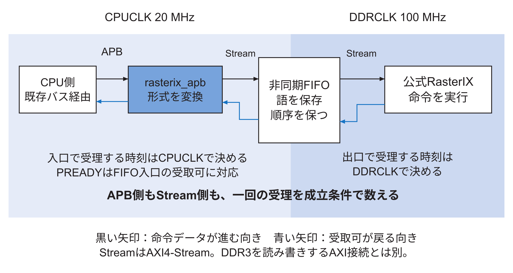
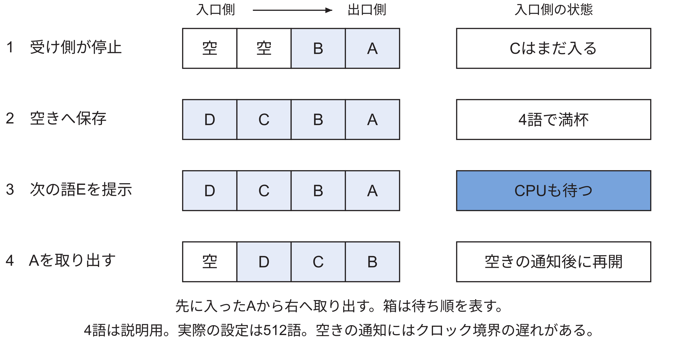
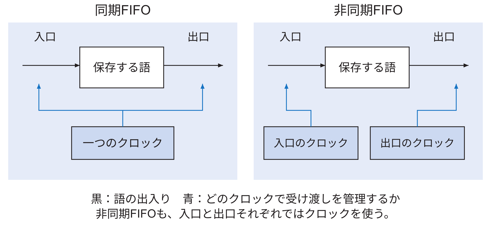
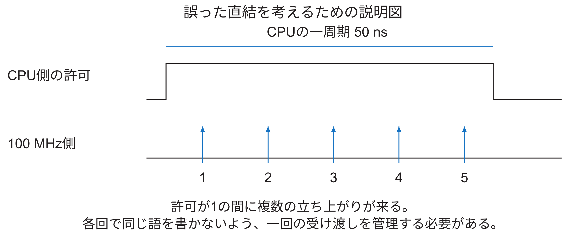
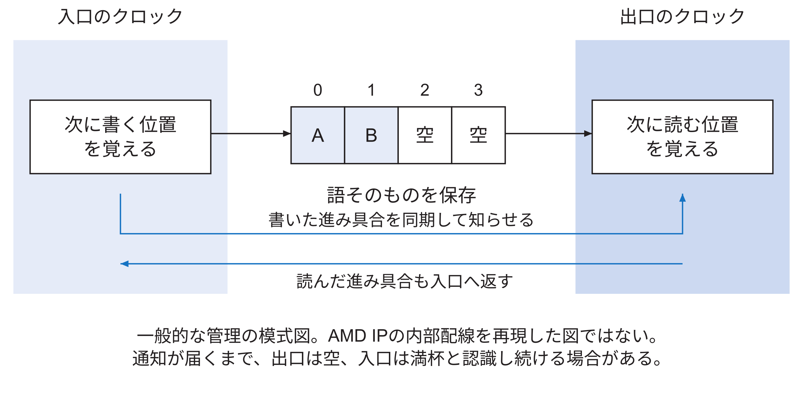

<!-- appendix-content:start -->
<a id="ch_i"></a>
# 付録I 命令の受け渡しとクロック境界を設計する
<!-- appendix-content:end -->

[付録の総目次](../../技術付録.md) ｜ [論文本文](../../本文.md) ｜ [参考文献](../references.md)

[第IV部 RasterIXと描画システム](README.md)

ファイルパスの表記は、[資料フォルダー](../../README.md)を基準とする。

## このページの目次

- [I.1 まず保存する場所と接続の約束を分ける](#s_i_1)
- [I.2 一語と一命令と一枚の画像は大きさが違う](#s_i_2)
- [I.3 APBで一回の書き込みが終わる瞬間](#s_i_3)
- [I.4 AXI4-Streamでは有効と受取可の両方を見る](#s_i_4)
- [I.5 FIFOの出口が止まっても入口はすぐには止まらない](#s_i_5)
- [I.6 20 MHzと100 MHzだけでは処理の速さを比べられない](#s_i_6)
- [I.7 公式RasterIXに受け取りを止める処理がある](#s_i_7)
- [I.8 同期FIFOは一つの時計で入口と出口を管理する](#s_i_8)
- [I.9 遅い側の信号を速い側へ直結すると何が足りないか](#s_i_9)
- [I.10 一ビットを二段で受けるだけでは一語を守れない](#s_i_10)
- [I.11 非同期FIFOは何を同期するのか](#s_i_11)
  - [保存位置が一周したときの空と満杯](#h1137)
- [I.12 周波数が違えば非同期FIFOだけが正解なのか](#s_i_12)
- [I.13 実装した設定を一行ずつ読む](#s_i_13)
- [I.14 容量512語とFIFOそのものの採用理由を分ける](#s_i_14)
- [I.15 同じ機能を作る別の方法と比べる](#s_i_15)
- [I.16 ソースで分かることと実験で確かめること](#s_i_16)
- [I.17 接続を変更するなら何を試すか](#s_i_17)
- [I.18 自分の言葉で採用理由を説明する](#s_i_18)

<!-- appendix-content:start -->
この付録では、CPUの一回の書き込みを出発点にして、APB、AXI4-Stream、FIFO、非同期FIFOの関係を説明する。到達点は、名前を覚えることではなく、配線を変えたときに「どの条件を保たなければ命令を失うか」を説明できることである。本文7章の概要から入り、[I.1](#s_i_1)〜[I.8](#s_i_8)で動作を追い、[I.9](#s_i_9)以降で採用理由と確認方法を検討する。

<a id="s_i_1"></a>
## I.1 まず保存する場所と接続の約束を分ける

まず、描画命令の三語D0、D1、D2が、CPUの使うメモリに並んでいる場面を考える。CPUはD0を読み、MMIOの命令口へ書く。接続回路はその書き込みをFIFOへ渡す。D0はそこで一時的に保存され、FIFOの出口からRasterIXへ渡る。次にD1、D2も同じ道を進む。ここでD0などは、具体的な命令値を省いて順番だけを表す名前である。

この道の途中で、CPUが使うメモリの保存場所をコマンドバッファ、回路側の順序付きの保存場所をFIFOと呼んでいる。APBやAXI4-Streamは保存場所の名前ではなく、その場所の間で語を渡す規則の名前である。まず、保存する物と、渡すための信号を分けて読めばよい。

CPUのメモリにある命令バッファ、CPUとRasterIXの間にあるFIFO、RasterIX内部の画素用作業領域は、どれもデータを保存するが、同じものではない。命令バッファには、CPUが用意した描き方の数値列が入る。FIFOには、CPUが送信した数値列のうち、まだ次へ渡していない語が入る。画素用作業領域には、描画処理によって計算した色などが入る。

一方、APBとAXI4-Streamは保存場所の名前ではない。「どの信号を出し、どの瞬間に一回の受け渡しが成立するか」という接続の約束である。箱をFIFO、箱の入口と出口で使う受け渡し方法をAXI4-Streamと考えると、同じ経路に両方の名前が出ても矛盾しない。



図I.1の黒い矢印は命令データが進む向き、青い矢印は受け取り可否が戻る向きである。淡い青の領域はCPUCLKで動く部分、中間の青の領域はDDRCLKで動く部分を表す。色の違いは速い回路と遅い回路の優劣ではない。どのクロックの立ち上がりで受け渡しを数えるかが違うことを表している。

Wallyの既存のバス変換を経て、CPUの要求はAPBで`rasterix_apb`へ届く。この追加回路が、番地と書き込みデータをAXI4-Streamのデータ・有効・終端へ変換する。FIFOを出た先は、公式RasterIXの命令入力である。RasterIXがDDR3へ画像を書き出すAXIメモリ接続は、図の命令の道とは別に存在する。

<a id="s_i_2"></a>
## I.2 一語と一命令と一枚の画像は大きさが違う

この接続の一語は32 bit、すなわち4 byteである。一回の書き込みは、その一語を運ぶ。一つの描画操作を指定するために必要な語数は操作により異なる。一語を受け取ったから一個の図形を描き終えた、とは限らない。さらに、一個の図形を描くと多数の画素が変わる。

説明用に、命令列がA、B、Cという三語からなる場合を考える。Aなどの文字は32 bitの値に付けた名前であり、実機に送れる命令コードではない。CPUはメモリからAを読み、命令レジスタへ書く。次にBを読み書きし、最後のCは終端用レジスタへ書く。三語は順にFIFOへ入る。受け側は同じ順で取り出し、意味を解釈する。

`WallyBusConnector.hpp`の`writeData`は、この読み出しと書き込みをループで行う。CPUが完成済みの命令列を送る区間と、描く図形から命令列を作る区間は別である。本研究のプログラムは`NoThreadRunner`を使うため、「CPUが常に次フレームの命令を作りながら前フレームを描いている」とは説明しない。回路の並行動作と、プログラムの実行順は分けて確認する。

<a id="s_i_3"></a>
## I.3 APBで一回の書き込みが終わる瞬間

APBでは、最初に対象回路、番地、書き込みデータを提示する準備段階がある。その後、`PENABLE`を1にするアクセス段階へ進む。アクセス段階で対象が選ばれ、`PREADY`も1になったクロックの立ち上がりで、その転送が成立する。`PREADY`が0なら、送り手は同じ要求を保って待つ。

今回の変換回路は、命令への書き込み中、FIFOの`CmdReady`を`PREADY`へ返す。したがってCPUに「書き込みが終わった」と返す瞬間と、FIFOがその一語を受け取る瞬間が対応する。受け取っていないのに完了を返すと、その語を失う。受け取った後も同じ転送を何回も成立させると、語が重複する。この対応を守ることが変換回路の重要な役割である。

`CmdValid`は、有効な命令書き込みのアクセス段階で1になる。待っている間も1のままでよい。1である時間の長さだけで受け取った回数を決めるのではなく、次節の成立条件で数えるからである。APB試験では、`CmdReady`を意図的に0にしてもデータと終端が保たれることを確認している。

<a id="s_i_4"></a>
## I.4 AXI4-Streamでは有効と受取可の両方を見る

AXI4-Streamのこの接続では、データを`TDATA`、有効を`TVALID`、受取可を`TREADY`、列の終端を`TLAST`で表す。送り手はデータを用意したら有効を1にし、受け渡しが成立するまでデータと終端を保持する。受け手は、受け取れるときに受取可を1にする。[AMDAXI](../references.md#ref_amdaxi)

同じクロックの立ち上がりで、有効と受取可がともに1なら一語を渡す。片方が0なら渡さない。例えば下表で、Bを提示する時間は長いが、Bの転送回数は一回である。次の立ち上がりに別の語を用意し、有効と受取可が1なら、続けて別の一語を渡せる。

| 立ち上がり | データ | 有効 | 受取可 | この瞬間に渡る語 |
|---|---|---:|---:|---|
| 1 | A | 1 | 1 | A |
| 2 | B | 1 | 0 | なし |
| 3 | B | 1 | 0 | なし |
| 4 | B | 1 | 1 | B |
| 5 | C | 1 | 1 | C |

この表は受け渡し規則を説明する例であり、実機波形を測定した表ではない。また、FIFOの入口で成立した転送と出口で成立した転送は別々に数える。入口で受け取ったBが、同じ瞬間に出口からも出るとは限らない。

<a id="s_i_5"></a>
## I.5 FIFOの出口が止まっても入口はすぐには止まらない

FIFOは、先に入れた語から取り出す記憶回路である。説明用に四語入るFIFOを考える。中にAとBがあり、RasterIX側が受け取りを止めると、Aを出口に提示したまま保持する。その間も空きがあればCとDを入口から受け取れる。四語とも埋まった後でEを入れようとすると、入口側も受取可を0にする。



図I.2では、右端が次に取り出す語である。箱は待ち順を表す。描画回路の停止、FIFOの空き、CPUが待つ時点を分けた。実機の設定は512語である。四語という数は動きを図に収めるために選んだ。描画回路が再びAを受け取ると、空きが増える。ただし非同期FIFOでは、その空きの情報が入口側に伝わるまで時間があるため、CPUが同じ瞬間に再開するとは限らない。

受け手から送り手へ、受け取れないことを伝えて止める仕組みをバックプレッシャーと呼ぶ。この仕組みがあれば、受け手が一時停止しても保存容量を超えて書き込まない。永久に停止した場合は永久に処理が進まない可能性が残る。データを失わないことと、必ず有限時間で完了することは別の性質である。

<a id="s_i_6"></a>
## I.6 20 MHzと100 MHzだけでは処理の速さを比べられない

20 MHzのクロックは50 nsに一回、100 MHzのクロックは10 nsに一回立ち上がる。しかしCPUが一周期ごとにAPBへ新しい一語を書けるわけではない。メモリから値を読み、番地を計算し、繰り返し条件を調べ、バス転送を行う。キャッシュ、命令の依存、バスの待ちも関係する。

描画回路についても、一周期ごとに一枚の画像を描き終えるわけではない。例えば画像を一色で消去する仕事は、短い指示で多数の画素を書き換える。説明用に一周期に一画素を処理する回路を考えると、64画素を塗るには64周期分の仕事になる。この64周期はRasterIXの実測値でも、その実装の正確な周期数でもない。「短い指示に長い仕事が対応し得る」ことを示すための例である。

したがって、CPUの方が低い周波数だから受取可を無視できる、とは言えない。反対に、この説明だけでCPUが実際にFIFOを満杯にした、とも言えない。初期の記録E1〜E5には、実機のFIFO入口で待たされた時間の計測はなかった。追加実験E6では、命令書き込み中に入口の受取可が0だった周期を数え、16語と512語の両方で待ちを確認した。全占有量の時系列や、内部の停止原因ごとの時間は未計測である。この一般説明だけから満杯を想像することと、E6の実測結果を使うことを区別する。

<a id="s_i_7"></a>
## I.7 公式RasterIXに受け取りを止める処理がある

固定した公式版の`CommandParser.v`には、フレームバッファ操作を受けた際に受取可を0にし、`WAIT_FOR_IDLE`という状態へ移る処理がある。その状態では、描画処理、フレームバッファ、テクスチャ処理などが完了したかを調べてから先へ進む。`InternalFramebufferCommandHandler.v`の消去処理も、対象アドレスを進めながら作業する。[RasterIX](../references.md#ref_rasterix)

これは「遅いかもしれない」という推測だけで作った根拠ではない。公式回路に停止条件があることをソースで確認した根拠である。ただし、このパーサの前には別の処理や保持段もある。パーサの受取可が0になった同じ周期に、最上位の命令入力やCPUまで必ず止まる、という意味ではない。停止は途中の空きと制御に応じて伝わる。

読み直すときは、公式版`9fdcf97a31b2e4247594e06d605871980cd5e9e1`の`rtl/RasterIX/CommandParser.v`で`OP_FRAMEBUFFER`、`WAIT_FOR_IDLE`、`s_cmd_axis_tready`を検索する。その後、`RasterIX_IF.v`と`FrameStreamingCore.v`で、最上位の命令入力からパーサへ至る接続を追う。停止条件の存在、外部へ伝わる時刻、CPUの実測待ち時間を、別々の問いとして扱う。

<a id="s_i_8"></a>
## I.8 同期FIFOは一つの時計で入口と出口を管理する

例えば入口からAを入れ、出口から前の語を出す処理を、すべて同じクロックの立ち上がりで決める。こうして入った数と出た数が分かれば、いま何語残っているかも更新できる。これが同期FIFOの基本である。

入口だけが別の時計で勝手に書き始めると、管理側の立ち上がりの間に何が起きたかを、そのままでは同じ規則で数えられない。非同期FIFOでは、入口側と出口側がそれぞれ数を管理し、相手の進み具合を安全に受け取る仕組みを加える。単に保存領域を二つの時計へ配線する、という違いではない。

回路の時計であるクロックは、値を記憶するタイミングを決める。同期FIFOは、入口で語を保存する処理と、出口で語を取り出す処理を、同じクロックで管理する。書いた位置と読んだ位置を同じ時計で比べられるので、空きや残りを決めやすい。

非同期FIFOは、入口を動かすクロックと出口を動かすクロックが別々でよいFIFOである。CPU側はCPUCLKの立ち上がりで一語を渡し、RasterIX側はDDRCLKの立ち上がりで一語を取り出す。二つの立ち上がりがいつ重なるかに依存せず、語の順番を保つように管理する。



「非同期」は、回路が時計を使わないという意味ではない。両側はそれぞれ自分の時計で動く。「FIFO」は保存の順序を表し、「同期・非同期」は入口と出口の時計の扱いを表す。保存容量を大きくしても、一つの時計用に作られた管理回路が自動的に二つの時計へ対応するわけではない。

<a id="s_i_9"></a>
## I.9 遅い側の信号を速い側へ直結すると何が足りないか

ここでは、誤った接続を説明用に考える。CPUの一周期だけ1になる書き込み許可信号を、100 MHzで動く回路の書き込み許可信号へ、そのままつなぐ。CPUの一周期は50 nsあり、その間に100 MHz側には複数の立ち上がりが来る。受け側が各立ち上がりで書けば、同じ語を複数回保存してしまい得る。



図I.4は、CPU側の一周期分の幅に、高速側の複数の立ち上がりが入る模式図である。実際のAPB要求をこの図のように直結しているわけではなく、図の失敗を実機で観測したわけでもない。直結する場合には「一回だけ」を保証する追加の受け渡し制御が必要だと分かる例である。

もう一つの問題は、データが変わる瞬間と受け取る瞬間が近い場合である。レジスタには、立ち上がりの前後に入力を安定させておく時間条件がある。その条件を守れないと、出力がどちらの値に決まるか遅れることがある。これをメタステーブル状態という。低速側は変更回数が少なくても、変更する瞬間が高速側の立ち上がりに近付かない保証にはならない。

<a id="s_i_10"></a>
## I.10 一ビットを二段で受けるだけでは一語を守れない

一ビットの状態を別クロックへ伝えるとき、受け側に二段以上のレジスタを置く方法がある。最初の段が不安定になった場合にも、次の段が取り込むまでに落ち着く時間を設ける。失敗確率を十分小さくするための設計であり、物理的な不安定さを数学的にゼロにする操作ではない。

32 bitのデータすべてへ独立に同じ二段を置くだけでは、語のまとまりは保証できない。説明用に二ビットを01から10へ変える場合、二本が同時に受け側へ反映されなければ、途中で00や11に見えることがある。各ビットが最終的に正しい値へ落ち着くことと、同じ更新に属する二ビットをまとめて読むことは別である。

したがって、まとまった語では「値を安定に保存してから、その語が利用可能だと知らせる」方法が必要になる。非同期FIFOは、そのような管理を連続する多数の語に対して行う部品である。一つの値だけを、返事が来るまで保持して渡すハンドシェイクも別の選択肢になる。

<a id="s_i_11"></a>
## I.11 非同期FIFOは何を同期するのか

入口側の係が保存場所0へAを書き、出口側の係がそのAを読む、と考える。出口側が必要なのは「入口の時計と同じ速さで動くこと」ではなく、「場所0のAは書き終わっていて、読んでよい」と知ることである。入口側が次に場所0を使い直すには、「出口側はAを読み終わった」と知る必要がある。

この二つの通知が逆向きに進む。書込み済みの位置は入口から出口へ、読出し済みの位置は出口から入口へ伝える。データの各ビットを別々に届いたことにする代わりに、保存を終えたまとまりを読めるよう管理する。以下の模式図では、この管理情報とデータ本体を別の矢印で示す。

理解用に四つの保存位置0〜3を描く。入口側は次に書く位置を覚え、出口側は次に読む位置を覚える。入口側でAを書き終えた後、その進み具合を出口側へ安全に知らせる。出口側はAが利用可能だと認識してから読む。読んだ位置の進み具合も入口側へ戻し、上書きしてよい場所を判断する。



図I.5は一般的な非同期FIFOを理解する模式図であり、使用したAMD IPの内部回路をすべて再現した図ではない。データを保存する記憶部と、書き込み・読み出しの進み具合を交換する管理部がある、と分けて読む。今回、これらを自作したのではなく、AMDのAXI4-Stream Data FIFOを利用した。[AMD085](../references.md#ref_amd085)

一般的な実装では、位置情報をグレイ符号へ変換して同期する方法が使われる。例えば二ビットの順序を00、01、11、10とすれば、隣へ進むときに変わるのは一ビットである。普通の二進数01から10では二ビットが変わるため、位置情報をそのまま別クロックで受ける問題を避ける工夫である。ただしグレイ符号にしただけで配線条件や同期回路が不要になるわけではない。[AMDGray](../references.md#ref_amdgray)

入口が一語を書いてから、出口が利用可能と認識するまでには遅れがある。出口が読んで空きを作ってから、入口が空きを認識するまでにも遅れがある。そのため、一瞬だけ空きの利用を待つことはある。これはクロックを同じ位相へそろえた結果ではなく、違う時計のまま安全に情報を渡した結果である。

<a id="h1137"></a>
### 保存位置が一周したときの空と満杯

四つの保存位置では、0、1、2、3まで書くと、次の位置は0へ戻る。このように同じ場所を順に使い回す。空のときに書く位置も読む位置も0であり、まだ一語も読まないまま四語を書いた後も、位置だけなら両方0に見える。位置番号だけでは、空と満杯を区別できないのである。

そのため、一般的な管理では一周したことを区別する情報も持つ。説明用に、リセットから何語書いたかと何語読んだかを数えると、差が保存中の語数になる。実回路のカウンタは有限の幅なので、周回を含めて比較できる幅と方法が必要になる。表では分かりやすく総数を用い、AMD IPの内部信号名としては扱わない。

| 操作の後 | 書いた総数 | 読んだ総数 | 保存中の語数 |
|---|---:|---:|---:|
| 初期状態 | 0 | 0 | 0 |
| A、Bを書く | 2 | 0 | 2 |
| C、Dも書く | 4 | 0 | 4 |
| Aを読む | 4 | 1 | 3 |
| 空いた位置へEを書く | 5 | 1 | 4 |

実際の非同期FIFOでは、入口が読む側の最新の総数を直ちに知ることはできない。逆も同じである。この表の差を、二つのクロックの信号へ直接組合せ回路で計算すればよいわけではない。相手の進み具合を安全に受け取ってから、書いてよいか、読んでよいかを各側で判断する点が重要になる。

<a id="s_i_12"></a>
## I.12 周波数が違えば非同期FIFOだけが正解なのか

周波数の違いだけで、非同期FIFOが唯一の解になるわけではない。同じクロックから作った整数比のクロックで、立ち上がりの関係を設計上保証し、タイミング制約も与えられる場合は、同期式のクロック変換を使える。AMDのPG085も、位相がそろった整数比の条件で同期式の変換を説明している。[AMD085](../references.md#ref_amd085)

逆に、二つの発振器がどちらも100 MHzという仕様であっても、立ち上がりの位置やわずかな周波数差を管理できなければ、同じクロックとして扱えない。必要なのは周波数の数値だけでなく、どの信号を、どの時間関係を前提として受け渡すかである。

今回のCPUCLKはClocking Wizardの出力、DDRCLKはMIGの`ui_clk`である。どちらも基板のクロック生成系に属するので、「物理的に無関係な二つの発振器」とは説明しない。`axiscdc.tcl`はこの接続を`IS_ACLK_ASYNC=1`で生成しており、命令の受け渡しでは特定の位相関係を前提としない構成を採っている。同期式へ変えられるかを調べるなら、両クロックの生成、位相関係、IPの対応条件、経路の時間条件をまとめて確認する必要がある。

<a id="s_i_13"></a>
## I.13 実装した設定を一行ずつ読む

次は保存した`fpga/generator/axiscdc.tcl`の設定と同じ値である。見やすく改行している。この設定からVivadoがIPを生成し、`rasterix.sv`が生成された回路を接続する。

```tcl
create_ip -name axis_data_fifo -vendor xilinx.com \
    -library ip -module_name axiscdc
set_property -dict [list \
    CONFIG.TDATA_NUM_BYTES {4} \
    CONFIG.FIFO_DEPTH {512} \
    CONFIG.IS_ACLK_ASYNC {1} \
    CONFIG.HAS_TLAST {1} \
    CONFIG.HAS_TKEEP {0} \
    CONFIG.HAS_TSTRB {0}] [get_ips axiscdc]
```

4 byteは一語のデータ幅である。512は保存できる語数で、データだけなら512×4=2,048 byteとなる。実際の回路には終端や管理の情報もあるため、これをIP全体の物理メモリ使用量と同一視しない。非同期を1にして二つのクロックを用い、`TLAST`も各語と一緒に保存する。`TKEEP`と`TSTRB`は、このストリームでは使わない。APB側の`PSTRB`まで存在しないという意味ではない。

命令用のインスタンスでは入口がCPUCLK、出口がDDRCLKである。応答用では逆になる。逆方向もFIFOを置くのは、CPUが応答を読む時点とRasterIXが応答を出せる時点を、それぞれの時計で扱うためである。FIFOにデータだけを入れて終端を別に直結すると、データと終端の対応が崩れ得るため、一緒に運ぶ設定が必要になる。

<a id="s_i_14"></a>
## I.14 容量512語とFIFOそのものの採用理由を分ける

公式RasterIXのNexys Video用接続例にも、命令入力の前へ深さ512のAXI4-Stream FIFOを置いた構成がある。ただし、その例は同じクロックで接続されている。公式の例にFIFOがある事実と、今回二つのクロック間に非同期FIFOを置いた判断は分けて説明する。公式例の存在だけでは、本研究の512語が最適だとは言えない。

容量を考えるときには、一時的な到着量と処理量の差を見る。説明用に受け取りが停止した間に10語が到着し、そこに6語の空きしかなければ、6語を入れた後は送り手を待たせる。正しい待ち制御があれば、容量を超える4語を捨てる必要はない。容量が大きいほど待ちを吸収できる場面は増えるが、回路資源を使い、設計によっては遅延も変わる。

定常的に到着する方が処理より速ければ、有限のFIFOはいずれ満杯になる。大きくすることは根本の処理能力を増やすことと同じではない。今回の512語は当初の採用値であり、E6で16語と1語方式を比較して維持を判断した。最大占有量や中間容量まで調べて決めた最適値という主張はしない。FIFOを採用すること、正しく止めること、容量を最適化することは、それぞれ違う設計・評価の問題である。

<a id="s_i_15"></a>
## I.15 同じ機能を作る別の方法と比べる

| 方法 | 必要な仕組み | 主な性質 |
|---|---|---|
| 二つのクロックを同じにする | 回路全体の周波数と時間条件の再検討 | この境界のCDCは消せるが他の条件が変わる |
| 一語ずつ保持して返事を待つ | データ保持と要求・応答の同期 | 構造を追いやすいが往復を待つ |
| 同期FIFOと別の変換回路 | FIFOの外で安全なクロック変換 | 同期FIFOだけでは境界は解決しない |
| 非同期FIFO | 二つの時計と正しいリセット・制約 | 複数語を保存しながら境界を渡せる |

今回の非同期FIFOは、既存IPで順序を保つ受け渡しと二つのクロックへの対応をまとめて得られる選択である。この表は設計候補の整理である。そのうち、1語ずつ保持する4相方式と、16語・512語の非同期FIFOについては、E6で同条件の実装比較を追加した。比較していない候補まで含めて「これが最も小さく速い」とは主張しない。

<a id="s_i_16"></a>
## I.16 ソースで分かることと実験で確かめること

| 問い | 現在の根拠 | ここからは言えないこと |
|---|---|---|
| CPU側がAPBなのか | `rasterix_apb.sv`の信号と接続 | 外側までAPBで統一されているとは限らない |
| FIFOが非同期設定なのか | `axiscdc.tcl`と二つのクロック配線 | 設定だけで全接続の安全が証明されたとは言えない |
| 受け側が停止する設計なのか | 公式CommandParserの状態と条件。E6ではCPU入口の待ちも実測 | パーサ単体の停止時間や全占有量の時系列 |
| APBが待ちを正しく返すか | E1の変換回路試験と、E6の実IPを含む接続試験 | 任意のクロックやリセットに対する網羅的保証 |
| 512語が必要十分なのか | E6で1語方式・16語・512語を比較 | 未比較の容量や方式まで含む最適性 |

E1のAPB試験は、FIFOから来るはずの`CmdReady`を試験側で操作する。実際の非同期FIFOを満杯にしているのではない。変換回路の試験と、生成IPを含むクロック境界全体の試験を同じものとして記述しない。配置配線後のCDCレポートも、検出した構造を調べる根拠であって、任意の動作について命令の順序と内容が必ず正しいという万能の証明ではない。

<a id="s_i_17"></a>
## I.17 接続を変更するなら何を試すか

今後FIFOの容量や方式を変更する場合には、実IPを含めた試験で、入力として受理された語と出力として受理された語をそれぞれ記録する。入力側では`valid && ready`の瞬間だけ一覧へ追加する。出力側でも同じ条件の瞬間だけ比較し、順序、内容、終端の一致を調べる。提示したが受け取られていない語を一覧へ加えてはいけない。

受け側を長く停止させて満杯へ到達させ、満杯中にCPU側が同じ値を保持し、再開後に全語が一回ずつ出ることを確認する。時計の開始位相をずらす、異なる周波数の組を使う、空と満杯の境界を何度も通る、といった条件を与える。リセット中の語は別扱いにし、リセットをまたいだ保存を契約していないなら、破棄する範囲を決めてから比較する。

この方針に基づき、E6では1語方式の単体試験、生成したAMD FIFOを含む順序・停止・リセット試験、実機の画像・時間・資源比較を追加した。実施した条件は[技術付録第29章](../05-integration/chapter-29.md#ch_29)と保存ログに示す。全占有量の時系列やすべての容量を試したわけではない。今後さらに小さいFIFOで同じ性能を得られると主張する場合には、その容量の回路を作り、同じ条件で正しさと性能を確かめる必要がある。

通常のRTLシミュレーションは0と1の動きを扱うため、実際のレジスタのアナログ的な不安定さをそのまま再現するわけではない。シミュレーションで順序と停止・再開を調べ、CDC解析で受け渡し構造を調べ、タイミング解析とIPの制約で物理的な時間条件を調べる。それぞれ違う種類の誤りを探しているため、一つの試験の成功だけで他を省略しない。

<a id="s_i_18"></a>
## I.18 自分の言葉で採用理由を説明する

「CPUが20 MHzだからGPUより速くデータを作る」と説明する必要はない。今回の理由は、「APBの書き込みを公式RasterIXの命令ストリームへ変換し、CPUCLKからDDRCLKへ一語ずつ順序を保って渡すため、非同期FIFOを使った。受取可が0のときは受け渡しを成立させず、FIFOも満杯ならAPBを待たせる」である。さらに現在は、「同じクロック条件で1語方式と16語FIFOも比べ、512語FIFOでCPUの送信待ちを減らせた。追加資源が小さかったため維持した」と、E6の結果を添えて説明できる。

この説明ができた後、別の設計を考える練習をする。例えば、FIFOを100 MHzだけの同期FIFOに交換すると何が足りなくなるか。答えは、CPUCLK側の一回を出口側の一回へ正しく対応付けるクロック変換である。保存容量を増やすだけでは補えない。逆に、両側を本当に同じクロックで動かす構成へ変えたなら、同じ理由で非同期FIFOが必須とは言えない。
<!-- appendix-content:end -->

---

[前：付録H 設定を変えるための計算と設計判断](appendix-h.md) ｜ [次：付録J 設計を変更できる理解へ進む](appendix-j.md)
