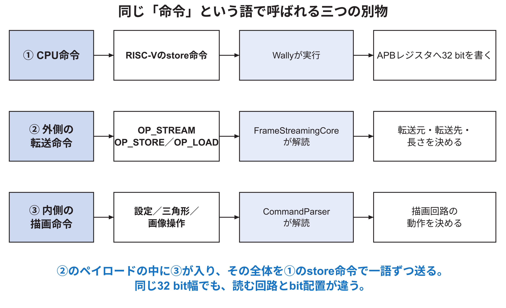
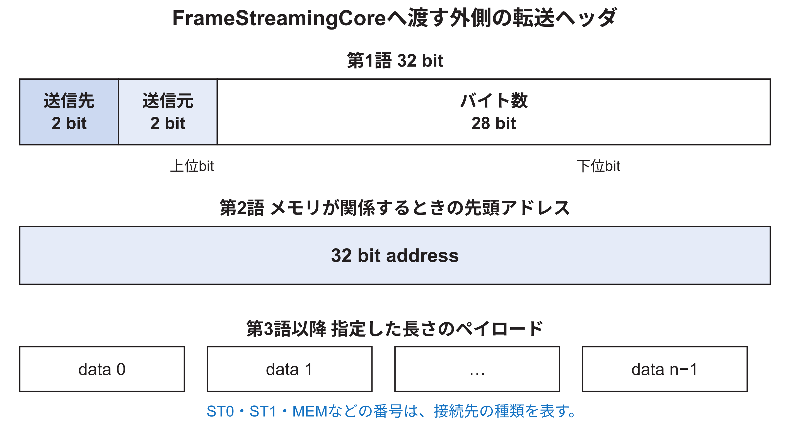

<!-- appendix-content:start -->
<a id="ch_p"></a>
# 付録P 三層の命令とbit配置を読む
<!-- appendix-content:end -->

[付録の総目次](../../技術付録.md) ｜ [論文本文](../../本文.md) ｜ [参考文献](../references.md)

[第IV部 RasterIXと描画システム](README.md)

ファイルパスの表記は、[資料フォルダー](../../README.md)を基準とする。

## このページの目次

- [P.1 「描画命令」を一種類だと思わない](#s_p_1)
- [P.2 Wally側APBレジスタの役割](#s_p_2)
- [P.3 外側の転送ヘッダ](#s_p_3)
- [P.4 `FrameStreamingCore`の状態機械](#s_p_4)
- [P.5 内側の描画命令の共通形式](#s_p_5)
- [P.6 設定registerは「物理アドレス」ではない](#s_p_6)
- [P.7 FEATURE_ENABLEのbitを読む](#s_p_7)
- [P.8 FRAMEBUFFER命令のbit](#s_p_8)
- [P.9 三角形記述子の語数](#s_p_9)
- [P.10 `TLAST`とsizeは別の役割を持つ](#s_p_10)
- [P.11 一つの具体的な転送を分解する](#s_p_11)
- [P.12 命令列が壊れたときの症状](#s_p_12)
- [P.13 命令形式を変更するときの原則](#s_p_13)

<!-- appendix-content:start -->
<a id="s_p_1"></a>
## P.1 「描画命令」を一種類だと思わない

本システムでは、少なくとも三種類の命令が連続して現れる。図P.1の①はWallyが実行するRISC-V機械命令、②はRasterIXの転送器が解読する外側の命令、③は描画器が解読する内側の命令である。



例として、C++の配列にあるdisplay listを描画器へ送る場合を考える。Wallyは①の`store`を繰り返し、APBレジスタへ32 bit語を書く。その列の最初には②の`OP_STREAM`ヘッダがある。そのペイロードの先頭には③の設定命令や三角形命令がある。①、②、③はすべて32 bitの語を含み得るが、解読する回路とbit配置が異なる。

<a id="s_p_2"></a>
## P.2 Wally側APBレジスタの役割

本研究の`rasterix_apb`は、RasterIXのstreamをCPUから扱えるよう、次のレジスタを持つ。offsetはRasterIX用APB領域の先頭からの距離である。

| offset | 名前 | CPU操作 | 意味 |
|---:|---|---|---|
| `0x00` | CMD | write | 通常の命令語をFIFOへ入れる |
| `0x04` | CMD_LAST | write | 最後の語を入れ、`TLAST`を付ける |
| `0x08` | STATUS | read | command受付可、response有、busyを読む |
| `0x0c` | ID | read | 識別値`RIX1`を読む |
| `0x10` | FRAME_COUNT | read | 表示切替完了回数を読む |
| `0x14` | FRAME_ADDR | read | 現在の表示用アドレスを読む |
| `0x18` | RESPONSE | read | 応答FIFOの先頭を取り出す |

`STATUS`を読むだけでは応答FIFOを消費しない。`RESPONSE`を読むと、その値をCPUへ返すと同時に先頭を取り出す。この違いは[付録I](appendix-i.md#ch_i)の図I.6で説明した。

<a id="s_p_3"></a>
## P.3 外側の転送ヘッダ

`DeviceDataUploader`とRTLの`FrameStreamingCore`は、データをどこからどこへ何byte運ぶかを共有する。先頭32 bitは、送信先channel、送信元channel、byte数を含む。メモリが関係する操作では、次の32 bitが先頭addressになる。その後にpayloadが続く。



公式実装では、上位nibbleで用途を区別する定数として`OP_STORE`、`OP_LOAD`、`OP_STREAM`が使われる。概念上の関係は次である。

| 外側operation | 転送の向き | 代表用途 |
|---|---|---|
| `OP_STREAM` | stream入力から別streamへ | display listをrendererへ渡す |
| `OP_STORE` | stream入力からメモリへ | textureや命令用データをDDRへ保存する |
| `OP_LOAD` | メモリからstream出力へ | DDRのデータを読み出す |

channel番号には内部経路、stream 0、stream 1、memoryなどが割り当てられる。Wallyから入るraw streamはST0で受け、renderer側のST1へ流す。定数名だけで向きを推測せず、`DeviceDataUploaderCommands.hpp`と`FrameStreamingCore.v`のsource／destination選択を照合する。

<a id="s_p_4"></a>
## P.4 `FrameStreamingCore`の状態機械

`FrameStreamingCore`は、概ね`IDLE`、`COMMAND`、`ADDR`、`STREAM`を進む。転送先が受け取れないときは`STREAM_PAUSED`相当の状態で未転送の一語を保持する。

| 状態 | 読むもの | 決めること |
|---|---|---|
| IDLE | 転送開始 | 新しい転送を始めるか |
| COMMAND | 第1語 | source、destination、長さ |
| ADDR | 第2語 | memory先頭address |
| STREAM | payload | 指定先へ何語転送したか |
| STREAM_PAUSED | 保持中の一語 | destination再開まで待つ |

長さを32 bit語数だけでなくbyte数として持つのは、memory busの幅や末尾の有効byteを扱うためである。AXI側では`LinearAddressGenerator`がburstを作る。公式構成はAXI3互換の制限も考慮し、境界をまたぐ転送を分割する。

<a id="s_p_5"></a>
## P.5 内側の描画命令の共通形式

`CommandParser`が読む内側の命令は、32 bitの上位4 bitをoperation、下位28 bitをimmediateとする。operationごとに、immediateの意味と後続語数が異なる。

```text
bit 31                         bit 28 bit 27                    bit 0
+-----------------------------------+------------------------------+
|           operation 4 bit         |       immediate 28 bit       |
+-----------------------------------+------------------------------+
```

| operation | 名前 | 後続データ |
|---:|---|---|
| 0 | NOP | なし |
| 1 | RENDER_CONFIG | register値一語 |
| 2 | FRAMEBUFFER | immediate内の制御bit |
| 3 | TRIANGLE_STREAM | 三角形記述子 |
| 4 | FOG_LUT_STREAM | fog用table |
| 5 | TEXTURE_STREAM | texture page情報 |

operation番号は`rtl/RasterIX/RegisterAndDescriptorDefines.vh`を基準にする。C++側では`lib/gl/renderer/commands/Op.hpp`と各command classが同じ約束を作る。一方だけを変更すると、C++が送る意味とRTLが読む意味がずれる。

<a id="s_p_6"></a>
## P.6 設定registerは「物理アドレス」ではない

`RENDER_CONFIG`のimmediateには、RasterIX内の設定register番号が入る。続く一語が設定値である。これはWallyのAPB addressではない。APB addressは命令streamへ語を入れる入口、render config registerはそのstreamの中で指定する描画器内部の宛先である。

基準版の設定項目は次のように分類できる。

| 分類 | 主なregister | 何を決めるか |
|---|---|---|
| 機能有効化 | FEATURE_ENABLE | fog、blend、depth、alpha、stencil、scissor、TMU、logic op |
| 初期化値 | COLOR_CLEAR、DEPTH_CLEAR | clear時に入れる値 |
| fragment処理 | FRAGMENT_PIPELINE、STENCIL | 比較関数、参照値、mask、blend、logic op |
| 画面範囲 | SCISSOR_START／END、Y_OFFSET、RESOLUTION | 対象範囲、帯の位置、横幅・高さ |
| texture | TMU_CONFIG、TMU_ENV、TMU_COLOR | 大きさ、wrap、filter、format、合成式 |
| memory | COLOR／DEPTH／STENCIL_ADDR | 外部bufferのaddress |

公式定義には19個の設定registerがある。各bit位置は`RegisterAndDescriptorDefines.vh`にまとまっている。設定を追加するときは、C++側のcommand生成、RTL側のregister bank、初期値、試験を同時に変更する。

<a id="s_p_7"></a>
## P.7 FEATURE_ENABLEのbitを読む

FEATURE_ENABLEは、各機能を一つずつ有効化する。代表的にはfog、blend、depth test、alpha test、stencil test、scissor、TMU0、TMU1、logic opがある。`1`なら必ず最終画像が変わるとは限らない。例えばblendを有効にしても、blend factorがsourceのみを選ぶ設定なら見た目は変わらない。

回路では、機能を無効にしたときに段全体を取り除くparameterと、実行時にその機能をbypassするregisterがある。前者は合成時に回路規模を変え、後者は同じbitstream上で動作を変える。二つを区別する。

<a id="s_p_8"></a>
## P.8 FRAMEBUFFER命令のbit

FRAMEBUFFER命令は、immediateの各bitで複数の操作を指定する。

| bit | 意味 | 本構成での代表例 |
|---:|---|---|
| 0 | COMMIT | 内部の帯をDDR3へ書き出す |
| 1 | MEMSET | 内部領域をclearする |
| 2 | SWAP | 完成した外部画像を表示先へ依頼する |
| 3 | READ | DDR3の帯を内部へ読み戻す |
| 4 | COLOR_SELECT | color bufferへ命令を適用 |
| 5 | DEPTH_SELECT | depth bufferへ命令を適用 |
| 6 | STENCIL_SELECT | stencil bufferへ命令を適用 |
| 7 | VSYNC_ENABLE | 表示同期を待つ指定 |
| 8以降 | SIZE | 対象画素数 |

複数のbufferを同時にclearする場合、COLOR、DEPTH、STENCILの選択bitを組み合わせる。SWAPは内部BRAMの前後を入れ替える操作ではなく、外部color bufferの表示切替要求と結び付く。

<a id="s_p_9"></a>
## P.9 三角形記述子の語数

三角形streamの後続データは、固定部分30語と、TMU一個につき9語からなる。公式が最大二TMUを扱う形では48語、Wally構成の`TMU_COUNT=1`では39語になる。したがって、「三角形は常に48語」と覚えると本設定とずれる。

| 部分 | 32 bit語数 | 内容 |
|---|---:|---|
| reserved | 1 | alignment用 |
| bounding box | 2 | 四つの16 bit境界値 |
| 三辺の初期値 | 3 | w0, w1, w2 |
| 三辺のX増分 | 3 | 一画素右への増分 |
| 三辺のY増分 | 3 | 一行への増分 |
| 色の開始・X増分・Y増分 | 12 | RGBAを三組 |
| depthの開始・X増分・Y増分 | 6 | zとwを三組 |
| texture一個 | 9 | s,t,qを三組 |

実際のbyte数は`sizeof(TriangleDescX)`と構成parameterから決まる。C++の構造体は`#pragma pack`を使い、RTLのregister配置と一致させる。compilerや型を変える場合は、構造体のpaddingを必ず確認する。

<a id="s_p_10"></a>
## P.10 `TLAST`とsizeは別の役割を持つ

sizeは何語または何byteを処理するかを示し、`TLAST`はstream上の一まとまりの終端を示す。正常な列では両者が一致するよう生成するが、意味は同じではない。sizeが間違えばstate machineが早く終わるか余分な語を待つ。`TLAST`が間違えばpacket境界の扱いが崩れる。

Wally側では、最後の語だけ`CMD_LAST`へ書くことで非同期FIFOの`tlast`を1にする。ここを単にすべて`CMD`へ書くと、32 bit値自体は届いても終端情報が失われる。

<a id="s_p_11"></a>
## P.11 一つの具体的な転送を分解する

三角形一個を描くdisplay listが、設定命令二語と三角形command一語、Wally構成の記述子39語からなると仮定する。内側は合計42語、168 byteである。外側の`OP_STREAM`は、この168 byteをST0からrenderer側ST1へ送ると指定する。CPUは外側のヘッダと内側42語を、APBへ順に書く。

ここで数えた42語は説明用の最小例である。実際のdisplay listにはFramebuffer操作、複数三角形、状態変更などが入る。また外側のヘッダ形式によってaddress語の有無も変わる。計測では、推定語数と実際のbus write回数を分けて記録する。

<a id="s_p_12"></a>
## P.12 命令列が壊れたときの症状

| 症状 | 最初に疑う層 | 確認するもの |
|---|---|---|
| IDは読めるが描画が始まらない | APBから外側stream | CMD write、FIFO valid／ready、TLAST |
| memory転送だけ失敗 | 外側命令 | source、destination、address、length |
| 一個目は描けるが次で停止 | 内側のsize／終端 | CommandParser state、streamCounter |
| 色設定だけ無視される | render config | register番号と続く値 |
| 三角形の形が壊れる | descriptor配置 | C++構造体size、固定小数点、語順 |
| swapだけ終わらない | FRAMEBUFFER命令 | swap bit、`fb_swapped`、表示handshake |

症状から一つの層へ絞り、そこで入力と出力を観察する。すべてのsignalを一度に波形へ追加すると、重要な境界を見失う。

<a id="s_p_13"></a>
## P.13 命令形式を変更するときの原則

新しいrender registerを追加する場合、少なくとも次を同じ変更単位として扱う。

1. `RegisterAndDescriptorDefines.vh`へbit位置またはregister番号を追加する。
2. C++側の対応定義とcommand生成を追加する。
3. `CommandParser`またはregister bankが値を受け取るようにする。
4. 使用するmoduleへ信号を配線する。
5. reset時の既定値を決める。
6. C++のcommand encode試験とRTLのdecode試験を加える。
7. 古い命令列との互換性が必要か決める。

番号を一方でずらすだけの変更は、合成には成功しても画面を壊す。命令はソフトウェアとRTLのABIであると考える。
<!-- appendix-content:end -->

---

[前：付録O 一つの二次元四角形を画素まで追う](appendix-o.md) ｜ [次：付録Q CPU側で三角形記述子を作る](appendix-q.md)
