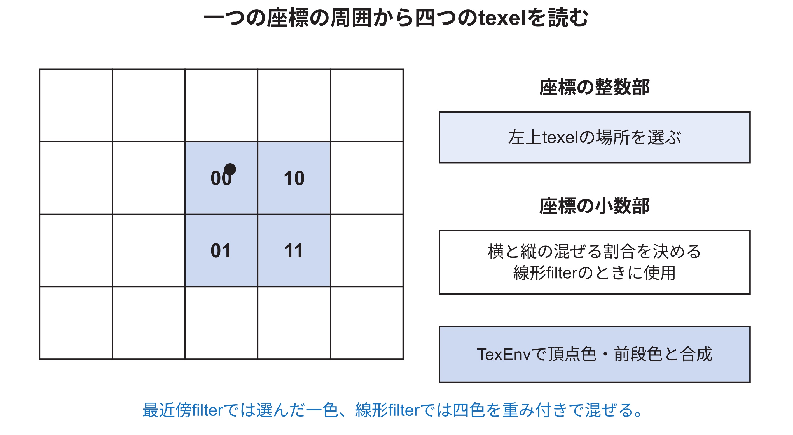

<!-- appendix-content:start -->

# 付録T textureとPixel Pipeline
<!-- appendix-content:end -->

[付録の総目次](../../技術付録.md) ｜ [論文本文](../../本文.md) ｜ [参考文献](../references.md)

[第IV部 RasterIXと描画システム](README.md)

ファイルパスの表記は、[資料フォルダー](../../README.md)を基準とする。

## このページの目次

- [T.1 textureとは何を保存するものか](#s_t_1)
- [T.2 textureがhardwareへ届くまで](#s_t_2)
- [T.3 page方式を使う理由](#s_t_3)
- [T.4 一つのTMUの内部順序](#s_t_4)
- [T.5 なぜ四texelを同時に読むか](#s_t_5)
- [T.6 `TextureBuffer`のmemory構成](#s_t_6)
- [T.7 wrapとclamp](#s_t_7)
- [T.8 mipmapとLOD](#s_t_8)
- [T.9 `TexEnv`が色を組み合わせる](#s_t_9)
- [T.10 一つのTMUを使う本構成](#s_t_10)
- [T.11 fogの位置](#s_t_11)
- [T.12 TMU無効時のbypass](#s_t_12)
- [T.13 RGB565とtexture format](#s_t_13)
- [T.14 texture異常の見分け方](#s_t_14)
- [T.15 texture変更の検証順](#s_t_15)

<!-- appendix-content:start -->

## T.1 textureとは何を保存するものか

textureは、図形の表面へ対応付ける画像である。画像の一要素をpixelと区別してtexelと呼ぶ。pixelは画面上の位置、texelはtexture画像内の位置である。一つのpixelを決めるとき、texture座標`s,t`から一つまたは周囲のtexelを読み、その色を頂点色などと組み合わせる。

文字もtextureで描ける。一文字分のbitmapをtextureへ置き、文字を表示する長方形に貼る。複数文字を一枚のtexture atlasへ並べ、各文字の`s,t`範囲だけを選ぶ方法も一般的である。本研究の文字描画でtextureを使うことは、三次元表示を意味しない。

## T.2 textureがhardwareへ届くまで

textureの元画像はCPU側でformat変換され、texture memory managerがdevice memory上のpageを割り当てる。`DeviceDataUploader`は`OP_STORE`によりtexture dataをDDR3へ置く。描画時、texture stream commandは使用するpage addressの列をhardwareへ伝える。

`PagedMemoryReader`はpage addressに従ってAXI readを発行し、現在使うtextureを`TextureBuffer`へ読み込む。`TextureBuffer`はTMUごとに一つあり、一つのtexture全体を保持する設計である。公式説明では代表的に256×256×16 bitで128 KiBとなる。[RasterIX](../references.md#ref_rasterix)

| 段階 | 保存場所 | 内容 |
|---|---|---|
| 元画像 | CPU memory／SD card | PNGなどから得た画素 |
| device texture memory | DDR3 | page単位で配置したtexture data |
| TextureBuffer | FPGA内部memory | 現在TMUがsampleするtexture |
| filter出力 | pipeline register | 一fragment分のtexture色 |

## T.3 page方式を使う理由

textureを連続する大領域だけで管理すると、異なる大きさの追加・削除で空き領域が断片化しやすい。page方式では、一定sizeのpageを複数割り当て、texture commandがpage addressを列挙する。hardwareは必要なpageを順に読む。

page size、最大texture size、page数はC++設定とhardware構成の両方に関係する。`RenderConfigs.hpp`は、最大textureのbyte数とmipmap分を考慮して必要page数を計算する。本研究のCMake設定は`NUMBER_OF_TEXTURE_PAGES=4096`、`NUMBER_OF_TEXTURES=256`であるが、これは同時に4096枚のtextureを内部保持する意味ではない。 更新版E6では、1ページ当たりのバイト数を2,048へそろえた。このページサイズと、確保するページの個数4096は別の設定である。

## T.4 一つのTMUの内部順序

`TextureMappingUnit.v`は、概ね次の四段を持つ。

1. `LodCalculator`がmipmap levelを選ぶ。
2. `TextureSampler`が周囲の四texelを読む。
3. `TextureFilter`が必要なら四色を混ぜる。
4. `TexEnv`がtexture色と前段色などを組み合わせる。

公式コメントの代表的なpipeline depthは、LOD 1 cycle、sample 5 cycle、filter 4 cycle、TexEnv 4 cycleで、合計14 cycleである。機能を無効にした場合のgenerateやbypassにより実効経路は変わる。

## T.5 なぜ四texelを同時に読むか

線形filterでは、座標を囲む左上、右上、左下、右下の四texelを使う。整数部が左上texelの場所を、小数部が横・縦の混合割合を決める。

texture座標がちょうどtexel中心なら一色の影響が大きい。二texelの中間なら両方をほぼ半分ずつ混ぜる。最近傍filterでは小数部に応じて一色を選ぶ。線形filterは滑らかになるが、乗算・加算と複数read portが必要になる。

## T.6 `TextureBuffer`のmemory構成

一cycleに四texelを得るには、一portの単純RAMを四回読むだけでは毎cycleのthroughputを保てない。`TextureBuffer`と下位RAMは、bankingまたは複数のmemory配置を使い、2×2のtexel quadをまとめて取り出せるようにする。具体的なaddress bitとbank選択は`TextureBuffer.v`、`MipmapOptimizedRam.v`、`TextureSampler.v`で追う。

変更時には、論理上のtexture addressと、各BRAM bankのaddressを分ける。偶数・奇数のs,tによるbank選択を誤ると、縞模様や2画素周期の入れ替わりが生じる。

## T.7 wrapとclamp

texture座標が範囲外へ出たとき、端のtexelに固定するclampと、反対側へ繰り返すrepeatがある。texture widthとheightは2の冪として設定され、maskや上位bitを使ったaddress生成を簡単にする。

四texel samplingでは、右端または下端で隣のtexelを読む場合もwrap／clampを適用する必要がある。中心座標だけを範囲内へ直し、隣接addressをそのまま増やすと、端で別行や別memory領域を読む。

## T.8 mipmapとLOD

mipmapは、元textureを段階的に縮小した画像群である。画面上でtextureが小さく見えるとき、元の高解像度から少数sampleを選ぶとaliasingが出る。LODは、どの縮小levelを使うかを決める値である。

RasterIXの`LodCalculator`は、現在のtexture座標と画面上で一画素ずらした位置の座標差から変化量を推定する。mipmap機能を無効にした構成では、この計算をbypassできる。二次元の等倍spriteではlevel 0だけで足りる場合が多いが、拡大縮小を行うならfilterとLODの見た目を確認する。

## T.9 `TexEnv`が色を組み合わせる

sampleしたtexture色をそのまま出すとは限らない。`TexEnv`は、texture色、頂点から補間したprimary color、前のTMUの色、constant colorをsourceとして、replace、modulate、addなどの演算を行う。

例えば白い文字glyphのalphaをtextureに持ち、頂点色を赤にすると、texture alphaで形を決め、RGBは赤にできる。逆にtexture RGBをそのままreplaceすれば、元画像の色を使う。

## T.10 一つのTMUを使う本構成

Wally側のinstanceは`TMU_COUNT=1`である。`PixelPipeline`はTMU0を通り、二個目のTMU経路は構成に応じて生成されないかbypassされる。C++側も同じ`RIX_CORE_TMU_COUNT=1`でbuildする必要がある。

hardwareだけ2、softwareだけ1にすると、descriptor語数、register、texture状態の解釈がずれる。TMU数は性能・資源だけでなく、software／hardware ABIに関わる構成値である。

## T.11 fogの位置

`PixelPipeline`はTMUの後にfogを適用する。fogはdepthまたはdistanceに応じ、現在色とfog colorを混ぜる。二次元ゲームでは通常無効にするが、pipeline上のbypass条件とlatencyには関係する。

fog LUTは専用stream commandで更新される。単なる一個のregisterではなく、複数entryのtableであるため、command parserがfog用streamへpayloadを振り分ける。

## T.12 TMU無効時のbypass

公式設計ではTMUが無効なら、計算したtexture色ではなく前段の色を転送する。これは「黒を出す」動作ではない。textureを使わない一様色の長方形は、補間された頂点色がそのままfogまたはper-fragment段へ進む。

無効機能のbypassにも、valid、last、keep、座標、indexを同じlatencyで渡す必要がある。data colorだけをbypassし、controlが別の遅延になると画素がずれる。

## T.13 RGB565とtexture format

外部color bufferはRGB565を使う。texture側は設定したpixel formatに応じてRGBやalphaを展開し、内部のsubpixel幅へ変換する。RGB565は赤5 bit、緑6 bit、青5 bitで、alphaを持たない。

| component | bit数 | 段階数 |
|---|---:|---:|
| red | 5 | 32 |
| green | 6 | 64 |
| blue | 5 | 32 |

薄いgradientでは色段差が見える可能性がある。texture sampleの誤りと最終RGB565量子化を分けるため、単色pattern、原色、段階gradientを使う。

## T.14 texture異常の見分け方

| 見え方 | 候補 | 小さな試験 |
|---|---|---|
| 2画素周期の色交換 | bank／近傍address | 2×2で四色が異なるtexture |
| 端だけ別の色 | wrap／clamp | 端を目立つ色にしたtexture |
| 全体が一色 | TMU無効、page未読込、TexEnv | 4×4 checkerboard |
| 拡大時だけ崩れる | fractional座標、filter | 2倍拡大した格子 |
| 縮小時だけちらつく | LOD／mipmap | 段階別に色を変えたmipmap |
| 色は正しくalphaだけ無効 | format／TexEnv／blend | 透明・半透明・不透明の三領域 |

## T.15 texture変更の検証順

texture formatを追加する場合、最初からゲームを動かさない。次の順で範囲を広げる。

1. C++で既知の数画素を正しいpacked値へ変換する試験。
2. `TextureSampler`へ小さなRAM内容と整数座標を与えるRTL試験。
3. 小数座標で最近傍と線形filterを比較する試験。
4. wrap／clampの四辺と四隅を試す。
5. TexEnvをreplaceに固定して色だけ確認する。
6. blendとalphaを有効にする。
7. 実機で拡大画像と1:1画像を比較する。

複数機能を同時に有効にすると、誤りがsample、filter、TexEnv、blendのどこか分からなくなる。
<!-- appendix-content:end -->

---

[前：付録S hardware Rasterizerと属性補間](appendix-s.md) ｜ [次：付録U Per-Fragment Pipelineで最終色を決める](appendix-u.md)
