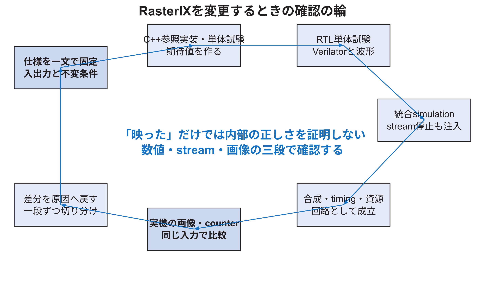

<!-- appendix-content:start -->
<a id="ch_w"></a>
# 付録W RasterIXを変更・検証できる開発手順
<!-- appendix-content:end -->

[付録の総目次](../../技術付録.md) ｜ [論文本文](../../本文.md) ｜ [参考文献](../references.md)

[第IV部 RasterIXと描画システム](README.md)

ファイルパスの表記は、[資料フォルダー](../../README.md)を基準とする。

## このページの目次

- [W.1 読んだことと確認したことを分ける](#s_w_1)
- [W.2 公式unit testを実行する](#s_w_2)
- [W.3 どの試験がどのmoduleを扱うか](#s_w_3)
- [W.4 一つの変更を小さく定義する](#s_w_4)
- [W.5 開発の確認loop](#s_w_5)
- [W.6 waveformで最初に見る信号](#s_w_6)
- [W.7 ready停止を意図的に入れる](#s_w_7)
- [W.8 新しいrender config registerを追加する例](#s_w_8)
- [W.9 blend modeを追加する例](#s_w_9)
- [W.10 texture formatを追加する例](#s_w_10)
- [W.11 internal framebuffer sizeを変える例](#s_w_11)
- [W.12 TMUを二個へ増やす例](#s_w_12)
- [W.13 performanceを調べるcounter](#s_w_13)
- [W.14 simulationと実機のreferenceをそろえる](#s_w_14)
- [W.15 合成後に確認すること](#s_w_15)
- [W.16 実機での段階的な成功条件](#s_w_16)
- [W.17 source変更をしない理解確認](#s_w_17)
- [W.18 開発者向けの症状別入口](#s_w_18)
- [W.19 本研究の構成parameter一覧](#s_w_19)
- [W.20 公式sourceの索引](#s_w_20)
- [W.21 理解を確認する総合課題](#s_w_21)
- [W.22 本付録の限界と次の一次資料](#s_w_22)

<!-- appendix-content:start -->
<a id="s_w_1"></a>
## W.1 読んだことと確認したことを分ける

開発者は、sourceから分かる設計意図、simulationで確認した論理、合成で確認した回路成立、実機で確認した外部挙動を分ける。

| 証拠 | 強く言えること | まだ言えないこと |
|---|---|---|
| source読解 | 実装された条件とdata path | そのpathが実機で使われたか |
| software unit test | C++参照処理の例 | RTLの一致 |
| Verilator unit test | 対象RTLの入力出力 | SoC全体とtiming |
| synthesis／timing | resourceと時間制約成立 | game画像の正しさ |
| 実機counter | 定義したeventの回数・時間 | 人が見た映像の完全性 |
| capture画像 | end-to-endの見た目 | 内部で偶然相殺した誤りの不存在 |

「開発者並み」とは、最も強い証拠だけを集めることではなく、疑問に必要な証拠を選べることである。

<a id="s_w_2"></a>
## W.2 公式unit testを実行する

RasterIXにはC++ software testとVerilator RTL testがある。公式READMEの手順は次である。[RasterIX](../references.md#ref_rasterix)

```bash
cd /path/to/wally-game-console/addins/rasterix

cmake --preset unittest_software
cmake --build build/unittest-software -j8
ctest --test-dir build/unittest-software --output-on-failure

cmake --preset unittest_verilator
cmake --build build/unittest-verilator -j8
ctest --test-dir build/unittest-verilator --output-on-failure
```

Verilatorのversionなど依存関係が合わない場合、失敗を回路不良と断定しない。configure logで「toolがない」「optionが変わった」「compile error」「test assertion」のどこかを分ける。

<a id="s_w_3"></a>
## W.3 どの試験がどのmoduleを扱うか

| 対象 | 公式試験の例 | 確認内容 |
|---|---|---|
| CPU側Rasterizer | `test_Rasterizer.cpp` | 画素集合、index、帯offset、境界 |
| CPU側属性補間 | `test_AttributeInterpolator.cpp` | 色、depth、texture補間 |
| texture演算 | `test_TextureMap.cpp`、`test_TexEnv.cpp` | samplingと色合成 |
| alpha／depth比較 | `test_TestFunc.cpp` | 比較関数 |
| blend／logic／stencil | 対応software test | 個別演算 |
| FrameStreamingCore | `sim_FrameStreamingCore.cpp` | 転送、停止、長さ、channel |
| fixed補間 | `sim_AttributeInterpolationX.cpp` | 増分command |
| 遠近補正 | `sim_AttributePerspectiveCorrectionX.cpp` | q逆数とformat |
| texture sampler | `sim_TextureSamplerTestModule.cpp` | 四texel読出しとfilter |
| internal FB command | `sim_InternalFramebufferCommandHandler.cpp` | memset、commit、read、停止 |
| FIFO結合 | `sim_StreamConcatFifo.cpp` | 複数streamの対応 |

公式試験に`CommandParser`全体や`PerFragmentPipeline`全体の直接testが見当たらない場合、下位演算のtestがあることをもって全体が完全に検証済みとはしない。変更範囲に応じて統合testを追加する。

<a id="s_w_4"></a>
## W.4 一つの変更を小さく定義する

「RasterIXを高速化する」は大きすぎる。次のように、入力、変更点、期待出力、非変更条件を一文で定義する。

```text
RGBA=(255,0,0,128)のsourceとRGB=(0,0,255)のdestinationに対し、
標準alpha blendのroundingを変更する。depthとstencilの判定、
valid／ready、出力順序は変えない。
```

この一文から、必要なsoftware期待値、RTL module、境界値、画像testを選べる。

<a id="s_w_5"></a>
## W.5 開発の確認loop

図W.1の順に、小さなtestから実機へ進み、差が出た段へ戻る。



実機で映ったことは重要だが、それだけでは境界値やstall時の正しさを十分に確認できない。反対にunit testだけではWally、DDR3、表示回路まで通ることを示さない。

<a id="s_w_6"></a>
## W.6 waveformで最初に見る信号

すべてのinternal signalを追加する前に、module境界のhandshakeを見る。

| 境界 | 最初に見る信号 |
|---|---|
| command FIFO→RasterIX | data、valid、ready、last |
| FrameStreamingCore→CommandParser | data、valid、ready、last |
| CommandParser→Rasterizer config | valid、ready、streamCounter |
| Rasterizer→補間器 | x、y、index、command、valid、ready、keep、last |
| 補間器→PixelPipeline | color、depth、s、t、valid、ready |
| Pixel→PerFragment | 新色と旧buffer値のvalid対応 |
| PerFragment→Framebuffer | write enable、index、color、depth、stencil |
| commit→AXI | AW、W、Bの各valid／ready／last |

data busが広すぎる場合、最初はindexとvalid／readyだけを見る。欠落・重複がなければ、異常が出る一indexのdataを詳しく見る。

<a id="s_w_7"></a>
## W.7 ready停止を意図的に入れる

stream回路のbugは、readyが常に1では現れないことが多い。testbenchで、規則的または擬似乱数的にreadyを0にし、受け渡した要素の列をreferenceと比較する。

確認条件は次である。

```text
受信した要素列 = 送信した要素列
順序は同じ
重複なし
欠落なし
lastの位置は同じ
stall中にdataとcontrolを保持
```

時間が延びることは正常である。要素列が変わることが異常である。

<a id="s_w_8"></a>
## W.8 新しいrender config registerを追加する例

例として、debug用に出力colorを強制するregisterを追加すると仮定する。

1. 未使用のregister番号とbit配置を決める。
2. C++側に`WriteRegisterCmd`を生成するsetterを作る。
3. `CommandParser`のregister streamが新番号を受けることを確認する。
4. config register bankへ値を保存する。
5. `PerFragmentPipeline`手前へenableとcolorを配線する。
6. disable時は従来出力とbit単位で一致させる。
7. reset後disableとなる既定値を定める。
8. command encode、register decode、color override、stallのtestを作る。

debug機能でも、未使用時にtimingやresourceへ影響し得る。最終版へ残すか、simulation専用にするか決める。

<a id="s_w_9"></a>
## W.9 blend modeを追加する例

blend factorまたは式を追加する場合、`ColorBlender.v`だけでなく、OpenGL enumからinternal enumへの変換、config bit幅、software reference、RTL truth tableを変更する。

同じ番号を別の意味へ再利用すると、古いprogramが別のblendを実行する。既存番号を保ち、新しい番号を末尾へ追加する。config fieldのbit数が足りなければ、命令ABI変更として扱う。

<a id="s_w_10"></a>
## W.10 texture formatを追加する例

texture formatは、upload時のbyte列、memory size計算、samplerのunpack、alpha既定値、filter内部bit幅、TexEnv入力へ影響する。次の四画素から始める。

| 位置 | 色 | 目的 |
|---|---|---|
| 左上 | 赤 | channel順 |
| 右上 | 緑 | addressのx方向 |
| 左下 | 青 | addressのy方向 |
| 右下 | 白・半透明 | alphaとfilter |

2×2を整数座標で正しく読めた後、小数座標、端、mipmapへ広げる。

<a id="s_w_11"></a>
## W.11 internal framebuffer sizeを変える例

size変更では、RTL instanceの`FRAMEBUFFER_SIZE_IN_PIXEL_LG`とC++の`RIX_CORE_FRAMEBUFFER_SIZE_IN_PIXEL_LG`を同じ値にする。帯数、帯高さ、display list buffer数、commit size、BRAM resource、timingを再確認する。

比較表には、少なくとも次を残す。

| 指標 | 変更前 | 変更後 |
|---|---:|---:|
| internal画素数 | 65,536 | 測定値 |
| 帯数 | 5 | 計算値 |
| 一frameのtriangle command数 | 測定値 | 測定値 |
| command送信時間 | 測定値 | 測定値 |
| Rasterizer stall cycle | 測定値 | 測定値 |
| BRAM／LUT／FF | report | report |
| worst slack | report | report |
| end-to-end frame時間 | 測定値 | 測定値 |

<a id="s_w_12"></a>
## W.12 TMUを二個へ増やす例

TMU数を2へ変えると、第二texture bufferとTMUのresourceが増え、descriptorは39語から48語へ増える。C++ library、hardware parameter、texture state、command sizeを一致させる。第二TMUが無効な描画でも、構成されたpipelineのlatencyやresourceが変わる可能性がある。

試験は、TMU0だけ、TMU1だけ、両方、両方無効の四条件を持つ。二枚のtextureを原色patternにし、TexEnvの前段色との組合せを確認する。

<a id="s_w_13"></a>
## W.13 performanceを調べるcounter

developerとして性能原因を絞るには、frame全体の時間だけでなく、各段の仕事量と停止を数える。

| counter候補 | 何を分けるか |
|---|---|
| command word数 | CPU送信量 |
| triangle数 | geometry量 |
| candidate fragment数 | Rasterizer仕事量 |
| kept fragment数 | 実際の画素候補 |
| Rasterizer stall cycle | downstream停止 |
| texture load byte | texture転送量 |
| framebuffer read／commit byte | 帯転送量 |
| AXI wait cycle | memory応答待ち |
| swap wait cycle | 表示同期待ち |

counter自体がtimingへ影響するため、幅、reset、読出し方法、overflowを設計する。測定用bitstreamと最終bitstreamを区別する。

<a id="s_w_14"></a>
## W.14 simulationと実機のreferenceをそろえる

同じ2D sceneを、software rasterizer、RTL simulation、実機で描く。sceneには次を含める。

1. 一様色の二三角形からなる四角形。
2. 三頂点色が異なるgradient。
3. 2×2原色textureの拡大。
4. alpha 0、0.5、1の重なり。
5. 画面端と帯境界をまたぐ図形。
6. scissor内外。

画像比較は完全一致だけでなく、異なるpixel数、最大component差、差の位置を保存する。RGB565や固定小数点のroundingがreferenceと異なる場合、許容差の根拠を明示する。

<a id="s_w_15"></a>
## W.15 合成後に確認すること

RTL simulationが通っても、FPGAへ実装できるとは限らない。Vivado reportで次を見る。

| report | 確認する点 |
|---|---|
| utilization | LUT、FF、BRAM、DSP、IO |
| timing summary | setup／hold、worst slack、clock domain |
| clock interaction | 非同期clock間の扱い |
| methodology／DRC | unconstrained path、unsafe CDCなど |
| power | 温度・電源の参考値 |

resource使用率が100%未満でも、routing混雑でtimingを満たさないことがある。逆にLUTが多くても、critical pathが短ければclockを満たす。resourceと速度を別々に評価する。

<a id="s_w_16"></a>
## W.16 実機での段階的な成功条件

| 段階 | 成功条件 |
|---|---|
| bus | IDが`RIX1`、command readyを読む |
| command | 小さなNOP／設定列が完了しbusyが戻る |
| framebuffer | clearした単色がDDR3へcommitされる |
| display | 原色patternが4:3で安定表示される |
| rasterizer | 一様色三角形の位置と境界が正しい |
| interpolation | gradientが期待方向へ変化する |
| texture | 2×2原色patternを正しく拡大する |
| per-fragment | alpha／depth／stencilの小sceneが一致する |
| game | 固定seed・固定入力で同じframe列となる |

段階を飛ばしてgameだけを見ると、異常がAPI、command、Rasterizer、memory、displayのどこか分からない。

<a id="s_w_17"></a>
## W.17 source変更をしない理解確認

まずコードを変えず、既存moduleで次を説明する。

1. `glVertex2f`の値が保存されるC++配列。
2. `GL_QUADS`が二三角形になる頂点順。
3. `TriangleDescX`のWally構成での語数。
4. 外側`OP_STREAM`と内側`OP_TRIANGLE_STREAM`の違い。
5. `CommandParser`が次のcommandを待つ条件。
6. Rasterizerの`PUSH`／`POP`。
7. `AttributeInterpolatorX`を選ぶgenerate条件。
8. TMUが四texelを読む理由。
9. alpha testとblendの違い。
10. READ、COMMIT、SWAPの違い。

答えをsource pathとsignal名で示せれば、変更へ進む基礎がある。

<a id="s_w_18"></a>
## W.18 開発者向けの症状別入口

| 症状 | 最初に開くfile | 最初に見る値 |
|---|---|---|
| 図形の位置が違う | `VertexPipeline`、`Rasterizer.cpp` | 変換後頂点、bounding box |
| 三角形に穴がある | software／RTL Rasterizer | 辺関数、境界規則、keep |
| gradientが壊れる | `AttributeInterpolationX.v` | init、X／Y increment |
| textureがずれる | `TextureSampler.v` | s、t、bank address |
| 透明が効かない | `TexEnv.v`、`PerFragmentPipeline.v` | alpha、test、blend factor |
| 前の画像が残る | framebuffer command | memset／read／commit size |
| 数frame後に停止 | command parser／FIFO | state、counter、valid／ready |
| memory trafficで遅い | IF command／AXI | read／commit byte、wait cycle |
| 上下反転 | Rasterizer index／display | y、offset、row address |
| 実機だけ不安定 | timing／CDC／reset | slack、clock、synchronizer |

<a id="s_w_19"></a>
## W.19 本研究の構成parameter一覧

| parameter | 本研究の値 | 影響 |
|---|---:|---|
| CPU clock | 20 MHz | C++処理とAPB送信速度 |
| RasterIX／DDR clock | 100 MHz | 描画pipelineとmemory interface |
| pixel clock | 25.2 MHz | 640×480映像timing |
| command data width | 32 bit | CPUからのstream語幅 |
| AXI data width | 64 bit | RasterIXのmemory転送幅 |
| framebuffer log2 pixels | 16 | 65,536画素、五帯 |
| TMU count | 1 | descriptor、texture回路、resource |
| display size | 640×480 | 外部画像と帯計算 |
| interpolation | fixed point | `AttributeInterpolatorX`経路 |
| color external format | RGB565 | 2 byte／pixel |
| threaded rasterization | true | command処理threadが頂点変換と記述子生成を担当 |

parameterの説明では値だけでなく、softwareとRTLのどこを一致させるかを書く。

<a id="s_w_20"></a>
## W.20 公式sourceの索引

| 知りたいこと | 主なsource |
|---|---|
| 全体設計 | `design.md` |
| OpenGL入口 | `lib/gl/opengl`、`RIXGL.cpp` |
| 頂点配列 | `VertexQueue.hpp`、`RenderObj.*` |
| primitive組立て | `transform/PrimitiveAssembler.cpp` |
| CPU側記述子計算 | `renderer/Rasterizer.cpp` |
| command class | `renderer/commands` |
| display list | `renderer/displaylist` |
| 外側転送生成 | `renderer/devicedatauploader` |
| 外側転送RTL | `FrameStreamingCore.v` |
| command／register定義 | `RegisterAndDescriptorDefines.vh` |
| 内側decode | `CommandParser.v` |
| 描画器top | `RasterIXRenderCore.v` |
| 画素列挙 | `Rasterizer.v`、`RasterizerCommands.vh` |
| 属性補間 | `AttributeInterpolationX.v`、`AttributeInterpolatorX.v` |
| 遠近補正 | `AttributePerspectiveCorrectionX.v` |
| texture | `TextureBuffer.v`、`TextureMappingUnit.v`、`TextureSampler.v` |
| 色合成 | `TexEnv.v`、`Fog.v` |
| fragment試験 | `PerFragmentPipeline.v`、`TestFunc.v`、`StencilOp.v` |
| blend／logic | `ColorBlender.v`、`LogicOp.v` |
| 内部画像 | `InternalFramebuffer*.v` |
| IF全体 | `RasterIXCoreIF.v`、`RasterIX_IF.v` |
| test | `unittest/software`、`unittest/verilator` |

<a id="s_w_21"></a>
## W.21 理解を確認する総合課題

赤い四角形一個について、次を一枚の紙へ描く。

1. 四頂点と二三角形の頂点順。
2. CPU側で作るbounding box、三辺の初期値・増分。
3. Wally APBレジスタ、非同期FIFO、外側command、内側command。
4. `CommandParser`からFramebuffer writeまでのmodule列。
5. valid／readyが0になった場合の保持場所。
6. 一帯のinternal addressと画面全体のDDR3 address。
7. commitとswapの時系列。
8. 各段で失敗したときの観察signalと試験。

この説明を、まずtexture無効の一様色で行う。次にtextureとalpha blendを一つずつ追加する。複雑なsceneを一度に説明するより、機能を一つ追加するたびにdata pathがどこへ増えるかを示す方が、設計を変更できる理解につながる。

<a id="s_w_22"></a>
## W.22 本付録の限界と次の一次資料

本付録は基準版のsourceを具体的に追える地図であり、すべてのparameter組合せ、OpenGL 1.x互換機能、AXI corner caseを形式検証したものではない。開発者として新しい変更を行う際は、固定版source、付属test、OpenGL ES／OpenGL仕様、AXI仕様、使用FPGAのmemory primitive仕様を一次資料として確認する。

理解の到達点は、「この付録にそう書いてあるから」ではなく、対象sourceで入出力を確認し、小さな再現testを作り、結果から説明できることである。本研究の標準構成を保つ限り、まず本付録の具体例を再現し、その後に一parameterまたは一moduleずつ変更する。
<!-- appendix-content:end -->

---

[前：付録V 内部Framebuffer、DDR3、表示まで](appendix-v.md) ｜ [次：付録X 座標、境界、辺関数を数式と実装で一致させる](appendix-x.md)
