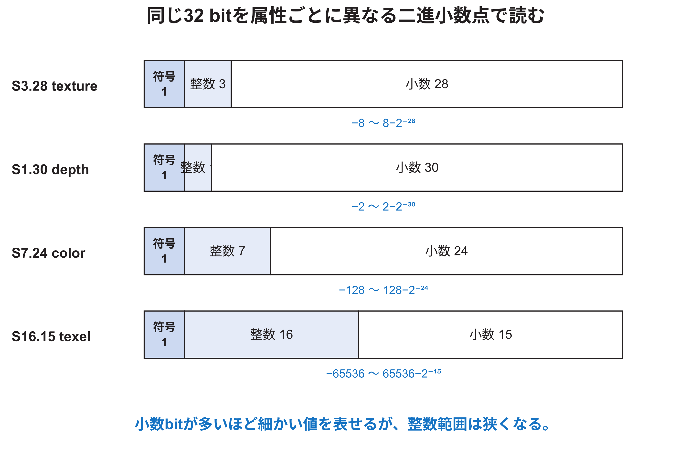
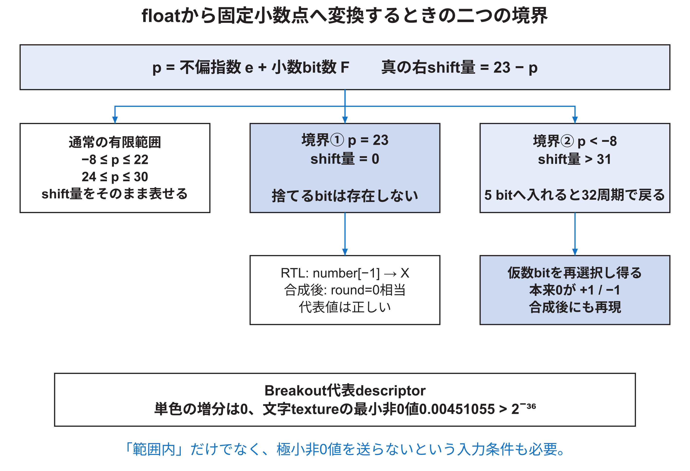
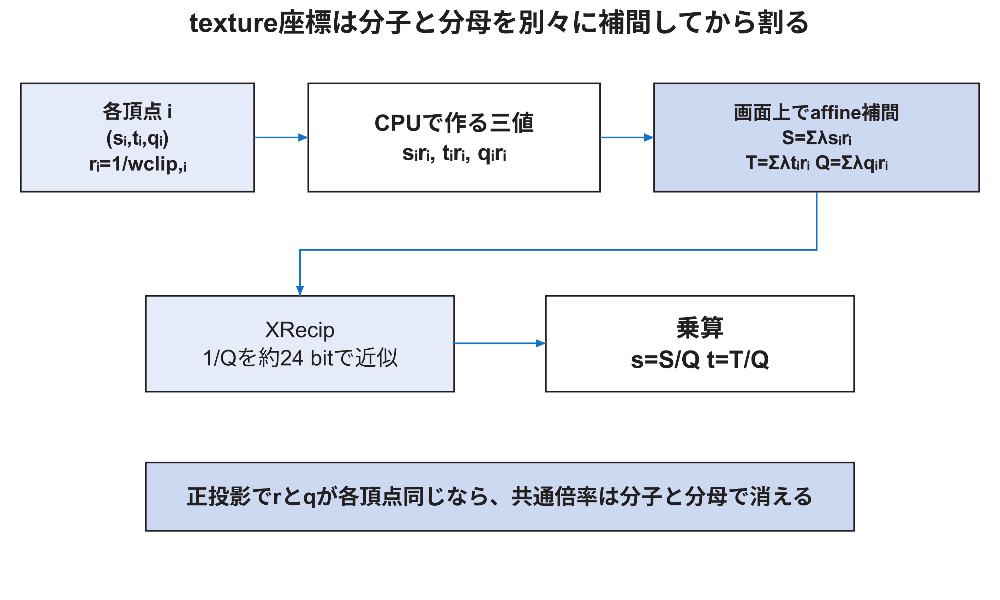
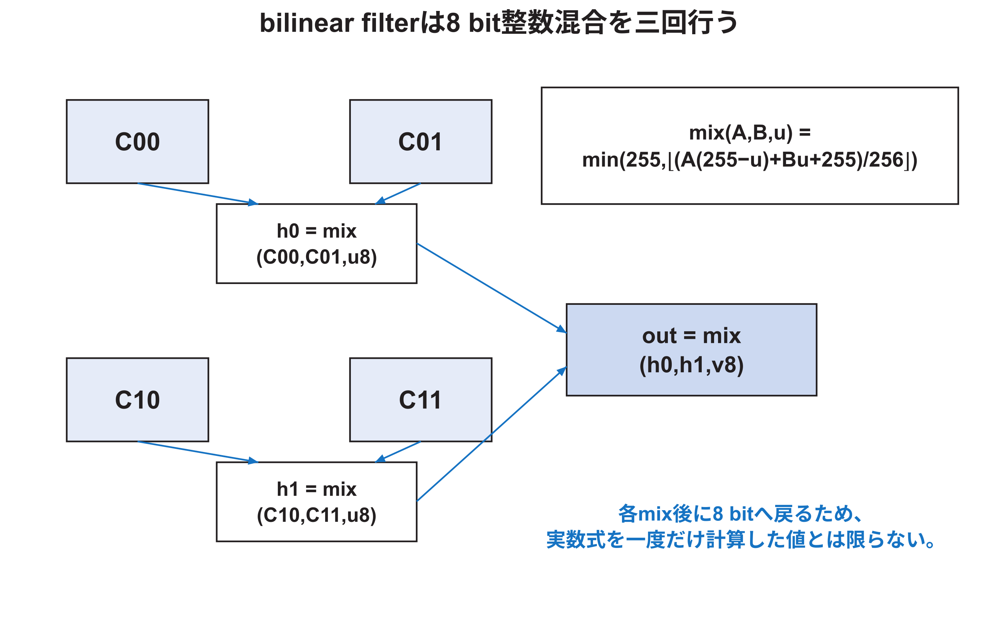

<!-- appendix-content:start -->
<a id="ch_y"></a>
# 付録Y 固定小数点、補間、texture、混色の数値を追う
<!-- appendix-content:end -->

[付録の総目次](../../技術付録.md) ｜ [論文本文](../../本文.md) ｜ [参考文献](../references.md)

[第IV部 RasterIXと描画システム](README.md)

ファイルパスの表記は、[資料フォルダー](../../README.md)を基準とする。

## このページの目次

- [Y.1 Q形式をbit列から読む](#s_y_1)
- [Y.2 float-to-fixed変換の語ごとの動作](#s_y_2)
- [Y.3 右shift量0の境界と極小値aliasを4値simulationと合成後回路で分ける](#s_y_3)
- [Y.4 属性のincrement更新は有限bitの漸化式である](#s_y_4)
- [Y.5 affine補間の開始値と増分](#s_y_5)
- [Y.6 textureのperspective-correct interpolation](#s_y_6)
- [Y.7 CPU側のw正規化が比を変えない理由](#s_y_7)
- [Y.8 逆数器の精度と入力前提](#s_y_8)
- [Y.9 colorとdepthの出力clamp](#s_y_9)
- [Y.10 texture座標S16.15からtexel addressを作る](#s_y_10)
- [Y.11 repeatとclamp-to-edge](#s_y_11)
- [Y.12 線形filterの整数式](#s_y_12)
- [Y.13 ColorMixerの式をbit sliceまで読む](#s_y_13)
- [Y.14 alpha blendの具体例](#s_y_14)
- [Y.15 test、stencil、logic operationを区別する](#s_y_15)
- [Y.16 量子化誤差を一つの数字へまとめない](#s_y_16)
- [Y.17 二次元だから不要になる処理と残る処理](#s_y_17)

<!-- appendix-content:start -->
<a id="s_y_1"></a>
## Y.1 Q形式をbit列から読む

本付録では`S整数bit数.小数bit数`を、符号bitを別に数える。32 bit signedの代表形式は次である。



| 形式 | bit構成 | 最小値 | 最大値 | 刻み |
|---|---|---:|---:|---:|
| S3.28 | 符号1、整数3、小数28 | -8 | `8-2^-28` | `2^-28` |
| S1.30 | 符号1、整数1、小数30 | -2 | `2-2^-30` | `2^-30` |
| S7.24 | 符号1、整数7、小数24 | -128 | `128-2^-24` | `2^-24` |
| S16.15 | 符号1、整数16、小数15 | -65536 | `65536-2^-15` | `2^-15` |

同じ32 bitでも、小数部を増やすほど刻みは細かく、整数範囲は狭くなる。bit列`N`をS3.28として読む実数は、Nをsigned 32 bit整数として解釈して`N/2^28`とする。

<a id="s_y_2"></a>
## Y.2 float-to-fixed変換の語ごとの動作

`TriangleStreamF2XConverter.v`は三角形streamの語番号を見て、変換する語とその小数bit数を選ぶ。

| 属性 | offset | 出力形式 |
|---|---:|---|
| texture s,t,qと増分 | -28 | S3.28 |
| color r,g,b,aと増分 | -24 | S7.24 |
| depth z,wと増分 | -30 | S1.30 |
| bounding box・辺関数 | 変換なし | 既に整数 |

`FloatToInt.v`はIEEE 754 singleのsign、exponent、mantissaを分け、offsetで二進小数点を移す。右shiftする場合、最初に捨てる一bitを`one_round`として保存し、結果の絶対値へ加える。負数はその後で二の補数にする。

この方式は、保持bitより小さい全bitを使うties-to-evenではない。ちょうど半分でも絶対値を大きくする。overflow判定時は最大値へ飽和せず0になる。したがって、入力範囲を守ることは画質だけでなく、値が突然0になることを避けるために必要である。

さらに、回路はmantissaの手前へ常にhidden bitの1を補う。これは正規化された有限のIEEE 754値に対応する読み方であり、subnormal、NaN、infinityを一般的に正しく変換する回路としては扱えない。非常に大きいshift量は`shiftSize`のbit幅へ切り詰められるため、特殊値を含む全32 bit patternへ通常の数値変換を一般化しない。正規化有限floatでも、非常に小さい非0値にはY.3の追加制約がある。本研究で使う値については、範囲だけでなく、0へ量子化される極小値をそのまま送らないことも入力契約に含める。

<a id="s_y_3"></a>
## Y.3 右shift量0の境界と極小値aliasを4値simulationと合成後回路で分ける

正規化有限floatの非負の絶対値を`x`、小数bit数を`F`とすると、意図する固定小数点の絶対値は概ね`round(x×2^F)`である。IEEE 754の非正規化前の仮数整数を`M=2^23+mantissa`、不偏指数を`e`とすれば、変換器内の有効指数は`e+F`となる。有効指数が23以下のときは、次の右shiftを行う。

```text
shiftSize = 23 - (e + F)
number    = M >> shiftSize
```

`shiftSize>0`なら、最初に捨てるbitは`M[shiftSize-1]`である。ところが`shiftSize=0`では捨てるbitが存在しないため、数学上のround bitは0でなければならない。公式`FloatToInt.v`はこの分岐を設けず、同じ式`number[shiftSize-1]`を評価する。この場合のindexは範囲外となる。

この差は、simulationが0と1だけを扱うか、不定値`X`も扱うかで見え方が変わる。Verilatorの通常modelは2値であり、このcaseを期待値どおりに見せる。一方、Vivado XSIMで未変更RTLを4値simulationすると、正の入力では`X`が出力へ伝播し、負の入力も期待する二の補数にならなかった。

次の表は、実行した11 caseから、式との対応を説明しやすい8 caseを抜き出したものである。

| 入力 | offset | `shiftSize` | 未変更RTLの4値simulation | 期待値 |
|---|---:|---:|---:|---:|
| color `+0.5` | -24 | 0 | `xxxxxxxx` | `00800000` |
| color `-0.5` | -24 | 0 | `00000001` | `ff800000` |
| color `1.0未満の最大float` | -24 | 0 | `xxxxxxxx` | `00ffffff` |
| texture `1/32` | -28 | 0 | `xxxxxxxx` | `00800000` |
| depth `1/128` | -30 | 0 | `xxxxxxxx` | `00800000` |
| color `0.25` | -24 | 1 | `00400000` | `00400000` |
| colorの極小正規化値、mantissa bit 0が1 | -24 | 33→5 bitでは1 | `00000001` | `00000000` |
| 上と同じ負値 | -24 | 33→5 bitでは1 | `ffffffff` | `00000000` |

次に、Nexys Videoと同じArtix-7 `xc7a200tsbg484-1`を対象としてVivado 2025.2で合成し、合成後functional netlistを4値simulationした。全11 caseのうち、六つの`shiftSize=0`代表値、`shiftSize=1`、左shift、真のshift量32の計9 caseは期待値と一致した。すなわち、今回の合成器は`shiftSize=0`で「round bitなし」に相当する回路を選んだ。

一方、極小値二件は合成後にも`+1`と`-1`になり、期待する0と一致しなかった。原因は、真のshift量33を5 bitの`shiftSize`へ入れると1になり、`mantissa[0]`を「最初に捨てるbit」と誤認するためである。正規化有限値について、有効指数を`p=e+F`とすると、数学的に正しいunderflow丸めは次だけで足りる。

```text
p = -1 : |x|×2^F は [0.5,1) なので、絶対値1へ丸める
p <= -2: |x|×2^F は 0.5未満なので、0へ丸める
```

現在のsourceは`23-p`を5 bitへ切り詰めるため、`p<-8`では32周期でmantissaまたはhidden bitを再び選び得る。正規化有限floatについて、公式sourceの分岐と今回確認した範囲を`p`ごとに分けると次になる。

| `p=e+F` | 公式sourceの経路 | 今回確定したこと |
|---:|---|---|
| `p<-8` | 真の右shift量が31を超え、5 bitへ切り詰められる | 指数によって仮数またはhidden bitを再選択し得るため、安全を一般化できない |
| `-8<=p<=-2` | underflow、選ぶround bitは`number[30:24]`のいずれか | 全24 bit正規化仮数でround bitが0、出力0 |
| `p=-1` | underflow、hidden bitをround bitにする | 全24 bit正規化仮数で出力絶対値1 |
| `0<=p<=22` | 右shiftし、最初に捨てるbitを加える | 全24 bit正規化仮数で絶対値のhalf-up丸め式と一致 |
| `p=23` | `shiftSize=0`で`number[-1]`を読む | 4値RTLでは未定義、今回のArtix-7合成後代表値は期待値と一致 |
| `24<=p<=30` | 左shift | 全24 bit正規化仮数で数学的な左shiftと一致し、正の大きさは`INT32_MAX`以下 |
| `p>=31` | `one_overflow=1` | 符号にかかわらず0を出すため、通常の飽和変換ではない |

負号は最後に32 bit二の補数として適用される。この操作がbit-vector上の剰余否定と等しいことも全32 bit patternで証明した。ただし、表の`p=23`にあるsource上の範囲外indexは、その証明範囲へ含めていない。

極小値aliasだけを避ける単純で保守的な下限は、値が厳密な0であるか、非0の正規化値について`p>=-8`であることとなる。実数の絶対値で書けば、各形式の下限は次である。上限側では別に`p<=30`が必要であり、sourceとして4値RTLでも定義済みであることまで要求するなら`p=23`を除くか、公式RTLへ明示分岐が必要である。

| 形式 | 非0値をそのまま送る保守的下限 |
|---|---:|
| S7.24 | `2^-32`、約`2.33×10^-10` |
| S3.28 | `2^-36`、約`1.46×10^-11` |
| S1.30 | `2^-38`、約`3.64×10^-12` |



この下限より小さい値は、本来0へ量子化されるため、CPU側で0にするか、RTL側で`p<=-2`を明示的に0へする設計が考えられる。`shiftSize=0`だけを直しても極小値aliasは直らない。

Breakout相当の公式descriptor生成も確認した。単色四角形のcolor・depth増分はbit列になる前のfloat段階で厳密な0だった。8×8文字、64×32 atlasの代表三角形では、texture開始値が`[0.00451055, 0.0090211, 0.57735]`、X増分が`[0.0090211,0,0]`、Y増分が`[0,0.0180422,0]`であり、非0値はS3.28の保守的下限より十分大きかった。この確認範囲では、極小値aliasは現在のBreakout描画へ現れない。

ただし、RTL simulationと合成後simulationが異なるsourceは保守上安全とは言えない。sourceだけを見て`shiftSize=0`を明示する最小変更は次だが、これは極小値aliasまで直す完全な修正ではない。

```systemverilog
one_round <= (shiftSize == 0) ? 1'b0 : number[shiftSize - 1];
```

本研究のrepositoryは公式RasterIX submoduleを変更しない方針なので、この修正は取り込んでいない。結果は`../../experiments/rasterix-math/rasterix-float-to-int-audit.json`、元RTLのlog、合成log、合成後simulation logへ保存した。この試験は代表境界値に対する合成後結果であり、任意のIEEE 754 bit patternについての形式的同値証明ではない。

<a id="s_y_4"></a>
## Y.4 属性のincrement更新は有限bitの漸化式である

属性`a`について、CPUが`a_init`、`a_x`、`a_y`を送る。RTL `AttributeInterpolationX.v`は32 bit registerで次を実行する。

```text
INIT  : a <- a_init
X_INC : a <- a + a_x
X_DEC : a <- a - a_x
Y_INC : a <- a + a_y
PUSH  : saved <- a
POP   : a <- saved
```

数学上は開始点から右へi画素、上へj行進んだ値が`a_init+i a_x+j a_y`になる。32 bit RTLでは各加算後に上位bitが保持されないため、範囲を越えるとmodulo `2^32`のbit列になる。色とdepthの出力段にはclampがあるが、補間途中のwrapを元へ戻すことはできない。

<a id="s_y_5"></a>
## Y.5 affine補間の開始値と増分

頂点属性`a0,a1,a2`と正規化weightを使うと開始値は次である。

```text
a_init = λ0(P0)a0 + λ1(P0)a1 + λ2(P0)a2
```

一画素のweight差を`Δx λi`、一行の差を`Δy λi`とすると次になる。

```text
a_x = Σ(Δx λi)ai
a_y = Σ(Δy λi)ai
```

三頂点の色が同じCなら、`Σλi=1`、`ΣΔλi=0`なので、無限精度では`a_init=C`、増分は0である。float計算とfixed変換後には微小な非0が生じる可能性があるため、試験では「理論上0」と「bit列が厳密に0」を分けて記録する。

<a id="s_y_6"></a>
## Y.6 textureのperspective-correct interpolation

頂点iのclip-space wの逆数を`r_i=1/w_clip,i`、同次texture座標を`(s_i,t_i,q_i)`とする。CPUは次の三値をaffine補間する。

```text
S(P) = Σ λ_i(P) s_i r_i
T(P) = Σ λ_i(P) t_i r_i
Q(P) = Σ λ_i(P) q_i r_i
```

RTLはQの逆数を近似して次を求める。

```text
s(P)=S(P)/Q(P)
t(P)=T(P)/Q(P)
```



`q_i=1`なら一般的なperspective-correct interpolationである。正投影かつ全頂点の`r_i`が同じなら、その共通値が分子と分母で消え、通常のaffine補間になる。

<a id="s_y_7"></a>
## Y.7 CPU側のw正規化が比を変えない理由

固定小数点経路では、CPU側`Rasterizer.cpp`が`(r0,r1,r2)`をEuclidean normで割る。共通倍率を`c`とすると、送る値は`r'_i=c r_i`である。

```text
S'(P)=c Σλ_i s_i r_i
Q'(P)=c Σλ_i q_i r_i
S'(P)/Q'(P)=S(P)/Q(P)
```

実数演算では結果を変えない。目的はS3.28の範囲へ値を収めやすくすることである。ただし、fixedへ量子化すると分子と分母が別々に丸められるため、有限bitでは完全に同じ値とは限らない。共通倍率は数学的な座標を保ちながら数値範囲を変える設計である。

<a id="s_y_8"></a>
## Y.8 逆数器の精度と入力前提

`AttributePerspectiveCorrectionX.v`の既定`CALC_PRECISION=25`では、符号用の余裕を除いた`TEXQ_PRECISION=24`を使う。`XRecip.v`は次の構成である。

| 項目 | 値 |
|---|---:|
| 初期推定 | 6 bit |
| Newton反復 | 2回 |
| 説明上の精度 | 約24 bit |
| 逆数段のlatency | `7+3×2=13` cycle |
| 後段 | 乗算・形式変換4 cycle |
| 合計 | 17 cycle |

source commentは入力qが0から1に正規化されることを前提とし、sign bitを外して逆数器へ入れる。q=0を明示的に処理する分岐はなく、公式`AttributePerspectiveCorrectionX`試験にもq=0例はない。したがって正しさの前提は`Q(P)>0`である。clip-space wが0でないだけでは十分でなく、texture qも含む補間後Qが正でなければならない。

<a id="s_y_9"></a>
## Y.9 colorとdepthの出力clamp

colorはS7.24の上位16 bitを一度取り出す。その16 bit値について、sign bitが1なら0、8 bitより上の7 bitのいずれかが1なら255、それ以外は下位8 bitを出す。S7.24の整数bit列を`fixedColor`と書けば、概念的には次である。

```text
color8 = clamp(fixedColor >> 16, 0, 255)
```

ただし実装は一回の理想的な実数丸めではなく、先にbit sliceを取ってから判定する。depth zはsign bitが1なら0、bit30が1なら65535、それ以外は`depth_z[14 +: 16]`を出す。これもS1.30から16 bitへbit sliceする具体的な規則である。

<a id="s_y_10"></a>
## Y.10 texture座標S16.15からtexel addressを作る

`TextureSampler.v`は1×1から256×256の2のべき乗textureを扱う。入力はS16.15である。texture sizeのregister値はlog2サイズで、0が1画素、1が2画素、8が256画素を表す。

線形filterでhalf-pixel offsetが有効なら、sample位置の左右上下へtextureサイズに応じた0.5 texelを引き足しする。無効なら現在位置と1 texel先を使う。その後、座標の整数側から四address`00,01,10,11`を作り、小数側からQ0.16のsub-coordinateを作る。

addressは概念的に次である。

```text
address(u,v) = mipOffset + v * textureWidth + u
```

RTLでは幅と高さが2のべき乗なので、乗算の代わりにshiftとORで組み立てる。mipmap levelに応じたoffsetも前段で加える。

<a id="s_y_11"></a>
## Y.11 repeatとclamp-to-edge

repeatでは座標の下位bitをaddressへ使うことで、texture幅・高さを越えた整数部が周期的に折り返される。clamp-to-edgeでは負座標を0へ、1以上の正規化座標を端側へ制限する。

四texelの右または下が端を越えると、`TextureSampler`は越えた側のtexelを端のtexelで置き換える。例えば右だけ越えた場合、`01=00`、`11=10`となる。これにより、線形filterがtexture外の別addressを混ぜない。

<a id="s_y_12"></a>
## Y.12 線形filterの整数式

`TextureFilter.v`はsub-coordinate U、Vを16 bitで受けるが、`ColorInterpolator.v`は上位8 bitだけをweightとして使う。`u8=floor(U/256)`、`v8=floor(V/256)`とする。

一channelについて、RasterIXの補間関数は次である。

```text
mix(A,B,u8)
= min(255, floor((A(255-u8) + B u8 + 255)/256))
```

まず上段`00-01`と下段`10-11`を横に混ぜ、その二結果を縦に混ぜる。

```text
h0  = mix(C00,C01,u8)
h1  = mix(C10,C11,u8)
out = mix(h0,h1,v8)
```



重みの和は255で、分母は256、最後に255を足してからshiftする。理想式`(1-u)A+uB`を実数で一度計算するものではない。各段で8 bitへ戻すため、横方向の量子化誤差が縦方向へ入力される。一方、`u8=0`ならA、`u8=255`ならBを8 bit全組合せで正確に返すことを独立監査で全数確認した。

<a id="s_y_13"></a>
## Y.13 ColorMixerの式をbit sliceまで読む

既定の8 bit精度では、`ColorMixer.v`の一channelは二つの積を17 bitで加え、定数255を加える。bit16が1なら255へ飽和し、そうでなければbit15から8を結果にする。従って正確な整数式は次である。

```text
result = min(255, floor((A*B + C*D + 255)/256))
```

独立監査はA、B、C、Dを0から255の乱数20万組で計算し、bit shiftで書いた式と一致すること、結果が0から255に収まることを確認した。この式はtexture filterだけでなくColorBlenderでも使われる。

<a id="s_y_14"></a>
## Y.14 alpha blendの具体例

Breakoutの文字は`SRC_ALPHA`と`ONE_MINUS_SRC_ALPHA`を使う。source colorをCs、destination colorをCd、source alphaをAsとすると、各RGB channelは次の整数式になる。

```text
Cout = min(255, floor((Cs*As + Cd*(255-As) + 255)/256))
```

例えば`Cs=255`、`Cd=0`、`As=128`なら次である。

```text
Cout = floor((255*128 + 0*127 + 255)/256)
     = floor(32895/256)
     = 128
```

同じfragmentが共有辺で二度処理されると、二回目のCdは一回目の結果である。従って半透明textureを二三角形で描くと、共有対角線だけ濃くなる可能性がある。これは[付録X.14](appendix-x.md#s_x_14)の境界規則と本節の混色式を組み合わせた帰結である。

<a id="s_y_15"></a>
## Y.15 test、stencil、logic operationを区別する

PerFragment pipelineには複数の機能がある。

| 機能 | 入力 | 主な出力 |
|---|---|---|
| alpha test | 新fragmentのalphaと基準値 | fragmentを通すか |
| depth test | 新depthと保存済みdepth | fragmentを通すか、depth更新 |
| stencil test | 保存済みstencilと基準値 | 通過判定とstencil更新 |
| blend | 新色、旧色、factor | 算術的に混ぜた色 |
| logic op | 新色、旧色 | AND、OR、XORなどのbit演算色 |

testの比較関数とstencil operationはenumで選び、公式software試験と一部RTL試験がある。blendとlogic opは同時に同じ意味で使う処理ではない。機能enable、比較結果、write maskを順に追わないと、「testに落ちた」「maskで書かなかった」「同じ値を書いた」を区別できない。

<a id="s_y_16"></a>
## Y.16 量子化誤差を一つの数字へまとめない

最終画素までには複数の誤差源がある。

| 段階 | 主な誤差・境界 |
|---|---|
| float座標→Q5 | `+0.5`後の0方向切捨て、負数非対称 |
| barycentric計算 | int32 overflow、float除算 |
| float属性→fixed | guard bit丸め、overflow時0 |
| fixed increment | 32 bit wrap |
| reciprocal | 有限初期推定とNewton反復2回 |
| texture座標 | S16.15へのshiftと切捨て |
| filter weight | Q0.16から上位8 bitだけ使用 |
| ColorMixer | `/256`、`+255`、各段8 bit化 |
| external color | RGBA内部値からRGB565へ量子化 |

「誤差は最大1」と一括して断定できない。各段の入力範囲と、誤差が次段で増幅されるかを調べる。二次元Breakoutでは一様色の図形が多く、textureは文字だけなので、座標境界とalpha blendを優先して試験する。

<a id="s_y_17"></a>
## Y.17 二次元だから不要になる処理と残る処理

| 処理 | 2D Breakoutでの状態 |
|---|---|
| perspectiveの見た目 | 正投影なので通常は不要 |
| perspective補正回路 | 汎用pipelineとして通る |
| depth test | applicationがdisable |
| depth値の補間 | 記述子・pipelineには残る |
| texture | 文字で使用 |
| bilinear filter | texture設定に従って使用 |
| alpha blend | 文字で使用 |
| shared-edge規則 | 四角形を二三角形にするため関係する |

「2DだからRasterizerの数値問題は関係ない」とは言えない。奥行きの理解を発表の中心にしなくても、四角形の境界、文字texture、alpha blendは本研究の画像へ直接作用する。
<!-- appendix-content:end -->

---

[前：付録X 座標、境界、辺関数を数式と実装で一致させる](appendix-x.md) ｜ [次：付録Z 数学、source、試験を結び付けた検証記録](appendix-z.md)
