<!-- appendix-content:start -->
<a id="ch_g_commands"></a>
# 第38章 図形の指定がメモリ上の描画命令になるまで
<!-- appendix-content:end -->

[付録の総目次](../../技術付録.md) ｜ [論文本文](../../本文.md) ｜ [参考文献](../references.md)

[第IV部 RasterIXと描画システム](README.md)

ファイルパスの表記は、[資料フォルダー](../../README.md)を基準とする。

## このページの目次

- [38.1 最初に画面上で何を変えたいかを決める](#s_g_commands_1)
- [38.2 色を変える関数だけではまだ画面を塗らない](#s_g_commands_2)
- [38.3 四つの頂点を一つの四角形にする指定](#s_g_commands_3)
- [38.4 アプリケーションの座標を描画先へ対応付ける](#s_g_commands_4)
- [38.5 CPUで行う仕事とRTLで行う仕事](#s_g_commands_5)
- [38.6 描画命令とCPU命令は別の命令](#s_g_commands_6)
- [38.7 コマンドバッファはRAM上の数値列](#s_g_commands_7)
- [38.8 同じデータ幅でも長さの単位を確認する](#s_g_commands_8)
- [38.9 五本の帯と二組の命令リスト](#s_g_commands_9)
- [38.10 バッファを再利用してよい時点](#s_g_commands_10)
- [38.11 VBOを使えば同じ問題がすべて解決するか](#s_g_commands_11)
- [38.12 呼出しをまとめると減る仕事](#s_g_commands_12)
- [38.13 配列へ保存した語を回路へ送るところまで追う](#s_app_38_13)
- [38.14 OpenGL関数を呼ぶとCPUで何が実行されるか](#s_graphics_38_14)
- [38.15 状態を覚えるAPIを一呼出しずつ追う](#s_graphics_38_15)
- [38.16 設定の変更と描画の開始と完了を分けて読む](#s_graphics_38_16)
- [38.17 VBOとコマンドバッファとDMAが指すもの](#s_graphics_38_17)
- [38.18 シェーダーと固定機能をどう説明するか](#s_graphics_38_18)
- [38.19 今回のゲームのOpenGLコードを図で読む](#s_opengl_38_19)
- [38.20 最初に用意する描画の設定](#s_opengl_38_20)
- [38.21 ゲームの座標を画面上の場所へ対応させる](#s_opengl_38_21)
- [38.22 背景の色を指定して描画先を初期化する](#s_opengl_38_22)
- [38.23 赤いブロック一個を四隅で指定する](#s_opengl_38_23)
- [38.24 指定した色が四つの頂点に付くまで](#s_opengl_38_24)
- [38.25 文字Aの模様を画素の配列へ入れる](#s_opengl_38_25)
- [38.26 複数の文字を一枚の画像へ並べる](#s_opengl_38_26)
- [38.27 テクスチャの番号と画像データを登録する](#s_opengl_38_27)
- [38.28 画像のAを画面上の四角形へ対応させる](#s_opengl_38_28)
- [38.29 四隅の間で画像のどこを参照するか](#s_opengl_38_29)
- [38.30 文字を拡大したときに使う点を選ぶ](#s_opengl_38_30)
- [38.31 文字の色を決め透明な場所へ背景を残す](#s_opengl_38_31)
- [38.32 図形の指定を終えて画面へ反映する](#s_opengl_38_32)
- [38.33 値を変えたときの画面をコードから説明する](#s_opengl_38_33)

<!-- appendix-content:start -->

「図形と設定を関連付ける」「後で回路へ渡す形式にする」を、白い四角形一個の例へ置き換える。ここでは座標や色の意味から始め、CPU側の状態、頂点、命令配列、転送までを追う。実装の基本説明は固定版RasterIX `9fdcf97a`を対象とし、E6の`9269a01c`との違いは別に示す。

<a id="s_g_commands_1"></a>
## 38.1 最初に画面上で何を変えたいかを決める

横640、縦480の画面で、左上が`(100,80)`、幅16、高さ16の白い四角形を描くとする。左上という言葉を使うため、この説明ではアプリケーションの座標を「右へ行くとxが増え、下へ行くとyが増える」と決める。

四つの角は`(100,80)`、`(116,80)`、`(116,96)`、`(100,96)`になる。これらは図形の境界の位置であり、画素の番号の列そのものではない。どの画素を塗るかは、後で画素ごとの判定点を決めて求める。この区別を[画素化の章](rasterization.md)で実際に計算する。

<a id="s_g_commands_2"></a>
## 38.2 色を変える関数だけではまだ画面を塗らない

```cpp
glColor4ub(255, 255, 255, 255);
```

ここでは赤、緑、青、alphaの四成分を指定する。これは「以後に渡す頂点などに使う現在の色」を設定する操作であり、画面全部をその場で白へ塗る操作ではない。

CPU側のライブラリは、色などの現在の設定を状態として持つ。続いて頂点を渡すと、その時点の色やテクスチャ座標と位置を関連付ける。関連付けるとは、例えば「この角の位置は(100,80)、色は白、模様を使うなら模様の位置は(u,v)」という一組を扱うことである。

APIを「関数名の一覧」として覚えるより、設定を変えた後に何を渡すかを一緒に追うと動作を説明しやすい。

<a id="s_g_commands_3"></a>
## 38.3 四つの頂点を一つの四角形にする指定

```cpp
glBegin(GL_QUADS);
glVertex2f(100, 80);
glVertex2f(116, 80);
glVertex2f(116, 96);
glVertex2f(100, 96);
glEnd();
```

`GL_QUADS`があるので、渡された四頂点を一つの四角形として扱える。同じ頂点数でも、線として渡すのか、独立した点として渡すのかで図形は違う。頂点を並べるだけでは、何を作るかという情報が足りない。

後段が三角形を処理するなら、四角形を二つの三角形へ分ける。これは2Dの四角形を塗るためにも使う方法であり、奥行きのあるゲームを実装したことを意味しない。三角形にすると内外の判定と属性の補間を共通の処理で扱える。

このコードは動きを説明する抜粋である。単独でプログラムになるものではなく、描画コンテキスト、座標変換、画面の更新などの準備が必要になる。

<a id="s_g_commands_4"></a>
## 38.4 アプリケーションの座標を描画先へ対応付ける

固定版の[BreakoutRenderer.hpp](https://github.com/SoshiroFujimori/wally-game-console/blob/cdf907bc1752b0f300e4fc70b9a51b2bae983b7f/examples/rasterix/BreakoutRenderer.hpp)は、`glViewport`、射影行列の設定、`glOrtho`などを使って、ゲームの位置と画面の範囲を対応付ける。

`glViewport`は最終的に使う画面内の範囲を指定する。`glOrtho`は、指定した座標の範囲がどのように見えるかを決める変換を設定する。引数の上下の順を変えると、アプリケーションでyを下向きに増やす対応を作れる。

本実装には半画素の位置合わせもある。これを「とりあえず見た目を合わせた数字」として暗記せず、ライブラリの座標変換後にどの格子点で内外を判定するかと対応付ける。固定版の式を最後まで追う資料は[技術付録第56章](coordinates-edge-equations.md#ch_x)にある。

<a id="s_g_commands_5"></a>
## 38.5 CPUで行う仕事とRTLで行う仕事

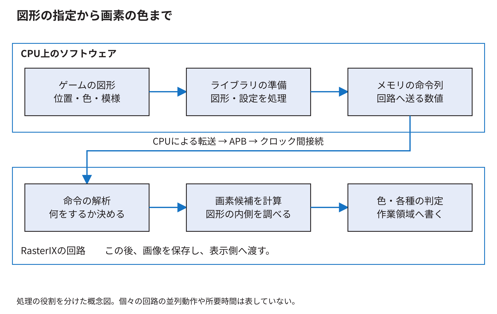

CPU側は、APIの設定、頂点の収集、座標変換、必要な切取り、三角形の準備、命令列の作成などを担当する。描画回路へ「C++の四角形オブジェクト」をそのまま渡しているのではない。回路が順番に解釈できる数値へ変換する。

回路側は、その数値から三角形の画素を列挙し、属性や模様の色を求め、各画素で必要な試験や混色を行い、作業領域へ書く。どこまでをCPUで行うかは構成で変わり得るので、一般のGPUと同一と仮定せず、固定版の[公式設計資料](https://github.com/ToNi3141/RasterIX/blob/9fdcf97a31b2e4247594e06d605871980cd5e9e1/design.md)とコードを対応付ける。

<a id="s_g_commands_6"></a>
## 38.6 描画命令とCPU命令は別の命令

RISC-Vの`sw`はCPUが理解する命令である。RasterIXへ渡す「設定を変更する」「三角形の情報が続く」といった語は、RasterIXの命令解析回路が理解する命令である。CPUはRISC-V命令を実行することで、RasterIX向けの命令を作って転送する。

コンパイル時に一度作られたCPUの機械語と、ゲームの状態に応じて実行中に作られる描画命令を分ける。ボールの位置が毎フレーム変わる場合、同じCPUプログラムが違う数値を描画命令へ入れる。

<a id="s_g_commands_7"></a>
## 38.7 コマンドバッファはRAM上の数値列

例えば概念上「設定を表す語」「三角形の情報が始まることを表す語」「辺の値や増分を表す語」のように並べる。これは形式を説明する模式例であり、任意の数字を並べて実行できる命令表ではない。

バッファを置くと、CPUが作った数値のまとまりを、転送処理が後から順に読める。処理を分けやすくなる一方、配列へ書く手間、メモリ容量、転送開始までの遅れが生じる。バッファという言葉だけから高速化を保証してはいけない。

実際の語の形式を調べるときは、ソフトウェアの[DisplayListAssembler](../../再現資料/詳説用ソース/RasterIX/lib/gl/renderer/displaylist/RIXDisplayListAssembler.hpp)と、RTLの[RegisterAndDescriptorDefines.vh](https://github.com/ToNi3141/RasterIX/blob/9fdcf97a31b2e4247594e06d605871980cd5e9e1/rtl/RasterIX/RegisterAndDescriptorDefines.vh)を対にして読む。片側だけ読んで単位や長さを推測しない。

<a id="s_g_commands_8"></a>
## 38.8 同じデータ幅でも長さの単位を確認する

長さが16と書かれていても、16 byte、16語、16画素では大きさが違う。32ビット語なら16語は64 byteである。RGB565なら16画素は32 byteである。

命令ヘッダが示す長さと、ループの回数と、バスで数えた転送回数を同じ単位へ直す。最後の語の印`TLAST`も、APIの一回の呼出し、描画命令の終わり、一画面の終わりと常に一致するわけではない。どの層の区切りかを定義した箇所を読む。

<a id="s_g_commands_9"></a>
## 38.9 五本の帯と二組の命令リスト

固定版は640×480=307,200画素を、65,536画素の内部作業領域で扱う。`getDisplayLines()`はこの条件で5を返す。ここでのlinesは、この説明では画面の横線一本ではなく、分割して扱う帯の数として読む。

一画面分の命令を五本の帯に対して用意する。さらに、それぞれについて二組のリストを扱うので10個になる。転送用の別のバッファが一つあり、[WallyBusConnector](../../再現資料/接続ソース/examples/rasterix/WallyBusConnector.hpp)の配列数は`2 * 5 + 1 = 11`となる。

「もう一組」は、同じ五本に対応する別のリスト群である。画面の別の五本が増えて計十本になるという意味ではない。表示用の画像が二枚ある話とも、別の保存場所の話である。

このコネクタは各配列を1 MiB分確保する。11 MiBは確保したデータ領域の合計であり、毎フレーム11 MiBすべてを転送するという意味ではない。実際に使った長さを渡して転送する。

<a id="s_g_commands_10"></a>
## 38.10 バッファを再利用してよい時点

転送前に配列を書き換えると、まだ送っていない語が別のフレームの内容になる。転送中は、必要な範囲の内容を保つ必要がある。MMIOへのコピーが終われば、そのコピー済みの語は接続側の保持場所が持つので、CPU側の元の配列を再利用できる段階になる。

しかし、配列を再利用できることと、表示用画像を描き換えてよいことは違う。後者は、表示回路がまだ読んでいないかを確かめる必要がある。「転送完了」という名前だけで、どの保存場所が自由になったかを判断しない。

<a id="s_g_commands_11"></a>
## 38.11 VBOを使えば同じ問題がすべて解決するか

VBOは頂点データをバッファとして扱うAPI上の仕組みである。変わらない大量の頂点の再利用などで意味を持つ。一方、コマンドバッファは回路へ渡す操作や設定の列であり、同じ種類のバッファではない。VBOを使っても、設定、図形の準備、転送、表示の待ちがすべて消えるわけではない。

今回のブロック崩しは小さな四角形と文字が中心で、実装と比較はその条件で行った。VBO方式との同条件比較は本資料の成果ではない。「常に不要」「必ず速い」のどちらも言わない。検討するなら、再利用できる頂点の量、CPU側処理、転送量、実装の対応範囲を調べて比較する。

<a id="s_g_commands_12"></a>
## 38.12 呼出しをまとめると減る仕事

四角形一個ごとに状態を切り替えたり、開始と終了を繰り返したりすると、図形数とは別の処理が発生する。同じ設定で描ける四角形を一回のまとまりにすれば、その繰返しを減らせる。

ただし描画順は画像の一部である。透明な図形を勝手に色順へ並べ替えると、重なった部分の色が変わることがある。固定版のRendererは、四角形の群と文字の群を扱うが、任意の透明図形群を無条件で並べ替えられる最適化ではない。

最後に、APIを一回呼んだこと、CPUが数値列を作り終えたこと、FIFOへ語が入ったこと、回路が画素を書いたこと、画面が切り替わったことを、五つの別の出来事として説明できれば、この経路の入口がつながる。

<a id="s_app_38_13"></a>
## 38.13 配列へ保存した語を回路へ送るところまで追う

描画関数の呼出しと、回路への書込みの間には、CPU側の命令配列がある。配列の各要素は32ビットの数値であり、CPU上のライブラリが回路向けの設定や図形の情報を決めた順序で書き込む。配列そのものは、まだ画素の色を並べた画像ではない。

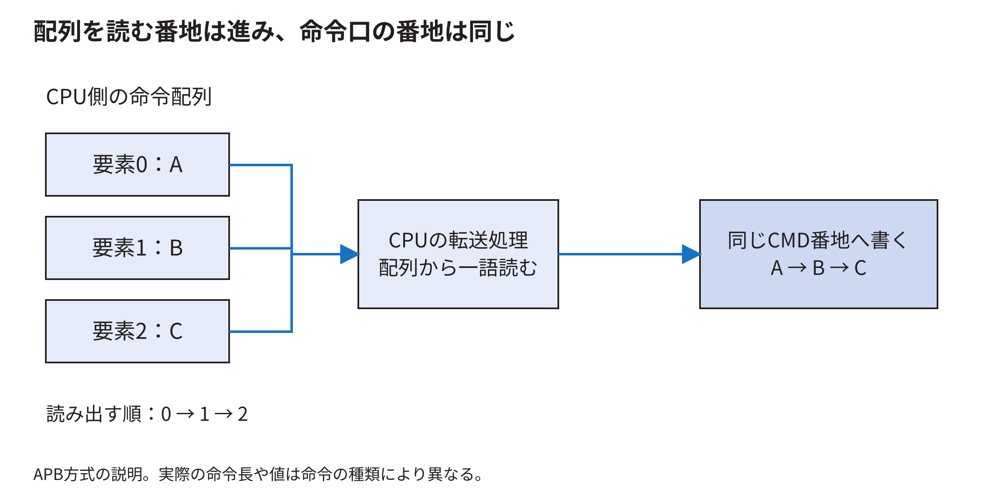

APB送信では、CPUが配列の要素0を読み、MMIOの命令口へ書く。そのバス取引が完了したら、要素1を読み、同じ命令口へ書く。この繰返しで、配列の語順を保ったまま命令列を渡す。CPUが読む配列の番地は要素ごとに進むが、書く先の命令口の番地は同じである。

図のA、B、Cは順序を示す名前であり、三語で一つの図形を描けるという実装の説明ではない。実際にはヘッダ、設定、三角形の記述子などが規則に従って並ぶ。そのビット配置を[技術付録第48章](command-bit-layout.md#ch_p)で、CPUが辺の値などを求める計算を[技術付録第49章](triangle-descriptors.md#ch_q)で追う。

この配列を回路が直接読む実験がDMA方式である。実験E7では読み出す物理領域を別に用意し、そこへ命令列をコピーした。APB方式のC++ポインタをそのまま回路へ渡したのではない。採用状況と試験の限界は[技術付録第72章](../05-integration/command-dma-comparison.md#ch_30)に示す。

<a id="s_graphics_38_14"></a>
## 38.14 OpenGL関数を呼ぶとCPUで何が実行されるか

ゲームのソースに`glVertex2f(100,80)`と書いた時点では、これはC/C++の関数呼出しである。Wallyが直接`glVertex2f`という名前の機械語命令を持っているわけではない。ビルド時に、ゲームとRasterIXのライブラリをRISC-V用の機械語へ変換し、関数の呼出し先を結び付ける。実行時にはWallyがその機械語を順に実行する。

コンパイルはソースを対象CPUの命令へ変換する工程、リンクはゲームが呼ぶ関数とライブラリの中身を結び付ける工程である。ヘッダの`gl.h`は関数名や引数の型などを知らせるが、ヘッダを読み込むだけで回路への送信機能が完成するわけではない。ライブラリ本体と、Wallyの接続先を操作するコードが必要になる。

この環境では、`CMakeLists.txt`が公式RasterIXのライブラリを組み込み、TMU数、描画先の大きさ、画像メモリの位置などを設定する。`WallyBusConnector.hpp`がWally側のMMIOレジスタへアクセスする。MMIOはMemory-Mapped I/Oの略で、特定の番地への読書きを周辺回路の操作に対応させる方式である。ゲーム側が四角形を一つ指定するたびに、C/C++コンパイラが改めてHDLを生成するのではない。描画回路は先にFPGAへ実装されており、実行中のソフトウェアがデータと設定を送って利用する。

この対応は、[製品側のビルド設定](https://github.com/SoshiroFujimori/wally-game-console/blob/ed6a1c09b34d597dcde92ec26a4f5a97cbf18a17/examples/rasterix/CMakeLists.txt)と[接続クラス](https://github.com/SoshiroFujimori/wally-game-console/blob/ed6a1c09b34d597dcde92ec26a4f5a97cbf18a17/examples/rasterix/WallyBusConnector.hpp)で確認できる。Linux上で物理番地を操作するためのメモリ割当てとマッピングは、[第31章](../03-linux/mmio-ordering.md#ch_24)および[第32章](../03-linux/graphics-software-stack.md#ch_25)のシステムソフトウェアの説明へつながる。

<a id="s_graphics_38_15"></a>
## 38.15 状態を覚えるAPIを一呼出しずつ追う

描画ライブラリは、「現在選択している色」「現在のテクスチャ座標」「テクスチャを使うか」などの設定値を覚えている。この設定値の集まりを描画状態、stateと呼ぶ。次の短い例では、頂点を二つだけ取り出して、値がいつ保存されるかを見る。

```cpp
glColor4ub(255, 0, 0, 255);
glBegin(GL_QUADS);
glTexCoord2f(0.125f, 0.0f);
glVertex2f(100, 80);
glTexCoord2f(0.250f, 0.0f);
glVertex2f(116, 80);
// Two more vertices complete the quadrilateral.
```

最初の行で現在の色を赤にする。次に、四個の頂点を一つの四角形として扱う指定をする。三行目では現在のテクスチャ座標を(0.125,0)へ変える。四行目で位置(100,80)を渡すと、ライブラリは位置だけでなく、その時点の色とテクスチャ座標も一緒に頂点の情報として保存する。

五行目でテクスチャ座標を(0.250,0)へ変えても、すでに保存した一個目の頂点の座標を書き換えるわけではない。六行目で作る二個目の頂点が、新しいテクスチャ座標を持つ。図38.3は、この二回の記録を示す。

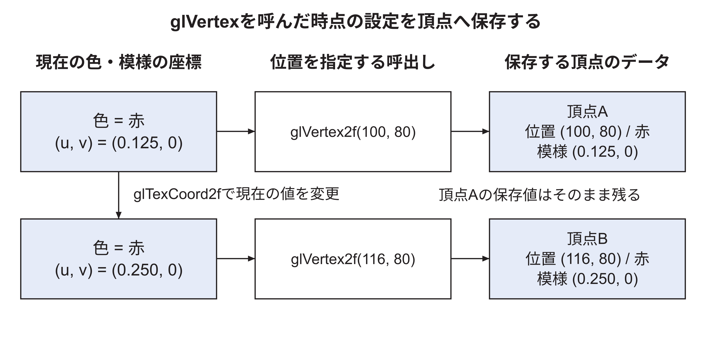

このため、`glColor`を一度呼んだ後に四個の頂点を渡せば、四個ともその色を持つ。頂点を渡す途中で色を変えれば、頂点ごとに異なる色を持てる。滑らかに色を補間する設定では、その色から三角形内部の色が計算される。何かを「関連付ける」という説明の中身は、このように値を一つの頂点のデータへまとめる処理である。

実際の保存処理は、公式RasterIXの`VertexQueue`と`glVertex2f`の実装で確認できる。四個の頂点をそろえて三角形へ組み立てる処理は`PrimitiveAssembler`にある。これらはCPU上で実行する処理であり、頂点を受け取った瞬間に表示端子の色が変わるわけではない。[RasterIX26](../references.md#ref_rasterix26)

<a id="s_graphics_38_16"></a>
## 38.16 設定の変更と描画の開始と完了を分けて読む

`glEnable(GL_TEXTURE_2D)`は、以後の描画でテクスチャを使う状態にする。`glBindTexture`は、どのテクスチャを使うかを選ぶ。`glTexImage2D`は、そのテクスチャに使う画像の内容を登録する。似た名前が続いても、選択する操作と画像を与える操作の役割を分けて読むと、コードを理解しやすくなる。

`glClearColor`は、描画先を消すときの色を指定する。`glClear(GL_COLOR_BUFFER_BIT)`で、その色による初期化を依頼する。前者だけでは画像が消えない。壁や文字を描いた後で全体を初期化すると、それまでの絵が消えてしまうため、描く順序にも意味がある。

`glEnd`は`glBegin`から始めた頂点の指定を終える操作である。描画回路が全画素を書き終えたか、表示する画像が切り替わったかは、この関数の名前から判断できない。本ゲームでは、アプリケーション、RasterIXの描画処理、接続クラスが画像の完成と表示先の切替えを連携させる。[40.23節](framebuffer-display.md#s_graphics_40_23)で、送信、描画、表示の時点を整理する。

一般的なOpenGLの`glFlush`と`glFinish`にも、処理を進める要求と完了を待つ役割の違いがある。ただし、関数がライブラリに存在することだけで、その実装がすべての完了条件を満たすと推定しない。本研究の動作確認は、実際に利用した接続処理と回路の完了通知を根拠にする。説明対象のAPIと呼出し経路は[描画コード](https://github.com/SoshiroFujimori/wally-game-console/blob/ed6a1c09b34d597dcde92ec26a4f5a97cbf18a17/examples/rasterix/BreakoutRenderer.hpp)から確認できる。

<a id="s_graphics_38_17"></a>
## 38.17 VBOとコマンドバッファとDMAが指すもの

VBOはVertex Buffer Objectの略で、頂点の位置や色などを、まとめたデータとして登録し、描画時に参照するための仕組みである。例えば四角形の四頂点を配列に入れ、その配列を繰り返し使う。頂点ごとに関数を呼ぶ方式と比べて、入力の渡し方が変わる。

コマンドバッファには、描画装置へ何を実行させるかという命令列を置く。例えば描画設定の変更、三角形の処理、画像の転送などの指示が並ぶ。VBOには図形の材料となる頂点を置き、コマンドバッファには装置へ依頼する仕事を置く。どちらもメモリを使うが、保存している値の意味を見れば区別できる。

DMAはDirect Memory Accessの略で、CPUが一語ずつ転送する代わりに、転送回路がメモリとのデータの移動を進める仕組みを指す。したがって、VBOを使うこと、コマンドバッファを作ること、DMAで転送することは、一つの機能を三通りに呼んでいるわけではない。

| 着目するもの | 問い | 今回の通常構成 |
|---|---|---|
| 頂点の渡し方 | 四角形の位置をどう登録するか | `glBegin`と`glVertex2f`などで渡す |
| 命令の準備 | 回路へ依頼する仕事をどこへ並べるか | CPU側のメモリへ命令列を作る |
| 命令の転送 | 誰が回路の入口へ語を書き込むか | CPUがMMIOへ書き込む |
| 画像の転送 | 誰がDDRへ画像を読み書きするか | RasterIXや表示回路のメモリアクセス回路 |

使用版のRasterIXにもVBOのAPIがあるが、その実装はCPU側にデータを確保する。公式READMEは、このドライバのVBOを主に互換性のための機能として説明している。VBOへ変えるだけで頂点の計算がFPGAへ移るとは言えない。本ゲームについてVBO方式との比較測定は行っていないので、速さを断定する根拠にはしない。[RasterIX26](../references.md#ref_rasterix26)

<a id="s_graphics_38_18"></a>
## 38.18 シェーダーと固定機能をどう説明するか

シェーダーは、頂点や画素候補などに対して実行する計算を、プログラムとして指定する仕組みである。例えば「テクスチャから色を読み、赤成分だけ半分にする」という計算を画素用のプログラムへ書く。一般的なGPUでは、そのプログラムを多くの頂点や画素候補について実行する。

本構成では、用意された描画回路へ設定値を渡す。文字の色を変えるなら頂点色を変え、色を混ぜるなら合成係数を指定する。任意のGLSLプログラムを受け取って実行する回路は使っていない。GLSLはOpenGL Shading Languageの略で、シェーダーを記述する言語である。C/C++のゲームをRISC-V用にコンパイルする工程と、GLSLをGPU向けに処理する工程を混同しないようにする。

「現在のOpenGLと書き方が違う」と質問されたときは、従来型の固定機能APIを実装したRasterIXを対象にしている、と説明できる。今回使う`GL_QUADS`や`glBegin`は、この実装で使用する関数と指定である。現代のOpenGL core profileへそのまま移植できるコードとして提示しているものではない。

<a id="s_opengl_38_19"></a>
## 38.19 今回のゲームのOpenGLコードを図で読む

ここからは、ブロック崩しの描画プログラムを、赤いブロック一個と文字Aを例にして読む。関数名を覚えるだけでなく、関数へ渡す値がどこに保存され、その値が画面の位置や色へどうつながるかを確かめる。説明対象は、製品コミット`ed6a1c09b34d597dcde92ec26a4f5a97cbf18a17`の`examples/rasterix/BreakoutRenderer.hpp`と`breakout.cpp`である。呼出しの統合や変更領域の描画といった最適化は33章で扱う。

まず、描画前のデータを確認する。ゲーム側の`scene(game)`は、画面に置きたい四角形の一覧`rects`と、文字の一覧`glyphs`を作る。四角形一個には位置、大きさ、色を保存する。文字一個には文字コード、位置、拡大率、色を保存する。この段階で保存するのは物体の情報であり、640×480個の画素を塗り終えた画像ではない。

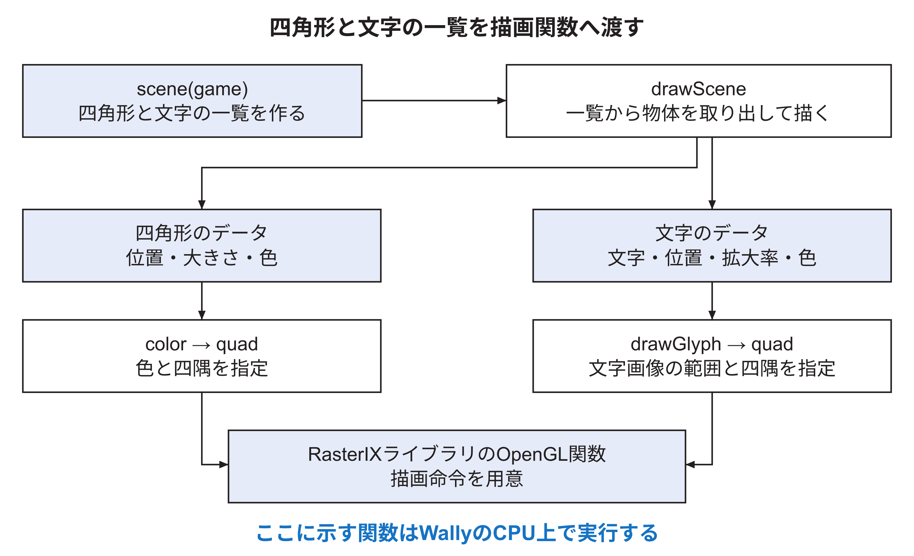

図38.4の上から下へ読む。`drawScene`は一覧に入っている物体を順に取り出す。単色の四角形なら、`color`が色を指定し、`quad`が四隅の座標を渡す。文字なら、`drawGlyph`が文字画像の参照範囲を求め、同じ`quad`へ渡す。これらの関数をWallyが実行する。OpenGL関数の実装は、公式RasterIXのソフトウェアライブラリにある。

| 実装を読む場所 | この説明で追う仕事 |
|---|---|
| `Breakout.hpp`の`scene` | ブロック、壁、パドル、ボール、文字の一覧を作る |
| `BreakoutRenderer.hpp`のコンストラクタ | 座標の対応と描画の設定を用意し、文字画像を登録する |
| 同ファイルの`drawScene`、`color`、`quad` | 一覧の物体をOpenGLへ渡す |
| 同ファイルの`createFont`、`drawGlyph` | 文字の模様を作り、使う区画を選ぶ |
| `breakout.cpp`の`present` | 描画を依頼し、命令の提出と表示先切替えの確認を行う |

以下の短いコードは、これらの関数から関係する呼出しを取り出し、変数を具体的な値へ置き換えた説明用の抜粋である。各例の前で、必要な描画設定を示す。一つの例を、そのまま単独で動くプログラム全体としては扱わない。[BreakoutGL26](../references.md#ref_breakoutgl26)

<a id="s_opengl_38_20"></a>
## 38.20 最初に用意する描画の設定

`Renderer`を作ると、コンストラクタが一度実行される。ここで、ゲームの座標を画面へ対応させ、今回は使わない描画機能を無効にし、文字の模様を登録する。次は座標設定の実際の呼出しを数値で示したものである。

```cpp
glViewport(0, 0, 640, 480);
glMatrixMode(GL_PROJECTION);
glLoadIdentity();
glOrtho(0, 640, 480, 0, -1, 1);
glMatrixMode(GL_MODELVIEW);
glLoadIdentity();
glTranslatef(-0.5f, 0.5f, 0.0f);
glDisable(GL_DEPTH_TEST);
glDisable(GL_CULL_FACE);
glDisable(GL_LIGHTING);
```

`glMatrixMode`は、これから操作する座標変換の設定を選ぶ。`GL_PROJECTION`は描画する範囲の対応、`GL_MODELVIEW`は物体の座標などの変換に使う。`glLoadIdentity`は、選んだ設定を「座標をそのまま通す変換」へ戻す。その後で`glOrtho`や`glTranslatef`を呼び、必要な変換を組み合わせる。行列の全要素を先に暗記するより、どの設定を選んでから、どの対応を指定するかを追うとコードの順序が分かる。

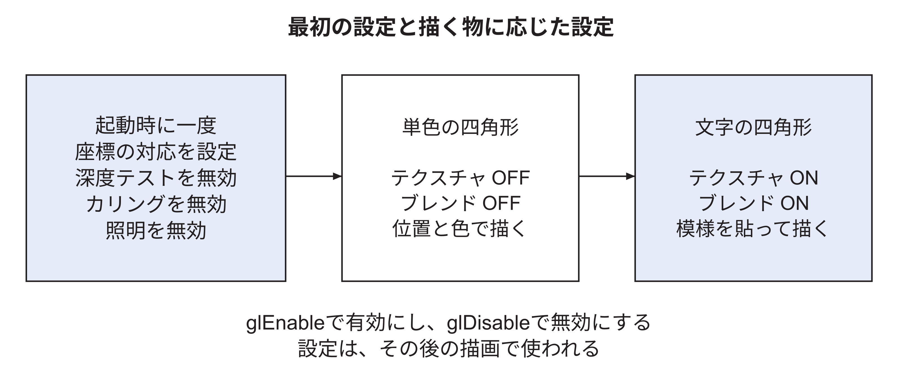

`glDisable`は、その名前の機能を使わない設定にする。深度テストは奥行きによる採否、カリングは図形の表裏による除外、ライティングは照明による色の計算である。本ゲームでは、2Dの位置と指定色を用いて描くので、これらを無効にしている。四角形を描くときはテクスチャとブレンドを無効にし、文字を描くときに有効にする。この切替えは`drawScene`に書かれている。

<a id="s_opengl_38_21"></a>
## 38.21 ゲームの座標を画面上の場所へ対応させる

画面の横幅は640、縦幅は480画素である。ゲームでは左上を原点とし、右へ進むほどx、下へ進むほどyを大きくする。`glOrtho(0,640,480,0,-1,1)`の最初の四つの引数は、左、右、下、上の境界である。下を480、上を0にしているため、このゲームで使うyは下向きに増える。

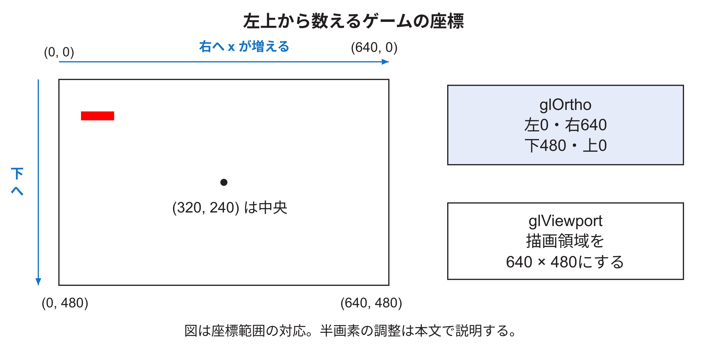

`glViewport(0,0,640,480)`は、変換後の図形を置く描画領域を指定する。図38.6では、座標の範囲の対応を示す。例えば(320,240)は中央で、xを10増やすと右へ10、yを10増やすと下へ10進む。右端640と下端480は境界の位置を表し、最後の画素の番号はそれぞれ639と479である。

実装には`glTranslatef(-0.5f,0.5f,0)`もある。これは使用版の描画回路が画素の内外を判定する位置へ合わせる半画素の調整で、`GL_MODELVIEW`に設定される。図のゲーム座標の意味は保ったまま、描画処理へ渡す座標を調整する。この一行も実装の一部である。境界の画素まで計算する場合の説明は[39.14〜39.15節](rasterization.md#s_app_39_14)にある。

<a id="s_opengl_38_22"></a>
## 38.22 背景の色を指定して描画先を初期化する

黒い背景の準備には、次の二つの呼出しを使う。

```cpp
glClearColor(0, 0, 0, 1);
glClear(GL_COLOR_BUFFER_BIT);
```

`glClearColor`の四つの値は、赤、緑、青、alphaの順である。ここでは0〜1で指定し、RGBがすべて0なので黒となる。最後の1は完全不透明を表す。この関数は、初期化に使う色を設定する。

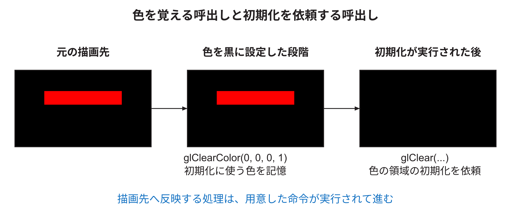

`glClear`は、設定した色で描画先を初期化する処理を依頼する。`GL_COLOR_BUFFER_BIT`は、色を保存する領域を対象にする指定である。図38.7では、色を覚えた段階と、黒い画像を作る処理を依頼した段階を分けている。描画回路への送信と表示までの流れは[38.32節](#s_opengl_38_32)で追う。今回の実装は起動時などに全体を初期化する。毎回必ずこの二行を呼んでいるという説明ではない。

<a id="s_opengl_38_23"></a>
## 38.23 赤いブロック一個を四隅で指定する

最上段の左端のブロックは、左上(44,76)、幅62、高さ18である。右端は44+62=106、下端は76+18=94になる。テクスチャとブレンドを無効にした状態で、この一個の指定を展開すると次のようになる。

```cpp
glBegin(GL_QUADS);
glColor4ub(255, 0, 0, 255);
glVertex2f(44, 76);
glVertex2f(106, 76);
glVertex2f(106, 94);
glVertex2f(44, 94);
glEnd();
```

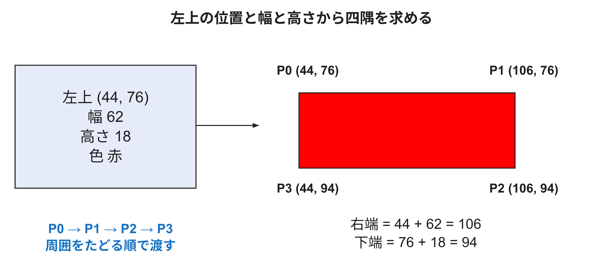

`GL_QUADS`は、四つずつの頂点を一つの四角形として扱う指定である。上のコードでは左上、右上、右下、左下の順に周囲をたどる。[GLBegin21](../references.md#ref_glbegin21) `glVertex2f`の2は二つの座標、fは浮動小数点の引数を表す。この呼出しでは省かれたzを0、wを1とする。[GLVertex21](../references.md#ref_glvertex21)

`glColor4ub`の4はRGBAの四成分、ubは符号なし1バイトの引数を表す。RGBが(255,0,0)なので赤で、alphaが255なので完全不透明である。実装の`color`は`0xff0000`のようにまとめた色からRGBを取り出して、この関数へ渡す。`glEnd`で頂点の指定を終える。これだけで表示まで終わったと判断するのではなく、後で命令を提出する。

実装の`quad`は四隅ごとに`glTexCoord2f`も呼ぶ。単色図形ではテクスチャ機能を無効にしているので、ここでは位置と色に着目してその行を省いた。文字を描く場合には、このテクスチャ座標が必要になる。

<a id="s_opengl_38_24"></a>
## 38.24 指定した色が四つの頂点に付くまで

`glColor4ub`は、ライブラリが覚える「現在の色」を変更する。続いて`glVertex2f`を呼ぶと、その時点の位置と色が一つの頂点として記録される。同じ赤を指定したまま四頂点を渡せば、四頂点とも赤になる。

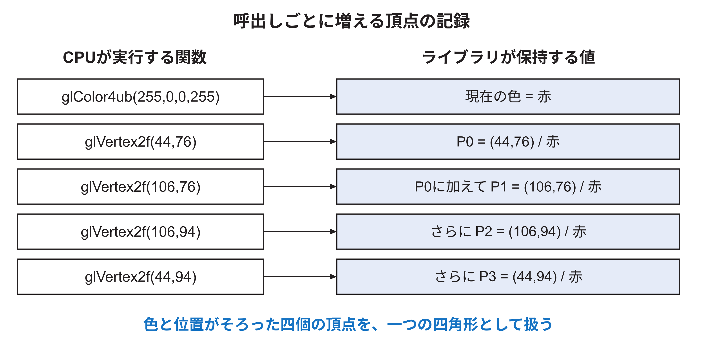

図38.9では、呼出し一回ごとに頂点の一覧が増える。色を指定した直後には位置がまだないため、どの場所の四角形かは決まっていない。位置を四回渡して初めて、四角形の四隅がそろう。後で現在の色を青へ変えても、すでに記録した四頂点の赤を一括して青へ変える操作にはならない。新しく渡す頂点へ青が付く。

ライブラリは四角形を三角形へ組み立てる。回路側では、その三角形が覆う画素位置を求め、画素の色を計算する。図38.10の対角線は、四角形を二枚の三角形として表せることを説明する線である。ゲーム画面へ黒い対角線を描く指示を追加しているわけではない。

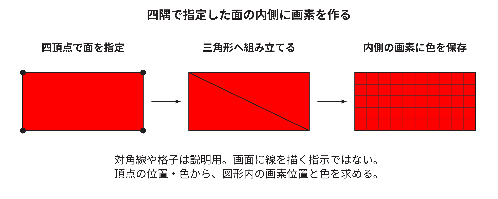

このように図形から画素位置を求める処理をラスタライズと呼ぶ。三角形の内部で色やテクスチャ座標を求める処理を補間と呼ぶ。赤い四角形では各頂点が同じ赤なので、内部も赤になる。文字では、四隅のテクスチャ座標から内部で参照する位置を求める。図は処理の意味を示し、境界画素の厳密な判定規則は39章で扱う。

<a id="s_opengl_38_25"></a>
## 38.25 文字Aの模様を画素の配列へ入れる

文字を描く準備は`createFont`が行う。文字Aの模様は、横5、縦7の点で定義されている。実装の七つの行の値は`14,17,17,31,17,17,17`である。例えば14を5ビットで書くと`01110`となり、その行の中央三点が文字の線になる。

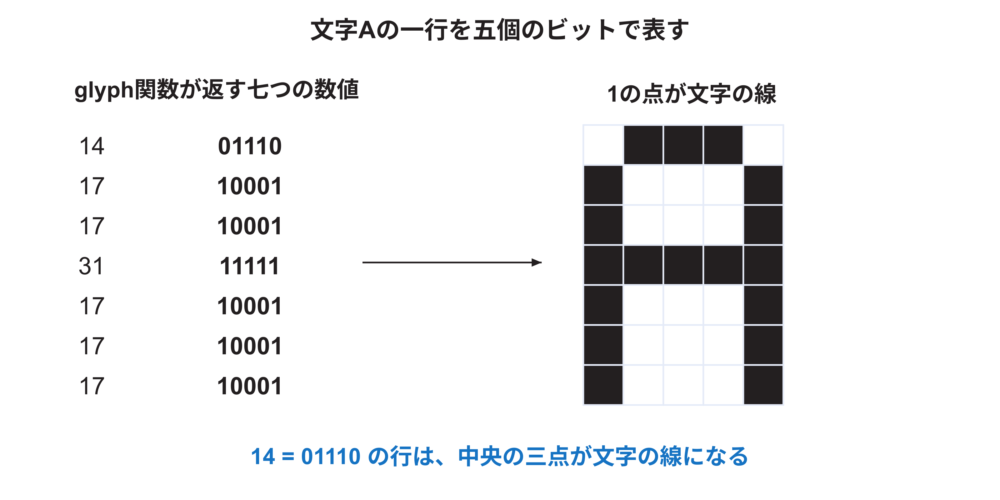

この点の模様を、8×8の区画へ入れる。区画の余った場所には文字の線を置かない。CPUが用意する画像配列では、一つの点ごとにR、G、B、Aの四つの値を保存する。RGBはすべて255の白とし、文字の線がある点だけAを255にする。それ以外の点のAは0にする。したがって、画像には白い文字と、その周囲の透明な部分が入る。

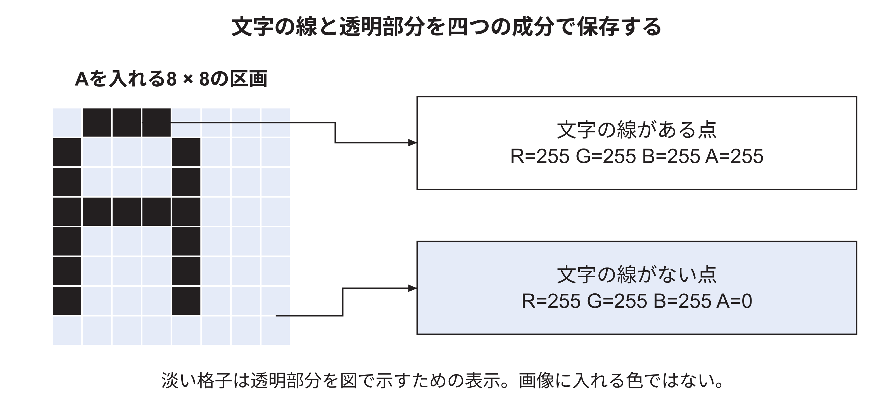

図38.12では、文字の線がある点を黒で目立たせ、その点に保存する数値を右側に書いた。保存するRGBは白の(255,255,255)である。淡い格子は、透明な場所を紙の上で見分けるための表現である。Aが0の場所で背景を残す計算は[38.31節](#s_opengl_38_31)で説明する。

<a id="s_opengl_38_26"></a>
## 38.26 複数の文字を一枚の画像へ並べる

`createFont`は、横64、縦32の画像を作る。8×8の区画を横に8個、縦に4個並べられるので、最大32文字分の場所がある。実装は、必要な文字を文字列`" 0123456789ABCDEGIKLMORSTUVWY"`の順に配置する。先頭の空白が区画0、数字0が区画1、文字Aが区画11である。

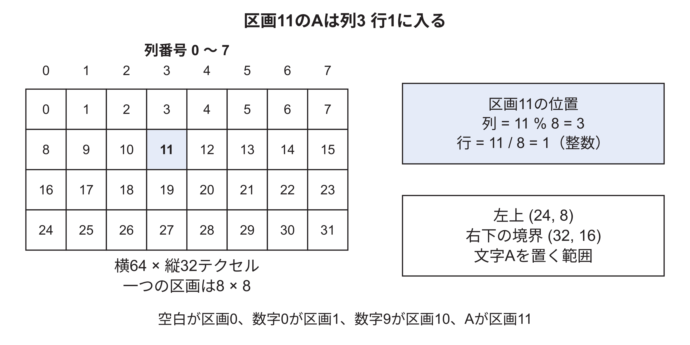

区画11を横8個の並びに置くと、列は11を8で割った余りの3、行は整数で割った1になる。区画の左上は(3×8,1×8)=(24,8)、右下の境界は(32,16)である。`slots`という配列は、文字コードを受け取り、この区画番号を調べるために使う。画面にAを描くときは、文字画像を作り直すのではなく、この区画の位置を選ぶ。

<a id="s_opengl_38_27"></a>
## 38.27 テクスチャの番号と画像データを登録する

画像をOpenGLへ登録する部分には、三つの役割がある。

```cpp
glGenTextures(1, &font);
glBindTexture(GL_TEXTURE_2D, font);
glTexImage2D(GL_TEXTURE_2D, 0, GL_RGBA, 64, 32, 0,
             GL_RGBA, GL_UNSIGNED_BYTE, pixels.data());
```

`glGenTextures`は、画像を識別する番号を一つ得て、変数`font`へ入れる。`glBindTexture`は、その番号の画像を、これから操作する対象にする。`glTexImage2D`は、選んだ画像へ大きさや画素配列を渡す。番号は画像を選ぶための識別子で、CPUの画素配列のアドレスやDDRの保存番地そのものではない。

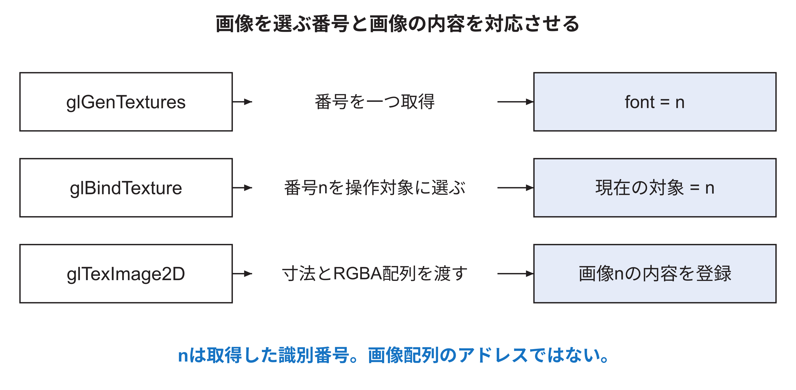

配列`pixels`には64×32×4=8,192バイトがある。`GL_RGBA`と`GL_UNSIGNED_BYTE`は、入力配列がRGBAの順で各成分1バイトであることを伝える。使用版のRasterIXはこの入力をRGBA4444へ変換するので、登録後の画像データは4,096バイトとなる。各成分4ビットで、完全透明と完全不透明は0と15で表される。[GLTexImage](../references.md#ref_glteximage) この内部形式の対応は[52.18節](textures-pixel-pipeline.md#s_graphics_52_18)で詳しく追える。

`glBindTexture`だけでは、画面へ文字が現れない。どの画像を使うかが決まった段階であり、続いて画面上の四角形と、そこへ貼る画像内の範囲を指定する。

<a id="s_opengl_38_28"></a>
## 38.28 画像のAを画面上の四角形へ対応させる

画面上の位置にはx、yを使い、画像内の参照位置にはu、vを使う。このゲームでは、画像全体の横幅64、縦幅32をそれぞれ1としてu、vを表す。Aの左端は24/64=0.375、右端は32/64=0.5、上端は8/32=0.25、下端は16/32=0.5となる。

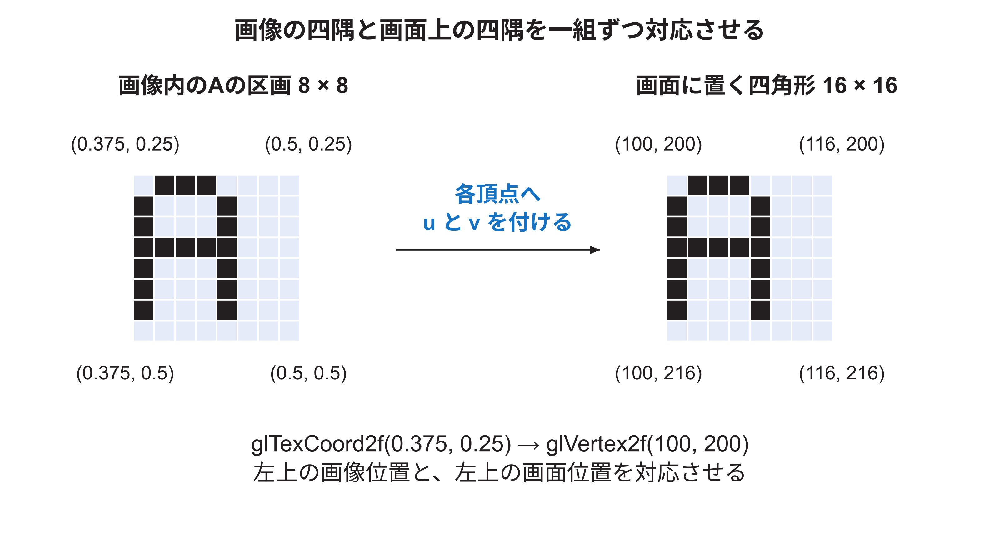

例えばAを画面の左上(100,200)へ拡大率2で描く。8×8の区画を16×16の四角形へ貼るので、右下は(116,216)になる。テクスチャを有効にし、`font`を選んだうえで、次の値を渡す。

```cpp
glBegin(GL_QUADS);
glTexCoord2f(0.375f, 0.25f); glVertex2f(100, 200);
glTexCoord2f(0.500f, 0.25f); glVertex2f(116, 200);
glTexCoord2f(0.500f, 0.50f); glVertex2f(116, 216);
glTexCoord2f(0.375f, 0.50f); glVertex2f(100, 216);
glEnd();
```

各行の前半で現在の画像座標を設定し、後半で画面上の位置を持つ頂点を記録する。その頂点には、その時点のu、vも一緒に付く。例えば一行目は「画面の(100,200)に、画像の(0.375,0.25)を対応させる」という指定である。Aを右へ移動したいなら画面座標のxを変える。別の文字を描きたいなら、その文字の区画に合わせてu、vを変える。

<a id="s_opengl_38_29"></a>
## 38.29 四隅の間で画像のどこを参照するか

四隅の対応を渡すと、図形の内部で参照するu、vは描画処理が求める。図38.16では四角形の幅を0〜1の割合で表している。横方向の中央では、左のu=0.375と右のu=0.5の中間である0.4375になる。縦方向の中央ではv=0.375になる。この二つを合わせると、Aの区画の中央に対応する。

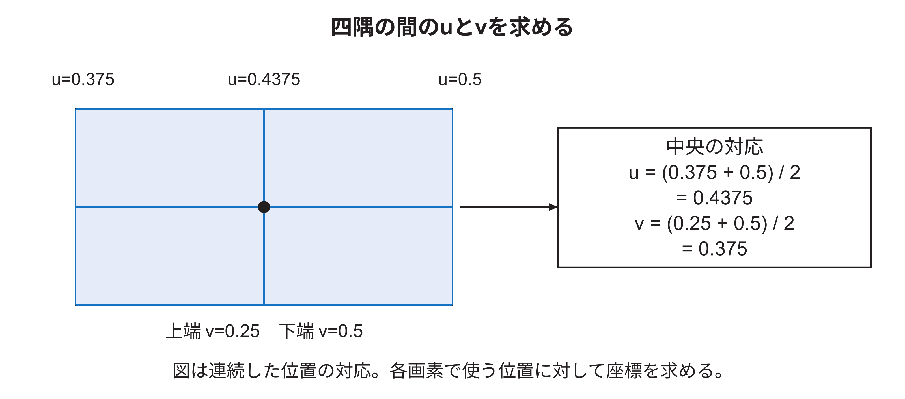

この例では、四隅が同じ平面にあり、直交投影を使っているため、横と縦の割合をそのまま補間できる。四角形の中の一画素ごとにCPUが`glTexCoord2f`を呼ぶ必要はない。各画素位置の参照座標を求め、文字画像から色とalphaを読む仕事を描画処理が行う。実際の画素でどの位置を判定点にするかは座標の調整にも関係するので、図38.16は連続した位置の対応を示している。

<a id="s_opengl_38_30"></a>
## 38.30 文字を拡大したときに使う点を選ぶ

テクスチャの点をテクセルと呼ぶ。画像座標からテクセルの色を得る処理がサンプリングである。本ゲームの`createFont`は、拡大と縮小の両方に`GL_NEAREST`を設定する。

```cpp
glTexParameteri(GL_TEXTURE_2D, GL_TEXTURE_MIN_FILTER, GL_NEAREST);
glTexParameteri(GL_TEXTURE_2D, GL_TEXTURE_MAG_FILTER, GL_NEAREST);
glTexParameteri(GL_TEXTURE_2D, GL_TEXTURE_WRAP_S, GL_CLAMP_TO_EDGE);
glTexParameteri(GL_TEXTURE_2D, GL_TEXTURE_WRAP_T, GL_CLAMP_TO_EDGE);
```

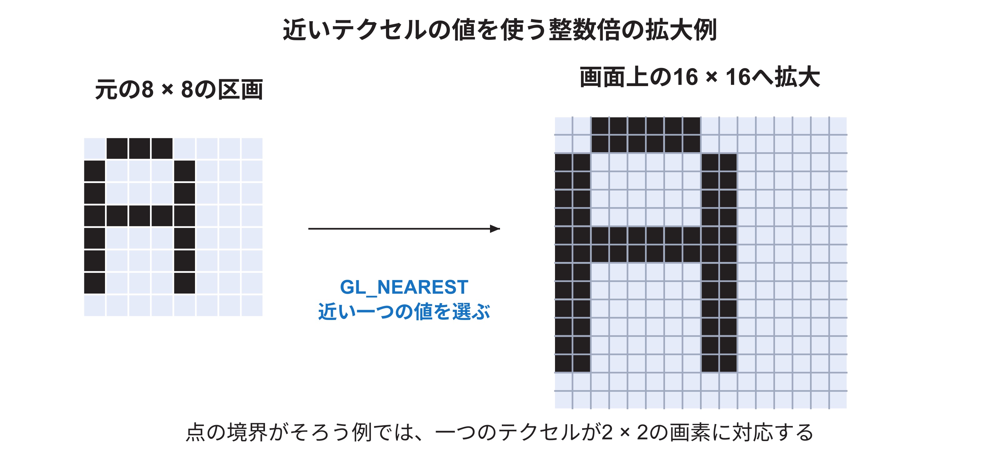

`MIN_FILTER`は縮小、`MAG_FILTER`は拡大のときの色の選び方である。`NEAREST`は、参照座標に対応する近いテクセルを一つ選び、その値を使う。図38.17は点の境界がそろう整数倍の拡大例で、一つの点を2×2の画素へ広げる。文字の線と透明部分の間に、新しい中間の色を混ぜて滑らかにする設定にはしていない。[GLTexParameter](../references.md#ref_gltexparameter)

`WRAP_S`と`WRAP_T`は横と縦の画像端の扱いで、ここではu、vに対応する。`CLAMP_TO_EDGE`は画像端を越えた参照を端の値へとどめる設定である。この設定が対象にするのは64×32の画像全体の端であり、Aの8×8区画の境界を自動で切り抜く機能ではない。どの文字を使うかは[38.28節](#s_opengl_38_28)の座標で指定する。

<a id="s_opengl_38_31"></a>
## 38.31 文字の色を決め透明な場所へ背景を残す

`drawGlyph`は、文字の模様を貼る前に`color(item.color)`を呼ぶ。文字の模様のRGBは白なので、白に指定色を掛け合わせると指定色になる。本構成の既定のテクスチャ合成は`MODULATE`である。図38.18では、説明用にRGBを0〜1で表す。

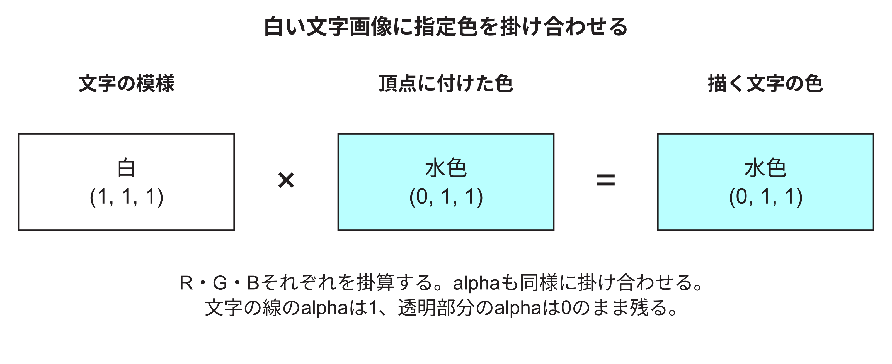

文字の線の点も透明な点もRGBは白である。違うのはalphaで、文字の線が1、周囲が0となる。頂点色のalphaを1にしているので、掛算後もこの区別が残る。続いて、背景へどう重ねるかを決める。

```cpp
glEnable(GL_TEXTURE_2D);
glEnable(GL_BLEND);
glBlendFunc(GL_SRC_ALPHA, GL_ONE_MINUS_SRC_ALPHA);
glBindTexture(GL_TEXTURE_2D, font);
```

`glEnable(GL_BLEND)`で色の合成を有効にする。`glBlendFunc`の二つの引数は、新しく描く文字の色に掛ける係数と、すでに描画先にある色に掛ける係数である。この組合せでは、RGBの各成分を「文字の色×alpha + 背景の色×(1−alpha)」で求める。[GLBlend](../references.md#ref_glblend)

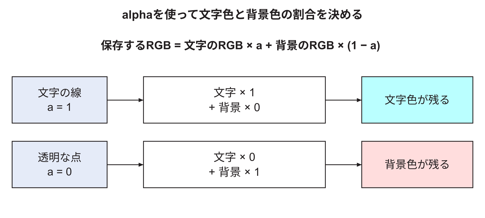

alpha=1の点では背景の係数が0になり、文字の色だけが残る。alpha=0の点では文字の係数が0になり、背景だけが残る。そのため、文字の周りを四角く白で塗りつぶさずに、文字の線だけを描ける。半透明を作る一般的な計算も[53.15節](fragment-tests-blending.md#s_graphics_53_15)にあるが、この文字画像が持つalphaは完全透明と完全不透明である。

このゲームは、先に単色の四角形を描き、次に文字を描く。深度テストを無効にしているので、不透明な文字の点は、その時点で描画先にある色を上書きする。文字の透明な点ではその色が残る。この描く順序も、コードを読む際の一部になる。

<a id="s_opengl_38_32"></a>
## 38.32 図形の指定を終えて画面へ反映する

`breakout.cpp`の`present`では、次の順に処理する。

```cpp
renderer.draw(breakout::scene(game));
const auto previous = bus.frameCount();
gl.swapDisplayList();
bus.waitForFrame(previous);
```

最初の行は、ゲームの状態から図形の一覧を作り、描画関数へ渡す。ここまでに説明した色、頂点、文字の指定が、この中で行われる。二行目は、回路が持つ表示先切替えの完了回数を読む。三行目の`swapDisplayList`はRasterIXライブラリ固有の関数であり、標準OpenGLの関数名ではない。描画結果の保存と表示先切替えの命令を加え、文字画像や命令列の送信処理を進める。

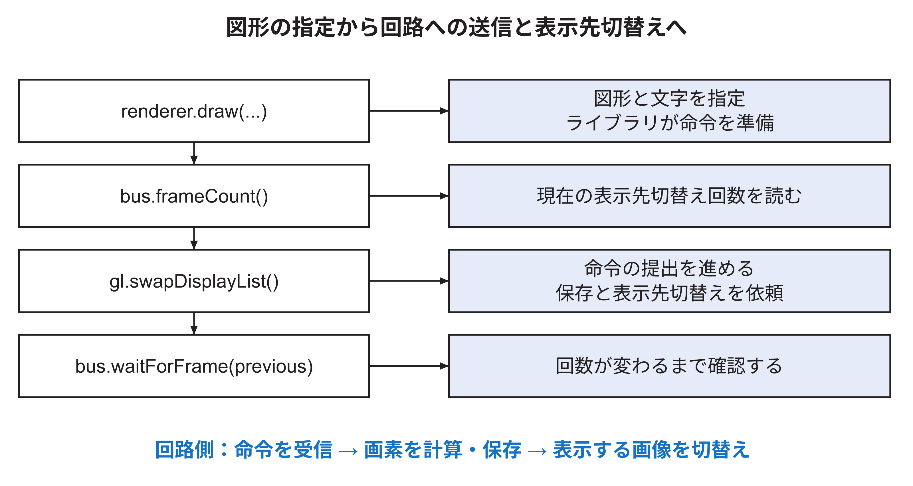

公式ライブラリは、回路へ依頼する処理を数値の列として用意する。Wally用の`WallyBusConnector::writeData`は、その列を32ビットずつ取り出し、MMIOの描画回路向けの窓口へ書く。MMIOは、特定のアドレスへの読み書きで回路を操作する仕組みである。このプログラムの通常構成ではCPUがその書込みを行う。関数呼出しが、回路へ値を渡す処理につながる場所がここにある。

最後の`waitForFrame`は、先ほど読んだ回数から値が変わるまで確認する。表示する画像の切替え完了を確かめてから、次の処理へ進むためである。この回数は表示先切替えの完了を数え、ディスプレイが最後の画素まで見せ終わった回数を直接観測するものではない。回路が画素を計算して画像を保存することと、表示回路が画像を順に読み出すことは、図38.20の後半で対応付ける。各完了時点の詳細は[40.23節](framebuffer-display.md#s_graphics_40_23)にある。

<a id="s_opengl_38_33"></a>
## 38.33 値を変えたときの画面をコードから説明する

次の問いは、実機を変更せずにコードを読んで確かめられる。初めは前の図へ戻りながら説明してよい。

| 画面で変えたいもの | コードで変える値 | その値が使われる場所 |
|---|---|---|
| ブロックを右へ10移動する | 四頂点のxへ10を足す | `quad`が渡す画面上の位置 |
| ブロックを横に広げる | 幅を増やす | 右側二頂点のx |
| 赤いブロックを緑にする | RGBを(0,255,0)へ変える | `glColor4ub`で指定する現在の色 |
| Aを右へ移動する | 文字のxを増やす | `glVertex2f`へ渡す位置 |
| AをBへ変える | Bの区画番号からu、vを求める | `glTexCoord2f`へ渡す画像内の位置 |
| Aを大きくする | `scale`を増やす | 画面側の四角形の幅と高さ |
| Aを水色から赤へ変える | 文字の指定色を赤にする | 白い模様へ掛け合わせる色 |

例えばAを大きくする場合も、元の模様として選ぶ8×8の区画は同じである。変わるのは、その模様を画面上のどれだけ広い四角形へ対応させるかである。AをBへ変える場合は、画面上の四角形を同じままにして、画像内の参照範囲を変えられる。この二つを図38.15へ戻って指し示せれば、文字描画の二組の座標を説明できる。

ここで扱った呼出しは、RasterIXの従来型の固定機能APIを利用する。任意のGLSLシェーダーを書く工程は、このゲームにはない。使っている関数とデータの流れを確認した後、実装の内部まで追う場合は、[38.14～38.18節](#s_graphics_38_14)、39章、52～53章へ進める。
<!-- appendix-content:end -->

---

[前：第37章 白い四角形を一つ表示するまで](walkthrough.md) ｜ [次：第39章 三角形から画素と色を求める計算](rasterization.md)
