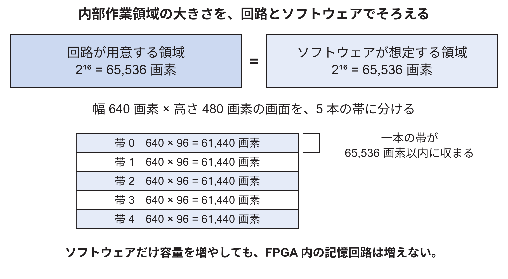
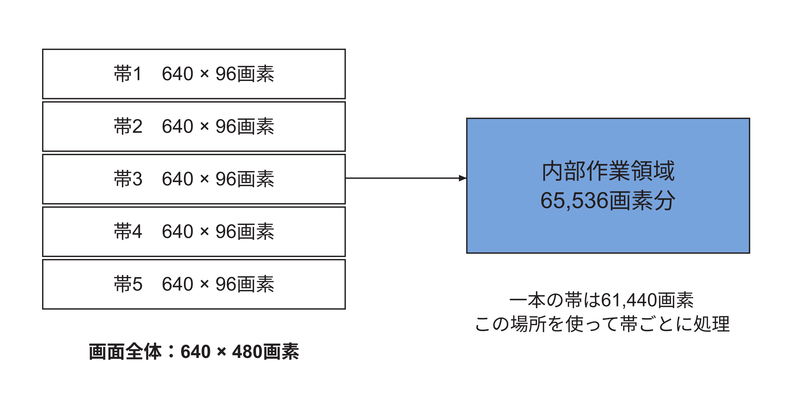
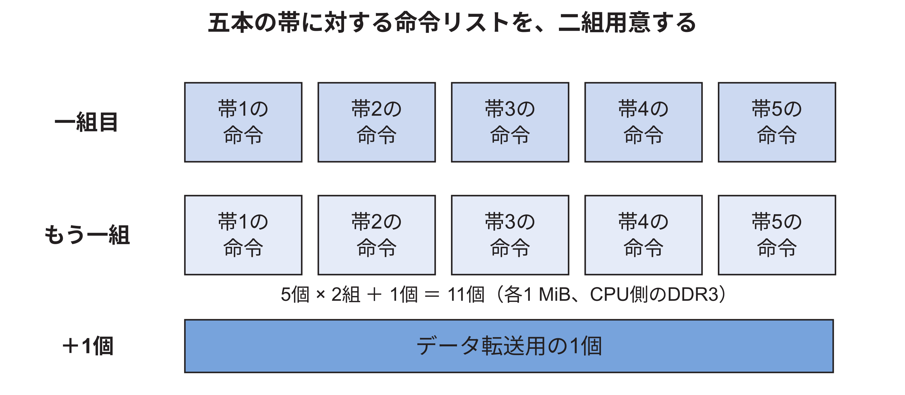
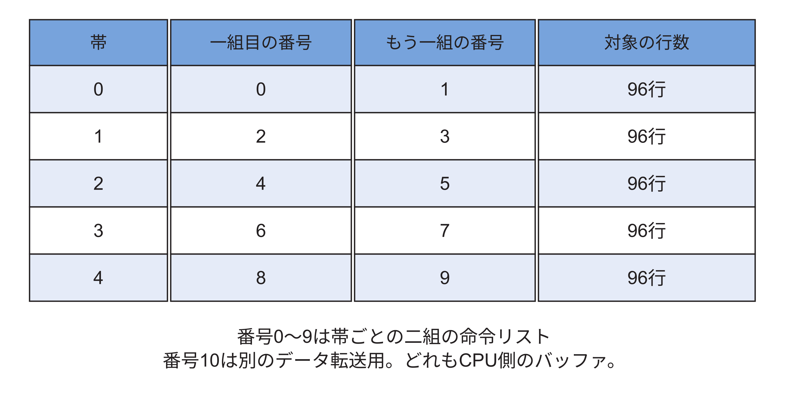

<!-- appendix-content:start -->

# 第43章 設定を変えるための計算と設計判断
<!-- appendix-content:end -->

[付録の総目次](../../技術付録.md) ｜ [論文本文](../../本文.md) ｜ [参考文献](../references.md)

[第IV部 RasterIXと描画システム](README.md)

ファイルパスの表記は、[資料フォルダー](../../README.md)を基準とする。

## このページの目次

- [43.1 内部作業領域を増やす案を計算する](#s_h_1)
- [43.2 画面の大きさを変えるときの落とし穴](#s_h_2)
- [43.3 CPUを速くしたいときに一緒に見る場所](#s_h_3)
- [43.4 アドレスを変える場合の三者の一致](#s_h_4)
- [43.5 理解できたかを確認する課題と解答](#s_h_5)
- [43.6 RasterIX_IFを使う意味](#s_app_43_6)
- [43.7 回路とソフトウェアでそろえる値](#s_app_43_7)
- [43.8 五本の帯に分ける計算](#s_app_43_8)
  - [帯を処理しても画面に横線が残るわけではない](#h2018)
  - [作業領域を使い回すと、ボールのどの部分が残るか](#h2022)
- [43.9 五本の帯の命令リストを二組用意する](#s_app_43_9)
- [43.10 五本の帯の処理を実際の配列へ対応させる](#s_app_43_10)

<!-- appendix-content:start -->
内部画像メモリを大きくする場合、増えるのは保存できる画素数だけではない。画面を分ける帯の数や、CPUが用意する命令リストの数も変わる。この章では設定値から計算できる量を求め、その計算だけでは決まらない資源使用量や速度を区別する。

## 43.1 内部作業領域を増やす案を計算する

現在の内部作業領域は2の16乗で65,536画素である。これを2の17乗、131,072画素へ増やす案を考える。307,200画素の画面を収めるために必要な帯は切り上げて3本、各帯は480÷3=160行となる。一帯は102,400画素で、131,072画素に収まる。コネクタのバッファ数は2×3+1=7個になる。

| 項目 | 現構成LG=16 | 検討例LG=17 |
|---|---:|---:|
| 内部作業領域 | 65,536画素 | 131,072画素 |
| 必要な帯数 | 5 | 3 |
| 一帯の高さ | 96行 | 160行 |
| 一帯の画素数 | 61,440 | 102,400 |
| コネクタの1 MiBバッファ | 11個 | 7個 |

この表はコードと寸法から求めた計算値である。内部メモリを増やせばFPGA内の資源が必要になる。命令の準備量が減る可能性があっても、配置配線の混雑や周波数の条件が変わるため、速くなることまではこの表だけで分からない。接続比較版を用いて容量17の回路を実装し、画像と性能を比較した実験結果は[72.17節](../05-integration/command-dma-comparison.md#s_30_17)に示す。計算による予想と実機の結果を対応付けて読む。

変更する場合は、RTLの`FRAMEBUFFER_SIZE_IN_PIXEL_LG`とCMakeの`RIX_CORE_FRAMEBUFFER_SIZE_IN_PIXEL_LG`を一致させる。片方だけ変えると、ソフトウェアが一帯に描けると思う画素数と、実際の内部メモリの容量が食い違う。回路生成後にはBRAMの合計、階層別使用量、タイミングを調べ、同じ画像と状態列で速度を比較する。[RasterIX](../references.md#ref_rasterix)[Console26](../references.md#ref_console26)

## 43.2 画面の大きさを変えるときの落とし穴

640×480を320×240へ変える案では、76,800画素なのでLG=16の内部作業領域でも2本の帯が必要になる。一帯は120行で38,400画素になる。これだけを計算して「解像度変更は終わり」としてはいけない。描画の寸法、表示回路の寸法、画素クロック、フレームバッファの行の幅、ゲームの座標が一致する必要がある。

例えば表示回路が引き続き一行640画素を読むのに、ソフトウェアが一行320画素分だけ保存すると、表示側は隣の行を続けて読んでしまう。これはGPUの描画速度以前に、メモリ中の画像の並び方が合っていない問題である。

また、公式Dispatcherは高さを帯数で整数除算する。別の解像度を選ぶ場合、最後の帯をどう扱うかを実装から確かめる必要がある。本構成の480行は5で割り切れるが、すべての高さがそうなるわけではない。「画素数が内部容量以下に分割できる」という計算だけでは、すべての行を扱える保証にはならない。[RasterIX](../references.md#ref_rasterix)

図43.1は、横320と640の違いを、見やすい横4と8の違いに置き換えた模式図である。画素の番号0〜7がメモリに順に並ぶ点は同じだが、どこまでを一行と数えるかが異なる。

保存側が4画素で次の行へ進んだつもりでも、表示側が8画素を一行として読むと、元の二行を一行につなげてしまう。先頭アドレスが正しくても、行を進める幅が一致しなければ画像は崩れる。このため解像度の変更では、描画側と表示側の両方を確認する。

## 43.3 CPUを速くしたいときに一緒に見る場所

CPUを20 MHzから別の周波数へ変える場合、最初に変える対象はMMCMの出力と、そのクロックを使う接続条件である。[技術付録59.5節](../05-integration/board-reproduction.md#s_g_board_reproduction_5)のcreate_clockの例で解析上の周期だけを変えても、基板から来る100 MHzや、CPUへ実際に届くクロックの周期は変わらない。この例のBoardClockという名前を、完成版のXDCに書かれた設定だと解釈しない。本構成の入力クロック制約はClocking Wizardが生成する。実際のクロックを作る設定と、解析へその条件を伝える制約の両方を合わせる必要がある。

さらに、起動用プログラムはSYSTEMCLOCKを使ってUARTやSDの速度を設定する。ここを古い20 MHzのままにすると、回路が動作していてもUARTの通信速度がずれ、文字化けする場合がある。Linuxへ渡すクロック情報、クロック変換IPの条件、CPU領域を含む時間解析もそろえる必要がある。[Console26](../references.md#ref_console26)

新しい周波数でbitstreamが生成できても、時間条件を満たしたとは限らない。まず負の時間余裕や未制約の経路がないか調べ、その後、起動とゲームを確認する。性能を比較するときは、解像度や描画方式を同じにし、クロックを変えたことでどの処理時間が変わったかを見る。

読み終わったら、次の変更を実行せずに考えてみる。CPUを25 MHzにする場合、Makefileの数字だけでなく、クロック生成、時間条件、UART、時刻計数、DTSをどのようにそろえる必要があるか。実物のメモリ容量を変えないままEXT_MEM_RANGEだけ増やしたら何が起こるか。この二つを理由付きで説明できれば、既存設定の写し方だけでなく、設定同士のつながりを理解できている。

## 43.4 アドレスを変える場合の三者の一致

命令ポートの基点を変える場合、回路のEXT_IO_BASE、Linuxへ伝えるdtsのreg、アプリケーションのmmapをそろえる。さらに既存のUARTやSDなどの番地と重ならないか調べる。空いているように見える値を一か所へ書くだけでは、接続先を変更したことにならない。

画像用領域を変える場合は、GRAM_MEMORY_LOC、色・深度・ステンシルのオフセット、予約領域の開始と大きさを対応させる。例えば本設定の色画像の一つは、基点0x9e000000とオフセット0x01e00000を足して0x9fe00000となる。オフセットをすでに物理アドレスだと思って渡すと、基点を二度加えた誤った値になり得る。

| 値の種類 | 現構成の例 | 意味 |
|---|---|---|
| I/Oの物理アドレス | 0x10080000 | 命令レジスタがある場所 |
| GPU用メモリの基点 | 0x9e000000 | 予約領域の開始 |
| 色画像のオフセット | 0x01e00000 | 予約領域の開始からの距離 |
| 色画像の物理アドレス | 0x9fe00000 | CPU側の番地として表す画像位置 |
| DDR3内のオフセット | 0x1fe00000 | DDR3先頭0x80000000からの距離 |

これらの値はすべて「アドレスに関係する数」だが、基準にする開始位置が違う。設計を変更するときは、変数名だけでなく、どこから測った値なのかを式で確認する。

図43.3では、画像Aの物理アドレス0x9fe00000を固定し、二つの先頭からの距離を別々に計算する。下段の値は、画像が二か所に複製されたことを意味しない。同じ場所を異なる基準から数えている。

DDR3制御側へ渡す距離なら0x80000000を基準とし、描画用領域の先頭からの画像オフセットなら0x9e000000を基準とする。どちらもオフセットと呼ばれるため、変数名だけで判断せず、何の先頭を加え戻すと物理アドレスになるかを確認する。

## 43.5 理解できたかを確認する課題と解答

課題1は、32 bitの最後の一語を送るとき、regsの添字と物理アドレスを答えることである。解答は添字1、0x10080004である。根拠は、uint32_t一要素が4 byteで、CMD_LASTが+0x04だからである。CPU自体が64 bitだから添字を8倍する、という計算はしない。

課題2は、FIFOが3クロック満杯で、4番目の立ち上がりで空いた場合、受け取る語数を答えることである。解答は1語である。最初の3回はValidが1でもReadyが0なので受理しない。4回目に両方1となって初めて受理する。同じ語を4回送ったとは数えない。

課題3は、幅640のRGB565画像で(x,y)=(3,2)の画素の位置を計算することである。先頭からの画素番号は2×640+3=1283、byteのオフセットは2566=0x0a06である。画面Aなら0x9fe00a06から2 byteを使う。横座標と縦座標を逆にすると、別の行の画素を書いてしまう。

課題4は、完了回数を読む値が42で、新しい切り替え後に43になったとき、何が分かったかを説明することである。解答は、回路で定めた切り替え完了が一回通知された、である。画像の全画素が正しいことや、ディスプレイの描画が終了したことまでは、この値だけでは分からない。

課題5は、古いボールを黒で消したときに文字の一部まで消えた場合、どの処理を確認するかを答えることである。解答は、変更領域に重なる文字も描き直し対象へ含めたか、元の描画順を守ったか、対象バッファに対応する履歴を使ったか、である。新しいボールだけを描けばよいという方法では、消した文字は復元されない。

課題6は、CPUを速くした後にUARTが文字化けした場合、何を疑うかを答えることである。解答の一つは、起動コードやLinuxが計算に使うクロック値と、実際のCPUクロックが合っていない可能性である。ただし配線や端末設定でも文字化けするため、これだけを原因と断定せず、変更前後の条件を照合する。

答えの数値だけでなく、その値を確認するファイルと信号を指せるかを確かめる。分からなかった項目は、[論文本文第6章](../../本文.md#ch_6)、[第9章](../01-hdl-fpga/clock-reset-crossings.md#ch_6)、[第10章](../01-hdl-fpga/verification-layers.md#ch_7)、[第13章](../02-wally/cpu.md#ch_g_cpu)と[技術付録第33章](../03-linux/game-loop.md#ch_26)・[第42章](rasterix-integration.md#ch_g)・[第59章](../05-integration/board-reproduction.md#ch_g_board_reproduction)へ戻る。単語を言えることより、どこで値が変わり、どこで受け渡しが完了するかを追えることが、同じ接続を設計するための理解になる。

## 43.6 RasterIX_IFを使う意味

例えば、黒い背景の上へ白いボールを重ねる場合を考える。まず画素を黒にし、その後、ボールの内側だけ白へ変える。描画回路は、こうして途中まで作った色を保存しながら、次の図形を重ねる。この描画途中の保存場所を、どこに置くかという選択がIFとEFの違いに関係する。

RasterIXには、作業中の画素をFPGA内部のメモリで扱うIFと、外部メモリで扱うEFという構成がある。[RasterIX](../references.md#ref_rasterix) ここでいう内部と外部は、FPGAチップの内側と外側を指す。

本研究が使うのはRasterIX_IFである。IFの内部作業領域はFPGA内のBRAMを利用する。完成した画像をディスプレイへ送るための保存先は、これとは別に基板上のDDR3へ置く。「IFだから画像を一切DDR3に置かない」という構成ではない。

本構成の内部作業領域は65,536画素分であり、横640、縦480の全307,200画素を一度には置けない。そこで画像を五本の帯に分け、一つの帯を内部で扱ってからDDR3へ保存し、同じ作業領域を次の帯に使う。[43.8節](#s_app_43_8)では、実際に一帯61,440画素になる計算を行う。

一本の帯の作業が終わったら、その色をDDR3へ書き出して残し、内部作業領域を次の帯に使う。既に描いた画像の一部だけを変える場合は、描き直す先に残っている画素をDDR3から内部作業領域へ読み込んでから変更する。古い画像を読み込む処理まで含めた流れは[40.9節](framebuffer-display.md#s_g_framebuffer_display_9)で説明する。これにより、容量の小さい作業領域を使い回しながら、画面の変えていない色を残せる。

この構成で二次元ゲームの動作を確認した。IFとEFの比較は行っていないため、IFが最善とは結論しない。IFの内部作業領域を65,536画素分から131,072画素分へ増やした比較は[72.21節](../05-integration/command-dma-comparison.md#s_app_72_21)に示す。製品を再現する場合は、IFと65,536画素分の設定にそろえる。

## 43.7 回路とソフトウェアでそろえる値

同じ作業領域を、回路が65,536画素だと思い、ソフトウェアが別の大きさだと思って使うと、帯の分け方が一致しない。次の値は、回路側のパラメータとソフトウェア側のCMake設定で対応させる。

| 決めること | 回路側 | ソフトウェア側 |
|---|---|---|
| 作業領域の画素数 | FRAMEBUFFER_SIZE_IN_PIXEL_LG = 16 | RIX_CORE_FRAMEBUFFER_SIZE_IN_PIXEL_LG = 16 |
| テクスチャ処理部の個数 | TMU_COUNT = 1 | RIX_CORE_TMU_COUNT = 1 |
| ゲーム画面 | 表示回路640×480 | MAX_DISPLAY_WIDTH = 640、HEIGHT = 480 |
| 外部メモリの利用範囲 | DDR3へ接続 | GRAM_MEMORY_LOCと各画像のオフセット |

LGの値16は、16画素という意味ではない。2の16乗、すなわち65,536画素を表す。TMUは、画像の模様を参照して図形に貼る処理を担当する部分である。二次元ゲームでも文字用の模様を使うため、テクスチャの処理を利用する。

図43.4では、上段の二つの箱が同じ容量を表すことを確認し、下段でその容量に収まる帯を作る。640×480の画面を高さ96の帯五本に分けると、一帯は61,440画素になる。

回路側のFRAMEBUFFER_SIZE_IN_PIXEL_LGと、ソフトウェア側のRIX_CORE_FRAMEBUFFER_SIZE_IN_PIXEL_LGをともに16とすることで、65,536画素という約束をそろえる。二つの値は別のファイルにあるため、片方の編集だけで両方が自動的に変わるとは考えない。帯の順次処理は[43.8節](#s_app_43_8)で詳しく追う。

テクスチャを転送する際のページサイズも、両側でそろえる。ページは、画像データを分けて扱う際の一単位である。接続比較版では回路側が2,048 byteなので、ソフトウェア側にも`RIX_CORE_TEXTURE_PAGE_SIZE=2048`を指定した。これにより、画像データを何byteずつ分けて扱うかを両側で一致させる。このページサイズは、上で説明した画素用作業領域の容量とは別の設定である。

設定をそろえる意味を、容量の計算で確かめる。仮にソフトウェアだけを131,072画素分へ変えると、高さ160の帯は640×160=102,400画素なので「一度に扱える」と判断する。しかし回路が65,536画素分のままなら、その帯を保存する場所は足りない。これは設定不一致の説明例であり、この条件を製品で動かしたという測定結果ではない。[72.21節](../05-integration/command-dma-comparison.md#s_app_72_21)の容量比較では、この食い違いを避けるため、回路とソフトウェアを同時に変更した。

## 43.8 五本の帯に分ける計算

640×480の画面には307,200画素ある。一方、内部の作業領域は65,536画素分である。307,200 ÷ 65,536は約4.69なので、画面全体を扱うには少なくとも五つの部分が必要になる。

固定した公式版のDisplayListDispatcher.hppでは、必要な分割数を求め、その数で画面の高さを分ける。高さ480は5で割り切れるため、一本の帯は640×96 = 61,440画素になる。これは65,536画素の作業領域に収まる。ここでの分け方は、高さ480を五等分して各帯の高さを96にそろえるものである。

| 帯 | 説明用の画面上の範囲 | 画素数 |
|---|---|---:|
| 1 | 上から0〜95行 | 61,440 |
| 2 | 96〜191行 | 61,440 |
| 3 | 192〜287行 | 61,440 |
| 4 | 288〜383行 | 61,440 |
| 5 | 384〜479行 | 61,440 |

表と図は画面上で範囲を理解するための並べ方である。ライブラリ内部の命令リスト番号は反転して扱う箇所もある。実装を追うときは、画面上の上からの番号と配列の添字を同じと決めつけず、reverseDisplayListIndexを確認する。

### 帯を処理しても画面に横線が残るわけではない

五本に分けるのは内部作業領域へ収めるためであり、表示する画像を五つの独立したウィンドウへ分けるわけではない。一本目の結果をDDR3内の対応する場所へ保存し、次の帯を同じ内部作業領域で処理する。五本分を保存すると、一枚の640×480画像になる。

一つの四角形が二本の帯にまたがる場合、その帯で扱う範囲に従ってそれぞれの処理が必要になる。従って、APIで一つの四角形を指定したことと、回路内部で一回だけ仕事をすることは同じではない。このような準備や分割も、ライブラリが扱う仕事に含まれる。

計算を小さく確認する。一本61,440画素を五本処理すると、61,440×5=307,200画素である。内部領域65,536画素から一本分を引くと4,096画素分の余りがある。この余りはこの分け方で領域内に残る容量であり、画面に描かない穴ができるという意味ではない。

### 作業領域を使い回すと、ボールのどの部分が残るか

[論文本文第2章](../../本文.md#ch_2)のボールはy=200から始まるので、画面上の192〜287行を扱う帯に入る。その帯の中では、上から200−192=8行進んだ位置になる。横位置103はそのまま使い、画面全体での縦位置と、帯の中での縦位置を区別する。これが、同じ図形でも描画先に合わせた位置の計算が必要になる具体例である。

描画回路がその帯を処理したら、帯の画素をDDR3上の一枚の画像の192〜287行に当たる場所へ保存する。次に内部作業領域を別の帯で使っても、先に保存した画素はDDR3側に残る。表示回路は、すべての帯が置かれた一枚の画像を読むため、内部で作業領域を使い回したことを知る必要はない。

説明用にボールがy=190から8行分ある場合は、190〜191行と192〜197行にまたがる。ライブラリと描画回路は、二つの帯でそれぞれ該当範囲を扱う必要がある。ゲーム側は一つのボールを指定しただけでも、その後の仕事が必ず一回で済むわけではない。帯ごとに必要な命令を作る理由はここにある。実際の内部番号の上下方向は[43.10節](#s_app_43_10)でソースへ対応させる。

## 43.9 五本の帯の命令リストを二組用意する

五本の帯それぞれについて、実行する命令を入れる場所を用意する。これが5個で一組になる。さらに、二組を切り替えて使うため、5個の組をもう一つ持つ。合計は10個である。

例えば一組目に、ある時点のボールやブロックを描く命令が入っているとする。次の命令を準備するときはもう一組を使い、一組目の内容を準備途中で壊さないようにする。同じ5個のリストを二重に数えているのではなく、内容を保存する場所が10個ある。

この二組は、公式ライブラリが命令リストを切り替えて使うための領域である。二組あるという事実だけから、二つのCPUスレッドが同時に命令を作っているとは言えない。本ゲームでは[32.10節](../03-linux/graphics-software-stack.md#s_app_32_10)のとおり、描画準備はゲームと同じ実行の流れで行う。命令リストの個数と、同時に動くソフトウェアの個数は別に数える。

WallyBusConnectorは、これにデータ転送用の1個を加えた11個のバッファを確保する。各バッファは1 MiBである。これらはCPUが使うDDR3上のメモリであり、内部作業領域の65,536画素分とは別である。「二組の命令」「二枚の完成画像」「一つの内部作業領域」を混同しないことが、この構成を理解する要点になる。

図43.6では、画面を五本の帯に分けたことと、命令リストが二組あることを分けて示す。

横方向の五つは画面の上から下までの五本の帯に対応する。上段と下段はその五本分の命令を別々に保持できる二組であり、帯が十本になるわけではない。色の濃さは二組を区別するためである。さらに転送用の一つを加え、確保する領域は合計11個になる。ここはCPU側のDDR3に置く命令の領域で、BRAM内の画素の作業領域とは別である。

ここで「二組」と、表示画像の「二枚」を対応させてはいけない。二組の命令リストは、CPU側で命令を準備・受け渡しするための保存場所である。二枚の表示画像は、描画回路が作った画素を置くDDR3の保存場所である。また、五本の帯は、一枚の画像をBRAMの容量に収めて処理するための分割である。

| 数えているもの | 中に入るもの | 二組・二枚・五本という数の意味 |
|---|---|---|
| 帯ごとの命令リスト二組 | 描画回路へ送る命令 | 各組が一画面を構成する五本分を持つ |
| 表示画像二枚 | 完成した画素 | 表示に使う側と、次の画像を描く側を分ける |
| 一画像の五本の帯 | その帯に属する画素 | 内部作業領域を順に使い回して一画像を作る |

例えば一枚の画像を描くために五本分の命令を送っても、表示画像が五枚できるわけではない。五本の結果を同じ一枚の画像の異なる行へ保存し、全体として640×480の一画像にする。具体的な命令リストの番号は[43.10節](#s_app_43_10)、表示画像の番地は[論文本文9.3節](../../本文.md#s_9_3)で確認する。

## 43.10 五本の帯の処理を実際の配列へ対応させる

本設定の最大画面は640×480で307,200画素、内部作業領域は65,536画素である。公式`RenderConfigs.hpp`の`getDisplayLines`は、この設定では整数除算307,200÷65,536の商4に1を加え、帯の領域を5組用意する。実行時の`DisplayListDispatcher::setResolution`も必要な帯数を切り上げて求め、480÷5=96行を一つの帯の高さにする。[RasterIX](../references.md#ref_rasterix)

「Lines」という名前が使われているが、ここで求める5は走査線5本という意味ではない。96行ずつの五つの帯である。一つの帯の画素数は640×96=61,440なので、65,536画素の作業領域に入る。残り4,096画素は、この分割では使わない。

`ThreadedVertexTransformer::initDisplayLists`は、各帯について二組分のバッファ番号を交互に割り当てる。最初の帯には番号0と1、次は2と3、以降も同様に8と9までを使う。そのため「一組目は0から4、二組目は5から9」と思い込むと、ソース上の番号と合わなくなる。

もう一つの番号10は、装置とのデータ転送用に用意する領域である。`WallyBusConnector`が確保する各1 MiBの領域は、C++の`std::vector`で作るCPU側のメモリである。65,536画素の内部作業領域や、DDR3上の二枚の画面画像とは違う。合計11 MiBという計算はこのコネクタが確保するバッファだけの値であり、アプリケーション全体の使用メモリ量ではない。

命令を送る順番は、常に図の上から下とは限らない。公式Dispatcherは帯の番号を逆順にたどる。その理由はストリーム表示にも使えるようにするためとコードに記されており、アドレス指定で画面を保存する本構成では、保存先が合っていれば上下の順番そのものを画面の位置と同一視する必要はない。
<!-- appendix-content:end -->

---

[前：第42章 RasterIXとの接続を自分で組み立てる](rasterix-integration.md) ｜ [次：第44章 命令の受け渡しとクロック境界を設計する](command-clock-boundary.md)
