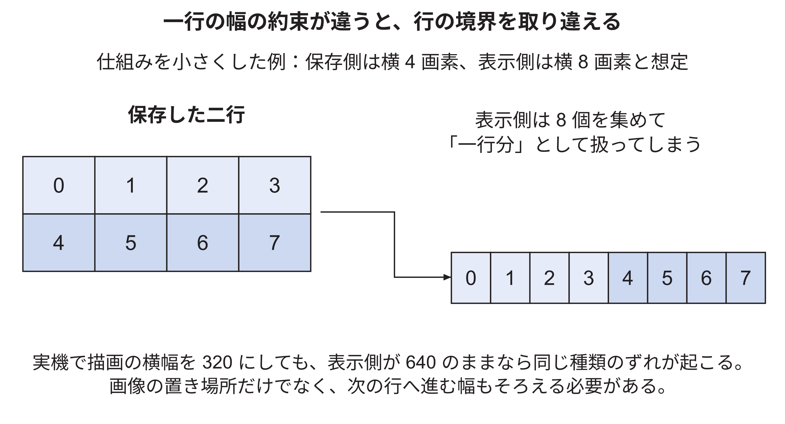
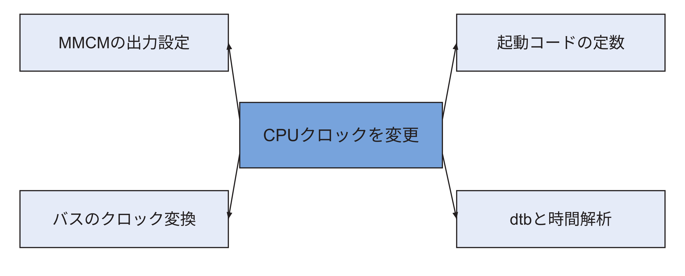
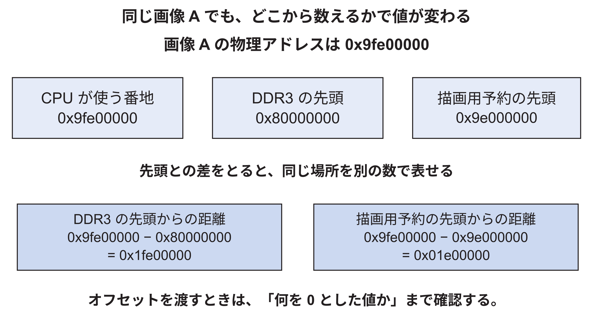

<!-- appendix-content:start -->

# 第43章 設定を変えるための計算と設計判断
<!-- appendix-content:end -->

[付録の総目次](../../技術付録.md) ｜ [論文本文](../../本文.md) ｜ [参考文献](../references.md)

[第IV部 RasterIXと描画システム](README.md)

ファイルパスの表記は、[資料フォルダー](../../README.md)を基準とする。

## このページの目次

- [43.1 内部作業領域を増やす案を計算する](#s_h_1)
- [43.2 画面の大きさを変えるときの落とし穴](#s_h_2)
- [43.3 CPUを速くしたいときに一緒に見る場所](#s_h_3)
- [43.4 アドレスを変える場合の三者の一致](#s_h_4)
- [43.5 理解できたかを確認する課題と解答](#s_h_5)

<!-- appendix-content:start -->
内部画像メモリを大きくする場合、増えるのは保存できる画素数だけではない。画面を分ける帯の数や、CPUが用意する命令リストの数も変わる。この章では設定値から計算できる量を求め、その計算だけでは決まらない資源使用量や速度を区別する。

## 43.1 内部作業領域を増やす案を計算する

現在の内部作業領域は2の16乗で65,536画素である。これを2の17乗、131,072画素へ増やす案を考える。307,200画素の画面を収めるために必要な帯は切り上げて3本、各帯は480÷3=160行となる。一帯は102,400画素で、131,072画素に収まる。コネクタのバッファ数は2×3+1=7個になる。

| 項目 | 現構成LG=16 | 検討例LG=17 |
|---|---:|---:|
| 内部作業領域 | 65,536画素 | 131,072画素 |
| 必要な帯数 | 5 | 3 |
| 一帯の高さ | 96行 | 160行 |
| 一帯の画素数 | 61,440 | 102,400 |
| コネクタの1 MiBバッファ | 11個 | 7個 |

この表はコードと寸法から求めた計算値である。内部メモリを増やせばFPGA内の資源が必要になる。命令の準備量が減る可能性があっても、配置配線の混雑や周波数の条件が変わるため、速くなることまではこの表だけで分からない。接続比較版を用いて容量17の回路を実装し、画像と性能を比較した実験結果は[72.17節](../05-integration/command-dma-comparison.md#s_30_17)に示す。計算による予想と実機の結果を対応付けて読む。

変更する場合は、RTLの`FRAMEBUFFER_SIZE_IN_PIXEL_LG`とCMakeの`RIX_CORE_FRAMEBUFFER_SIZE_IN_PIXEL_LG`を一致させる。片方だけ変えると、ソフトウェアが一帯に描けると思う画素数と、実際の内部メモリの容量が食い違う。回路生成後にはBRAMの合計、階層別使用量、タイミングを調べ、同じ画像と状態列で速度を比較する。[RasterIX](../references.md#ref_rasterix)[Console26](../references.md#ref_console26)

## 43.2 画面の大きさを変えるときの落とし穴

640×480を320×240へ変える案では、76,800画素なのでLG=16の内部作業領域でも2本の帯が必要になる。一帯は120行で38,400画素になる。これだけを計算して「解像度変更は終わり」としてはいけない。描画の寸法、表示回路の寸法、画素クロック、フレームバッファの行の幅、ゲームの座標が一致する必要がある。

例えば表示回路が引き続き一行640画素を読むのに、ソフトウェアが一行320画素分だけ保存すると、表示側は隣の行を続けて読んでしまう。これはGPUの描画速度以前に、メモリ中の画像の並び方が合っていない問題である。

また、公式Dispatcherは高さを帯数で整数除算する。別の解像度を選ぶ場合、最後の帯をどう扱うかを実装から確かめる必要がある。本構成の480行は5で割り切れるが、すべての高さがそうなるわけではない。「画素数が内部容量以下に分割できる」という計算だけでは、すべての行を扱える保証にはならない。[RasterIX](../references.md#ref_rasterix)

図43.1は、横320と640の違いを、見やすい横4と8の違いに置き換えた模式図である。画素の番号0〜7がメモリに順に並ぶ点は同じだが、どこまでを一行と数えるかが異なる。

保存側が4画素で次の行へ進んだつもりでも、表示側が8画素を一行として読むと、元の二行を一行につなげてしまう。先頭アドレスが正しくても、行を進める幅が一致しなければ画像は崩れる。このため解像度の変更では、描画側と表示側の両方を確認する。

## 43.3 CPUを速くしたいときに一緒に見る場所

CPUを20 MHzから別の周波数へ変える場合、最初に変える対象はMMCMの出力と、そのクロックを使う接続条件である。[論文本文6.3節](../../本文.md#s_6_3)のcreate_clockの例で解析上の周期だけを変えても、基板から来る100 MHzや、CPUへ実際に届くクロックの周期は変わらない。この例のBoardClockという名前を、完成版のXDCに書かれた設定だと解釈しない。本構成の入力クロック制約はClocking Wizardが生成する。実際のクロックを作る設定と、解析へその条件を伝える制約の両方を合わせる必要がある。

さらに、起動用プログラムはSYSTEMCLOCKを使ってUARTやSDの速度を設定する。ここを古い20 MHzのままにすると、回路が動作していてもUARTの通信速度がずれ、文字化けする場合がある。Linuxへ渡すクロック情報、クロック変換IPの条件、CPU領域を含む時間解析もそろえる必要がある。[Console26](../references.md#ref_console26)

新しい周波数でbitstreamが生成できても、時間条件を満たしたとは限らない。まず負の時間余裕や未制約の経路がないか調べ、その後、起動とゲームを確認する。性能を比較するときは、解像度や描画方式を同じにし、クロックを変えたことでどの処理時間が変わったかを見る。

読み終わったら、次の変更を実行せずに考えてみる。CPUを25 MHzにする場合、Makefileの数字だけでなく、クロック生成、時間条件、UART、時刻計数、DTSをどのようにそろえる必要があるか。実物のメモリ容量を変えないままEXT_MEM_RANGEだけ増やしたら何が起こるか。この二つを理由付きで説明できれば、既存設定の写し方だけでなく、設定同士のつながりを理解できている。

## 43.4 アドレスを変える場合の三者の一致

命令ポートの基点を変える場合、回路のEXT_IO_BASE、Linuxへ伝えるdtsのreg、アプリケーションのmmapをそろえる。さらに既存のUARTやSDなどの番地と重ならないか調べる。空いているように見える値を一か所へ書くだけでは、接続先を変更したことにならない。

画像用領域を変える場合は、GRAM_MEMORY_LOC、色・深度・ステンシルのオフセット、予約領域の開始と大きさを対応させる。例えば本設定の色画像の一つは、基点0x9e000000とオフセット0x01e00000を足して0x9fe00000となる。オフセットをすでに物理アドレスだと思って渡すと、基点を二度加えた誤った値になり得る。

| 値の種類 | 現構成の例 | 意味 |
|---|---|---|
| I/Oの物理アドレス | 0x10080000 | 命令レジスタがある場所 |
| GPU用メモリの基点 | 0x9e000000 | 予約領域の開始 |
| 色画像のオフセット | 0x01e00000 | 予約領域の開始からの距離 |
| 色画像の物理アドレス | 0x9fe00000 | CPU側の番地として表す画像位置 |
| DDR3内のオフセット | 0x1fe00000 | DDR3先頭0x80000000からの距離 |

これらの値はすべて「アドレスに関係する数」だが、基準にする開始位置が違う。設計を変更するときは、変数名だけでなく、どこから測った値なのかを式で確認する。

図43.3では、画像Aの物理アドレス0x9fe00000を固定し、二つの先頭からの距離を別々に計算する。下段の値は、画像が二か所に複製されたことを意味しない。同じ場所を異なる基準から数えている。

DDR3制御側へ渡す距離なら0x80000000を基準とし、描画用領域の先頭からの画像オフセットなら0x9e000000を基準とする。どちらもオフセットと呼ばれるため、変数名だけで判断せず、何の先頭を加え戻すと物理アドレスになるかを確認する。

## 43.5 理解できたかを確認する課題と解答

課題1は、32 bitの最後の一語を送るとき、regsの添字と物理アドレスを答えることである。解答は添字1、0x10080004である。根拠は、uint32_t一要素が4 byteで、CMD_LASTが+0x04だからである。CPU自体が64 bitだから添字を8倍する、という計算はしない。

課題2は、FIFOが3クロック満杯で、4番目の立ち上がりで空いた場合、受け取る語数を答えることである。解答は1語である。最初の3回はValidが1でもReadyが0なので受理しない。4回目に両方1となって初めて受理する。同じ語を4回送ったとは数えない。

課題3は、幅640のRGB565画像で(x,y)=(3,2)の画素の位置を計算することである。先頭からの画素番号は2×640+3=1283、byteのオフセットは2566=0x0a06である。画面Aなら0x9fe00a06から2 byteを使う。横座標と縦座標を逆にすると、別の行の画素を書いてしまう。

課題4は、完了回数を読む値が42で、新しい切り替え後に43になったとき、何が分かったかを説明することである。解答は、回路で定めた切り替え完了が一回通知された、である。画像の全画素が正しいことや、ディスプレイの描画が終了したことまでは、この値だけでは分からない。

課題5は、古いボールを黒で消したときに文字の一部まで消えた場合、どの処理を確認するかを答えることである。解答は、変更領域に重なる文字も描き直し対象へ含めたか、元の描画順を守ったか、対象バッファに対応する履歴を使ったか、である。新しいボールだけを描けばよいという方法では、消した文字は復元されない。

課題6は、CPUを速くした後にUARTが文字化けした場合、何を疑うかを答えることである。解答の一つは、起動コードやLinuxが計算に使うクロック値と、実際のCPUクロックが合っていない可能性である。ただし配線や端末設定でも文字化けするため、これだけを原因と断定せず、変更前後の条件を照合する。

答えの数値だけでなく、その値を確認するファイルと信号を指せるかを確かめる。分からなかった項目は、[論文本文第7章](../../本文.md#ch_7)、10章、11章、14章と[技術付録第42章](rasterix-integration.md#ch_g)へ戻る。単語を言えることより、どこで値が変わり、どこで受け渡しが完了するかを追えることが、同じ接続を設計するための理解になる。
<!-- appendix-content:end -->

---

[前：第42章 RasterIXとの接続を自分で組み立てる](rasterix-integration.md) ｜ [次：第44章 命令の受け渡しとクロック境界を設計する](command-clock-boundary.md)
