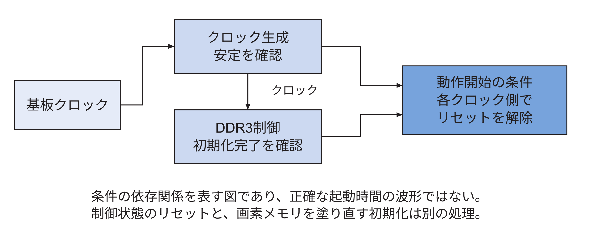
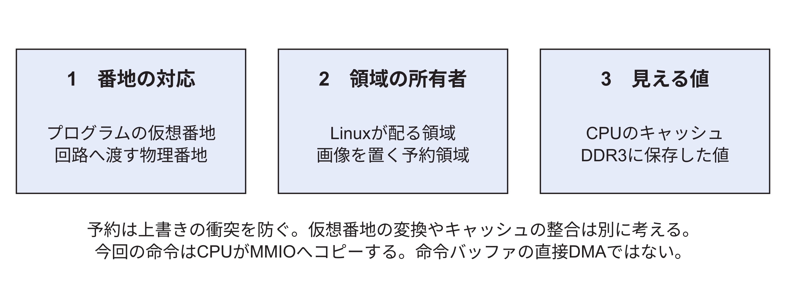
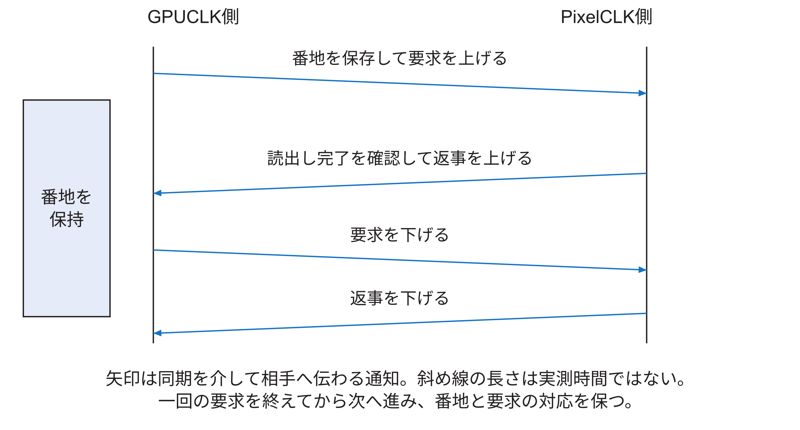
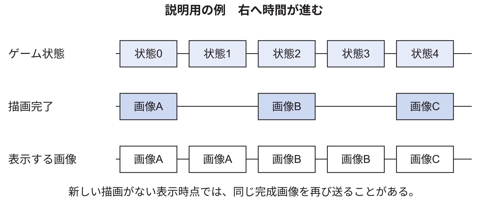

<!-- appendix-content:start -->

# 第45章 設計を変更できる理解へ進む
<!-- appendix-content:end -->

[付録の総目次](../../技術付録.md) ｜ [論文本文](../../本文.md) ｜ [参考文献](../references.md)

[第IV部 RasterIXと描画システム](README.md)

ファイルパスの表記は、[資料フォルダー](../../README.md)を基準とする。

## このページの目次

- [45.1 部品の仕様から接続で守る条件を取り出す](#s_j_1)
- [45.2 クロックとリセットは別々の仕事をする](#s_j_2)
- [45.3 番地と所有者とキャッシュを三つに分ける](#s_j_3)
- [45.4 volatileとfenceだけで描画完了は分からない](#s_j_4)
- [45.5 メモリ共有では平均帯域と待ち時間を分ける](#s_j_5)
- [45.6 AXIの一件の要求はすぐに一件の応答にならない](#s_j_6)
- [45.7 表示の通知は一回の要求に一回の返事を対応させる](#s_j_7)
- [45.8 描画の速さと映像の速さとゲーム時間を分ける](#s_j_8)
- [45.9 FPGA資源の余りと動作周波数の余裕は違う](#s_j_9)
- [45.10 起動の失敗をどの層で調べるか](#s_j_10)
- [45.11 計測で原因を絞るとは何をすることか](#s_j_11)
- [45.12 設定変更を一つ選び影響を最後まで追う](#s_j_12)
- [45.13 説明できるかを確認する課題と解答](#s_j_13)

<!-- appendix-content:start -->
この章は、各部品の名前を知った後に、ゲーム機全体をどう設計し、どこを確かめるかを説明する。専門家が設計を検討するときには、正常に動く一例だけでなく、停止、再起動、設定変更の条件も扱う。ここでいう理解の目標は、本構成の入力、出力、状態、所有者、完了条件を示し、変更によって影響する場所と確認方法を選べることである。CPU全命令やDDR3 PHYの内部を一から設計する知識まで、このゲーム機の再現に必須とするわけではない。

## 45.1 部品の仕様から接続で守る条件を取り出す

部品Aの出力を部品Bの入力につなぐ前に、「何が運ばれるか」「何bitか」「どの時計か」「どの条件で受け取ったことになるか」「止められるか」「リセットすると何を失うか」を書き出す。線の名前だけが似ていても、この六点が一致しなければ、そのまま接続できるとは限らない。

例えばCPUのAPB書き込みは、番地を伴う操作である。一方、RasterIXの命令入力は語の列を受け取る。ここには形式の変換が必要である。さらに両者の時計も違うため、形式を変換しただけでは接続は完成しない。このように、互換でない点を一つずつ埋めると、追加した回路の理由を説明できる。

| 境界 | 運ぶもの | 守るべき条件 | 実装を読む入口 |
|---|---|---|---|
| CPUから命令入口 | 32 bitの命令語 | 一回の書き込みと一回の受理の一致 | `rasterix_apb.sv` |
| CPUCLKからDDRCLK | 命令語と終端 | 順序とまとまりの保持 | `axiscdc.tcl` |
| 描画から表示 | 画像の物理番地 | 古い画像の読出し完了まで再利用しない | `rasterixdisplay.sv` |
| OSと描画用メモリ | 利用できる番地範囲 | OSが画像を別用途へ割り当てない | デバイスツリーと`RenderConfigs.hpp` |

## 45.2 クロックとリセットは別々の仕事をする

クロックは状態を更新する時刻を決め、リセットは状態を出発点へ戻す。例えばFIFOがどこまで書かれたか、表示がどの画像を読んでいるかは状態である。リセットを解除しても、DDR3に以前保存した画像の全画素が自動で消えるとは限らない。制御用レジスタを初期状態へ戻す処理と、画像の内容を塗り直す処理は別に必要になる。

図45.1は起動条件の依存関係である。時間を正確な長さで描いた波形ではない。基板クロックからClocking WizardとDDR3制御を準備し、クロック安定やDDR3初期化完了を見て、利用する回路を動かす。実配線の信号名と極性は[技術付録59.7節](../05-integration/board-reproduction.md#s_app_59_7)にある。`resetn`のような名前の末尾のnは、0でリセットとなる信号を読む手掛かりになるが、名前だけで決めず代入式を確認する。

非同期の解除を各クロックへそろえる必要があるのは、同じ状態機械のレジスタの一部だけが先に動き始める状況を避けるためである。また、非同期FIFOを使う場合はIPのリセット仕様も満たす必要がある。片側だけの再起動で途中の語がどう扱われるかを決めずに、一語も失わないことを期待してはいけない。保存したリセット試験が扱った条件と、今後追加する途中リセットの試験は区別する。

## 45.3 番地と所有者とキャッシュを三つに分ける

例として、次の画像を置く範囲Bを考える。まず「Bはどの番地からどこまでか」を決めなければ、読書きする場所を指定できない。次に「今は描画回路がBを書いてよいか」を決める必要がある。表示回路がBを読んでいる間なら、番地が正しくても、そのまま書き換えてよいとは限らない。

さらにCPUがBへ何かを書いた場合、その値がCPUのキャッシュだけに残り、別の回路が読むDDR3まで届いているかという問題がある。「場所が正しい」「今そこを使ってよい」「別の回路にも新しい中身が見える」は、それぞれ別に確かめる。ここで所有者という語は、その時点で領域を更新・再利用してよい主体を表し、ファイルの著作権などを意味しない。

同じ番地の数字を使っていても、CPUのプログラムが扱う仮想番地と、外部回路がDDR3へ出す物理番地は別である。`mmap`によってプログラム内に得たポインタを、そのまま描画回路の物理番地として渡せるとは限らない。今回のMMIO入口は物理番地`0x10080000`を対応付け、その対応先へ32 bit単位で書いている。

メモリの所有者も考える。Linuxが通常のプログラムへ自由に配る領域と、描画回路が画像を置く領域が重なると、双方は自分の正しい操作のつもりで相手のデータを壊せる。デバイスツリーで画像用領域を予約するのは、この割り当ての衝突を防ぐためである。

ただし、領域を予約することはキャッシュの内容を一致させることと同じではない。一般にCPUのキャッシュに新しい値が残り、DDR3に古い値が残っていれば、外部回路は古い方を読む可能性がある。その場合は、非キャッシュの対応付け、キャッシュの書き戻し・無効化、ハードウェアの一貫性機構など、構成に合う方法が必要になる。

今回の描画命令は、CPUが通常メモリから値を読み出してMMIOへコピーする。RasterIXがCPUの命令バッファを直接DMAで読む方式ではない。この違いがあるため、「命令バッファの番地を教えるだけで送信が終わる」という説明は当てはまらない。もしDMA方式へ変更するなら、番地変換、キャッシュ、バッファの寿命、完了通知を新たに検討する。

## 45.4 volatileとfenceだけで描画完了は分からない

`volatile`は、コンパイラに対して、その場所へのアクセスを通常の不要な読み書きのように省略しないことを求めるために使う。`fence`は、CPUのメモリアクセスやI/Oの順序を扱う命令である。どちらも、その先のGPUが全画素を描き終えたことや、ディスプレイが画素を表示したことを直接返す機能ではない。

今回の送信関数は、一語ずつのMMIO書き込みを完了し、その順序を整えてから返る。これにより元の命令バッファの内容を送信用に保持し続ける段階を終えられる。一方、描画回路や表示回路には続きの仕事がある。アプリが次へ進める時点は、表示切り替え完了の回数など、目的に対応した通知で判断する。

この違いを理解すると、「関数が返った」「回路が受け取った」「画像が完成した」「古い画像を再利用できる」「人の目に届いた」を一つの完了へまとめずに説明できる。[論文本文6.7節](../../本文.md#s_6_7)の表は、この区別を本構成の観測点へ対応させている。

## 45.5 メモリ共有では平均帯域と待ち時間を分ける

CPU、描画回路、表示回路はDDR3への要求を共有する。表示回路は、画面を送り続けるために画素を読みたい。描画回路は、新しい画像を書いたりテクスチャを読んだりしたい。CPUは命令やデータを必要とする。接続回路は、同時に来た要求を順に処理できるように調整する。

平均的な転送量がDDR3の能力より小さくても、必要な時刻までに表示用のデータが来なければ困る。例えば、表示用FIFOに十分な画素が蓄えられていれば一時的な待ちを吸収できるが、蓄えが尽きるほど長く待たされると映像の生成に間に合わない。この考え方は命令FIFOと似ているが、表示側には送り出す時刻の制約がある。

本構成の有効な画像だけを60回/秒読み出す量は、640×480×2×60=36,864,000 byte/秒となる。これはRGB565の画素データ量を計算した値であり、実測したDDR3使用帯域ではない。メモリ要求の粒度、空き時間、他の要求、キャッシュ、コマンドの負担を含んでいない。この計算だけで帯域に十分余裕があるとは結論しない。

## 45.6 AXIの一件の要求はすぐに一件の応答にならない

メモリへ「この番地から読んでほしい」と伝える時刻と、読んだデータが返る時刻は違う。例えば要求1を受け付けても、DDR3の読出しや他の要求の処理に時間がかかり、返事が後になる。その間に要求2を受け付けることもある。したがって、要求1の受付を見ただけでは、要求1の読出しが終わったとは判断できない。

AXIの読出しでは、番地の要求を受け取った後、データは別の信号で後から返る。一度の要求で複数のデータを返すまとまりをバーストという。最後のデータには`RLAST`が付く。要求が成立した回数から、最後のデータを受け取った回数を引くと、まだ完了していないバーストの数が分かる。

表示先の番地をAからBへ変更しても、既に受け付けられたAへの読出しが残る場合がある。ここで描画側にAを書かせると、表示回路が必要としているAの内容を途中で変えてしまう。従って、設定レジスタを書き換えたことだけでAを再利用してはいけない。

`rasterixdisplay.sv`は未完了の読出しを数え、新しい画像からの読出しを検出した後、その応答まで確認して完了を通知する。これは、接続している表示回路の読出し順序と応答の扱いを前提とする設計である。将来、複数IDで応答順序が変わる構成へ変更するなら、数だけを引き継いでよいか再検討が必要になる。詳細な現在の計算例は[40.19節](framebuffer-display.md#s_app_40_19)と[41.5節](signals-and-numbers.md#s_b_5)にある。

## 45.7 表示の通知は一回の要求に一回の返事を対応させる

表示切り替えでは、GPU側が新しい画像の番地を保持し、要求を出す。画素クロック側が要求を受け取り、表示回路へ設定し、必要な読出し完了を待って返事を出す。GPU側が返事を受け取った後に要求を下げ、相手が返事を下げたことを見て次の要求へ進む。

表示変換回路の入力名は`GPUCLK`で、外側から`DDRCLK`を接続している。別の新しい周波数のクロックを作ったという意味ではない。ソースを読むときは、部品の入力名と、その入力へ接続された外側の信号名を区別する。

この手順では、番地そのものを毎周期書き換えない。要求を出す前に用意し、相手が受け取って処理を終えるまで保持する。要求や返事の一ビットを同期させる方法と、番地を安定して置いておく方法が組み合わさっている。多ビットのすべてを独立な同期器へ通す方法とは違う。

CPUへ完了を伝える経路では、完了に応じて値を反転させ、CPUCLK側で反転を検出する。速いクロックの一周期だけのパルスを遅い側が見逃す問題を避ける考え方である。ただし、反転方式ならどんな頻度のイベントも無制限に運べるわけではない。受け側が確認する前に二回反転すれば元に戻る。今回の一回ずつ進める切り替えの手順と通知の頻度を併せて考える。

## 45.8 描画の速さと映像の速さとゲーム時間を分ける

ボールの位置を60回/秒更新すること、一秒間に58枚の描画を完了すること、表示回路が約60 Hzで信号を送ることは別である。ゲーム状態の更新は位置を計算し、描画はその時点の状態を画素へ変え、表示は完成画像を繰り返し読む。新しい画像が間に合わなければ、表示回路は前の画像を送ることがある。

図45.4は関係を示す説明用の時系列であり、保存した映像や実機の波形を写した図ではない。研究の数値を説明する際は、どの列を数えたかを述べる。`FRAME_COUNT`から得た切り替え完了数を、そのまま人の目で数えた異なる画像の数と呼ばない。

部分描画は状態更新を省く操作ではなく、前に残っている画像を利用して、同じ次の画像を少ない書き換えで作る操作である。このため、同じゲーム状態を与える比較と、画像の一致の確認が必要になる。[技術付録33.9節](../03-linux/game-loop.md#s_app_33_9)の二枚別の履歴は、描画先ごとに残っている画像を正しく把握するためにある。

## 45.9 FPGA資源の余りと動作周波数の余裕は違う

LUTやBRAMの使用率は、使った部品の量である。タイミング余裕は、信号が次の記憶時刻に間に合うかという時間の量である。部品が空いていても、長い配線や複雑な組合せ計算を一周期で通す経路があれば、周波数を上げられない。逆に、レジスタを追加して処理を何段かに分ければ、資源を少し多く使いながら周波数を上げられる場合もある。

ただし段を増やせば、入力から出力までの周期数や、停止したときに保持すべきデータも変わる。回路へレジスタを追加するだけで既存のプロトコルが保たれるとは限らない。変更後に、有効信号、データ、終端が同じ処理に対応して遅れるかを確認する。

タイミングレポートの正の余裕は、指定された制約に対する結果である。解析されていない経路が残っていないか、例外指定が広過ぎないかも読む。特にCDCの経路を時間解析から除外する指定は、安全な受け渡し回路を作る代わりにはならない。基準版の保存結果と警告件数は[65.17節](../05-integration/verification.md#s_app_65_17)、動作確認版の結果は[論文本文12.3節](../../本文.md#s_12_3)に示す。

## 45.10 起動の失敗をどの層で調べるか

FPGAへbitstreamを書き込めたこと、Wallyが命令を実行できること、Linuxが起動すること、ゲームが命令を送れること、映像が見えることは段階が違う。一番外側の「画面が黒い」だけでは、どの段階が失敗したか決められない。

まず使用したbitstreamとソースの版を一致させ、クロックとリセット、DDR3初期化の条件を見る。次にUARTに起動ログが出るか、Linuxが必要なメモリ範囲を認識しているかを確認する。アプリではMMIOの識別値を読む。ここで期待する値が返らなければ、描く四角形の座標より先に、アドレス判定、ビルド設定、マッピングを調べる。

識別値が読めた後は、小さな既知の画像、表示先の番地、切り替え完了数、映像信号の順に観察する。各段階で入力と期待結果を決めると、別の層の不具合を推測し続けずに済む。詳しいコマンドと成功の判断は[技術付録第63章](../05-integration/console-reproduction.md#ch_m)にある。SDWire3や取り込み機器は実験を助ける道具であり、公開設計の機能とは分ける。

## 45.11 計測で原因を絞るとは何をすることか

長い処理区間が見つかっただけでは、その区間の中で何を減らせばよいかは分からない。保存したE5では、まず画像と図形数を保って描画呼び出しのまとめ方を変えた。次に呼び出しのまとまりを固定して図形数を変えた。この二つの操作で、繰り返す呼び出しと、図形に伴う準備量を改善対象として選んだ。

これはCPUのすべての命令の費用を測ったことではない。例えばキャッシュミスの回数を計測していなければ、残りの時間をすべてキャッシュのせいだと決められない。専門的な説明では、測った量、操作した条件、その結果から言える範囲をそろえる。分解していない原因を認めても、得た比較の価値がなくなるわけではない。

結果を再集計する人は、平均の速さだけでなく、対象の状態列、ウォームアップ、試行数、代表値、時間区間の定義を見る。さらに、標準DVI構成と実験用HDMI構成を混ぜない。描画の呼び出し方や図形数を変えた実験の条件と結果は[技術付録第66章](../05-integration/measurement.md#ch_g_measurement)に示し、再集計の手順は[技術付録第64章](../05-integration/repeating-experiments.md#ch_c)で説明する。

## 45.12 設定変更を一つ選び影響を最後まで追う

例えば画像の幅を640から別の値へ変えたい場合、画面上の座標だけを変更して終わらない。一行のbyte数、画素番地、フレームバッファ容量、内部作業領域へ入る行数、帯の数、命令バッファ数、映像のタイミングを順に確認する。幅×高さ×2という計算はRGB565の画像一枚の必要量であり、深度やテクスチャ、管理領域まで含めた総量ではない。

CPU周波数の変更なら、生成クロックだけでなくUARTなどの時間を決める設定、ソフトウェアへ知らせる値、タイミング解析、各クロック間の接続を確認する。MMIO番地の変更なら、CPU側の判定、外部I/Oの属性、ソフトウェアのマッピングをそろえる。[技術付録第43章](configuration-calculations.md#ch_h)には現在の値を使った計算がある。

設計を理解できたかは、「どの一行を直すか」だけでなく、「他のどこを合わせ、何を観測すれば誤りを見つけられるか」まで答えて確かめる。これは新しい変更を直ちに実機へ入れる指示ではない。まず固定した動作基準と比較できる別の作業場所で検討する。

## 45.13 説明できるかを確認する課題と解答

問1。FIFOが空いているがRasterIXが受取可を0にしたとき、CPUの次の書き込みは必ず止まるか。答えは、必ずは止まらない。FIFOの入口に空きがあり入口側が受取可を返せば、CPUは一語を保存して先へ進める。停止がCPUまで伝わる条件は、出口の停止と入口の空きを分けて考える。

問2。Linux用領域から画像用領域を除外すれば、どんなCPUキャッシュ構成でもGPUに最新値が見えるか。答えは、除外だけでは保証できない。割り当ての衝突と、保存された値の一貫性は別だからである。今回の命令のCPUコピー方式と、将来のDMA方式も分ける。

問3。画像AからBへ表示設定を書き換えた直後、Aへ描画してよいか。答えは、古い読出しが残っていないことを本接続の完了条件で確認する必要がある。設定の変更と要求済みデータの受信は別の時刻に起こる。

問4。LUTが半分近く空いていれば、CPUを二倍の周波数にできるか。答えは、使用率からは判断できない。遅い経路、配線、クロック条件、IPの対応範囲を調べ、変更後の時間解析と動作を確認する。

問5。画素の最終一致が0不一致なら、ゲーム中の全画面を検査済みか。答えは、最終画像だけの比較からは言えない。保存した結果が扱った画像の枚数と時点を述べる。途中の画像すべてについて主張するには、その時点に対応した比較が必要である。

問6。今回の方式が唯一の正解か。答えは、そうではない。CPU直描き、別の転送方式、同期式の変換などの候補はある。本研究の到達点は、採用した方式をソースと動作条件に結び付けて説明し、保存した確認結果の範囲で成立を示すことである。
<!-- appendix-content:end -->

---

[前：第44章 命令の受け渡しとクロック境界を設計する](command-clock-boundary.md) ｜ [次：第46章 RasterIXを開発者の視点で読むための地図](rasterix-source-map.md)
