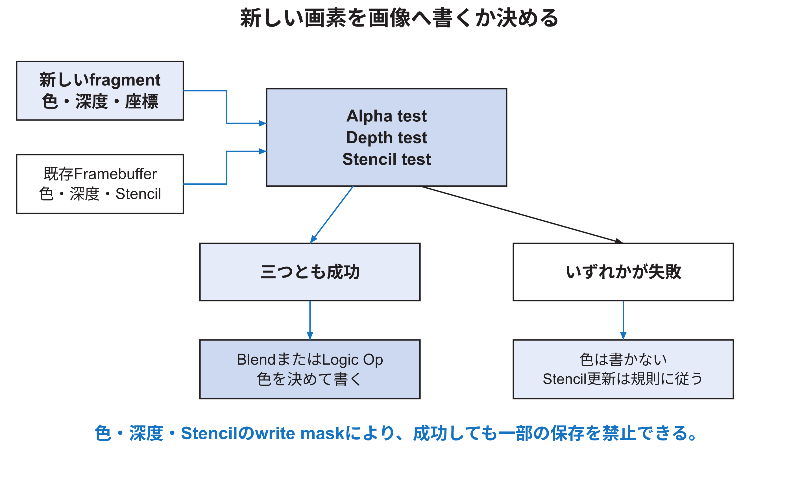

<!-- appendix-content:start -->
<a id="ch_u"></a>
# 第53章 画素候補の採否と色の混合
<!-- appendix-content:end -->

[付録の総目次](../../技術付録.md) ｜ [論文本文](../../本文.md) ｜ [参考文献](../references.md)

[第IV部 RasterIXと描画システム](README.md)

ファイルパスの表記は、[資料フォルダー](../../README.md)を基準とする。

## このページの目次

- [53.1 fragmentはまだ画面に書かれたpixelではない](#s_u_1)
- [53.2 新しい値と既存値をそろえる](#s_u_2)
- [53.3 三つの試験と色の演算](#s_u_3)
- [53.4 alpha test](#s_u_4)
- [53.5 depth test](#s_u_5)
- [53.6 stencil testと三種類のoperation](#s_u_6)
- [53.7 blending](#s_u_7)
- [53.8 logic operation](#s_u_8)
- [53.9 color、depth、stencilのwrite mask](#s_u_9)
- [53.10 処理の並列性](#s_u_10)
- [53.11 Pipelineを停止する`ce`](#s_u_11)
- [53.12 二次元文字の具体例](#s_u_12)
- [53.13 重なる四角形の具体例](#s_u_13)
- [53.14 PerFragment変更の単体試験](#s_u_14)

<!-- appendix-content:start -->
<a id="s_u_1"></a>
## 53.1 fragmentはまだ画面に書かれたpixelではない

Rasterizerが三角形内の一位置を生成し、色やdepthが付いた段階を画素候補と呼ぶ。画素候補は候補であり、alpha、depth、stencil testで捨てられる場合がある。blendにより既存色と混ざる場合もある。Framebufferへ書かれて初めて保存された画素になる。

<a id="s_u_2"></a>
## 53.2 新しい値と既存値をそろえる

`PerFragmentPipeline`の入力には、新しい画素候補の色・depthだけでなく、同じindexから読んだ既存color、depth、stencilが必要である。`StreamConcatFifo`がこれらを対応付ける。

例えば新しい画素候補 Aの色と、次の画素候補 Bの既存depthが組み合わさると、depth testが別画素の値で行われる。valid／ready停止中にも順序と対応を保つことが重要である。

<a id="s_u_3"></a>
## 53.3 三つの試験と色の演算

図53.1は、最終的な書込み判断を単純化して示す。



alpha、depth、stencilの三試験が成功し、`keep`が有効なら、色と必要なdepth／stencilを書ける。失敗時もstencil operationは、stencil失敗、depth失敗、全成功という場合ごとの規則に従う。

<a id="s_u_4"></a>
## 53.4 alpha test

alpha testは、新しい画素候補のalphaとreference値を比較する。比較関数にはnever、less、equal、less-or-equal、greater、not-equal、greater-or-equal、alwaysなどがある。透明部分を完全に捨てる文字やspriteに使える。

alpha testはblendと異なる。alpha testは画素候補を通すか捨てるかの二択、blendは通った画素候補の色を既存色と混ぜる処理である。半透明を表すには通常blendを使う。

<a id="s_u_5"></a>
## 53.5 depth test

depth testは、新しいdepthと保存済みdepthを比較し、手前にあるものなどを残す。二次元ゲームで描画順を明示し、depthを使わないなら無効化できる。無効化してもdepth buffer回路をパラメータで削除したとは限らず、実行時にbypassしている場合がある。

同じdepth値に対して`LESS`を使うか`LEQUAL`を使うかで、共有面や重ね描きの結果が変わる。二次元で同じzの四角形を重ねるなら、depthを無効にしてdraw orderを使うか、zを分けるか、比較関数を意識する。

<a id="s_u_6"></a>
## 53.6 stencil testと三種類のoperation

stencil bufferは各画素に小さな整数を保存し、maskのように使う。testは保存値とreferenceを比較する。さらに、次の三場合で保存する値を変えられる。

| 場合 | operationの例 |
|---|---|
| stencil test失敗 | keep、zero、replaceなど |
| stencil成功・depth失敗 | increment、decrementなど |
| stencilとdepth成功 | replaceなど |

本構成の内部stencilは4 bitである。0から15の範囲を持つ。8 bitの一般的なGPUと同じ範囲だと思い込まない。

<a id="s_u_7"></a>
## 53.7 blending

blendは、新しいソース色と既存destination色へ係数を掛け、加える。単純化すると次である。

```text
output = source × sourceFactor + destination × destinationFactor
```

典型的なalpha blendでは、ソース factorをソース alpha、destination factorを1−ソース alphaにする。alpha=1なら新しい色、alpha=0なら既存色、0.5ならほぼ半分ずつになる。

固定bit幅の演算ではroundingとsaturationがある。理想実数の式と完全に同じであるとは限らない。公式ソフトウェア testの`BlendFunc`とRTL出力を比較する。

<a id="s_u_8"></a>
## 53.8 logic operation

logic opは、ソースとdestinationのbitごとにAND、OR、XOR、copyなどを行う。blendと同時に最終色へ適用するのではなく、設定によりlogic op側またはblend側の結果を選ぶ。bit単位の演算なので、知覚的な明るさを混ぜる処理とは異なる。

二次元の選択枠や反転表示にはXORが使える場合がある。しかし同じ場所へ二回描けば元へ戻るなど、描画回数に依存する。通常の半透明spriteにはblendを使う。

<a id="s_u_9"></a>
## 53.9 color、depth、stencilのwrite mask

試験が成功しても、write maskが0なら対応するbufferを更新しない。color maskはcomponentごと、depth maskはdepth書込み、stencil maskはbitごとの書込みを制御する。

例としてdepth prepassではcolor書込みを無効にしてdepthだけ作る。二次元研究では使わなくても、状態が前の描画から残ると「何も描かれない」原因になる。描画前に必要なstateを明示する。

<a id="s_u_10"></a>
## 53.10 処理の並列性

`PerFragmentPipeline`では、blend、logic op、alpha test、depth test、stencil testの候補計算を並列に進め、最後に結果とenableからwriteを決める。ソースコードの行順が、そのまま時間順に一つずつ処理されるわけではない。

Verilogの連続代入や別モジュール instanceは並列回路となる。`always @(posedge aclk)`内でも、nonblocking assignmentは同じクロック エッジでレジスタ更新する。C++の逐次実行の読み方をそのまま適用しない。

<a id="s_u_11"></a>
## 53.11 Pipelineを停止する`ce`

出力先Framebufferが受け取れないとき、`m_frag_tready=0`となり、PerFragment内部のパイプライン レジスタを`ce=0`で止める。新しい画素候補の演算値だけでなく、test結果、座標、index、lastを同じ位置に保持する。

この停止が正しいかは、連続入力でreadyを途中だけ0にし、停止前後の出力列がready常時1の結果と同じになるか比較する。出力時刻は遅れてよいが、値と順序と個数は変わってはならない。

<a id="s_u_12"></a>
## 53.12 二次元文字の具体例

白いglyph テクスチャのalphaを使い、文字色を青、背景を黒とする。テクスチャ sampleのalphaが0ならalpha testで捨てる。alphaが1なら青を保存する。antialiasされた端で0と1の間を持つなら、alpha testだけでは階段状になり、blendで背景と混ぜる方が滑らかになる。

文字が長方形の背景まで塗る、縁が黒くなる、二回目だけ壊れる場合は、次を分けて確認する。

1. テクスチャのRGBとalphaのformat。
2. TexEnvが頂点色とテクスチャ alphaをどう組み合わせるか。
3. alpha testの比較関数とreference。
4. blend factor。
5. 前のstateが次の文字へ残っていないか。
6. 部分描画で背景を正しく描き直したか。

<a id="s_u_13"></a>
## 53.13 重なる四角形の具体例

最初に赤い四角形、次に半透明青の四角形を重ねる。depth無効、標準alpha blendなら、重なりは紫に近い色になる。順序を逆にすれば別の色になる。blendは可換ではないためである。

部分描画で古いボール位置を黒く塗るだけでは、そこにあった赤いblockも消える。この問題はPerFragmentの誤りではなく、どの図形をどの順で再描画するかというgame renderer側の問題である。ハードウェアが正しく上書きしているからこそ、背景や重なる物体の再描画が必要になる。

<a id="s_u_14"></a>
## 53.14 PerFragment変更の単体試験

| 変更対象 | 最小入力 | 確認する境界値 |
|---|---|---|
| alpha test | alphaとreference | 直前、等値、直後 |
| depth test | ソースとdestination depth | 0、同値、最大 |
| stencil | 4 bit値とmask | 0、15、overflow、underflow |
| blend | ソース／destination原色 | alpha 0、1、0.5 |
| logic op | bit pattern `0xAAAA`と`0x5555` | 各truth table |
| write mask | 全componentが異なる色 | 禁止bitが保存値を保つか |

個別演算のソフトウェア testで期待値を作り、VerilatorでRTLを試し、最後に統合画像を確認する。
<!-- appendix-content:end -->

---

[前：第52章 テクスチャの参照と画素の色の計算](textures-pixel-pipeline.md) ｜ [次：第54章 内部画像メモリからDDR3と表示へ](framebuffer-memory-display.md)
