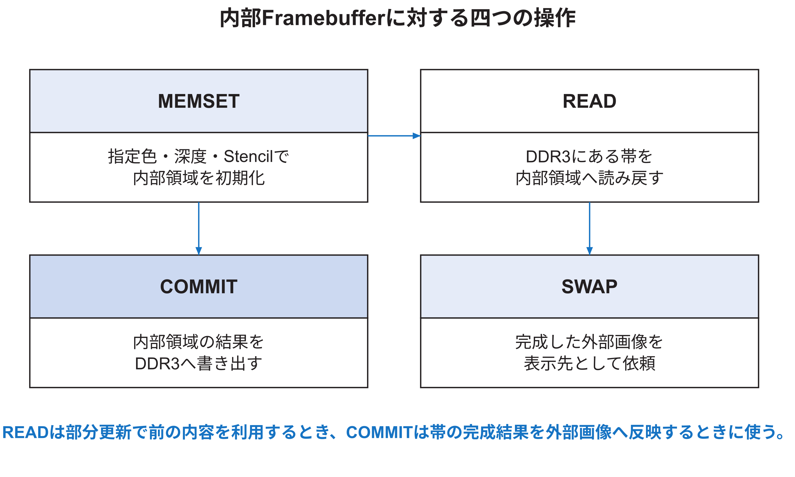
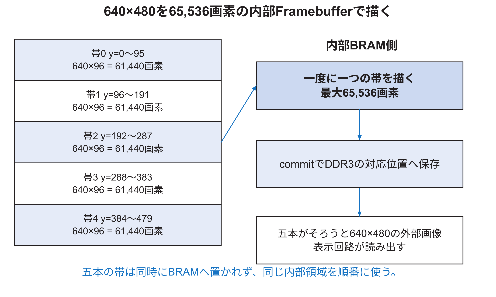

<!-- appendix-content:start -->

# 第54章 内部画像メモリからDDR3と表示へ
<!-- appendix-content:end -->

[付録の総目次](../../技術付録.md) ｜ [論文本文](../../本文.md) ｜ [参考文献](../references.md)

[第IV部 RasterIXと描画システム](README.md)

ファイルパスの表記は、[資料フォルダー](../../README.md)を基準とする。

## このページの目次

- [54.1 三種類のbufferを分ける](#s_v_1)
- [54.2 `InternalFramebuffer`の二port](#s_v_2)
- [54.3 color、depth、stencilは別々のmemory](#s_v_3)
- [54.4 MEMSET、READ、COMMIT、SWAP](#s_v_4)
- [54.5 部分描画でREADが必要になる理由](#s_v_5)
- [54.6 640×480を五帯へ分ける計算](#s_v_6)
- [54.7 一つの図形を帯ごとに扱う](#s_v_7)
- [54.8 external color bufferと二重buffering](#s_v_8)
- [54.9 起動直後に両bufferを初期化する](#s_v_9)
- [54.10 commitのmemory転送](#s_v_10)
- [54.11 readのmemory転送](#s_v_11)
- [54.12 表示切替handshake](#s_v_12)
- [54.13 DVI送信とRasterIXの境界](#s_v_13)
- [54.14 memory帯域を概算する](#s_v_14)
- [54.15 内部Framebuffer sizeを増やす判断](#s_v_15)
- [54.16 IFからEFへ変える場合](#s_v_16)

<!-- appendix-content:start -->
画像を扱う保存場所には、描画途中の画素を置くFPGA内の領域と、表示へ送る画像を置くDDR3の領域がある。この章ではそれぞれに何が残るかを決め、一つの帯を読み、描き、戻し、最後に表示へ渡す過程を追う。

## 54.1 三種類のbufferを分ける

本構成でbufferという語は複数のものを指す。

| buffer | 保存内容 | 主な場所 |
|---|---|---|
| display list buffer | 描画命令列 | CPUが使うDDR3領域 |
| internal framebuffer | 現在の帯のcolor／depth／stencil | FPGA内部BRAM |
| external color buffer | 完成画像 | DDR3 |
| command／response FIFO | 32 bitの転送語 | クロック境界のFIFO |
| display reader FIFO | 映像出力前の画素 | 表示回路内部 |

front buffer／back bufferと呼ぶ場合は、多くはexternal color bufferの二枚を指す。internal framebufferの色・depth・stencil三種やdisplay list二組とは別である。

## 54.2 `InternalFramebuffer`の二port

各internal framebufferは、通常描画用のread／writeと、clear・commit・readなどのcommand用accessを両立させる。内部RAMはdual-portとして扱われ、一方を画素候補 パイプライン、他方をcommand handlerが使う。

ただし、両者が同じ番地へ同時に異なる操作をした場合の優先順位やRAM primitiveのread-during-write挙動が問題になる。`applied`信号によりcommand中は通常経路を適切に止め、同じ領域を無秩序に操作しない。

## 54.3 color、depth、stencilは別々のmemory

`RasterIXCoreIF`は、color、depth、stencilのinternal framebufferを別モジュールとしてinstance化する。代表的なbit幅はcolorが内部パラメータに応じたRGB、depth 16 bit、stencil 4 bitである。外部color streamはRGB565として扱う。

三つを別メモリにすることで、colorだけ、depthだけ、stencilだけのclearやread/write enableを持てる。一方、同じ画素候補について三つのread結果をそろえる必要があり、`StreamConcatFifo`が使われる。

## 54.4 MEMSET、READ、COMMIT、SWAP

内部Framebuffer周辺の四操作を図54.1に示す。

`MEMSET`は内部領域をclear値で埋める。scissorが有効なら対象外を保てる。`READ`はDDR3に残る前の帯を内部へ読み戻す。`COMMIT`は内部の結果をDDR3へ書き出す。`SWAP`は完成したexternal color bufferの表示切替を依頼する。

## 54.5 部分描画でREADが必要になる理由

毎frame全画面を描き直すなら、内部帯をclearし、すべての物体を描き、commitできる。変更領域だけを描く場合、変えていない画素を保つ必要がある。external bufferに前の画像があり、内部BRAMは別の帯や別frameに再利用されているため、対象帯の旧画像を`READ`で戻してから一部を上書きする。

ただし本研究の最適化は、二枚のexternal bufferそれぞれに残る状態をソフトウェアでも管理する。表示中でないbufferへ次の画像を作るため、そのbufferが何frame前の状態かを考え、必要な物体を描き直す。

## 54.6 640×480を五帯へ分ける計算

画面は640×480で307,200画素、internal framebufferは`2^16=65,536`画素である。公式`RenderConfig::getDisplayLines()`は、最大画面が内部sizeと完全一致しない場合、整数除算の商へ1を加える。この設定では`307,200÷65,536=4`余りがあるため5帯になる。

実行時は480行を5帯へ分け、一帯96行とする。一帯は`640×96=61,440`画素で、65,536画素以内に収まる。残る4,096画素はこの帯では使わない。

## 54.7 一つの図形を帯ごとに扱う

高さ100画素の長方形が帯0と帯1にまたがる場合、各帯のdisplay listに、その帯と重なる三角形を入れる。帯1では、49.14で説明したように属性開始値を帯の開始行まで進める。

図形数が同じでも、帯をまたぐ大きな図形は複数帯で処理される。internal framebufferを大きくすれば帯数を減らせるが、BRAM使用量が増える。性能とresourceのtrade-offを測る対象になり得る。

## 54.8 external color bufferと二重buffering

表示回路がbuffer Aを読み続ける間に、RasterIXはbuffer Bへ次frameを作る。完成したら表示先をBへ切り替え、その後Aを次の描画先にできる。これにより、表示途中の画像へ書き込み、上半分だけ新frameになるtearingを避けやすい。

`RIX_CORE_COLOR_BUFFER_LOC_1`と`LOC_2`は、テクスチャ メモリ baseからのoffsetとして設定する。本構成では0x01e00000と0x01c00000を使う。CMakeの値、Linux reserved-memory、RTLが見る物理番地、表示回路が読む番地が一致しなければならない。

## 54.9 起動直後に両bufferを初期化する

プログラムを再実行してもDDR3上の二枚の外部画像が自動で0になるとは限らない。一枚だけを全画面描画し、その直後から部分描画へ移ると、もう一枚へ切り替えたとき古い実行の画像が現れる。

そのため二枚それぞれに確実な全画面状態を作ってから部分描画へ入る。本研究のrendererが最初の複数回を全体描画にするのは、この二重bufferの履歴をそろえるためである。内部BRAM一個をclearしただけでは、二枚の外部bufferは初期化されない。

## 54.10 commitのmemory転送

`InternalFramebufferCommandHandler`は、内部RAMから順に画素を読み、外部streamへ出す。後段のadapterがAXI write burstを作る。color、depth、stencilは選択bitに応じて個別にcommitできる。

転送先が止まれば、内部readの結果を失わないようstreamを停止・bufferする。commit完了は、最後の画素を内部から読んだだけではなく、定義された外部受渡しが完了した状態で判断する。

## 54.11 readのmemory転送

READは外部メモリからAXI readを行い、返ったdataを内部RAMへ書く。requestを出した順とresponseのID、burstのlast、画素packingを一致させる必要がある。本構成のAXI data幅は64 bitで、RGB565なら一beatに複数画素が入る。

番地 alignment、末尾の有効画素、帯の実画素数61,440と内部最大65,536を区別する。使わない残り4,096画素まで誤ってcommitすると、次のメモリ領域を上書きする危険がある。

## 54.12 表示切替handshake

RasterIXは`swap_fb`と`fb_addr`で新しい表示先を要求する。表示回路は安全な時点で番地を取り込み、`fb_swapped`で完了を返す。本研究ではこのhandshakeから`GPUFrameDone`を作り、クロック境界を越えてCPU側`FRAME_COUNT`を増やす。

完了countが増えたことは、回路が定める表示先切替を受理したことを示す。ディスプレイが全画面を実際に表示し終えた時刻や、人が見た時刻までは示さない。映像captureによる確認とcounter測定を分ける。

## 54.13 DVI送信とRasterIXの境界

公式RasterIXの内部Framebufferは完成画素を作り、外部DDR3へ置く。本研究の標準構成では、別の表示回路がDDR3を読み、HDMI OUT端子からDVI形式を送る。したがって映像timing、TMDS serialization、aspect ratioは表示回路側の責務であり、triangle Rasterizerの責務ではない。

画面が横長に伸びる場合、まずcaptureまたはmonitor側が640×480の4:3を16:9へ引き伸ばしていないか確認する。Framebuffer内で正方形の幅・高さを画素数で数え、映像表示後の見た目と分ける。

## 54.14 memory帯域を概算する

640×480のRGB565一枚は`640×480×2=614,400 byte`である。60 frame/sで表示回路が読むだけなら約36.9 MB/sとなる。描画側のcommitも毎frame全画面なら同量のwriteが加わる。READを毎frame行えばさらに同量のreadが加わる。

これは最小限のcolor trafficの概算であり、テクスチャ、depth、stencil、AXI overhead、burst境界、CPU accessは含まない。理論DDR帯域より小さいというだけで、stallがないとは言えない。瞬間的な競合、arbitration、遅延、短いburstを測る必要がある。

## 54.15 内部Framebuffer sizeを増やす判断

`FRAMEBUFFER_SIZE_IN_PIXEL_LG`を16から17へ増やすと、65,536から131,072画素になり、640×480を三帯程度に減らせる。一方、color、depth、stencilの各メモリが増え、BRAM使用量とroutingが変わる。テクスチャ bufferもBRAMを使うため、単にresource表の「空きBRAM」がそのまま利用可能とは限らない。

変更前に次を比較する。

| 観点 | 期待される変化 |
|---|---|
| 帯数 | 減る |
| 同じ図形の再処理 | 帯をまたぐ回数が減る可能性 |
| commit回数 | 減る |
| 一回のcommit長 | 増える |
| BRAM | color、depth、stencil分増える |
| timing | 大きなRAMとroutingで悪化する可能性 |
| ソフトウェア ABI | 同じパラメータで再buildが必要 |

resourceに余りがあることだけで最善とは決めない。実際のframe時間、帯別命令数、stall、timing slackを比較する。

## 54.16 IFからEFへ変える場合

EFへ変えると、内部帯のclear／read／commitという流れが変わり、画素候補ごとに外部Framebufferへaccessする。ソフトウェア設定、top モジュール、メモリ port、性能特性が大きく変わるため、単純なパラメータ変更ではない。

比較実験を行うなら、同じresolution、同じgame state、同じテクスチャ、同じクロック、同じexternal メモリ条件をそろえ、frame timeだけでなくAXI request数、stall、resourceを測る。IFの結果からEFの優劣を推測して結論にしない。
<!-- appendix-content:end -->

---

[前：第53章 画素候補の採否と色の混合](fragment-tests-blending.md) ｜ [次：第55章 RasterIXを変更・検証できる開発手順](rasterix-development.md)
