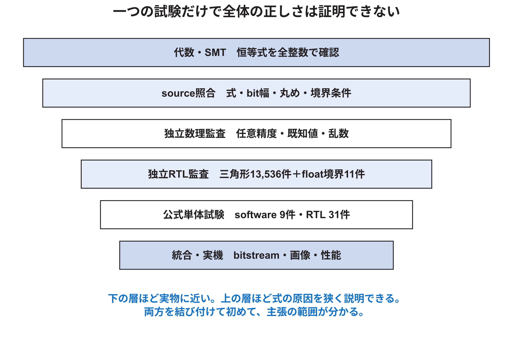

<!-- appendix-content:start -->
<a id="ch_z"></a>
# 第58章 数式とソースと試験を対応付けた検証記録
<!-- appendix-content:end -->

[付録の総目次](../../技術付録.md) ｜ [論文本文](../../本文.md) ｜ [参考文献](../references.md)

[第IV部 RasterIXと描画システム](README.md)

ファイルパスの表記は、[資料フォルダー](../../README.md)を基準とする。

## このページの目次

- [58.1 完璧という語を検証可能な主張へ分解する](#s_z_1)
- [58.2 固定したsourceと変更禁止範囲](#s_z_2)
- [58.3 公式software試験](#s_z_3)
- [58.4 公式Verilator試験](#s_z_4)
- [58.5 公式C++を呼ぶsource-level監査](#s_z_5)
- [58.6 独立したRTL Rasterizer監査](#s_z_6)
- [58.7 FloatToIntの4値RTLとArtix-7合成後監査](#s_z_7)
- [58.8 独立した数理監査](#s_z_8)
- [58.9 主張からsourceと試験への対応表](#s_z_9)
- [58.10 今回訂正した説明](#s_z_10)
- [58.11 再実行手順](#s_z_11)
- [58.12 まだ証明していないこと](#s_z_12)
- [58.13 RTL Rasterizer監査で固定したものと残る拡張](#s_z_13)
- [58.14 「正しい画像」と「正しい内部処理」を分ける](#s_z_14)
- [58.15 本研究で採用できる最終的な主張](#s_z_15)

<!-- appendix-content:start -->
<a id="s_z_1"></a>
## 58.1 完璧という語を検証可能な主張へ分解する

有限規模の卒業研究で、C++、SystemVerilog、コンパイラ、FPGA、DDR3、displayを含む全状態について誤りが存在しないことを証明するのは現実的でない。本章では代わりに、主張ごとに前提、導出、試験、未確認範囲を示す。



| 証拠 | 強く言えること | それだけでは言えないこと |
|---|---|---|
| 代数導出 | overflow前の式が全入力に成立 | RTLの配線が式どおり |
| SMTによる反例探索 | 論理式と前提の範囲で反例がない | 数式化していない回路状態、tool自体の誤り |
| ソース inspection | 固定commitの記述内容 | synthesis後の全動作 |
| C++ ソース harness | そのコンパイラ・入力での出力 | 他の全入力、RTL同値 |
| official CTest | 登録されたcaseが成功 | 未登録モジュール、実機統合 |
| independent randomized audit | 多数caseで恒等式の実装が一致 | 無限入力の形式証明 |
| FPGA実機画像 | そのbitstream・sceneで表示 | 内部全状態や境界case |

<a id="s_z_2"></a>
## 58.2 固定したsourceと変更禁止範囲

| 対象 | commit | 状態 |
|---|---|---|
| Wally統合repository | `d3e181ac434a01a1f174549b5fbc7ee03a8875b4` | 監査開始時clean |
| 公式RasterIX submodule | `9fdcf97a31b2e4247594e06d605871980cd5e9e1` | 監査開始時clean |

監査プログラムとbuild directoryはrepository外へ置き、RasterIX ソースを変更していない。公式ソースを変えずにinclude・linkし、結果だけを研究資料側へ保存した。

<a id="s_z_3"></a>
## 58.3 公式software試験

out-of-tree buildでソフトウェア CTest 9件を実行し、9件すべて成功した。

| test | 結果 |
|---|---|
| attributeInterpolator | pass |
| blendFunc | pass |
| fog | pass |
| logicOp | pass |
| rasterizer | pass |
| stencilOp | pass |
| testFunc | pass |
| texEnv | pass |
| textureMap | pass |

ソフトウェア rasterizer試験には`w==0`の境界を含むcaseがある。これはソフトウェア modelの境界規則を確認するが、RTL Rasterizerの同値を直接試験しない。

<a id="s_z_4"></a>
## 58.4 公式Verilator試験

Verilator 5.026を使うout-of-tree buildで、登録された31件すべてが成功した。数値経路に直接関係する主なtestは次である。

| test | 主に確認する対象 |
|---|---|
| attributeInterpolationX | fixed属性の増分更新 |
| attributePerspectiveCorrectionX | 逆数、テクスチャ復元、color・depth出力 |
| triangleStreamF2XConverter | float語からfixed語への変換 |
| textureSampler | 四texel 番地、clamp、sub-coordinate |
| colorInterpolator | 8 bit色補間 |
| texEnv | テクスチャと前段色の合成 |
| framebufferScissor | 半開区間のwrite mask |
| stencilOp、logicOp | 画素単位operation |

`sim_rasterizer.cpp`という名前のファイルは存在するが、内容は有効なRasterizer検証を行わず、CTestにもRTL Rasterizer試験として登録されない。このため31/31成功を「Rasterizerを含む全RTLの証明」と解釈しない。

<a id="s_z_5"></a>
## 58.5 公式C++を呼ぶsource-level監査

`../../experiments/rasterix-math/rasterix_descriptor_audit.cpp`は、公式`Rasterizer.cpp`とソフトウェア rasterizerをrepository外でcompileし、次をassertした。

1. Breakoutと同じ半画素移動をした4×4四角形を二三角形へする。
2. 二つの`TriangleDesc`を公式ソフトウェア rasterizerへ渡す。
3. 画素集合の和が16であることを確認する。
4. 共有辺4画素が重複し、画素候補合計が20であることを確認する。
5. scissorが記述子bounding boxを書き換えないことを確認する。
6. `Veci::createFromVec`の負数を含む8入力を確認する。

| 観察値 | 結果 |
|---|---|
| triangle 0 bounding box | [0,0,5,5] |
| triangle 1 bounding box | [0,0,5,5] |
| union | 16画素 |
| overlap | 4画素 |
| 画素候補合計 | 20 |
| scissorによるdescriptor bbox書換え | false |
| Q5変換 | [-31,-15,0,0,1,16,32,48] |

この試験はRTL Rasterizerを実行していない。しかし、CPU側記述子、ソフトウェア walker、既存境界規則を同じ入力で具体化し、従来説明の誤りを見つける役割を果たした。

<a id="s_z_6"></a>
## 58.6 独立したRTL Rasterizer監査

公式repositoryには有効なRTL Rasterizer単体試験が登録されていなかったため、`qa/rtl_rasterizer_audit`にrepository外のVerilator harnessを作った。公式`Rasterizer.v`は変更せず、モジュールへbbox、三辺の初期値、X増分、Y増分を直接与えた。

まず、58.5で公式C++が作った4×4四角形の二つの記述子を、同じ数値のままRTLへ入れた。ソフトウェア walkerとRTL walkerは同一行を走る順序が一部異なったため、両者については`(x,y,index)`の**多重集合**を比較した。単なる集合ではなく多重集合にしたのは、同じ画素を誤って二度生成した場合も失敗させるためである。二つの三角形はいずれも全画素候補が一致した。

次に、RTL内部の`ready`を周期的に0へし、パイプラインの受取り停止を発生させた。この場合はRTLの常時ready実行と、値だけでなく出力順序まで一致した。さらに`w0=w1=w2=0`の1×1境界入力が1画素を生成することを確認した。

最後に、6×6整数格子の36点から異なる三点を選ぶ全組合せを取り、面積0の組を除き、両方の頂点順を試した。各入力について、RTLとは別に三辺の辺関数を全bbox画素で直接評価し、`w0>=0 && w1>=0 && w2>=0`となる参照多重集合を作った。

| 確認 | 結果 |
|---|---:|
| 非退化三角形・両頂点順 | 13,536 case pass |
| 比較したRTL 画素候補 | 86,496 画素候補 |
| 4×4のソフトウェア／RTL多重集合 | 二三角形とも一致 |
| 周期ready停止 | 値・順序とも常時ready実行と一致 |
| `w==0`境界 | 1×1の1画素を生成 |

この全数試験は「6×6整数格子から作る三角形」という有限領域では漏れがない。一方、任意の32 bit記述子、画面外座標、全tile offset、算術overflow、synthesis後の回路まで証明するものではない。実行結果は`../../experiments/rasterix-math/rasterix-rtl-rasterizer-audit.json`へ保存した。

Verilatorは`if (rrCmd & RR_CMD_*)`の五箇所に、6 bit値を条件式へ使う`WIDTHTRUNC` warningを出した。現在の定数では、0なら偽、非0なら真という意図どおりにsimulationされ、上記照合も成功した。これは直ちに機能不良を示す結果ではないが、将来のソース整理では`if ((rrCmd & RR_CMD_*) != 0)`と意図を明示できる箇所である。

<a id="s_z_7"></a>
## 58.7 FloatToIntの4値RTLとArtix-7合成後監査

`qa/float_to_int_audit`は、公式RasterIX checkoutを変更せず、57.3で示した`shiftSize=0`と極小値aliasを二段階で試した。

1. XSIMで未変更`FloatToInt.v`を4値RTL simulationした。
2. 同じソースをNexys Videoの`xc7a200tsbg484-1`向けにVivado 2025.2で合成し、functional netlistを4値simulationした。

| 層 | case | pass | fail | 読み取れること |
|---|---:|---:|---:|---|
| 未変更RTL、4値XSIM | 11 | 3 | 8 | shift 0の範囲外bit選択と極小値aliasを検出した |
| Artix-7合成後functional netlist | 11 | 9 | 2 | shift 0代表値は正しいが、極小正負値が±1になる |

未変更RTLのshift 0失敗を、そのままNexys Video上の故障件数と読んではならない。この部分は合成後には正しい。一方、極小値二件は合成後にも再現したため、回路の入力契約または公式RTLで対処すべき実在の数値境界である。ここで確定したのは、RTLと合成後netlistの意味がshift 0で一致しないこと、現在の合成後回路にも5 bit shift量の極小値aliasが残ること、Breakout代表記述子はその値域へ入らないことの三点である。

保存物は次である。

| ファイル | 内容 |
|---|---|
| `../../experiments/rasterix-math/rasterix-float-to-int-rtl-four-state.txt` | 未変更RTLのXSIM log |
| `../../experiments/rasterix-math/rasterix-float-to-int-synthesis.txt` | Artix-7合成log |
| `../../experiments/rasterix-math/rasterix-float-to-int-post-synth.txt` | 合成後functional simulation log |
| `../../experiments/rasterix-math/rasterix-float-to-int-audit.json` | caseごとの入力、offset、出力、期待値 |

<a id="s_z_8"></a>
## 58.8 独立した数理監査

`../../experiments/rasterix-math/rasterix_math_audit.py`は公式実装を呼ばず、式をPythonの任意精度整数で独立計算した。

| 確認 | case数 | 結果 |
|---|---:|---|
| 辺関数の和とX・Y増分 | 200,000 | pass |
| clip交点の平面距離 | 100,000 | pass |
| ColorMixer式 | 200,000 | pass |
| 8 bit補間の両端 | 65,536組×両端 | pass |
| bilinearの四隅 | 4 | pass |
| fixed形式の範囲 | 4形式 | pass |
| FloatToInt underflow指数分類 | 正規化指数254個×3形式 | counterexampleと安全域を確認 |
| 640×480のint32面積上限 | 1 | pass |

乱数seedは`0x524958`に固定し、同じcaseを再現できる。JSON結果は`../../experiments/rasterix-math/rasterix-mathematical-audit.json`へ保存した。

乱数試験とは別に、`../../experiments/rasterix-math/rasterix_formal_audit.py`をZ3 5.1.0で実行した。各命題の否定をsolverへ渡し、`unsat`、すなわち記した前提の下では反例が存在しないことを確認した。

| 形式的に確認した命題 | 変数領域 | 結果 |
|---|---|---|
| 三辺関数の和が向き付き面積に等しい | 数学的な全整数 | 反例なし |
| X・Y一画素移動の増分式 | 数学的な全整数 | 反例なし |
| 遠近補正で共通非0倍率が比から消える | 分母非0の実数 | 反例なし |
| clipping交点の平面距離が0 | 二距離が異なる実数 | 反例なし |
| 17 bit ColorMixer bit sliceと整数式が同値 | 全有効中間値255から130,305 | 反例なし |
| ColorMixer出力が0から255 | 同上 | 反例なし |
| 8 bit補間の`u=0`と`u=255`が両端値を返す | A、Bの全65,536組に相当する整数制約 | 反例なし |
| FloatToIntの`p=-1`は絶対値1へ丸める | 全24 bit正規化仮数 | 反例なし |
| FloatToIntの`-102<=p<=-2`は数学上0へ丸める | 全24 bit正規化仮数と指数 | 反例なし |
| ソースの`-8<=p<=-2`で選ぶround bitは0 | 全24 bit正規化仮数と指数 | 反例なし |
| ソースの`p=-1`で選ぶround bitはhidden bitの1 | 全24 bit正規化仮数 | 反例なし |
| ソースの`0<=p<=22`は絶対値のhalf-up式と同値 | 全24 bit正規化仮数と23指数 | 反例なし |
| ソースの`24<=p<=30`は正確な左shiftでsigned正値範囲内 | 全24 bit正規化仮数と7指数 | 反例なし |
| 負号の`~magnitude+1`は32 bit剰余否定 | 全32 bit pattern | 反例なし |

Z3では16命題の否定を`unsat`とした。これとは別に、辺関数の長方形上限は多重一次式の極値が隅で得られる性質を使い、各画面について64隅組を任意精度整数で全数確認した。監査JSON上は合計17検証項目であり、結果は`../../experiments/rasterix-math/rasterix-formal-audit.json`へ保存した。Z3の証明も、有限bit C++やRTLが正しく配線されていることを単独で証明しないため、ソース試験とRTL試験を別に残す。

<a id="s_z_9"></a>
## 58.9 主張からsourceと試験への対応表

| 主張 | 主なソース | 検証 |
|---|---|---|
| Q5式は`trunc(32x+0.5)` | `lib/gl/math/Veci.hpp` | C++ harness、Python既知値 |
| bboxは`+16`と`+48`後にshift | `lib/gl/renderer/Rasterizer.cpp` | C++ harnessの[0,0,5,5] |
| 辺増分は一定 | `Rasterizer.cpp` | 代数導出、Z3反例なし、20万case |
| insideは三辺`>=0` | `rtl/RasterIX/Rasterizer.v` | ソース inspection、ソフトウェア境界test、RTL有限全数試験 |
| top-left規則なし | `Rasterizer.v` | ソース inspection、ソフトウェア／RTLの4画素重複 |
| scissorは半開区間 | `FramebufferScissor.v` | 公式Verilator test |
| CPU scissorはbboxを書換えない | `Rasterizer.cpp` | C++ harness |
| テクスチャ固定形式はS3.28 | `TriangleStreamF2XConverter.v` | 公式converter test |
| shift 0のRTLと合成後挙動は異なる | `FloatToInt.v` | XSIM 4値RTL、Vivado Artix-7合成後simulation |
| 極小floatは5 bit shift量でaliasし得る | `FloatToInt.v` | 代数的分類、正負のRTL・合成後再現、Breakout代表descriptor監査 |
| perspective段は17 周期 | `AttributePerspectiveCorrectionX.v` | ソース、公式Verilator test |
| ColorMixerは`(+255)/256` | `ColorMixer.v` | Z3で全有効17 bit中間値、20万case、端点全数 |
| Breakoutは半画素移動する | `examples/rasterix/BreakoutRenderer.hpp` | ソース、画素集合test |

<a id="s_z_10"></a>
## 58.10 今回訂正した説明

| 以前の読み方 | ソース照合後の説明 |
|---|---|
| 辺関数は画素中心へ直接0.5を足して評価する | 辺関数sampleは整数格子。0.5はbbox整数化とBreakout側変換に別々に現れる |
| Q5変換は正負対称な四捨五入 | `value×32+0.5`を0方向へ整数化するため負数で非対称 |
| 共有辺は片方だけが描く | top-left規則がなく、4×4例では4画素を両方が生成 |
| CPU scissorがbboxを切り詰める | CPUは非重複を早期除外するだけで、画素maskはRTL後段 |
| 公式RTL Rasterizer testがある | ファイル名はあるが有効な登録testではないため、repository外の独立Verilator試験を追加した |
| fixed変換は範囲外を飽和する | `FloatToInt` overflowは0を出す |
| Verilatorで通れば4値RTLでも定義済み | `shiftSize=0`は2値Verilatorで見えず、4値RTLでは不定値が現れる。ただしArtix-7合成後代表値は正しい |

訂正を残す理由は、最初から正しかったように見せるためではない。どの思い込みがソースと一致しなかったかを明示すると、同じ誤読を防げる。

<a id="s_z_11"></a>
## 58.11 再実行手順

公式checkoutを変更せず、監査側のPythonを再実行する。

```bash
python ../../experiments/rasterix-math/rasterix_math_audit.py
```

形式監査には`z3-solver`が必要である。

```bash
python ../../experiments/rasterix-math/rasterix_formal_audit.py
```

公式ソフトウェア testの保存済みbuildを再実行する例は次である。

```bash
cd "$RESEARCH_ROOT/build/rasterix-software"
ctest --output-on-failure
```

公式Verilator testは次である。

```bash
cd "$RESEARCH_ROOT/build/rasterix-verilator"
ctest --output-on-failure
```

C++ ソース harnessの実行結果はJSONとして保存する。

```bash
"$RESEARCH_ROOT/build/rasterix-descriptor/rasterix_descriptor_audit"
```

独立RTL Rasterizer監査は、公式checkoutを変更せず次でbuildして実行する。

```bash
bash qa/rtl_rasterizer_audit/build_and_run.sh
```

FloatToIntの未変更RTL 4値simulationとArtix-7合成後simulationは次である。現在の公式ソースでは、最初のcommandは11件中8件、二番目は11件中2件の`AUDIT_FAIL`を検出し、どちらも非0終了する。これは試験環境の失敗ではなく、前者では`shiftSize=0`の4値RTL問題と極小値alias、後者では合成後にも残る極小値aliasを再現した結果である。case別の期待値と実測値は`../../experiments/rasterix-math/rasterix-float-to-int-audit.json`で照合する。

```bash
bash qa/float_to_int_audit/run_vivado.sh
bash qa/float_to_int_audit/run_post_synth.sh
```

build directoryは再利用物なので、別PCでの再現には同じcommitからCMake configureとcompileをやり直す。成功条件はtest数だけでなく、0 failure、使用commit、コンパイラ、Verilator versionを一緒に保存することである。

<a id="s_z_12"></a>
## 58.12 まだ証明していないこと

| 未証明項目 | 現在言える範囲 | 次の検証 |
|---|---|---|
| RTL Rasterizerと参照式の任意入力同値 | 6×6格子の13,536 caseと4×4実記述子は一致 | 形式検証または入力範囲を拡大した差分試験 |
| 全座標でoverflowしないこと | 640×480の単純上限は安全 | 64 bit referenceと全descriptor range assertion |
| q=0、負qの遠近補正 | current testは正q | 入力契約をassertし、異常caseを試験 |
| FloatToIntの任意float bit patternと合成後回路 | 正規化値の`p=-8..22`と`24..30`は全仮数で式を確認し、11境界値では合成後も比較した。`p<-8`のalias反例も確定 | `p=23`について合成後回路の全仮数同値、subnormal・NaN・infinityの仕様化。RTLを修正する場合は修正版との形式的同値 |
| threaded scissorの開始非0 | ソース上の不整合候補 | レジスタ列からdescriptorまでの単体test |
| 全blend・stencil共有辺結果 | 4×4不透明集合だけ確認 | 半透明・stencil sceneのpixel-exact比較 |
| 任意OpenGL プログラムの仕様準拠 | 本研究で使う機能を確認 | 対象APIごとのconformance corpus |
| synthesis後の算術とRTL simulationの同値 | 公式testと実機scene | formal equivalenceまたはILA trace |
| metastabilityやtiming failureがないこと | timing reportは別資料 | CDC、timing、実機長時間試験 |

この表を空にするまで「完全」と言うのではなく、研究の主張に必要な行を選び、その行の検証を完了させる。Breakoutの設計説明に直接必要なのは、640×480、使用API、固定パラメータ、実際の四角形・文字sceneである。

<a id="s_z_13"></a>
## 58.13 RTL Rasterizer監査で固定したものと残る拡張

今回の独立試験は、次のうち1から5を実装した。

1. C++ harnessが作った`TriangleDescX`の全語をtest vectorへ保存する。
2. RTL Rasterizerへ同じbbox、w初期値、X・Y増分を与える。
3. `valid && ready && pixel && keep`の周期だけ`(spx,spy,index)`を収集する。
4. readyを常時1、周期停止、擬似乱数停止の三条件で実行する。
5. ソフトウェアとは画素多重集合を比較し、RTLのready条件間では順序も比較する。
6. `w=0`、1×1、4×4共有辺を個別caseにする。

負座標はモジュール portがunsigned画面座標であるため、通常は前段clipping後に現れない。帯offset、空bbox、最大bit幅付近、32 bit wrapは追加余地として残る。現在のtest vectorは、境界規則をtop-leftへ変更したとき、意図した画素差とready停止への耐性をreviewする基礎になる。

<a id="s_z_14"></a>
## 58.14 「正しい画像」と「正しい内部処理」を分ける

4×4四角形は最終画像として16画素を正しく塗るが、内部では20 画素候補を生成する。この例は、画像一致だけでは内部効率や副作用を証明できないことを示す。

| 観点 | 4×4不透明例 |
|---|---|
| 覆われた画素集合 | 正しい16画素 |
| 欠け | なし |
| 画素候補重複 | 4 |
| 不透明な最終色 | 見た目は同じ |
| blend・stencilへの一般化 | 別試験が必要 |
| 性能 | 重複分のパイプライン仕事が増える |

発表では「四角形が正しく見えた」と「画素候補が一度ずつ処理された」を同じ結果として述べない。

<a id="s_z_15"></a>
## 58.15 本研究で採用できる最終的な主張

現在の証拠から、次は根拠を示して述べられる。

1. 固定した公式RasterIXを変更せずWallyへ結合した。
2. 640×480のBreakoutと同じ半画素規則を使う画面内4×4例は、16画素を隙間なく覆う。
3. RasterIXの辺関数増分とbarycentric恒等式は、overflow前の全整数について代数導出とZ3の反例なし結果が一致した。
4. 固定小数点、遠近補正、テクスチャ、混色の実装形式と遅延をソースへ対応付けた。
5. 公式ソフトウェア 9件とVerilator 31件は固定環境で全件成功した。
6. 独立RTL Rasterizer監査では、6×6格子の13,536入力と86,496 画素候補が参照式に一致し、4×4実記述子とready停止も一致した。
7. 共有辺の二重画素候補、負座標丸め、CPU scissorの役割、任意32 bit入力の形式証明不足を限界として特定した。
8. float-to-fixedのshift 0境界では未変更RTL 4値simulationとArtix-7合成後simulationが異なり、合成後のshift 0代表値は期待値と一致した。
9. 5 bit shift量による極小値aliasをRTLと合成後回路で再現し、現在のBreakout代表descriptorがその値域へ入らないことを確認した。
10. 正規化有限値について、`p=-8..22`と`p=24..30`のソース算術を全24 bit仮数で形式確認し、未定義の`p=23`と誤変換し得る`p<-8`を証明範囲から分離した。

「RasterIX全体を数学的に完全証明した」「任意のOpenGL プログラムで正しい」「すべての境界条件を試験した」とは述べない。主張を狭くすることは成果を弱める行為ではなく、どこまで確認したかを第三者が再現できる形にする行為である。
<!-- appendix-content:end -->

---

[前：第57章 固定小数点と補間とテクスチャと混色の計算](fixed-point-color-math.md) ｜ [次：第59章 Nexys Video対応とRasterIX接続をファイルから再現する](../05-integration/board-reproduction.md)
