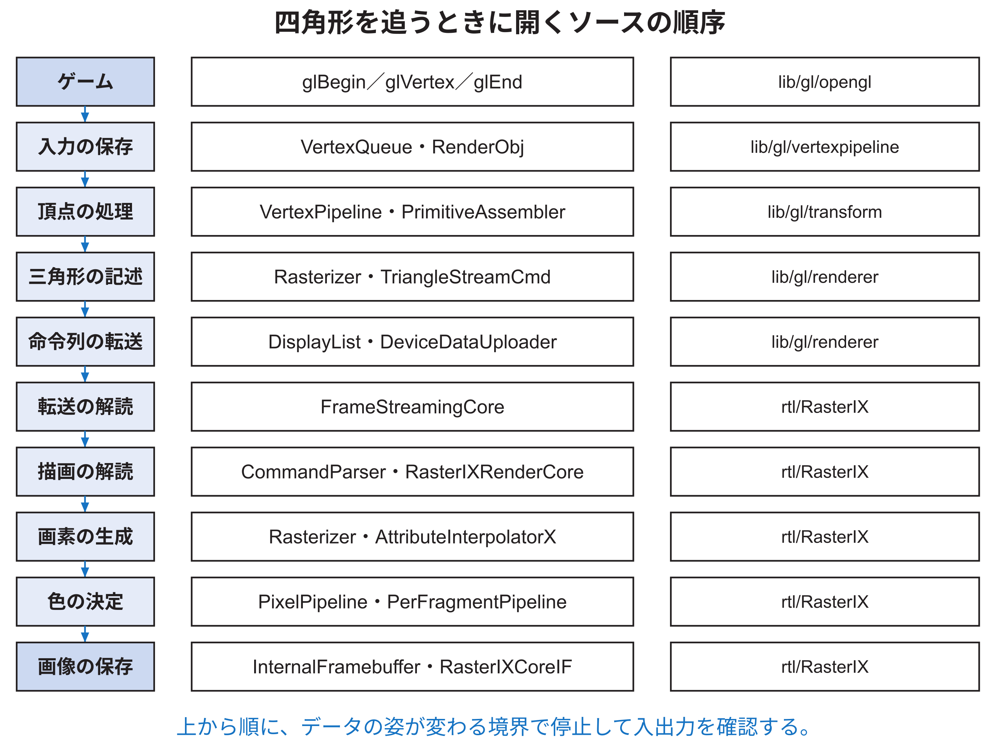
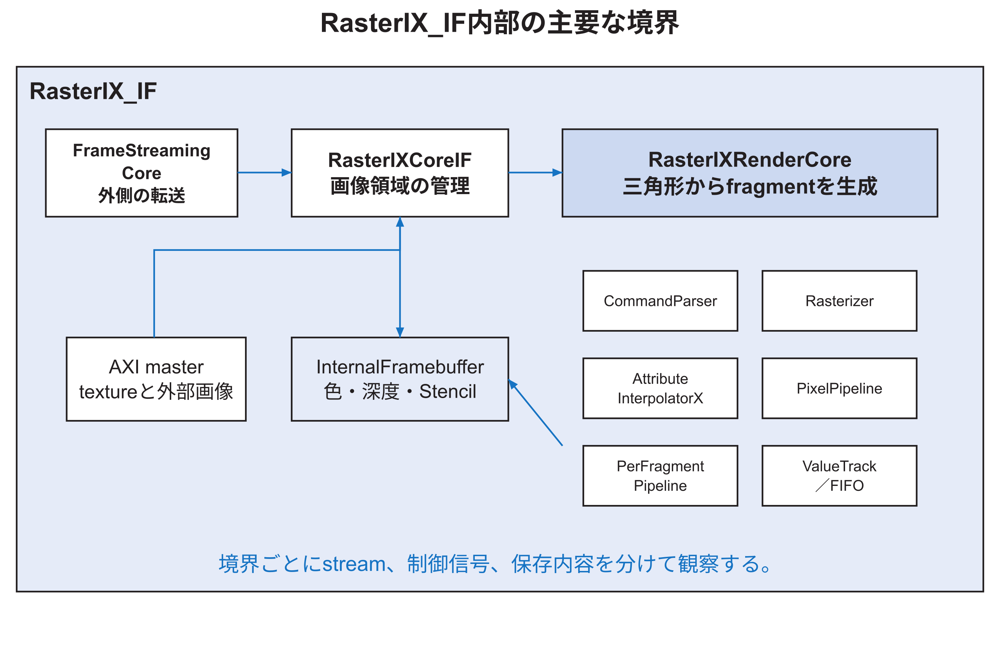

<!-- appendix-content:start -->
<a id="ch_n"></a>
# 第46章 RasterIXを開発者の視点で読むための地図
<!-- appendix-content:end -->

[付録の総目次](../../技術付録.md) ｜ [論文本文](../../本文.md) ｜ [参考文献](../references.md)

[第IV部 RasterIXと描画システム](README.md)

ファイルパスの表記は、[資料フォルダー](../../README.md)を基準とする。

## このページの目次

- [46.1 この章でいう「開発者並みの理解」](#s_n_1)
- [46.2 説明の基準版と、変わり得る箇所](#s_n_2)
- [46.3 RasterIX_IFとRasterIX_EFは何が違うか](#s_n_3)
- [46.4 上位から見たモジュール階層](#s_n_4)
- [46.5 ソフトウェアとRTLの分担](#s_n_5)
- [46.6 データ、制御、保存場所を混ぜない](#s_n_6)
- [46.7 二次元ゲームでも三角形の回路を使う理由](#s_n_7)
- [46.8 読解を始める実際のコマンド](#s_n_8)
- [46.9 この後の読み方](#s_n_9)

<!-- appendix-content:start -->
<a id="s_n_1"></a>
## 46.1 この章でいう「開発者並みの理解」

RasterIXの開発者並みに理解するとは、全ソースを暗記することではない。ある画面上の現象から関係する処理段を選び、入力、内部状態、出力をソースで確認し、変更した場合の影響を予測し、試験で確かめられることである。本章では、少なくとも次の七つを自分で行える状態を目標とする。

| 能力 | できること | 本章の入口 |
|---|---|---|
| 経路を追う | `glVertex2f`からFramebufferの書込みまで追う | [技術付録第47章](rectangle-to-pixels.md#ch_o) |
| 命令を読む | 32 bitの語がどの層の何を意味するか判定する | [技術付録第48章](command-bit-layout.md#ch_p) |
| 数式とRTLを結ぶ | 辺関数、増分、固定小数点を信号へ対応させる | [技術付録第49章](triangle-descriptors.md#ch_q)・[技術付録第51章](rasterizer-interpolation.md#ch_s) |
| 制御を読む | 状態機械とvalid／readyによる停止を説明する | [技術付録第50章](rtl-control-stalls.md#ch_r) |
| 色の決定を追う | テクスチャ、fog、alpha、depth、blendを追う | [技術付録第52章](textures-pixel-pipeline.md#ch_t)・[技術付録第53章](fragment-tests-blending.md#ch_u) |
| 画像の保存を追う | 内部BRAM、DDR3、表示切替を区別する | [技術付録第54章](framebuffer-memory-display.md#ch_v) |
| 安全に変更する | 変更単位、試験、波形、実機確認を選ぶ | [技術付録第55章](rasterix-development.md#ch_w) |

「名前を知っている」だけでは、この目標を満たさない。例えばRasterizerという名前を知るだけでなく、入力される`TriangleDescX`のどの値を使い、どの状態で座標を動かし、出力の`tindex`をどう作るかまで説明できる必要がある。一方で、すべてのVerilog文を一度に読む必要もない。図46.1の順に、データの姿が変わる境界で止まりながら読む。



<a id="s_n_2"></a>
## 46.2 説明の基準版と、変わり得る箇所

本章が説明する公式RasterIXは、サブモジュールで固定したコミット`9fdcf97a31b2e4247594e06d605871980cd5e9e1`である。Wally側は本研究の基準版[Console26](../references.md#ref_console26)である。開発中の`main`ブランチは将来変わり得るため、行番号よりも、モジュール名、クラス名、信号名、固定コミットを手掛かりにする。[RasterIX](../references.md#ref_rasterix)

公式RasterIXのソース自体には変更を加えていない。したがって本章では、次の二種類を明確に分ける。

| 種類 | 例 | 読む場所 |
|---|---|---|
| 公式RasterIXの設計 | Rasterizer、TMU、内部Framebuffer | `addins/rasterix` |
| 本研究で追加した結合 | APBレジスタ、非同期FIFO、DDR3共有、表示切替 | `fpga/src`と`examples/rasterix` |

公式の内部設計を説明する箇所で、本研究がその回路を新規設計したかのようには書かない。本研究で設計したのは、Wallyから公式RasterIXを利用できる接続と、その構成で二次元ゲームを動かすソフトウェアである。

<a id="s_n_3"></a>
## 46.3 RasterIX_IFとRasterIX_EFは何が違うか

公式RasterIXには、主に`RasterIX_IF`と`RasterIX_EF`という二つの構成がある。末尾のIFはInternal Framebuffer、EFはExternal Framebufferを指す。本研究が採用したのは`RasterIX_IF`である。

`RasterIX_IF`は、描画中の色、深度、StencilをFPGA内部のメモリへ置く。内部領域より画面が大きいときは、画面を横長の帯へ分け、一帯ずつ内部で描いてDDR3へ書き出す。内部メモリは低遅延で、画素パイプラインへ毎周期データを供給しやすい。一方で、同じ図形を各帯について処理する場合があり、テクスチャも帯ごとに読み込む可能性がある。

`RasterIX_EF`は、色、深度、Stencilを最初から外部メモリに置く。画面全体を一度に扱いやすく、同じテクスチャの再読込みを減らせる可能性がある。しかし、各画素候補について外部メモリの読書きを待つため、メモリ系が追いつかないとパイプラインが停止する。公式`design.md`も、理論上の利点に対して実際にはメモリ供給不足で停止しやすいと説明している。[RasterIX](../references.md#ref_rasterix)

| 観点 | RasterIX_IF | RasterIX_EF |
|---|---|---|
| 描画中の画素保存 | FPGA内部メモリ | 外部システムメモリ |
| 大きな画面 | 帯へ分割 | 画面全体を直接扱う |
| 画素アクセスの遅延 | 小さく予測しやすい | 外部メモリの混雑に依存 |
| 必要なFPGA内メモリ | 多い | 少ない |
| 本研究 | 採用 | 不採用 |

この選択は、「IFが常に優れている」という評価ではない。Nexys Video上で、公式の内部Framebuffer構成を保ち、640×480の二次元画像を確実に作るという条件に合う構成を選んだ。

<a id="s_n_4"></a>
## 46.4 上位から見たモジュール階層

`RasterIX_IF.v`は外部に、命令stream、応答stream、Framebuffer切替、AXIメモリmasterを見せる。その内側には、転送を扱う`FrameStreamingCore`、内部画像を管理する`RasterIXCoreIF`、三角形から画素候補を作る`RasterIXRenderCore`がある。図46.2は所有範囲を示す。



| 階層 | 主な責務 | 代表ファイル |
|---|---|---|
| `RasterIX_IF` | 外部streamとAXIをまとめる | `rtl/RasterIX/RasterIX_IF.v` |
| `FrameStreamingCore` | stream間・メモリ間の転送を解読する | `rtl/RasterIX/FrameStreamingCore.v` |
| `RasterIXCoreIF` | 内部Framebufferと外部画像の受渡し | `rtl/RasterIX/RasterIXCoreIF.v` |
| `RasterIXRenderCore` | 描画命令を画素へ変換する | `rtl/RasterIX/RasterIXRenderCore.v` |
| `CommandParser` | 内側の描画命令を解読する | `rtl/RasterIX/CommandParser.v` |
| `Rasterizer` | 三角形内の画素座標を列挙する | `rtl/RasterIX/Rasterizer.v` |
| `AttributeInterpolatorX` | 色、深度、テクスチャ座標を補間する | `rtl/RasterIX/AttributeInterpolatorX.v` |
| `PixelPipeline` | テクスチャとfogを適用する | `rtl/RasterIX/PixelPipeline.v` |
| `PerFragmentPipeline` | 各試験、blend、logic opを行う | `rtl/RasterIX/PerFragmentPipeline.v` |
| `InternalFramebuffer` | 色、深度、Stencilを保存する | `rtl/RasterIX/InternalFramebuffer.v` |

上位モジュールを読むときは、すべてのportを一度に理解しようとしない。まず命令stream、画素候補 stream、Framebuffer、AXIメモリという四群に色分けする。その後、各群の`valid`、`ready`、`data`、`last`を追う。

<a id="s_n_5"></a>
## 46.5 ソフトウェアとRTLの分担

RasterIXは、すべてをRTLで処理するGPUではない。CPU側のC++とFPGA側のRTLが仕事を分担する。特に、頂点の行列変換、primitiveの組立て、三角形の辺関数や属性増分の準備は、構成に応じてCPU側で行う。RTLは、その準備済みパラメータを使い、各画素を高速に列挙して色を決める。

| 処理 | 主に担当する側 | 本設定での意味 |
|---|---|---|
| OpenGL APIの状態管理 | CPU上のC++ | 現在色、テクスチャ設定などを保持 |
| 頂点の収集 | CPU上のC++ | 四角形の四頂点を配列へ保存 |
| primitive組立て | CPU上のC++ | 四角形を二三角形へ変換 |
| 行列・clipping・viewport | CPU上のC++ | 画面座標まで変換 |
| 辺関数の初期値と増分 | CPU上のC++ | `TriangleDesc`を作る |
| 内側画素の列挙 | FPGA上のRTL | `Rasterizer.v`が実行 |
| 属性補間 | FPGA上のRTL | 色、深度、テクスチャ座標を更新 |
| テクスチャ、fog、各試験 | FPGA上のRTL | 各画素候補の最終値を決定 |
| 画像保存と外部転送 | FPGA上のRTL | BRAMとDDR3を使用 |

この分担を知らずに「RasterIXが三角形を描く」とだけ覚えると、CPU側の処理時間が大きい理由を理解できない。CPUは四頂点を渡した直後に仕事を終えるのではなく、描画回路が使える記述子を作り、命令列として送信する。

<a id="s_n_6"></a>
## 46.6 データ、制御、保存場所を混ぜない

一つのモジュールを読むとき、信号を三種類に分けると理解しやすい。

**データ**は、色、座標、命令語、テクスチャ、アドレスなど、処理対象そのものである。**制御**は、`valid`、`ready`、`last`、`apply`、`busy`、`ce`など、いつ受け取り、いつ進めるかを決める。**保存場所**は、レジスタ、FIFO、テクスチャ buffer、color buffer、DDR3など、時間をまたいで値を保持する部分である。

例えば`m_frag_tcolor`だけを追っても、`m_frag_tvalid=0`ならその周期の色は有効ではない。逆に`valid=1`でも`ready=0`なら、その値はまだ次段へ受け取られておらず、同じ値を保持しなければならない。データと制御を一緒に読む必要がある。

<a id="s_n_7"></a>
## 46.7 二次元ゲームでも三角形の回路を使う理由

三角形は三次元専用ではない。画面上の四角形は、対角線で二つの三角形へ分けられる。ボール、パドル、ブロック、背景、文字の一文字を載せる長方形も同じである。RasterIX内部を理解するためにテクスチャ座標や遠近補正も説明するが、本研究の成果を三次元ゲームの研究として扱うわけではない。

二次元の場合、多くの値は単純になる。頂点のzを同じ値にし、qも一定にすれば、深度や遠近補正の変化はほとんどない。それでも同じ汎用パイプラインを通る。したがって、二次元ゲームで観察した処理時間には、汎用的な設定管理や三角形記述の費用が含まれる。

<a id="s_n_8"></a>
## 46.8 読解を始める実際のコマンド

基準版を確認し、上位階層と主要クラスを検索するには次を使う。

```bash
cd /path/to/wally-game-console
git submodule status addins/rasterix
cd addins/rasterix
git rev-parse HEAD
rg -n "module RasterIX_IF|module RasterIXRenderCore|module Rasterizer" rtl/RasterIX
rg -n "class VertexPipeline|class Renderer|class DeviceDataUploader" lib/gl
```

期待するRasterIXのHEADは`9fdcf97a31b2e4247594e06d605871980cd5e9e1`である。異なる版を読む場合、本章のモジュール名やbit配置が一致するとは限らない。

この内部解説は上記の固定版に対応する。2026年10月8日の更新版E6では、ページサイズの一致を追加確認し、命令解析回路の入力間隔と受信停止の組合せで重複を再現した。[技術付録71.12〜71.14節](../05-integration/fifo-comparison.md#s_29_12)に、更新版の条件と単体試験を示す。旧版のソースも同じ命令解析回路を含んでいたため、この解説を任意の入力に対する正しさの保証として読まない。

<a id="s_n_9"></a>
## 46.9 この後の読み方

最初に[技術付録第47章](rectangle-to-pixels.md#ch_o)を読み、一つの四角形だけを最後まで追う。その後、疑問に応じて[技術付録第48章](command-bit-layout.md#ch_p)以降へ移る。命令が分からなければ[技術付録第48章](command-bit-layout.md#ch_p)、三角形の数値が分からなければ[技術付録第49章](triangle-descriptors.md#ch_q)と[技術付録第51章](rasterizer-interpolation.md#ch_s)、色が分からなければ[技術付録第52章](textures-pixel-pipeline.md#ch_t)と[技術付録第53章](fragment-tests-blending.md#ch_u)、メモリが分からなければ[技術付録第54章](framebuffer-memory-display.md#ch_v)を読む。最初から全モジュールを横断すると、同名の`Rasterizer`クラスと`Rasterizer` RTL、外側と内側のcommand、内部と外部のFramebufferが混ざりやすい。
<!-- appendix-content:end -->

---

[前：第45章 設計を変更できる理解へ進む](design-change-reasoning.md) ｜ [次：第47章 一つの二次元四角形を画素まで追う](rectangle-to-pixels.md)
