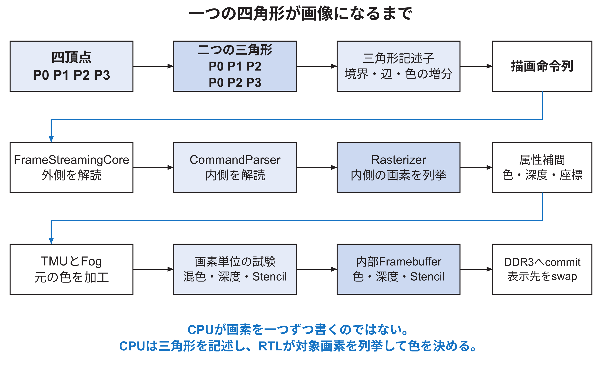

<!-- appendix-content:start -->
<a id="ch_o"></a>
# 第47章 一つの二次元四角形を画素まで追う
<!-- appendix-content:end -->

[付録の総目次](../../技術付録.md) ｜ [論文本文](../../本文.md) ｜ [参考文献](../references.md)

[第IV部 RasterIXと描画システム](README.md)

ファイルパスの表記は、[資料フォルダー](../../README.md)を基準とする。

## このページの目次

- [47.1 追跡する具体例](#s_o_1)
- [47.2 `glColor3f`は現在色を変える](#s_o_2)
- [47.3 `glBegin`と`glEnd`の間で起きること](#s_o_3)
- [47.4 `VertexPipeline::drawObj`が行う順序](#s_o_4)
- [47.5 四頂点が二三角形になる](#s_o_5)
- [47.6 行列変換とviewportは二次元でも通る](#s_o_6)
- [47.7 CPU側Rasterizerが記述子を作る](#s_o_7)
- [47.8 `TriangleStreamCmd`が内側の命令を作る](#s_o_8)
- [47.9 `DeviceDataUploader`が外側の命令を付ける](#s_o_9)
- [47.10 WallyがAPBレジスタへ一語ずつ書く](#s_o_10)
- [47.11 FPGA内で画素が生まれる](#s_o_11)
- [47.12 内部Framebufferから画面へ出る](#s_o_12)
- [47.13 この経路を自分で追う課題](#s_o_13)

<!-- appendix-content:start -->
<a id="s_o_1"></a>
## 47.1 追跡する具体例

例として、左下が`(100, 80)`、右上が`(180, 120)`の赤い長方形を考える。説明を単純にするため、テクスチャ、fog、blend、depth test、stencil testを無効にし、四頂点の色を同じ赤とする。概念上の呼出しは次のようになる。

```cpp
glColor3f(1.0f, 0.0f, 0.0f);
glBegin(GL_QUADS);
glVertex2f(100.0f,  80.0f); // P0
glVertex2f(180.0f,  80.0f); // P1
glVertex2f(180.0f, 120.0f); // P2
glVertex2f(100.0f, 120.0f); // P3
glEnd();
```

このコードから、CPUが8,000画素へ赤を書き込むわけではない。四頂点が二三角形へ変わり、各三角形の境界と色の規則が命令列になる。FPGA側が三角形の内側にある画素を列挙し、各画素へ赤を書き込む。図47.1に全体を示す。



<a id="s_o_2"></a>
## 47.2 `glColor3f`は現在色を変える

`glColor3f`は、その瞬間に画面を赤くしない。RIXGL内部の「現在色」を更新する。続く`glVertex2f`が頂点を追加するとき、その頂点には現在色が関連付けられる。したがって、頂点ごとに`glColor`を変えれば、三角形の三頂点へ異なる色を持たせられる。

`VertexQueue`は、位置だけでなく、その時点の法線、テクスチャ座標、色を対応する配列へ追加する。公式`lib/gl/vertexpipeline/VertexQueue.hpp`では、`addVertex`が`m_vertexBuffer`、`m_normalVertexBuffer`、`m_textureVertexBuffer`、`m_colorVertexBuffer`へ値を追加する。ここで「渡された値を保持する」とは、後で使うためにこれらのC++配列へコピーすることを指す。[RasterIX](../references.md#ref_rasterix)

<a id="s_o_3"></a>
## 47.3 `glBegin`と`glEnd`の間で起きること

`glBegin(GL_QUADS)`は、頂点をどの規則で組み立てるかを`QUADS`へ設定し、頂点配列を空にする。各`glVertex2f`は、二次元の`x`と`y`に加えて、既定の`z`と`w`を持つ四成分の頂点として保存される。`glEnd`は、それまでの配列を`RenderObj`として整え、頂点パイプラインへ渡す。

この段階の主な保存場所はCPUの通常メモリである。まだRasterIXの命令FIFOやFramebufferへは入っていない。したがって、`glVertex2f`の呼出し回数が増えれば、CPU側で配列へ追加し、後段で各頂点を処理する仕事も増える。

<a id="s_o_4"></a>
## 47.4 `VertexPipeline::drawObj`が行う順序

`lib/gl/vertexpipeline/VertexPipeline.cpp`の`drawObj`は、概ね次の順で進む。

1. 頂点配列が有効か確認する。
2. 行列や照明など、変更された大域状態を更新する。
3. Pixel パイプライン側の設定を命令列へ反映する。
4. primitiveの種類と頂点数を設定する。
5. 有効なTMUを局所状態へ記録する。
6. 新しい描画要素の開始を通知する。
7. 頂点を一つずつ`pushVertex`する。

ここでいうPixel パイプラインはC++側の設定管理クラスとRTL側の`PixelPipeline.v`の両方に同じ語が現れる。C++側は「どの機能を有効にするか」を命令へまとめ、RTL側は実際の画素候補へテクスチャやfogを適用する。ファイル拡張子と階層で区別する。

<a id="s_o_5"></a>
## 47.5 四頂点が二三角形になる

`lib/gl/transform/PrimitiveAssembler.cpp`の`QUADS`処理は、最初の三頂点から`P0,P1,P2`を作り、次に保存した`P0`と残る`P2,P3`から`P0,P2,P3`を作る。四角形を二つの三角形にする対角線は`P0`と`P2`を結ぶ線である。

| 生成順 | 三頂点 | 長方形で覆う部分 |
|---|---|---|
| 三角形0 | P0, P1, P2 | 右下側 |
| 三角形1 | P0, P2, P3 | 左上側 |

一般的なRasterizerでは、二三角形の共有辺をどちらか一方だけに含める規則を設けることが多い。しかし、固定したRasterIX ソースでは三辺とも`w >= 0`なら辺上を含め、top-left規則を実装していない。公式ソースを呼び出す独立試験では、半画素移動後の4×4四角形は16個の異なる画素を覆う一方、共有対角線上の4画素を両三角形が生成し、画素候補は合計20個になった。一様な不透明色では最終色が同じでも、blendやstencilを有効にすると共有辺へ二度作用し得る。[技術付録56.14節](coordinates-edge-equations.md#s_x_14)、[技術付録58.5節](mathematical-verification.md#s_z_5)、[技術付録58.6節](mathematical-verification.md#s_z_6)で、入力、ソフトウェア画素集合、RTL照合、適用範囲を示す。

<a id="s_o_6"></a>
## 47.6 行列変換とviewportは二次元でも通る

OpenGL風APIへ渡した座標が、そのままFramebufferの画素番号になるとは限らない。頂点はmodel-view行列、projection行列、clipping、perspective divide、viewport変換を通って画面座標になる。二次元ゲームでは、正投影行列を使い、ゲーム座標と画面画素を分かりやすく対応させることが多い。

正投影を適切に設定し、`(100,80)`が画面上の同じ位置へ写る場合でも、経路そのものは残る。これは汎用APIを利用する費用の一部である。本研究の描画準備時間には、この頂点処理、状態管理、命令列の構築が含まれる。

<a id="s_o_7"></a>
## 47.7 CPU側Rasterizerが記述子を作る

公式C++の`lib/gl/renderer/Rasterizer.cpp`は、三角形を直接塗らない。RTLのRasterizerが使う`TriangleDesc`を作る。主な内容は次である。

| 値 | 意味 |
|---|---|
| `bbStartX`, `bbStartY` | 調べ始める境界箱の左下側 |
| `bbEndX`, `bbEndY` | 調べ終える境界箱の右上側 |
| `wInit[0..2]` | 開始位置における三辺の辺関数 |
| `wXInc[0..2]` | 一画素右へ進むときの辺関数の増分 |
| `wYInc[0..2]` | 一行進むときの辺関数の増分 |
| `color` | 開始位置のRGBA |
| `colorXInc`, `colorYInc` | 右・次行へ進むときの色増分 |
| `depthZw`と増分 | depthとwの開始値・増分 |
| `texStq`と増分 | テクスチャ座標s,t,qの開始値・増分 |

四頂点が同じ赤なら、各三角形の色増分は原理上0に近く、開始色は赤になる。RTLは画素ごとに複雑な重み付き和を最初から計算せず、開始値へ一定の増分を加えていく。

<a id="s_o_8"></a>
## 47.8 `TriangleStreamCmd`が内側の命令を作る

`TriangleStreamCmd`は、先頭に「三角形stream」というoperationを置き、その後へ`TriangleDesc`の語を並べる。`RIXDisplayListAssembler`は、設定命令、Framebuffer命令、三角形命令を順番にdisplay listへ書く。

display listは、画面に表示する一覧という意味ではない。描画回路が順に実行する命令とデータの列である。CPUメモリ上に一度まとめるため、作成側と送信側の速度差を吸収し、複数の命令を一括して転送できる。

<a id="s_o_9"></a>
## 47.9 `DeviceDataUploader`が外側の命令を付ける

内側のdisplay listだけでは、`FrameStreamingCore`は、その列を描画器へ渡すのかDDR3へ保存するのか判断できない。`DeviceDataUploader`は、転送先、転送元、バイト数、必要ならメモリアドレスを持つ外側のヘッダを追加する。display listを描画器へ送る場合、外側は`OP_STREAM`となる。

この外側の命令は、[技術付録第48章](command-bit-layout.md#ch_p)で説明する`FrameStreamingCore`用である。そのペイロードに、`CommandParser`が読む内側の命令が入る。図48.1の三層を混同しない。

<a id="s_o_10"></a>
## 47.10 WallyがAPBレジスタへ一語ずつ書く

本研究の`WallyBusConnector.hpp`は、転送列を32 bit語に分け、RasterIX用APB領域の`CMD`または`CMD_LAST`へ書く。通常の語は`CMD`、転送の最後の語は`CMD_LAST`へ書く。最後を別レジスタにすることで、`TLAST`に相当する境界をRTLへ伝える。

CPU側20 MHzとRasterIX側100 MHzの間には非同期FIFOがある。FIFOが一時的に満杯ならAPBの`PREADY`を下げ、CPUの書込み完了を待たせる。したがって、CPUが書込み命令を実行したことと、RasterIXがその語を解読し終えたことは同じ時刻ではない。

<a id="s_o_11"></a>
## 47.11 FPGA内で画素が生まれる

外側の`FrameStreamingCore`がpayloadをrenderer用streamへ渡し、内側の`CommandParser`が三角形streamを`Rasterizer`用入力へ送る。`Rasterizer`は境界箱を走査し、三辺の辺関数が内側を示す画素について、座標、index、補間器への制御を出す。

`AttributeInterpolatorX`は、その画素の色、深度、テクスチャ座標を増分で更新する。本例ではテクスチャなどが無効なので、`PixelPipeline`は元の赤をほぼそのまま次へ渡す。`PerFragmentPipeline`では無効な試験を通過し、赤がcolor bufferへ書かれる。

<a id="s_o_12"></a>
## 47.12 内部Framebufferから画面へ出る

本構成では、一つの帯を内部Framebufferへ描く。帯が完成すると`COMMIT`によりDDR3上の外部color bufferへ書き出す。五帯がそろって一枚の640×480画像となる。`SWAP`命令は、その外部画像を次の表示先にするよう依頼する。

表示回路はDDR3からRGB565の画素を読み、DVI形式の映像信号をHDMI OUT端子へ送る。RasterIXが画素を書き終えた時点と、表示回路が新しい画像へ切り替えた時点と、ディスプレイがその画素を発光した時点は異なる。

<a id="s_o_13"></a>
## 47.13 この経路を自分で追う課題

次の順でソースを開き、各段で「入力の型」「出力の型」「保存場所」を一行ずつ記録する。

```text
VertexQueue.hpp
  ↓
VertexPipeline.cpp
  ↓
PrimitiveAssembler.cpp
  ↓
Rasterizer.cpp
  ↓
TriangleStreamCmd.hpp
  ↓
RIXDisplayListAssembler.hpp
  ↓
DeviceDataUploader.cpp
  ↓
FrameStreamingCore.v
  ↓
CommandParser.v
  ↓
Rasterizer.v
  ↓
AttributeInterpolatorX.v
  ↓
PixelPipeline.v
  ↓
PerFragmentPipeline.v
  ↓
InternalFramebuffer.v
```

答え合わせでは、単にファイル名が並んでいるかを見ない。例えば`Rasterizer.cpp`の出力は画素列ではなく三角形記述子、`Rasterizer.v`の出力は画素位置を伴うstreamである、と役割の違いを言えることが重要である。
<!-- appendix-content:end -->

---

[前：第46章 RasterIXを開発者の視点で読むための地図](rasterix-source-map.md) ｜ [次：第48章 三種類の命令とビットの配置](command-bit-layout.md)
