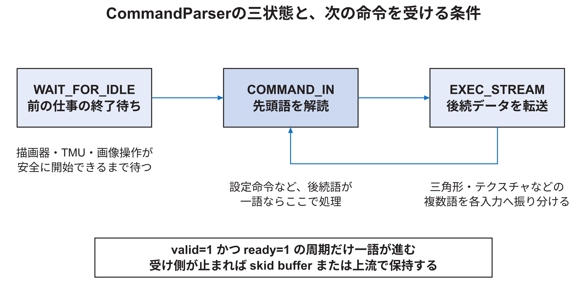
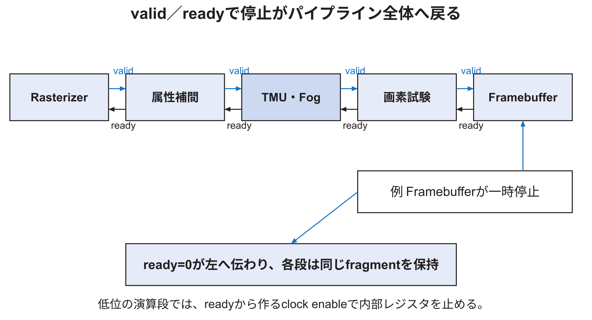

<!-- appendix-content:start -->
<a id="ch_r"></a>
# 第50章 RTL全体の制御と停止を読む
<!-- appendix-content:end -->

[付録の総目次](../../技術付録.md) ｜ [論文本文](../../本文.md) ｜ [参考文献](../references.md)

[第IV部 RasterIXと描画システム](README.md)

ファイルパスの表記は、[資料フォルダー](../../README.md)を基準とする。

## このページの目次

- [50.1 hardware pipelineの全体順序](#s_r_1)
- [50.2 `CommandParser`の三状態](#s_r_2)
- [50.3 なぜ前の仕事の終了を待つのか](#s_r_3)
- [50.4 `ValueTrack`が防ぐread-after-write衝突](#s_r_4)
- [50.5 stream broadcastとconcat](#s_r_5)
- [50.6 validとreadyの受渡し](#s_r_6)
- [50.7 `ce`は低位pipelineの時計を止める許可](#s_r_7)
- [50.8 skid bufferが必要な場面](#s_r_8)
- [50.9 `TLAST`とhidden flush fragment](#s_r_9)
- [50.10 performance信号の意味](#s_r_10)
- [50.11 pipeline latencyとthroughputを分ける](#s_r_11)
- [50.12 reset時に確認する状態](#s_r_12)
- [50.13 control変更の試験観点](#s_r_13)
- [50.14 一つの命令をcycleごとに追う](#s_r_14)
- [50.15 制御変更時に置くassertion](#s_r_15)

<!-- appendix-content:start -->
描画回路の途中には、入力を読んでから結果を出すまで複数段を通る処理がある。出口が止まったとき、途中の値を上書きしないように前の段も止める必要がある。この章では、一個の画素候補に付いた色や番地が、停止中も同じ組として残る仕組みを追う。

<a id="s_r_1"></a>
## 50.1 hardware pipelineの全体順序

`RasterIXRenderCore.v`は、描画器の中心である。固定小数点補間を使うWally構成では、概ね次の順に画素候補が進む。

```text
CommandParser
  → triangle register bank／F2X converter
  → Rasterizer
  → ValueTrackとstream broadcast
  → AttributeInterpolatorX
  → PixelPipeline
  → 既存color／depth／stencilとのStreamConcatFifo
  → PerFragmentPipeline
  → color／depth／stencil framebuffer write
```

テクスチャ dataは別経路から`TextureBuffer`へ入り、`PixelPipeline`内のTMUが読む。render configも別のレジスタ bankへ入り、複数段の制御入力となる。

<a id="s_r_2"></a>
## 50.2 `CommandParser`の三状態

`CommandParser`には、主に`WAIT_FOR_IDLE`、`COMMAND_IN`、`EXEC_STREAM`がある。図50.1は役割を簡略化したものである。



`WAIT_FOR_IDLE`では、前の三角形、framebuffer操作、TMUの準備などが終わるのを待つ。`COMMAND_IN`でoperationを解読する。三角形やテクスチャのように後続streamがある場合、`EXEC_STREAM`で指定先へpayloadを渡す。payloadが終わると次のcommandへ戻る。

<a id="s_r_3"></a>
## 50.3 なぜ前の仕事の終了を待つのか

次の三角形のレジスタを上書きした時点で、前の三角形の画素候補がまだパイプラインに残っていると、前の画素が新しい色や増分を使う危険がある。またFramebufferをclear中に画素候補を書けば、clearと描画の順序が壊れる。

そのため`CommandParser`は、Rasterizerだけでなく、パイプライン内の未完了画素、Framebuffer command、テクスチャ準備の状態も見て開始を制御する。単に「CPUが遅いから待たなくてよい」とは言えない。CPUが次のcommandをいつ送れるかと、内部パイプラインに前の仕事が残るかは別問題である。

<a id="s_r_4"></a>
## 50.4 `ValueTrack`が防ぐread-after-write衝突

同じ画素へ連続して二三角形が描かれる場合、後の三角形がFramebufferの古い色やdepthを読んだ後、前の三角形の書込みが遅れて到着すると、順序が逆転する可能性がある。`ValueTrack`はパイプライン内の画素数を追跡し、新しい三角形の開始条件を制御する。

これはCPUのレジスタ hazardに似ているが、対象は画素のFramebuffer readとwriteである。公式`design.md`は、前のtriangleの画素がパイプラインを流れている間に次のtriangleを開始するread-before-write conflictを避けるためと説明している。[RasterIX](../references.md#ref_rasterix)

<a id="s_r_5"></a>
## 50.5 stream broadcastとconcat

Rasterizerから出た一つの画素候補情報は、属性補間器と、color、depth、stencilの読出しへ分岐する。後段では、新しい画素候補の色・depthと、三つの既存値を同じ画素について再結合する必要がある。

`StreamConcatFifo`は、必要な入力がそろうまで待ち、対応する一組として`PerFragmentPipeline`へ渡す。無効にしたbufferの入力はbypassされる。内部Framebufferのread port自体には自由なbackpressureを掛けられないため、read結果を受けるFIFOが必要になる。

<a id="s_r_6"></a>
## 50.6 validとreadyの受渡し

高位モジュール間では、送信側が`valid`、受信側が`ready`を出し、両方が1の周期に一要素が移る。

| valid | ready | 意味 |
|---:|---:|---|
| 0 | 0または1 | 送信側に有効データがない |
| 1 | 0 | データは提示中だが未受領。保持する |
| 1 | 1 | この周期に一要素を受け渡す |

受信側が停止すると`ready=0`が上流へ戻る。各段は処理中の画素候補を失わず保持する。図50.2では、右端のFramebuffer側の停止が左へ伝わる。



<a id="s_r_7"></a>
## 50.7 `ce`は低位pipelineの時計を止める許可

高位のvalid／readyを、各演算段内部ではクロック enableの`ce`へ変換する。`ce=0`の周期では、パイプライン レジスタを更新せず同じ中間値を保持する。物理クロックそのものを停止しているのではなく、レジスタが次の値を取り込まないようにする。

逆数計算や乗算など、複数周期のパイプラインを途中で停止するとき、dataだけでなくvalid、座標、index、lastも同じ周期数だけそろえて停止しなければならない。一つだけ進むと、色と画素番地が別の画素候補の組合せになる。

<a id="s_r_8"></a>
## 50.8 skid bufferが必要な場面

readyが0へ変わる情報には組合せ経路の遅延がある。送信側が停止を認識する直前に一語を出していた場合、その一語を一時保存する場所が必要になる。`CommandParser`はskid bufferを持ち、destinationが受け取れない一語を保持する。

skid bufferは大量の待ち行列ではなく、readyの変化を安全に受ける小さな弾力性である。非同期FIFOと目的が異なる。skid bufferは同じクロック領域内の即時停止、非同期FIFOはクロック領域間のdata transferと短期bufferingを担当する。

<a id="s_r_9"></a>
## 50.9 `TLAST`とhidden flush fragment

各triangleの最後を示す`last`は、パイプラインのすべての段を通る。Rasterizerは、内部パイプラインに残る値を最後まで押し出すため、画素として書かない`tkeep=0`の終端要素を出す場合がある。`valid=1`でも`keep=0`なら、その要素はcontrolを進めるがFramebufferへ有効画素を書かない。

したがって、simulationで出力要素数を数えるとき、`valid`だけで画素数としない。`valid && ready && keep`を有効画素の受渡しとして数える。終端確認には`last`も見る。

<a id="s_r_10"></a>
## 50.10 performance信号の意味

上位には`perfBusy`、`perfTriangleRendering`、`perfRasterizerStall`などがある。

| 信号 | 分かること | 分からないこと |
|---|---|---|
| `perfBusy` | command処理がidleでない期間 | どの段が原因か単独では不明 |
| `perfTriangleRendering` | triangle処理が進行中か | 画面全体のFPSではない |
| `perfRasterizerStall` | Rasterizer出力validに対しreadyが0 | downstreamのどの段が根因か |

一つのperformance信号だけでボトルネックを断定しない。例えばRasterizer stallは、TMU、Framebuffer、AXI、またはさらに先の停止がbackpressureで戻った結果かもしれない。段ごとのvalid／readyと一緒に観察する。

<a id="s_r_11"></a>
## 50.11 pipeline latencyとthroughputを分ける

ある画素候補が入力から出力まで進む周期数を遅延、一度パイプラインが満たされた後に一周期当たり何画素候補を受けられるかをthroughputと呼ぶ。17 周期の補間器でも、各段がパイプライン化されていれば、毎周期一画素候補を受けられる場合がある。

公式コメントには、固定小数点の属性補正約17 周期、TMU各部の複数段、PerFragment約4 周期などの深さが記されている。ただし機能パラメータ、bypass、stallで実効遅延は変わる。各数を単純加算して「一画素に何周期」と評価しない。

<a id="s_r_12"></a>
## 50.12 reset時に確認する状態

state machine、valid レジスタ、FIFO ポインタ、framebuffer commandの`applied`は、リセット解除時に一貫したidle状態でなければならない。Wally構成ではCPU、DDR、画素のクロック領域ごとにリセットがある。RasterIX本体はDDR側100 MHzで動く。

リセット問題を調べるときは、次を順に確認する。

1. DDR クロックが安定している。
2. RasterIX側リセットが同期して解除された。
3. command FIFOの両側が空を示す。
4. `CommandParser`が`COMMAND_IN`へ入る。
5. Framebuffer commandが未適用状態に残っていない。
6. 最初のcommand受渡しでvalid／readyが同時に1になる。

<a id="s_r_13"></a>
## 50.13 control変更の試験観点

状態機械を変更した場合、正常に連続データを流す試験だけでは足りない。次の停止を挿入する。

| 停止条件 | 期待すること |
|---|---|
| command入力validが途切れる | 受領済みcounterを保持し再開する |
| destination readyが0 | 未転送の語を保持する |
| framebuffer readが遅れる | 画素候補と既存値の対応を保つ |
| 最後の一語でstall | lastとdataを保持する |
| リセットがpacket途中に入る | 規定のidleへ戻り、古いvalidを出さない |

backpressure試験を行わず、常にready=1だけで通すと、実機の混雑時だけ起きるdata lossを見逃す。

<a id="s_r_14"></a>
## 50.14 一つの命令をcycleごとに追う

状態機械を理解するときは、波形全体を眺めるのではなく、一つの短い命令について「その周期で所有権が移ったか」を表にする。次は、header一語とpayload二語を持つ命令を、二語目の直前で受信側が一周期停止する例である。

| 周期 | state | input valid | input ready | input data | destination ready | 起きること |
|---:|---|---:|---:|---|---:|---|
| 0 | `COMMAND_IN` | 1 | 1 | header | 1 | headerを受領し、長さと送信先を記録 |
| 1 | `EXEC_STREAM` | 1 | 1 | payload 0 | 1 | 一語目を転送し、counterを一つ減らす |
| 2 | `EXEC_STREAM` | 1 | 0 | payload 1 | 0 | handshakeなし。dataとlastを保持 |
| 3 | `EXEC_STREAM` | 1 | 1 | payload 1 | 1 | 二語目を転送し、最後として完了 |
| 4 | `COMMAND_IN` | 0 | 1 | ― | 1 | 次のheaderを待つ |

周期 2で`valid=1`でも`ready=0`なので、payload 1はまだ受領されていない。counterを減らしたり、dataを次へ進めたりしてはいけない。周期 3で`valid && ready`になった瞬間にだけ、同じ語の所有権が次段へ移る。この原則を入力、出力、Framebuffer read responseの各streamで適用する。

<a id="s_r_15"></a>
## 50.15 制御変更時に置くassertion

目視波形だけでは、低頻度のstallで壊れる条件を見落とす。simulationでは、少なくとも次の不変条件をassertionまたはtestbenchの検査として置く。

| 不変条件 | 検出できる不具合 |
|---|---|
| `valid && !ready`の間、`data`、`keep`、`last`が変化しない | stall中の語の上書き |
| counterは`valid && ready`のときだけ進む | 未受領語の消失、二重転送 |
| packet最後の受渡しと`last`が同じ周期になる | packet境界の一語ずれ |
| `keep=0`の要素でcolor／depthを書かない | flush要素を画素として保存 |
| リセット後、古い`valid`と未完了commandが残らない | リセット跨ぎの幽霊転送 |
| concatした各streamのindexが一致する | 別画素候補の新旧値の混合 |

assertionが失敗したら、まず失敗周期の直前から、原因となった最初のhandshakeを見る。後段に現れた壊れた色だけを追うと、数十周期前の停止条件まで戻ることになり、原因を見失いやすい。
<!-- appendix-content:end -->

---

[前：第49章 CPU側で三角形記述子を作る](triangle-descriptors.md) ｜ [次：第51章 描画回路の画素列挙と属性の補間](rasterizer-interpolation.md)
