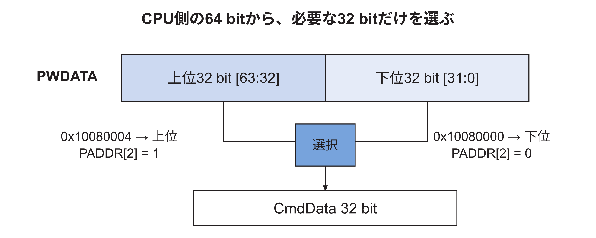
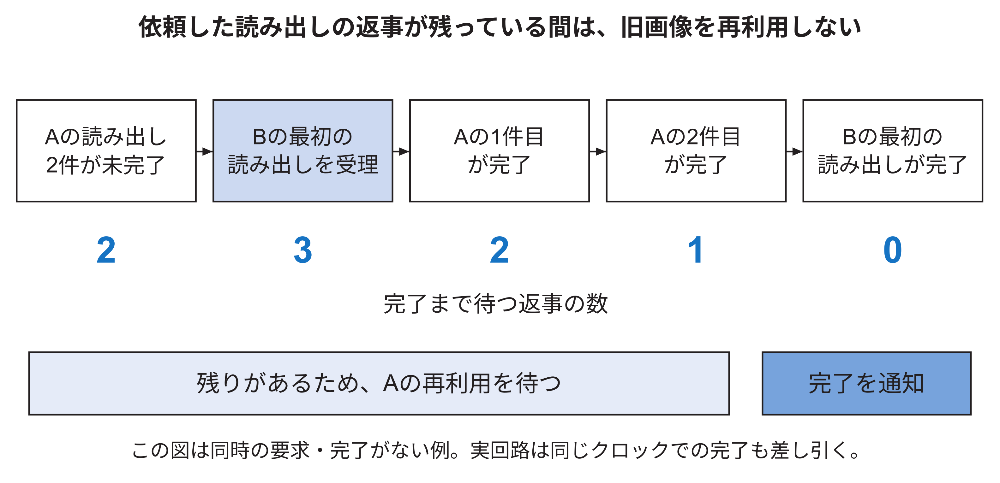

<!-- appendix-content:start -->
<a id="ch_b"></a>
# 第41章 信号とコードを数値で追う
<!-- appendix-content:end -->

[付録の総目次](../../技術付録.md) ｜ [論文本文](../../本文.md) ｜ [参考文献](../references.md)

[第IV部 RasterIXと描画システム](README.md)

ファイルパスの表記は、[資料フォルダー](../../README.md)を基準とする。

## このページの目次

- [41.1 命令の書き込みを一行ずつ読む](#s_b_1)
- [41.2 64 bitバスの中から32 bitを選ぶ](#s_b_2)
- [41.3 三つの命令データを送る具体例](#s_b_3)
- [41.4 完了回数を使う理由](#s_b_4)
- [41.5 未完了の読み出しを数える例](#s_b_5)

<!-- appendix-content:start -->
回路の信号を理解するために、一回の書込みと一語のデータへ話を絞る。まず数式やコードが表す成立条件を読み、その条件を満たす周期に何が一回だけ起こるかを確認する。論文本文の接続図と併せて読むと、図の矢印を具体的な信号へ対応付けられる。

<a id="s_b_1"></a>
## 41.1 命令の書き込みを一行ずつ読む

次は`rasterix_apb.sv`の抜粋であり、単独で完結するモジュールではない。接続全体は[論文本文第6章](../../本文.md#ch_6)と本書[第8章](../01-hdl-fpga/cdc-protocols.md#ch_g_cdc_protocols)で説明した。

```systemverilog
assign CmdValid = CommandWrite;
assign CmdLast = PADDR[2];
assign CmdData = WriteData;
```

CommandWriteは、この回路が選ばれた書き込みのアクセス段階で、必要な4 byteが有効、かつ命令用番地であるときに1になる。三行はそれぞれ「有効な語がある」「最後の語か」「語の値」を出す。受け取りはCmdValidとCmdReadyが両方1の立ち上がりで一度だけ成立し、同時にCPUへPREADYを返す。

| CmdValid | CmdReady | そのクロックでの動作 |
|---:|---:|---|
| 0 | 0 | 命令は渡らない |
| 0 | 1 | 受け取り側に空きがあるが、命令は渡らない |
| 1 | 0 | 命令とその値を保持して待つ |
| 1 | 1 | 命令を一つ受け取る |

<a id="s_b_2"></a>
## 41.2 64 bitバスの中から32 bitを選ぶ

CPU側のPWDATAは64 bit、RasterIXへ送る一語は32 bitである。次の条件演算は、PADDR[2]が1なら上半分、0なら下半分を選ぶ。

```systemverilog
assign WriteData = PADDR[2] ? PWDATA[63:32] : PWDATA[31:0];
```

0x10080000のbit 2は0、0x10080004では1である。したがって図41.1のように、通常命令は下位、最後の命令は上位から取り出す。濃い青の「選択」がこの条件演算で、出力CmdDataはどちらも32 bitとなる。



PSTRBは各byteが有効かを示す。選ぶ32 bitの4 byteすべてが有効であることも、[31.9節](../03-linux/mmio-ordering.md#s_app_31_9)のWordWriteの式で確かめる。ソフトウェアの32 bit単位・4 byte境界という約束と、この回路の選択を対応させる。

<a id="s_b_3"></a>
## 41.3 三つの命令データを送る具体例

説明用に0x11111111、0x22222222、0x33333333という三つの32 bit値を考える。実際の有効な描画命令の内容ではなく、転送の順番を示すための値である。

| 書く順序 | CPUが書く実アドレス | データ | CmdLast |
|---|---|---|---:|
| 1 | 0x10080000 | 0x11111111 | 0 |
| 2 | 0x10080000 | 0x22222222 | 0 |
| 3 | 0x10080004 | 0x33333333 | 1 |

最初の二回は同じアドレスへ書く。通常の配列へ保存するように、アドレスを4ずつ増やして並べる操作ではない。同じ命令口が毎回データを受け取り、FIFOの中へ順番に並べる。最後だけ終端を表す別の命令口へ書く。

C++のregsとの対応は[論文本文6.6節](../../本文.md#s_6_6)の表に示した。一要素は4 byteなので、regs[3]が先頭+12、すなわち識別値の0x0cを指す。

<a id="s_b_4"></a>
## 41.4 完了回数を使う理由

一瞬だけ1になる信号をCPUが直接読むと見逃し得るため、完了のたびに増える回数を回路側で保持する。例えば送信前が125なら、切り替え依頼後も125の間は待ち、126へ変わると新しい完了が分かる。アプリケーションは一回のpresentごとに確認し、旧画像を再利用する区切りにする。

回数が示すのは[論文本文9.5〜9.6節](../../本文.md#s_9_5)の回路内の条件であり、ディスプレイの画素を光学的に数えたものではない。

<a id="s_b_5"></a>
## 41.5 未完了の読み出しを数える例

メモリへ出す要求は、受け付けられる時点と返事が戻る時点が異なる。表示回路が古い画像に対して二件の要求を出していて、どちらの返事も終わっていないとする。このときOutstandingは2である。

次に新しい画像の先頭を読む要求が受け付けられる。同じクロックで返事の完了がないなら、待つべき件数は2 + 1 = 3になる。旧画像の二件と新画像の最初の一件が完了するまで待つ。新しい要求が出たという事実だけで、旧画像を再利用してはいけない。

| 出来事 | 残る返事の数 | 表示切り替えの完了を返すか |
|---|---:|---|
| 新画像の最初の要求を受理 | 3 | まだ返さない |
| 旧画像の一件目が完了 | 2 | まだ返さない |
| 旧画像の二件目が完了 | 1 | まだ返さない |
| 新画像の最初の一件が完了 | 0 | 返す |

実装の式には、同じクロックで返事が一件完了した場合の引き算もある。Remaining <= Outstanding + 1 - ReadCompletedという関係で、追加した一件と同時完了の一件を両方反映する。ここを省くと、一件余分に待ったり、早く完了を返したりする。

この数え方は、使用している表示側の要求と応答の順序に合わせた制御である。任意のAXI接続へ条件を確認せず流用できる一般的な完了判定として扱わない。


図41.2は、上の表を時間順に並べ直したものである。



青い箱の時点で新しい画像の要求が一つ加わり、返事を待つ件数が2から3に増える。その後、返事が終わるたびに3、2、1、0と減る。この例では最後の0で切り替え完了を通知する。図は説明用の一例であり、同時に要求と返事が成立する場合は、本文の式どおり増減を同時に計算する。
<!-- appendix-content:end -->

---

[前：第40章 画像を保存して連続した映像として送り出す](framebuffer-display.md) ｜ [次：第42章 RasterIXとの接続を自分で組み立てる](rasterix-integration.md)
